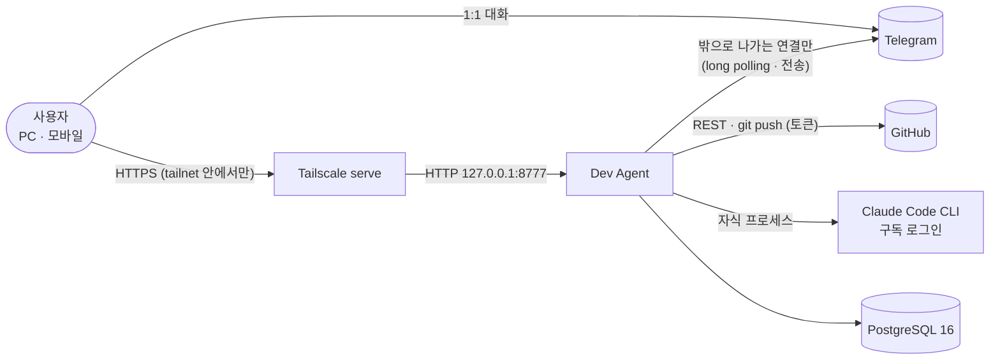
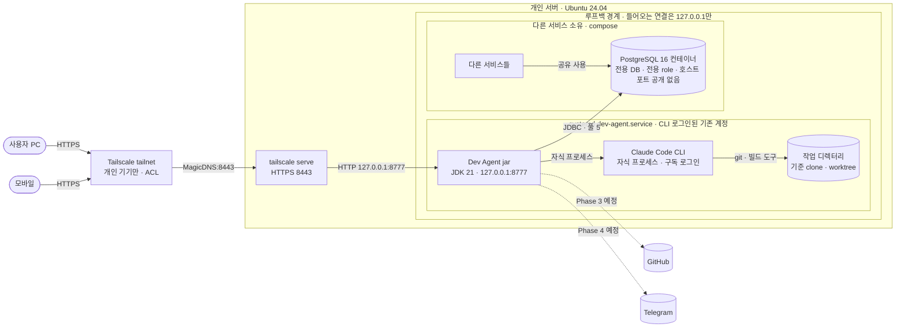
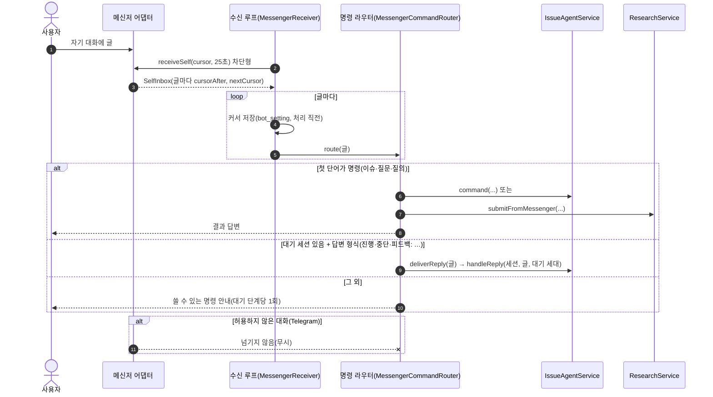
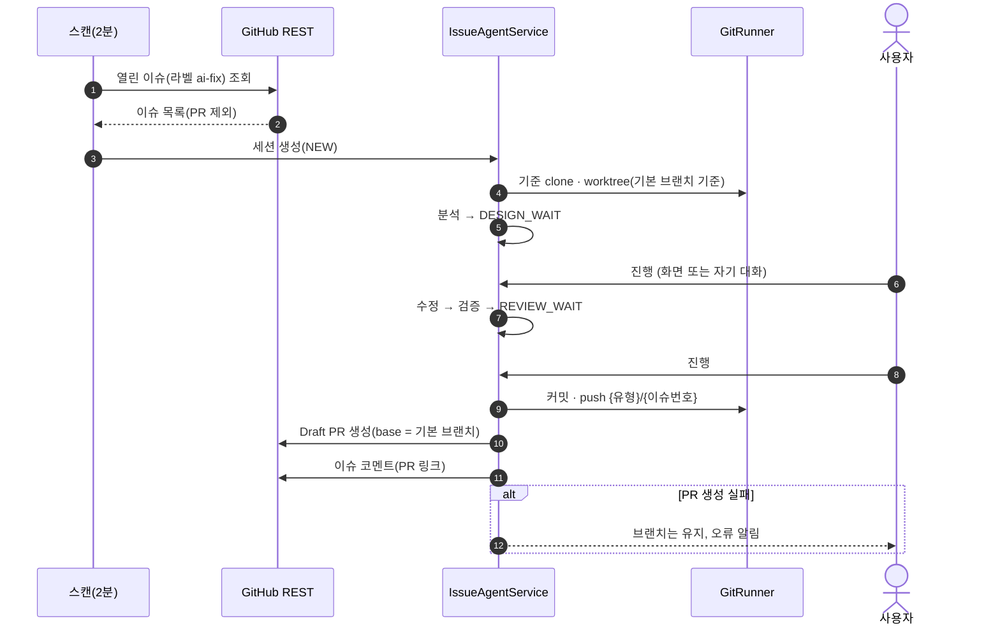
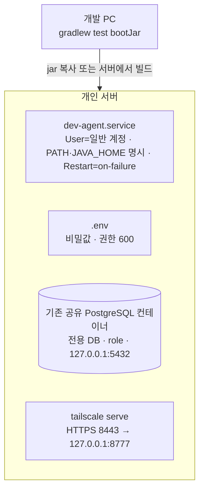

# 02. 아키텍처 설계서

> Dev Agent — 개인 개발 서버용 에이전트 운용 플랫폼으로의 전환(2.0)
> 버전 0.7 · 2026-11-25 · 상태: Draft
> 선행 문서: [01. 요구사항 정의서](./01-requirements.md)

현재 구조의 상세는 `CLAUDE.md`·`README.md`가 기준이다. 이 문서는 **목표 구조와 바뀌는 부분의 결정**만 적는다.

---

## 1. 설계 원칙

| 원칙 | 의미 | 관련 요구사항 |
|---|---|---|
| 루프백 고정 | 앱은 `127.0.0.1`에만 바인드하고, 외부 공개는 Tailscale이 맡는다 | FR-103, NFR-301 |
| 쓰지 않는 것은 지운다 | 하위 호환이 필요 없으므로 끄는 설정을 두지 않고 코드·테이블·설정을 지운다 | FR-201, FR-206, NFR-401 |
| 구현체가 하나면 포트를 만들지 않는다 | 쓰이는 포트(`MessengerPort`·`CodingAgent`)는 유지, 사용처가 없어진 포트는 지우고, 새 포트는 두 번째 구현체가 생길 때 | FR-303, FR-208 |
| 메신저는 선택 | 메신저가 없어도 화면과 알림함으로 전부 동작한다 | FR-205 |
| 단계마다 올릴 수 있는 상태 | 각 Phase가 끝나면 서버에서 돈다 | 01 §2.1 |

## 2. 전체 구조

### 2.1 시스템 컨텍스트 (목표)

### 2.2 컨테이너 구성 (목표, 서버 한 대)

- tailnet 쪽 입구는 `tailscale serve`의 HTTPS 8443 하나다. 앱은 127.0.0.1에만 바인드된다. 루프백 경계는 **들어오는 연결** 기준이며 나가는 연결은 막지 않는다.
- PostgreSQL은 **호스트에 포트를 공개하지 않는다**(OI-18, 2026-11-25). 앱은 호스트에서 컨테이너의 Docker bridge 주소로 직접 붙고, 그 주소는 기동 때 조회한다(§4.2 D-3). 서버 밖에서 DB로 가는 길은 없다. 아래 HTML 구성도의 "127.0.0.1:5432 공개" 문구는 옛 안이며 Phase 3 종료 때의 갱신에서 고친다(OI-25).
- 전체 구성도(상자마다 근거 파일 표시): [architecture/dev-agent-overview.html](./architecture/dev-agent-overview.html) — 원본 `architecture/src/dev-agent-overview.json`, 근거 표는 [T-005 변경 설명서](./tasks/results/T-005-전체-구성도.md#근거-표).
- 그림 범위(T-005 검수 결정): Phase 1 종료 시점의 **배치·접근 경로**만 그린다. 아래는 일부러 그리지 않았다.
  - GitLab 연동(Phase 1에서 실제로 씀)과 Claude CLI의 외부 연결(구독 로그인 대상): GitLab은 Phase 3(T-010)에서 GitHub로 교체되므로, Phase 3 종료 때 구성도를 갱신하면서 GitHub를 실선으로 바꾸고 CLI의 외부 연결을 함께 넣는다.
  - 로그(`logs/dev-agent.log`·systemd journal): 배치가 아니라 관측 경로이므로 §6에 둔다.

### 2.3 컴포넌트 책임 (바뀌는 것만)

#### 접근 제어 필터 (신규, `config/AccessControlFilter` — Phase 1, T-002)
- 책임: `GET`·`HEAD`·`OPTIONS` 외 **모든 요청(경로 무관)** 에 신뢰 Origin 확인(FR-104). 경로 조건(`/api/**`)은 `/api;x/…`·`/%61pi/…` 표기로 우회되므로 쓰지 않는다. 예전 `SystemController.foreign(req)` 10곳의 개별 확인을 대체했다. 규칙은 [05 §1.2](./05-api-specification.md#12-인증과-접근-제어).
- 하지 않는 것: 로그인·세션·역할, Tailscale 신원 확인(OI-05 — 만들지 않는다), Host 헤더 검사(이유는 §6).

#### 메신저 (`messenger/` — Phase 2에서 축소)
- 책임: ① 알림 전송(`notifySelf(kind, text)`, 유형별 끄기) ② 명령 답변 전송 ③ **자기 대화 수신**(신규). 포트 `MessengerPort`는 "자기 대화 하나"만 다룬다.
- 하지 않는 것: 방 목록, 다른 방 메시지 읽기·저장, 그룹 전송(관련 안전 정책 `bot.safety`도 함께 사라진다).
- 구현체: `none`(기본, 수신 없음·전송 버림), `telegram`(Phase 4).

#### 명령 라우터 (신규, `messenger/` — Phase 2)
- 책임: 수신 메시지를 ① 명령(`이슈`·`질문`) ② 확인 대기 답변 ③ 그 외로 나눠 `IssueAgentService`·`ResearchService`를 부른다. 지금 `MentionService.handleCommand`와 `IssueAgentService.pollReplies`에 흩어진 분기를 옮긴다.
- 하지 않는 것: 답변 해석 규칙 자체(`IssueTexts`의 순수 함수를 그대로 쓴다).

#### 이슈 에이전트 (`gitlab/` → `issue/` — Phase 3)
- 책임: 상태 기계·큐·검증·푸시는 그대로. 원격 API 호출만 `GitHubClient`로 바뀐다.
- 의존: `GitHubClient`(REST), `GitRunner`(git 자체 — 인증 헤더만 바뀜).

#### 설치 점검 (`ops/Doctor`)
- Phase 1: Linux 항목(Claude CLI, git, DB)과 고치는 방법. Phase 3: GitHub 토큰·권한. Phase 4: Telegram 연결.

## 3. 핵심 흐름

### 3.1 메신저 명령·답변 수신 (FR-203, FR-204)

지금: `CollectService`가 자기방을 폴링해 `chat_message`에 적재 → `MentionService`가 `@AI` 명령을 처리, `IssueAgentService.pollReplies`가 `wait_after_seq` 이후의 자기방 메시지를 답변으로 소비. 봇이 보낸 글은 접두어(`[이슈]` 등)로 걸러 낸다.

목표: 적재 없이 어댑터 → 라우터로 바로 넘긴다.

설계 판단
- **커서는 코어가 저장한다**(`bot_setting`의 키 `messenger_cursor.<provider>` — 구현체별 하나). 어댑터는 "커서 뒤의 새 메시지(글마다 그 글 뒤의 커서 `cursorAfter`)와 다음 커서"만 돌려준다. 코어는 글마다 **처리 직전에** 커서를 저장한다(글 단위 최대 한 번) — 재시작 뒤 같은 명령이 두 번 돌지 않고, 묶음 중간에 죽어도 남은 글은 다음 수신에서 다시 온다(FR-203). 포트 계약: `MessengerPort.receiveSelf(String cursor, Duration timeout)` → `SelfInbox(List<SelfMessage> messages, String nextCursor)`, `SelfMessage(IncomingMessage message, String cursorAfter)`. 실패는 RuntimeException이며 **예외 메시지에 자격증명·URL을 넣지 않는다**(수신 루프는 예외 클래스 이름만 기록).
- **확인 대기 세대**: 세션이 대기 상태에 들어갈 때마다 세대(메모리 카운터)가 오른다. 답변은 접수 때의 세대를 붙잡고, 처리 시점의 세대와 다르면(그 사이 앞 답변 처리로 새 결과가 나옴) 적용하지 않고 다시 답해 달라고 안내한다. 메신저·대시보드 입력 모두 같은 규칙. 재기동하면 세대는 0부터 다시 센다.
- 수신 루프는 `SmartLifecycle`로 컨텍스트가 다 뜬 뒤 시작하고 이슈 워커보다 먼저 멈춘다. 어떤 예외(Error 포함)에도 백오프(2~60초)로 재시도하고, 그래도 스레드가 끝나면 알림함(시스템)과 메신저 연동 카드(`receiver` 상태)에 드러난다. `none` 구현체면 시작하지 않는다.
- **자기 글 제외는 어댑터 책임**이다. Telegram은 봇이 보낸 글이 수신 목록에 오지 않으므로 접두어 제외 로직(`CollectService.isBotGenerated`, `ChatMessageMapper.selectSelfAfter`의 접두어 조건)이 필요 없다. 접두어(`[이슈]` 등)는 사람이 읽기 위한 표시로만 남긴다.
- **`@AI` 키워드는 없앤다**(`bot.mention.command-keyword`). 자기 대화는 봇 전용이라 호출 표시가 필요 없다.
- `issue_session.wait_after_seq`는 없앤다. 답변은 도착한 순간 대기 중인 세션에 전달한다(대시보드 입력과 같은 진입점).
- 수신 대기(long polling)는 `@Scheduled` 스레드(3개)를 잡지 않게 전용 스레드에서 돈다.

### 3.2 GitHub 이슈 → Draft PR (FR-302~FR-305)

상태 기계(NEW → … → DONE)는 바꾸지 않는다([03 §3](./03-data-model.md#3-상태-머신)).

## 4. 기술 스택

### 4.1 선정 결과
| 영역 | 선택 | 대안 | 선택 이유 |
|---|---|---|---|
| 접근 경로 | 루프백 + `tailscale serve` | Tailscale 주소에 직접 바인드 | D-1 |
| 실행 형태 | systemd + 호스트에 있는 JDK·CLI | Docker 컨테이너 | D-2 |
| 서버 DB | 서버의 기존 PostgreSQL 16 공유(전용 DB·role) | 새 Docker PostgreSQL, 내장 PostgreSQL(zonky) | D-3 |
| GitHub 호출 | Spring `RestClient` 직접 | `gh` CLI, 클라이언트 라이브러리 | 지금 `GitLabClient`가 같은 방식(199줄). 의존성 추가 없음 |
| GitHub 인증 | fine-grained PAT | GitHub App | D-6 |
| Telegram 수신 | long polling(`getUpdates`) | webhook | 수신 포트를 열 필요가 없다(FR-401). 서버는 tailnet 안에만 있다 |

### 4.2 주요 결정

#### D-1. 접근 제어: 루프백 바인드 + tailscale serve
- 배경: 지금은 `server.address: 127.0.0.1`, 인증 없음. 서버의 80·443은 다른 서비스가 쓴다. 모바일에서도 써야 한다.
- 선택지
  | | A. 루프백 + `tailscale serve` | B. Tailscale 주소에 직접 바인드 |
  |---|---|---|
  | 암호화 | HTTPS(MagicDNS 이름, 인증서 자동) | HTTP(인증서를 직접 관리해야 HTTPS) |
  | 모바일 | 브라우저의 보안 컨텍스트 조건 충족(클립보드·알림·홈 화면 추가) | HTTP라 일부 기능 제한 |
  | 기동 순서 | 앱은 Tailscale 상태와 무관하게 뜬다 | tailscale이 올라오기 전이면 바인드 실패 |
  | 노출 실수 | 앱 설정으로는 밖에 열 방법이 없다 | 주소 설정을 잘못 쓰면 다른 인터페이스에 열린다 |
  | 신원 | serve가 신원 헤더를 붙여 준다(추가 확인 가능) | 없음 |
  | Origin 확인 | 설정한 주소를 신뢰 목록에 추가해야 한다 | 주소만 다를 뿐 같다 |
- 결정: **A**. serve의 HTTPS 포트는 **8443**(2026-11-24 확정 — 443은 nginx proxy manager가 계속 쓰고, 8443은 서버에서 비어 있음을 확인).
- Origin 확인: 프록시 뒤에서는 요청의 서버 포트(8777)와 브라우저 Origin(`https://<이름>:8443`)이 다르다. 전달 헤더로 추정하지 않고 **설정값 `ACCESS_ALLOWED_ORIGINS`** 에 적은 것만 믿는다.
- 추가 인증: **만들지 않는다**(2026-11-24 결정, OI-05). tailnet에 사용자 개인 기기만 있어 tailnet 소속이 곧 본인이다. Tailscale 신원 헤더 확인은 선택 기능으로도 두지 않는다 — 켤 계획이 없고 서버에서만 검증되는 코드를 남기지 않는다(YAGNI). tailnet에 다른 사용자·기기를 들이게 되면 그때 접근 제어 필터에 더한다.
- 결과: Tailscale에 의존한다(serve 설정이 사라지면 원격 접근 불가 — 서버에서 루프백으로는 계속 쓸 수 있다). tailnet에 기기를 공유하거나 다른 사용자를 초대하면 이 결정을 다시 본다.

#### D-2. 서버 실행 형태: systemd + JDK 직접 설치
- 배경: 에이전트는 Claude Code CLI를 자식 프로세스로 띄우고, CLI는 그 계정의 구독 로그인 자격증명·git·대상 저장소의 빌드 도구를 쓴다.
- 서버 사실(2026-11-24 로그인 셸 기준 재확인): Claude Code CLI 2.1.328이 `~/.local/bin/claude`(네이티브 설치)에 있고 `~/.claude/.credentials.json`이 있어 **구독 로그인이 이미 돼 있다**. Temurin JDK 21(`~/.local/opt/jdk-21`), gradle도 `~/.local/bin`에 있고 node는 nvm의 v22(시스템 node는 18.19)다. 전부 **사용자 홈에 설치돼 로그인 셸 PATH에서만 보인다**.
- 선택지
  | | ① systemd 서비스(호스트에서 직접 실행) | ② Docker 컨테이너 |
  |---|---|---|
  | Claude CLI·구독 자격증명 | 이미 로그인된 계정으로 띄우면 그대로 쓴다 | 호스트의 CLI·자격증명을 못 쓴다. 이미지에 CLI를 넣고 자격증명 디렉터리를 볼륨으로 넘겨야 하며, 호스트와 컨테이너가 같은 자격증명 파일을 갱신하게 된다 |
  | JDK·git·빌드 도구 | 호스트에 있는 것을 쓴다(PATH만 맞추면 됨) | 대상 저장소마다 다른 도구를 이미지에 계속 넣어야 한다 |
  | 플랫폼 관리(자기 수정) | 호스트의 소스 저장소에서 그대로 | 소스·빌드 환경을 컨테이너에 따로 둬야 한다 |
  | 격리 | 서비스 계정 권한만큼 | 컨테이너 경계(장점) |
  | 추가 작업 | unit에 PATH·`JAVA_HOME` 명시 | 이미지·볼륨·갱신 절차 |
- 결정: **①**. Docker의 격리 이점보다, 이미 갖춰진 CLI 로그인과 도구를 다시 구성하는 비용이 크다.
- 구성
  - **서비스 계정 = CLI 로그인이 돼 있는 그 일반 계정**(root 아님, NFR-303). 전용 계정을 새로 만들면 CLI·JDK 설치와 구독 로그인을 다시 해야 한다. 단, 에이전트가 이 계정의 권한으로 명령을 실행하므로 계정의 sudo·docker 권한이 그대로 위험 범위가 된다(OI-07).
  - **unit에 `Environment=PATH=…`와 `JAVA_HOME`을 명시한다.** systemd는 로그인 셸 PATH를 쓰지 않아 `~/.local/bin`·nvm 경로가 빠진다. `ExecStart`의 java도 절대 경로로 쓴다. 경로 값은 저장소에 박지 않고 unit 틀의 자리표시자로 둔다.
  - Claude CLI 자체는 PATH가 없어도 찾는다(코드 확인: `ClaudeCliLocator.locate`가 PATH 다음에 `<user.home>/.local/bin/claude`를 본다). 그러나 CLI가 부르는 git·gradle·node와 앱이 직접 띄우는 검증 명령은 PATH가 필요하다.
  - 앱은 JDK 21로 **실행**할 수 있다(대상 17+). 서버에서 **빌드**하려면 Gradle toolchain이 Java 17을 요구한다(`build.gradle` `languageVersion = 17`) — 1단계는 개발 PC에서 만든 jar를 올리는 것을 기본으로 하고, 서버 빌드(플랫폼 관리)는 OI-14와 함께 정한다.
  - `Restart=on-failure`, 종료 코드 규약(10 = 재기동, 0 = 종료)은 그대로. 실행 방식 식별값에 `systemd`를 더한다(지금은 `launcher`·`run.cmd`·`direct`).
- **확인 필요**: Claude Code의 Bash 도구가 Linux에서도 로그인 셸 PATH를 쓰는지(Windows에서는 그렇다고 실측됨 — `CLAUDE.md`), systemd 아래에서 자격증명 갱신이 정상인지. T-003 절차서의 확인 항목으로 둔다.

#### D-3. DB: 서버의 기존 PostgreSQL을 공유, 내장 DB는 개발·QA·기동 확인용
- 선택지: ① 내장 PostgreSQL(zonky, `DB_URL`을 비우면 사용) ② Dev Agent용 Docker PostgreSQL을 새로 띄움 ③ 서버에 이미 떠 있는 PostgreSQL 인스턴스를 공유.
- 결정(2026-11-24, 사용자): 서버는 **③**. 전용 DB와 전용 role을 만들고 빈 DB로 시작한다.
- 근거(2026-11-24 읽기 전용 조회): 인스턴스 1개(PostgreSQL 16.15, Docker 컨테이너, 다른 서비스의 compose 소유). `max_connections` 100(예약 3)에 현재 연결 21, 컨테이너 메모리 한도 1.5GB 중 155MB 사용, DB는 전부 100MB 미만. Dev Agent의 커넥션 풀은 5라 합쳐도 26/100 수준 — 용량 문제 없음. 인스턴스를 하나 더 띄울 이유가 없다. ①은 테스트용 라이브러리가 바이너리를 풀어 자식 프로세스로 띄우는 방식이라 장기 운용에 맞지 않는다.
- **걸림돌**: 그 컨테이너는 호스트 포트를 공개하지 않고 Docker 네트워크 하나에만 붙어 있어, 호스트 루프백으로는 접속할 수 없다.
- **접속 경로 결정(2026-11-25, OI-18 — 사용자 의견 "내부 네트워크로 통신하면 공개하지 않아도 된다")**: 포트를 공개하지 않고 **기동 때 컨테이너 주소를 조회**한다(아래 (c)).
  - 서버 확인(2026-11-25, 읽기 전용): 호스트 5432 리슨 없음. 컨테이너는 bridge 네트워크 하나에 붙어 있고 고정 IP 설정이 없다. **호스트에서 컨테이너의 bridge 주소 5432로 TCP 연결이 된다.** `pg_hba`는 로컬·루프백만 trust이고 그 밖은 `scram-sha-256`이라 이 경로는 전용 role 비밀번호 인증을 탄다. 서비스 계정은 sudo 없이 docker 명령을 쓴다.
  | 방법 | 평가 |
  |---|---|
  | (c) 기동 때 `docker inspect`로 주소를 얻어 `DB_URL`을 만든다 | **채택.** DB 컨테이너·compose·다른 서비스 무변경, 무중단, 호스트에 리슨 포트가 생기지 않는다. 부품이 늘지 않는다(스크립트 하나). 단점: DB 컨테이너가 다시 만들어져 주소가 바뀌면 앱 재시작이 필요하다 — 드물고, 그때는 어느 방법이든 연결이 끊긴다 |
  | (a) 그 compose에 `127.0.0.1:5432:5432` 공개 추가 | 기각(이전 권고). 주소는 고정되지만 공유 DB를 한 번 다시 만들어야 하고(다른 서비스 순간 단절), 필요 없는 리슨 포트가 호스트에 생긴다 |
  | (b) DB compose에 고정 IP 지정 | 기각. (a)와 같이 재생성이 필요하고 남의 compose에 주소 대역 설정을 넣게 된다 |
  | (d) 같은 네트워크의 전달 컨테이너가 `127.0.0.1:<포트>`만 공개 | 기각. 주소는 안정적이지만 관리할 컨테이너가 하나 늘고 결국 루프백 공개다 |
  - 동작(T-017 완료): unit의 `ExecStartPre=+`가 root로 `resolve-db.sh`(root 소유, 앱 홈 밖)를 돌린다. 스크립트는 인자로 받은 컨테이너 이름으로 주소를 조회해 형식(IPv4 하나)을 확인하고 `DB_URL` 한 줄을 `/run/dev-agent/db.env`(root 0600)에 쓰며, `EnvironmentFile`이 그것을 java에 준다. 조회 권한이 root 쪽에만 있어 서비스 계정(에이전트가 이 계정으로 돈다)에 docker 그룹이 필요 없고, 입력이 인자라 java 환경에 남지 않는다. 컨테이너가 아직 안 떴으면 상한(기본 60초)까지 기다린다.
  - **조회에 실패하면 java를 실행하지 않고 실패로 끝난다**(systemd가 재시도). 이유(코드 확인): `Bootstrap`은 `DB_URL`이 비면 내장 DB를 띄운다 — 조회 실패가 "내장 DB로 조용히 기동"이 되면 안 된다.
  - 값의 출처는 하나로 둔다(코드 확인): `Bootstrap.val()`은 프로세스 환경변수를 `.env`보다 먼저 본다. Spring 쪽(`${DB_URL:}` + `spring-dotenv`)에서 둘이 겹칠 때의 우선순위는 확인하지 않았으므로, 서버 `.env`에는 `DB_URL`을 두지 않고 스크립트가 그런 `.env`를 거부한다. `DB_USERNAME`·`DB_PASSWORD`는 그대로 `.env`.
  - 조회한 주소는 저장소·문서에 적지 않는다(기동 때마다 얻는 값이다).
- 공유 인스턴스에서 지킬 것(CON-06)
  - 전용 role은 **전용 DB의 소유자일 뿐** 다른 권한(SUPERUSER·CREATEDB·CREATEROLE)이 없다. 다른 DB에 접속할 권한을 주지 않는다.
  - 앱이 전용 DB 밖을 건드리지 않는다. 코드 확인: `Bootstrap`은 접속한 DB에서 `public.bot_setting` 유무만 보고 `db/schema.sql`을 **DROP 문을 뺀 채** 실행하며, 매퍼의 DDL은 `CREATE TABLE/INDEX IF NOT EXISTS`와 `ALTER TABLE`뿐이다(`CREATE DATABASE`·`CREATE ROLE`·`CREATE EXTENSION` 없음). 절차서의 확인 항목으로도 둔다.
  - 커넥션 풀 상한 5를 넘기지 않는다(현행 Hikari 설정).
  - `db/schema.sql`을 사람이 직접 실행하지 않는다(파일 앞의 DROP 문 때문). 스키마는 앱의 첫 기동이 만든다.
- 내장 DB 코드는 지우지 않는다: 개발 PC·QA, 그리고 서버에서의 Linux 기동 확인(T-001 — 공유 DB에 손대지 않고 격리된 디렉터리에서 띄운다)에 쓴다.
- 결과: DB의 가용성·백업·버전은 공유 인스턴스의 주인 서비스에 달린다. Dev Agent 전용 DB의 백업(`pg_dump`)은 절차서에 적는다. systemd unit은 docker 뒤에 뜨고, DB에 붙지 못하면 재시도 정책으로 다시 뜬다.

#### D-4. 메신저 수신: 수집 대신 어댑터 → 라우터 직접 전달
- 배경: 명령·답변이 수집 경로로만 들어온다(코드 확인: `MentionService.handleCommand` 178행 부근, `IssueAgentService.pollReplies` 229행 부근이 `chat_message`를 읽는다).
- 결정: §3.1. 메시지를 DB에 쌓지 않는다. **수신 경로를 먼저 만들고(T-006) 그다음 수집을 지운다(T-007)**.
- 결과: `MessengerPort`에서 방 목록·방별 조회가 빠지고 "자기 대화의 새 메시지"와 "자기 대화로 전송"만 남는다. 대화 기록은 메신저에만 남는다.

#### D-5. GitHub 연동: 포트 없이 직접 교체
- 선택지: ① `GitLabClient`를 `GitHubClient`로 직접 교체 ② 저장소 호스팅 포트(인터페이스)를 두고 GitHub 구현체 추가.
- 결정: **①**. GitLab으로 돌아갈 계획이 없고 구현체가 하나뿐이다. 클라이언트는 199줄·공개 메서드 10개, 참조는 6개 파일(`IssueAgentService`·`IssueProjects`·`IssuePrompts`·`IssueReferences`·`Doctor`·`ResearchService`)이라 나중에 인터페이스를 뽑는 비용이 작다. 지금 포트를 두면 쓰지 않는 추상화가 된다(YAGNI).
- 딸려 오는 변경
  - 식별: GitLab의 숫자 `project_id` 대신 `owner/repo` 문자열, 이슈 `iid` 대신 이슈 번호.
  - 이슈 목록 API가 PR도 돌려주므로 걸러 낸다(FR-302).
  - 기준 브랜치: `develop` 고정 → 저장소 기본 브랜치. hotfix 전용 분기·일감번호 추출(`work-id-pattern`)은 없앤다(OI-10).
  - MR → Draft PR(`draft: true`).
  - git 인증 헤더: 지금 `GitRunner`가 `http.extraheader`에 `oauth2:<토큰>` Basic 값을 넣는다 → GitHub 형식으로 바꾼다.
- 개명 범위(D-10)는 기능 교체와 **작업을 나눈다**(T-010 기능, T-011 개명) — 한 번에 하면 diff에서 동작 변경을 가려낼 수 없다.

#### D-6. GitHub 인증: fine-grained PAT
- 선택지: ① fine-grained PAT ② classic PAT ③ GitHub App.
- 결정: **①**. 1인용이고 대상 저장소 몇 개만 다룬다. 저장소를 골라 권한(Contents·Issues·Pull requests 읽기/쓰기, Metadata 읽기)만 줄 수 있다. GitHub App은 설치·키 관리·토큰 갱신 구현이 필요해 1인용에는 과하다.
- 결과: 토큰 만료 시 사용자가 다시 발급해 `.env`를 고친다(Doctor가 알린다). 조직 저장소는 조직 정책에 따라 fine-grained PAT가 막힐 수 있다(OI-09).

#### D-7. 사내 문서 RAG: 제거 권고
- 판단 근거(코드 확인): ① 적재 원본이 사내 MkDocs 사이트의 `search_index.json`이다(`docs.search-index-url`, 기본 꺼짐). ② 주 사용처가 제거 대상인 멘션 초안·`@AI` 응답이다(`MentionService`). ③ 이슈 에이전트 쪽 사용은 "사내 문서 검색 안내"(curl)뿐이다. ④ 구현체가 하나(`mkdocs-keyword`)인 포트 `KnowledgeSource`만 남는다.
- 결정(2026-11-24 확정, OI-02): **패키지 `docs/`·포트·`doc_chunk`·설정 `docs.*`·API `/api/docs-*`·화면 카드를 모두 제거**한다.
- `KnowledgeSource` 포트를 남길지: 후속 과제로 자기소개서·포트폴리오 작성용 RAG가 있다(OI-17). 그래도 **지운다.** ① 이 포트의 규약은 "질문에 맞는 문서 섹션 몇 개를 점수 임계치로 걸러 프롬프트에 끼워 넣기"(MkDocs 키워드 검색 전제)라, 원본·검색 방식(벡터일 가능성)·쓰임(작성 화면)이 다른 새 기능의 계약이 될지 알 수 없다. ② 37줄짜리 인터페이스라 다시 만드는 비용이 거의 없다. ③ 구현체도 호출처도 없는 포트는 죽은 코드다(NFR-401). 새 기능은 기획 때 필요한 계약을 새로 정한다.

#### D-11. 운영 MCP·`운영` 질의·채팅 모델 포트 제거
- 결정(2026-11-24, 사용자, OI-03): 내장 운영 MCP 3종(opensearch·postgres·k3s-ops)과 `운영` 질의를 제거한다(자체 Grafana가 있고 따로 둘 생각 없음).
- 딸려 오는 것(코드 확인): 채팅 모델 포트의 호출처는 `MentionService`·`SummaryService`(제거 대상), `OpsQueryService`(제거 대상), 그리고 `AdminController`(연결 시험)·`PlatformController`(연동 카드 표시)뿐이다. 요약·멘션·운영 질의가 사라지면 **기능상 사용처가 없다** → `llm/ChatModel`·`llm/ToolChatModel`과 구현체(`llm/claude/ClaudeCliChatModel`·`ClaudeCliToolChat`·`ClaudeWarmSession`), 설정 `platform.chat-model`·`claude.*`의 채팅(warm) 항목, API `/api/llm-test`·`/api/mcp-ask`를 함께 제거한다.
- 남기는 것: `llm/UsageService`(사용량 — 에이전트 호출이 기록한다), `llm/claude/ClaudeCliProbe`(코딩 에이전트가 프롬프트 파일 쓰기에 쓴다 — 위치는 T-007에서 정리), `claude.cli-command` 등 코딩 에이전트가 읽는 설정(T-007에서 사용처를 확인해 남길 키를 정한다).
- `mcp/McpConfigService`는 남는다: **사용자 정의 MCP 서버**(`mcp_server` 테이블, `/api/mcp-servers`)를 에이전트 실행에 붙이는 범용 기능이다(가정: 유지 — AS-07). 내장 3종의 설정·안내문·허용 도구·상태 점검만 걷어 낸다. 예약 이름(`RESERVED`)에서 세 이름을 빼면 사용자가 그 이름으로 직접 등록할 수 있다.

#### D-8. Windows 전용 요소: 삭제
- 대상과 판단
  | 요소 | 처리 | 이유 |
  |---|---|---|
  | 트레이·감시자(`boot/Launcher`), 자동 실행(`boot/Autostart`) | 삭제 | 서버에서는 systemd가 감시·자동 기동을 맡는다 |
  | jpackage 배포(`gradle/dist.gradle`, `Dev Agent.exe`) | 삭제 | 배포 대상이 서버 한 대, 산출물은 jar 하나 |
  | `run.cmd`·`stop.cmd`·`restart.cmd`·`admin.cmd`·`list-rooms.cmd`·`install-autostart.ps1` | 삭제 | 위와 같음. 개발 PC에서는 `java -jar`로 띄운다 |
  | 로컬 프리뷰(`preview/`, `scripts/`, Tomcat·WAR) | 삭제(OI-04) | 사내 Spring MVC+JSP 앱의 WAR 배포를 전제로 만든 기능이고 설치 스크립트가 PowerShell이다. 개인 저장소에는 맞지 않는다 |
  | `platform/Os`의 분기 | 유지 | 개발 PC가 Windows다. `gradlew.bat`·`cmd /c` 분기가 계속 필요하다 |
- `Bootstrap`(`.env` 틀 생성, 내장 DB, 스키마 초기화)은 유지한다.
- 시점: Linux 기동(1단계)에서는 건드리지 않고 "Linux에서 꺼져 있고 오류가 없음"만 보장한다. 삭제는 2단계(T-009).

#### D-9. SPA: 같은 jar에서 정적 파일로 제공
- 결정(개요): 저장소에 `web/`(Vite 프로젝트)를 두고 빌드 결과를 jar의 정적 자원으로 넣는다. 별도 웹 서버·별도 포트를 두지 않는다(신뢰 Origin이 하나로 유지된다). 개발 중에는 Vite 개발 서버가 `/api`를 8777로 넘긴다.
- 서버에서 빌드할지(node 18.19) 개발 PC에서 빌드해 jar만 올릴지, API 응답 형식, 화면 구성은 5단계 기획에서 정한다(OI-13).

#### D-10. 개명 범위
- 패키지 `gitlab/` → `issue/`, `GitLabProperties` → `IssueProperties`, 설정 접두어 `gitlab.*` → `issue.*`(에이전트 실행·검증·컨벤션)와 `github.*`(토큰·API 주소), 환경변수 `GITLAB_*` → `ISSUE_*`·`GITHUB_*`, `bot_setting` 키 `gitlab_projects` → `projects`, 컬럼은 [03 §2](./03-data-model.md#2-설계-결정).
- 호스팅 이름을 식별자에 다시 넣지 않는다(다음에 또 바뀌어도 개명이 없도록). 호스팅에 종속된 것은 `GitHubClient`와 `github.*` 설정뿐이다.
- `bot.*` 설정에서 남는 것(`bot.ops`)은 `platform.*` 아래로 옮긴다. `bot_setting` 테이블 이름은 그대로 둔다(개명 이득이 없다).

## 5. 배포 구성

- 구성 파일은 저장소 `deploy/`에 둔다(T-003): systemd unit, DB·role 생성 SQL, `.env` 예시, 설치·serve 설정 절차서.
- 서버에 실제로 적용하는 일(unit 설치, 공유 DB의 포트 공개와 DB·role 생성, `tailscale serve`)은 **사용자가 절차서대로 한다**.
- 예외 하나: **Linux 기동 확인**(T-001, TC-001)은 SSH로 서버에서 돌린다. 격리된 디렉터리(`DEV_AGENT_HOME`)·다른 포트·내장 DB로 짧게 띄웠다 내리고 그 디렉터리를 지운다. 기존 서비스·컨테이너·공유 DB·사용자 설정은 건드리지 않는다. 접속 대상은 환경변수로만 받는다(문서·저장소에 적지 않는다).
- 배포 파이프라인은 만들지 않는다(1인·서버 1대: 절차서 + 수동 갱신).

## 6. 보안·관측성

- 인증/권한: 로그인 없음. 방어선은 ① tailnet 소속(Tailscale ACL) ② 루프백 바인드 ③ 신뢰 Origin 확인(브라우저를 통한 다른 사이트의 요청 차단). tailnet에는 사용자 개인 기기만 있다는 전제다(D-1).
- 서비스 계정: CLI 로그인이 돼 있는 기존 계정으로 돈다(OI-07 결정). 에이전트(CLI)가 실행하는 명령은 그 계정의 권한 전부를 갖는다 — 허용 도구 목록(`--allowedTools`)이 실질적인 경계다. 허용 도구를 넓힐 때 이 점을 본다.
- Host 헤더 검사는 하지 않는다: 앱은 루프백에만 있고(서버에는 브라우저가 없다), tailnet 쪽은 serve가 MagicDNS 이름의 인증서로 TLS를 끝내므로 다른 이름으로는 연결이 성립하지 않는다.
  - **재검토 중(OI-21)**: 이 근거는 서버에서만 성립한다. 앱과 브라우저가 같은 호스트에 있는 경우(개발 PC, 소스 실행)에는 DNS rebinding으로 다른 사이트가 `GET` 응답(세션 diff·이벤트·리서치 문서·이슈 목록·로그·구성 묶음)을 읽을 수 있다(T-002 보안 검토 M-1, 기존 문제).
- 에이전트 세션의 로컬 API 호출(OI-22): Origin 확인은 브라우저를 통한 요청만 막는다. 에이전트 CLI가 허용 도구 `curl`로 Origin 없이 상태 변경 API(`/api/maintain/push`, `/api/issues-reply` 등)를 부르는 것은 막지 못한다 — 프롬프트 인젝션 시 `git push` 금지·사람 확인 단계를 우회할 수 있다(T-002 보안 검토 M-2, 기존 문제).
- 서버의 로컬 프로세스는 신뢰한다(지금과 같은 전제).
- 비밀값: `.env`(권한 600)와 환경변수로만. GitHub 토큰·Telegram 봇 토큰은 로그·응답·구성 묶음에 싣지 않는다.
- 에이전트 권한: CLI는 서비스 계정의 권한으로 허용 도구만 실행한다. 서버 제어 도구는 추가하지 않는다(OI-01).
- 로그: `logs/dev-agent.log`(현행) + systemd journal. 알림함·Doctor는 현행 유지.

---

## 변경 이력

| 일자 | 버전 | 내용 |
|---|---|---|
| 2026-11-24 | 0.1 | 최초 작성 |
| 2026-11-24 | 0.2 | 사용자 결정 반영: D-1(8443 확정, 신원 확인 폐기), D-2(기존 계정), D-3(공유 PostgreSQL), D-7(포트까지 제거 확정), D-11 추가(운영 MCP·채팅 모델 포트 제거), §5(서버에서 기동 확인) |
| 2026-11-24 | 0.3 | T-002 반영: §2.3 접근 제어 필터 위치(`config/`)와 적용 범위(경로 무관), §6에 Host 검사 재검토(OI-21)·에이전트 세션의 로컬 API 호출(OI-22) |
| 2026-11-24 | 0.4 | T-005 반영: §2.2 그림을 전체 구성도 요약으로 교체(루프백 경계·다른 서비스 소유·Phase 3·4 예정 구분), HTML 구성도 링크, 그림 범위 결정(GitLab·CLI 외부 연결은 Phase 3 갱신 때, 로그는 §6) |
| 2026-11-24 | 0.5 | T-006 검수 반영: §3.1 그림을 수신 루프·라우터 구조로, 커서 키(`messenger_cursor.<provider>`)·글 단위 저장·포트 계약·예외 메시지 규약·확인 대기 세대·수신 루프 수명 추가 |
| 2026-11-25 | 0.6 | OI-18 결정 변경: D-3 접속 경로를 "포트 공개" → "포트 공개 없이 기동 때 컨테이너 주소 조회"(선택지 (a)~(d) 평가, 조회 실패 시 기동 거부, `DB_URL` 출처 단일화), §2.2 그림·설명 수정. OI-04 삭제 확정(D-8 표는 그대로) |
| 2026-11-25 | 0.7 | T-017 완료: D-3 동작을 실제 구성(`ExecStart` 감싸기 → `ExecStartPre=+` root 조회 + `EnvironmentFile`)으로 정정 |
