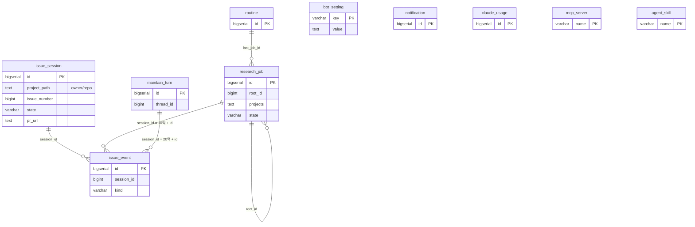
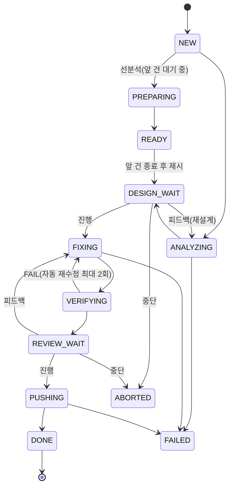

# 03. 데이터 모델 설계서

> Dev Agent — 개인 개발 서버용 에이전트 운용 플랫폼으로의 전환(2.0)
> 버전 0.3 · 2026-11-24 · 상태: Draft
> 대상: **PostgreSQL 16**
> 선행 문서: [02. 아키텍처 설계서](./02-architecture.md)

현재 스키마의 기준은 `db/schema.sql`과 각 매퍼의 `ensureTable()`이다. 이 문서는 **단계별 변경**만 적는다. 새 테이블은 없다.

---

## 1. ERD (목표 — 남는 테이블)



외래 키 제약은 지금도 없다(`issue_event.session_id`는 값 규약으로만 연결). 그대로 둔다.

## 2. 설계 결정

| 결정 | 이유 | 관련 요구사항 |
|---|---|---|
| **Phase 2**: `chat_message`·`chat_room_cursor`·`chat_summary`·`mention_reply` 삭제 | 수집·요약·멘션 제거. 메시지를 저장하지 않는다 | FR-201 |
| **Phase 2**: `doc_chunk` 삭제 | 사내 문서 RAG 제거(OI-02) | FR-202 |
| **Phase 2**: `issue_session.wait_after_seq` 삭제 | 답변을 `chat_message.seq` 기준으로 소비하지 않는다([02 §3.1](./02-architecture.md#31-메신저-명령답변-수신-fr-203-fr-204)) | FR-204 |
| **Phase 2**: 메신저 수신 커서는 `bot_setting`의 키 `messenger_cursor.<provider>`(구현체별 하나, 예 `messenger_cursor.telegram`)로 저장. 값은 어댑터가 정한 문자열 그대로. 테이블을 만들지 않는다 | 구현체마다 값 하나면 충분하다. 구현체를 바꿔도 다른 구현체의 커서를 해석하지 않는다(T-006) | FR-203 |
| **Phase 2**: `bot_setting`의 방 설정 키(자동응답 방 등)와 `messenger_notify_off`의 `summary`·`mention` 값은 쓰지 않는다 | 기능 제거 | FR-205 |
| **Phase 3**: `issue_session.project_id`(GitLab 숫자 id) 삭제 | GitHub는 `owner/repo`로 식별한다 | FR-301 |
| **Phase 3**: `issue_session.issue_iid` → `issue_number`, `mr_url` → `pr_url` | GitHub 용어 | FR-305 |
| **Phase 3**: `issue_session.work_id` 삭제, `base_branch`는 유지(값 = 저장소 기본 브랜치) | 일감번호 추출 폐지(OI-10) | FR-304 |
| **Phase 3**: `issue_event.kind` 값 `GITLAB` → `REMOTE` | 호스팅 이름을 값에 넣지 않는다 | NFR-401 |
| **Phase 3**: `bot_setting` 키 `gitlab_projects` → `projects` | [02 §4.2 D-10](./02-architecture.md#d-10-개명-범위) | FR-301 |
| 기존 데이터를 옮기지 않는다. 서버는 **공유 PostgreSQL 인스턴스 안의 전용 DB(전용 role 소유, 빈 상태)** 에서 시작하고, 스키마는 앱의 첫 기동(`Bootstrap`)이 `public` 스키마에 만든다 | 하위 호환 불필요, 2026-11-24 결정(OI-08). [02 §4.2 D-3](./02-architecture.md) | CON-06 |
| 전용 DB 밖의 객체(다른 DB, role, 확장)를 만들거나 바꾸는 DDL을 넣지 않는다. `db/schema.sql`을 사람이 직접 실행하지 않는다(파일 앞의 DROP 문) | 공유 인스턴스 | CON-06 |
| `mcp_server`는 유지한다(사용자 정의 MCP 등록 — 가정 AS-07). 내장 운영 MCP 제거에 따른 테이블 변경은 없다(내장 3종은 설정값이었다) | OI-03 | FR-208 |
| 마이그레이션 스크립트를 만들지 않는다. 개발 PC의 기존 DB는 버리고 새로 만든다 | 위와 같음. 변경이 삭제·개명뿐이라 dba 설계 단계를 두지 않고 backend-dev 지시서 범위에 명시한다 | — |

주의: 매퍼의 `ensureTable()`은 멱등 생성만 하고 컬럼을 지우거나 이름을 바꾸지 않는다. 개명·삭제 뒤에는 `db/schema.sql`과 `ensureTable()` 정의가 **같아야** 하고, 옛 DB에 붙으면 동작을 보장하지 않는다(빈 DB 전제).

## 이름 규칙

기존 규칙을 유지한다(새 테이블이 없으므로 표준 접두어 `tn_`을 도입하지 않는다).

| 대상 | 규칙 | 예 |
|---|---|---|
| 테이블 | snake_case 단수형, 접두어 없음 | `issue_session` |
| PK | `id BIGSERIAL` 또는 자연 키 | `agent_skill.name` |
| 인덱스 | `idx_<테이블>_<용도>` | `idx_issue_event_session` |

## 3. 상태 머신

### 3.1 이슈 세션 (변경 없음)



### 3.2 상태 코드
| 코드 | 의미 | 종료 상태 여부 |
|---|---|---|
| NEW / PREPARING / READY | 대기열 / 선분석 중 / 선분석 완료 | 아니오 |
| ANALYZING / FIXING / VERIFYING / PUSHING | 작업 중(재시작하면 FAILED) | 아니오 |
| DESIGN_WAIT / REVIEW_WAIT | 사용자 확인 대기 | 아니오 |
| DONE / ABORTED / FAILED | 완료 / 중단 / 실패 | 예 |

리서치(`research_job`)·플랫폼 관리(`maintain_turn`) 상태는 NEW/RUNNING/DONE/FAILED/ABORTED로 변경 없다.

## 4. DDL

마이그레이션 도구: 없음 — `db/schema.sql`(빈 DB 첫 기동 때 실행, DROP 문 제외) + 매퍼 `ensureTable()` · 경로: `db/schema.sql`, `src/main/java/**/**Mapper.java`

### 4.1 `issue_session` (Phase 3 이후 목표, 바뀌는 컬럼만)

```sql
-- 삭제: project_id, wait_after_seq(Phase 2), work_id
-- 개명: issue_iid → issue_number, mr_url → pr_url
    project_path   TEXT    NOT NULL,   -- "owner/repo"
    issue_number   BIGINT  NOT NULL,
    pr_url         TEXT,
    base_branch    TEXT,               -- 저장소 기본 브랜치
    UNIQUE (project_path, issue_number)
```

그 외 컬럼과 다른 테이블의 정의는 `db/schema.sql` 현행 그대로다. `research_job.kind`·`projects`의 주석(GitLab, group/repo)은 Phase 3에서 문구만 고친다.

## 5. 핵심 쿼리 패턴

변경 없음. 삭제되는 것: `ChatMessageMapper.selectSelfAfter`(자기방 답변 조회, 봇 접두어 제외 조건 포함).

## 6. 보관·정리 정책

| 데이터 | 보관 기간 | 방법 |
|---|---|---|
| `notification` | 최근 200건 | 현행(추가 때 정리) |
| 리서치 첨부 파일 | 스레드 종료 후 7일 | 현행(`research.attachment-keep-days`) |
| `issue_event`·`claude_usage` | 정리 없음(현행) | 서버 장기 운용 시 증가 — 필요해지면 별도 제안 |
| DB 백업 | 미정 | 서버 절차서(T-003)에 전용 DB만 대상으로 하는 수동 백업 명령(`pg_dump`)을 적는다 |

---

## 변경 이력

| 일자 | 버전 | 내용 |
|---|---|---|
| 2026-11-24 | 0.1 | 최초 작성 |
| 2026-11-24 | 0.2 | 서버 DB를 공유 PostgreSQL의 전용 DB로 변경(§2), `mcp_server` 유지 명시 |
| 2026-11-24 | 0.3 | T-006 반영: 수신 커서 키를 구현체별 `messenger_cursor.<provider>`로 정정(§2). 기존 설치의 `issue_session.wait_after_seq` 컬럼은 정의에서만 빠지고 DROP하지 않는다(nullable·미사용, 서버는 Phase 2 종료 때 빈 DB로 다시 시작) |
