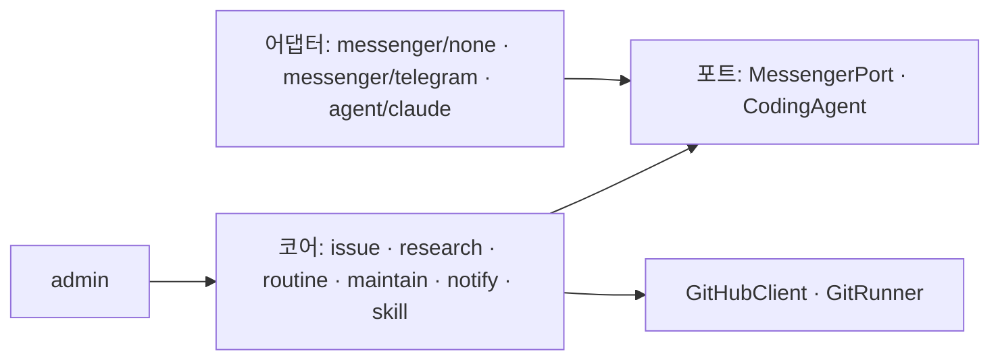

# 04. 프로젝트 구조 설계서

> Dev Agent — 개인 개발 서버용 에이전트 운용 플랫폼으로의 전환(2.0)
> 버전 0.1 · 2026-11-24 · 상태: Draft
> 선행 문서: [02. 아키텍처 설계서](./02-architecture.md)

코드 작업 규칙과 함정의 기준은 저장소 루트 `CLAUDE.md`다(개발 에이전트는 작업 전에 읽는다). 이 문서는 전환으로 바뀌는 구조와 실행·배포 정보만 적는다.

---

## 1. 전체 구조

```
Dev_Agent-Platform/
├── src/main/java/io/github/lib0823/devagent/   # Spring Boot 앱 (단일 모듈)
├── src/main/resources/
│   ├── application.yml          # 기본 설정
│   ├── static/                  # 정적 화면 (4단계까지). 5단계에서 SPA 빌드 결과로 교체
│   └── dist/env.template        # 첫 기동 때 만드는 .env 틀
├── src/test/java/               # 단위 테스트 (Spring 컨텍스트 없음)
├── db/schema.sql                # 빈 DB 첫 기동 때 실행
├── deploy/                      # (신규, T-003) systemd unit · 서버용 compose · 절차서
├── e2e/                         # (신규, T-004) qa의 Playwright 테스트
├── web/                         # (신규, 5단계) Vite + React + TypeScript
└── docs/                        # 이 문서 세트
```

### 모듈 역할 요약
| 모듈 | 역할 | 배포 단위 |
|---|---|---|
| 루트(Gradle 단일 모듈) | 앱 전체 | `build/libs/dev-agent.jar` |
| `web/` (5단계) | SPA 소스 | jar 안의 정적 자원 |

## 2. 패키지별 책임과 전환 처리

| 패키지 | 책임 | 처리 | Phase |
|---|---|---|---|
| `admin/` | REST 컨트롤러, 설정 서비스 | 유지. 접근 제어 필터 추가(1), 방·문서·프리뷰 API 제거(2) | 1, 2 |
| `agent/`, `agent/claude/` | `CodingAgent` 포트와 Claude CLI 구현 | 유지. Linux 동작 보정(1), 프리뷰 심·안내 제거(2) | 1, 2 |
| `boot/` | `Bootstrap`(.env 틀·내장 DB·스키마), `EmbeddedDb`, `Launcher`, `Autostart` | `Launcher`·`Autostart` 삭제(2), 나머지 유지 | 2 |
| `collect/`, `summarize/`, `mention/` | 방 수집·요약·멘션 | **삭제** | 2 |
| `docs/` (Java 패키지) | 사내 문서 RAG | **삭제** (OI-02) | 2 |
| `gitlab/` | 이슈 에이전트 | `GitLabClient` → `GitHubClient`(3, T-010), 패키지 `issue/`로 개명(3, T-011) | 3 |
| `llm/`, `llm/claude/` | 채팅 모델 포트, 사용량 | 채팅 모델 포트(`ChatModel`·`ToolChatModel`)와 구현체(warm 세션) **삭제**. `UsageService`·`ClaudeUsageMapper`·`ClaudeCliProbe`는 유지([02 §4.2 D-11](./02-architecture.md)) | 2 |
| `maintain/` | 플랫폼 관리 | 유지(서버에서 켤지는 OI-14) | — |
| `mcp/` | MCP 설정·운영 질의 | `OpsQueryService`와 내장 운영 MCP 3종 **삭제**. 사용자 정의 MCP(`McpConfigService`·`McpServer*`)는 유지(가정 AS-07) | 2 |
| `messenger/`, `messenger/none/` | 메신저 포트·정책 | 수신 규약 추가·방 관련 제거(2), `messenger/telegram/` 추가(4) | 2, 4 |
| `notify/`, `routine/`, `skill/`, `research/` | 알림함·루틴·스킬·리서치 | 유지. `research/`는 GitHub 클라이언트로 교체(3) | 3 |
| `ops/` | Doctor·시작/오류 알림 | Linux 항목(1), `RoomListRunner` 삭제(2) | 1, 2 |
| `platform/` | `Os`·`PortHealth`·`CallStats` | 유지 | — |
| `preview/` | 로컬 프리뷰 | **삭제** (OI-04) | 2 |
| `config/` | `*Properties` record | 제거·개명에 맞춰 정리 | 2, 3 |

루트의 `run.cmd`·`stop.cmd`·`restart.cmd`·`admin.cmd`·`list-rooms.cmd`·`install-autostart.ps1`·`scripts/`·`gradle/dist.gradle`은 2단계(T-009)에서 삭제한다. `docker-compose.yml`은 개발용으로 남긴다(OI-16).

## 3. 의존성 규칙



### 깨지면 안 되는 규칙
1. 코어 패키지는 어댑터 클래스(`ClaudeCli*`, 메신저 어댑터)를 직접 참조하지 않는다 — 검사 방법: 식별자 검색(자동 검사 없음).
2. 자기 대화로 보내는 알림은 `MessengerService.notifySelf(kind, text)`로만 보낸다(`sendToSelf` 직접 호출은 명령 답변에만) — 검사 방법: 호출처 검색.
3. 상태 전이는 `IssueAgentService.transition()`을 통한다.
4. 상태를 바꾸는 API는 접근 제어 필터를 거친다(개별 컨트롤러에서 Origin 확인을 다시 구현하지 않는다) — Phase 1 이후.
5. `GitHubClient` 밖에서 GitHub REST 경로를 조립하지 않는다 — Phase 3 이후.

## 4. 코딩 규약

- 언어·버전: Java 17(Gradle toolchain), Spring Boot 3.3.5. 5단계 화면은 TypeScript strict.
- 계층: Controller(`admin/`) → Service → MyBatis 어노테이션 매퍼. Properties는 record.
- 주석·메시지·문서는 한국어, 식별자는 영어. 기존 파일의 스타일을 따른다.
- 새 설정: `config/*Properties` + `application.yml` + `.env.example` + `resources/dist/env.template` + README 표를 함께 고친다. **기본값 없는 필수 자리표시자(`${X}`)를 만들지 않는다.**
- DB 스키마 변경: 매퍼 `ensureTable()`과 `db/schema.sql` 둘 다.
- 테스트: JUnit 5, `src/test/java`, Spring 컨텍스트 없는 단위 테스트. 새 기능은 테스트를 먼저 쓴다. 빈을 추가·변경했으면 기동 후 `/api/system/status` 응답을 확인한다(배선 오류는 단위 테스트로 잡히지 않는다).
- 프런트(4단계까지): `static/ui.css`·`ui.js` 사용, 수정 뒤 `node --check`. Java/JS 소스의 문자열 리터럴은 스크립트가 아닌 편집 도구로 넣는다.
- OS 차이는 `platform/Os`를 통해서만 다룬다(`cmd /c` 직접 사용 금지).

## 5. 빌드와 산출물

| 명령 | 용도 |
|---|---|
| `./gradlew test bootJar` (Windows: `gradlew.bat`) | 전체 테스트 + jar (`build/libs/dev-agent.jar`) |
| `./gradlew test --tests '<클래스>'` | 일부 테스트 |
| `node --check src/main/resources/static/<파일>.js` | 화면 스크립트 문법 확인 |

버전(`build.gradle`의 `version`): Phase 1은 하위 호환 기능 추가이므로 **1.13.0**, Phase 2의 첫 제거 작업(T-007)에서 **2.0.0**으로 올린다. 이후 단계는 2.x minor.

## 6. CI 구성

해당 없음 — CI가 없다(저장소에 파이프라인 정의 없음). 검증은 작업 지시서의 검증 명령과 QA 확인으로 한다. 도입은 이번 범위 밖.

## 7. 개발 환경

- 필수 도구: JDK 17, git, node(스크립트 문법 확인·e2e), Claude Code CLI(에이전트 기능을 실제로 돌릴 때만).
- 로컬 실행: §8.
- 환경 변수(이름만. 전체 목록은 `.env.example`)
  | 이름 | 의미 | Phase |
  |---|---|---|
  | `ADMIN_PORT` | 앱 포트(기본 8777) | 현행 |
  | `DB_URL`·`DB_USERNAME`·`DB_PASSWORD` | 외부 PostgreSQL. 비우면 내장 DB | 현행 |
  | `ACCESS_ALLOWED_ORIGINS` | 신뢰 Origin(쉼표 구분). 루프백은 항상 포함 | 1 |
  | `DEV_AGENT_RUN_MODE` | 실행 방식 표시(`systemd`). unit이 넣는다 | 1 |
  | `DEV_AGENT_SSH` | (개발 PC의 셸에만) 서버 기동 확인 스크립트가 쓰는 SSH 접속 대상. 값은 어디에도 적지 않는다 | 1 |
  | `GITHUB_TOKEN`, `ISSUE_*` | GitHub 토큰, 이슈 에이전트 설정(`GITLAB_*` 대체) | 3 |
  | `PLATFORM_MESSENGER`, `TELEGRAM_BOT_TOKEN`, `TELEGRAM_CHAT_ID` | 메신저 선택, Telegram 봇 토큰·허용 대화 | 4 |

  변수 이름의 최종 확정은 해당 작업의 변경 설명서에 적고 PM이 이 표를 갱신한다.

## 8. 로컬 실행

qa가 개발 PC(Windows)에서 앱을 띄울 때 쓴다. **가정**(OI-11) — T-004에서 실제로 확인해 고친다. 개발 PC에 사용자의 인스턴스가 8777에서 돌고 있을 수 있으므로 포트와 작업 디렉터리를 분리한다.

| 항목 | 값 |
|---|---|
| 띄우기 명령 | ① `gradlew.bat bootJar` ② 빈 작업 디렉터리에서 `ADMIN_PORT=8778`·`PREVIEW_ENABLED=false`·`MAINTAIN_ENABLED=false`를 준 뒤 `java -jar <저장소>/build/libs/dev-agent.jar` (`DB_URL`을 주지 않아 내장 DB 사용) |
| 준비 확인 URL | `http://127.0.0.1:8778/api/system/status` |
| 내리기 명령 | `POST http://127.0.0.1:8778/api/system/shutdown` (내장 DB까지 내린다). 응답이 없으면 프로세스 종료 |
| 화면 주소 | 준비 확인 URL과 같은 origin |
| DB 초기화 | 기동 전에 작업 디렉터리의 내장 DB 데이터 디렉터리를 지운다(위치는 T-004에서 확인) |
| DB 접속 | 내장 DB(포트 54329, 127.0.0.1). 사용자의 인스턴스가 내장 DB를 쓰고 있으면 포트가 겹친다 — T-004에서 확인 |
| 인증 방식 | 없음 |
| e2e 경로 | `e2e/` |
| 기본 포트 | 8778 (QA용. 사용자의 인스턴스는 8777) |

주의: 인스턴스 2개가 뜨면 `~/bin` 심을 서로 덮어쓴다(`CLAUDE.md`). QA 실행은 짧게, 에이전트 실행(Claude CLI 호출)을 일으키지 않는 흐름만 다룬다.

## 9. 배포

표준 템플릿의 차트·파이프라인 항목은 해당 없음(서버 1대, systemd). 값은 쓰지 않고 이름·자리표시자만 쓴다.

| 항목 | 값 |
|---|---|
| 배포 대상 환경 | 개인 서버 1대(Ubuntu 24.04 x86_64). 환경 구분 없음 |
| 배포 구성 경로 | `deploy/` — `systemd/dev-agent.service`(틀), `sql/create-db.sql`(전용 DB·role 생성), `env.server.example`, `README.md`(절차서) — T-003. `smoke/server-smoke.sh`(서버 기동 확인) — T-001 |
| 실행 계정 | CLI 로그인이 돼 있는 기존 일반 계정(자리표시자 `<SERVICE_USER>`). 2026-11-24 확정 |
| 서버 접속 | SSH. 주소·계정은 문서·저장소에 적지 않는다(환경변수 `DEV_AGENT_SSH`). **서버의 java·claude·gradle·node는 로그인 셸 PATH에서만 보인다** — 원격 명령은 로그인 셸(`bash -lc`)로 실행한다 |
| unit 환경 | `Environment=PATH=<JDK bin>:<~/.local/bin>:<node bin>:/usr/bin:/bin`, `JAVA_HOME=<JDK 경로>`, `DEV_AGENT_RUN_MODE=systemd`. `ExecStart`의 java는 절대 경로. systemd는 로그인 셸 PATH를 쓰지 않는다 |
| 실행 런타임 | 서버에 있는 Temurin JDK 21(앱 대상은 17+) |
| 산출물 전달 | 개발 PC에서 만든 `dev-agent.jar`를 서버로 복사(기본). 서버 빌드는 Java 17 toolchain이 필요하다 |
| 접근 경로 | `tailscale serve`(HTTPS **8443** 확정) → `127.0.0.1:8777` |
| DB | 서버의 기존 공유 PostgreSQL 16(다른 서비스의 compose 소유 컨테이너). 전용 DB + 전용 role(소유자 권한만), 빈 DB로 시작. `DB_URL`은 `jdbc:postgresql://127.0.0.1:5432/<전용 DB>` 형태 — **사용자가 그 compose에 `127.0.0.1:5432:5432` 공개를 더한 뒤에** 접속된다(OI-18). 커넥션 풀 5 유지 |
| 재시작 정책 | `Restart=on-failure`(종료 코드 10 = 재기동 요청, 0 = 종료), 부팅 시 자동 시작, docker 뒤에 기동(DB가 아직 안 떴으면 재시도로 다시 뜬다) |
| 차트 / 값 파일 / 클러스터 / 이미지 저장소 / 파이프라인 템플릿 / 러너 / air-gap 묶음 / 인프라 코드 / 감시 구성 | 해당 없음 |
| 필요한 비밀값(이름만) | `DB_USERNAME`·`DB_PASSWORD`, `GITHUB_TOKEN`(3), `TELEGRAM_BOT_TOKEN`(4) — 서버의 `.env`(권한 600) |
| 서버 적용 | 사용자가 `deploy/README.md` 절차대로 한다(공유 DB의 포트 공개 포함). 예외는 기동 확인 스크립트뿐이다: 격리된 디렉터리·다른 포트·내장 DB로 짧게 띄웠다 내리고 흔적을 지운다. 기존 서비스·컨테이너는 건드리지 않는다 |

---

## 변경 이력

| 일자 | 버전 | 내용 |
|---|---|---|
| 2026-11-24 | 0.1 | 최초 작성 |
| 2026-11-24 | 0.2 | 사용자 결정 반영: §2(`llm/`·`mcp/` 처리), §3 그림, §7 환경변수, §9(공유 DB, SSH·로그인 셸, 8443 확정) |
