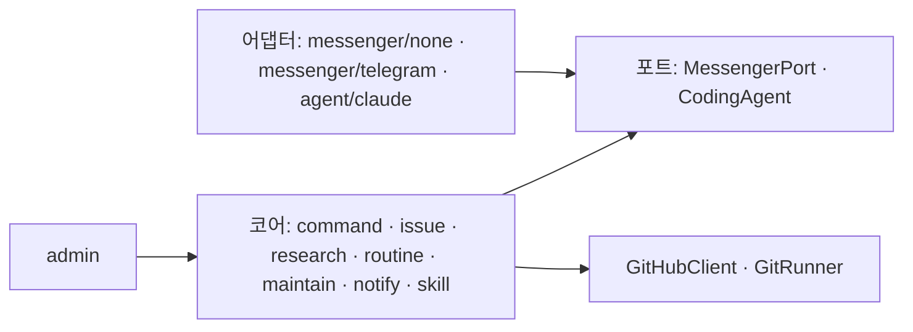

# 04. 프로젝트 구조 설계서

> Dev Agent — 개인 개발 서버용 에이전트 운용 플랫폼으로의 전환(2.0)
> 버전 0.23 · 2026-11-27 · 상태: Draft
> 선행 문서: [02. 아키텍처 설계서](./02-architecture.md)

코드 작업 규칙과 함정의 기준은 저장소 루트 `CLAUDE.md`다(개발 에이전트는 작업 전에 읽는다). 이 문서는 전환으로 바뀌는 구조와 실행·배포 정보만 적는다.

---

## 1. 전체 구조

```
Dev_Agent-Platform/
├── src/main/java/io/github/lib0823/devagent/   # Spring Boot 앱 (단일 모듈)
├── src/main/resources/
│   ├── application.yml          # 기본 설정
│   ├── static/                  # 정적 화면 (4단계까지). 5단계에서 SPA 빌드 결과로 교체
│   └── dist/env.template        # 첫 기동 때 만드는 .env 틀
├── src/test/java/               # 단위 테스트 (Spring 컨텍스트 없음)
├── db/schema.sql                # 빈 DB 첫 기동 때 실행
├── deploy/                      # (T-003) systemd unit · 전용 DB 준비 SQL · 서버 .env 예시 · 절차서
├── e2e/                         # (신규, T-004) qa의 Playwright 테스트
├── web/                         # (신규, 5단계) Vite + React + TypeScript
└── docs/                        # 이 문서 세트
```

### 모듈 역할 요약
| 모듈 | 역할 | 배포 단위 |
|---|---|---|
| 루트(Gradle 단일 모듈) | 앱 전체 | `build/libs/dev-agent.jar` |
| `web/` (5단계) | SPA 소스 | jar 안의 정적 자원 |

## 2. 패키지별 책임과 전환 처리

| 패키지 | 책임 | 처리 | Phase |
|---|---|---|---|
| `admin/` | REST 컨트롤러, 설정 서비스 | 유지. 접근 제어 필터 추가(1), 방·문서·프리뷰 API 제거(2) | 1, 2 |
| `agent/`, `agent/claude/` | `CodingAgent` 포트와 Claude CLI 구현 | 유지. Linux 동작 보정(1), 프리뷰 심·안내 제거(2) | 1, 2 |
| `boot/` | `Bootstrap`(.env 틀·내장 DB·스키마), `EmbeddedDb`, `Launcher`, `Autostart` | `Launcher`·`Autostart` 삭제(2), 나머지 유지 | 2 |
| `collect/`, `summarize/`, `mention/` | 방 수집·요약·멘션 | **삭제** | 2 |
| `command/` | 메신저 명령 라우터·수신 루프(`MessengerCommandRouter`·`MessengerReceiver`) | 신규(2, T-007 — `messenger/`에서 이동, 순환 참조 정리. [02 §2.3](./02-architecture.md#23-컴포넌트-책임-바뀌는-것만)) | 2 |
| `docs/` (Java 패키지) | 사내 문서 RAG | **삭제** (OI-02) | 2 |
| `gitlab/` | 이슈 에이전트 | `GitLabClient` → `GitHubClient`(3, T-010), 패키지 `issue/`로 개명(3, T-011) | 3 |
| `llm/`, `llm/claude/` | 채팅 모델 포트, 사용량 | 채팅 모델 포트(`ChatModel`·`ToolChatModel`)와 구현체(warm 세션) **삭제**. `UsageService`·`ClaudeUsageMapper`·`ClaudeCliProbe`는 유지([02 §4.2 D-11](./02-architecture.md)) | 2 |
| `maintain/` | 플랫폼 관리 | 유지(서버에서 켤지는 OI-14) | — |
| `mcp/` | MCP 설정·운영 질의 | `OpsQueryService`와 내장 운영 MCP 3종 **삭제**. 사용자 정의 MCP(`McpConfigService`·`McpServer*`)는 유지(가정 AS-07) | 2 |
| `messenger/`, `messenger/none/` | 메신저 포트·정책 | 수신 규약 추가·방 관련 제거(2), `messenger/telegram/` 추가(4) | 2, 4 |
| `notify/`, `routine/`, `skill/`, `research/` | 알림함·루틴·스킬·리서치 | 유지. `research/`는 GitHub 클라이언트로 교체(3) | 3 |
| `ops/` | Doctor·시작/오류 알림 | Linux 항목(1), `RoomListRunner` 삭제(2) | 1, 2 |
| `platform/` | `Os`·`PortHealth`·`CallStats` | 유지 | — |
| `preview/` | 로컬 프리뷰 | **삭제** (OI-04) | 2 |
| `config/` | `*Properties` record | 제거·개명에 맞춰 정리 | 2, 3 |

루트의 `run.cmd`·`stop.cmd`·`restart.cmd`·`admin.cmd`·`list-rooms.cmd`·`install-autostart.ps1`·`scripts/`·`gradle/dist.gradle`은 2단계(T-009)에서 삭제한다. `docker-compose.yml`은 개발용으로 남긴다(OI-16).

## 3. 의존성 규칙



### 깨지면 안 되는 규칙
1. 코어 패키지는 어댑터 클래스(`ClaudeCli*`, 메신저 어댑터)를 직접 참조하지 않는다 — 검사 방법: 식별자 검색(자동 검사 없음).
2. 자기 대화로 보내는 알림은 `MessengerService.notifySelf(kind, text)`로만 보낸다(`sendToSelf` 직접 호출은 명령 답변에만) — 검사 방법: 호출처 검색.
3. 상태 전이는 `IssueAgentService.transition()`을 통한다.
4. 상태를 바꾸는 API는 접근 제어 필터를 거친다(개별 컨트롤러에서 Origin 확인을 다시 구현하지 않는다) — Phase 1 이후.
5. `GitHubClient` 밖에서 GitHub REST 경로를 조립하지 않는다 — Phase 3 이후.

## 4. 코딩 규약

- 언어·버전: Java 17(Gradle toolchain), Spring Boot 3.3.5. 5단계 화면은 TypeScript strict.
- 계층: Controller(`admin/`) → Service → MyBatis 어노테이션 매퍼. Properties는 record.
- 주석·메시지·문서는 한국어, 식별자는 영어. 기존 파일의 스타일을 따른다.
- 새 설정: `config/*Properties` + `application.yml` + `.env.example` + `resources/dist/env.template` + README 표를 함께 고친다. **기본값 없는 필수 자리표시자(`${X}`)를 만들지 않는다.** 새 설정이 비밀값(비밀번호·토큰·키)이면 그 환경변수 이름을 `platform/ChildEnv.SECRET_KEYS`에도 더한다(`ChildEnvTest`가 `application.yml`의 password·secret·token 속성만 대조하므로 그 밖의 이름은 사람이 챙긴다).
- 자식 프로세스: `new ProcessBuilder(…)`는 `ChildEnv.clean(…)`을 거친 뒤 띄우고, 앱이 일부러 넣는 환경값은 정리 뒤에 넣는다(T-021, `ChildEnvTest`가 소스 검색으로 지킨다).
- 에이전트 도구 금지: `--disallowedTools`는 `ClaudeCliAgent.disallowedTools`에서만 조립한다(단위 테스트가 단계·출처별 항목을 지킨다, T-023). 상태를 바꾸는 로컬 API를 새로 만들면 플랫폼 관리 세션이 curl로 불러도 되는지 보고, 안 되면 `MAINTAIN_DENIED_APIS`에 경로를 더한다. 허용 도구(`*-tools` 설정)에 넣어도 금지가 이긴다.
- DB 스키마 변경: 매퍼 `ensureTable()`과 `db/schema.sql` 둘 다.
- 테스트: JUnit 5, `src/test/java`, Spring 컨텍스트 없는 단위 테스트. 새 기능은 테스트를 먼저 쓴다. 빈을 추가·변경했으면 기동 후 `/api/system/status` 응답을 확인한다(배선 오류는 단위 테스트로 잡히지 않는다).
- 프런트(4단계까지): `static/ui.css`·`ui.js` 사용, 수정 뒤 `node --check`. Java/JS 소스의 문자열 리터럴은 스크립트가 아닌 편집 도구로 넣는다.
- OS 차이는 `platform/Os`를 통해서만 다룬다(`cmd /c` 직접 사용 금지).

## 5. 빌드와 산출물

| 명령 | 용도 |
|---|---|
| `./gradlew test bootJar` (Windows: `gradlew.bat`) | 전체 테스트 + jar (`build/libs/dev-agent.jar`) |
| `./gradlew test --tests '<클래스>'` | 일부 테스트 |
| `node --check src/main/resources/static/<파일>.js` | 화면 스크립트 문법 확인 |

버전(`build.gradle`의 `version`): Phase 1은 하위 호환 기능 추가이므로 **1.13.0**, Phase 2의 첫 제거 작업(T-007)에서 **2.0.0**으로 올린다. 이후 단계는 2.x minor.

- 2.0.x는 서버에 한 번도 반영되지 않은 전환 중 버전이다(2.0.0 = 하위 호환 없는 전환, 사용자 결정). Phase 2 뒤의 보안 보완은 patch(2.0.1~2.0.4).
- **2.1.0**: GitHub 연동(T-010) — 기능 추가라 minor(2026-11-26, 메인 세션).
- 결정(2026-11-26, `OI-39` ①+③): 서버 첫 반영 전의 비호환 개명(T-011 — 설정 키·환경변수·컬럼)은 major를 올리지 않고 **2.2.0**(minor)으로 한다. T-011·T-012 묶음 커밋 때 올리고, 서버 첫 반영은 그 커밋 뒤. 서버 반영 뒤의 비호환 변경은 major.

## 6. CI 구성

해당 없음 — CI가 없다(저장소에 파이프라인 정의 없음). 검증은 작업 지시서의 검증 명령과 QA 확인으로 한다. 도입은 이번 범위 밖.

## 7. 개발 환경

- 필수 도구: JDK 17, git, node(스크립트 문법 확인·e2e), Claude Code CLI(에이전트 기능을 실제로 돌릴 때만).
- 로컬 실행: §8.
- 환경 변수(이름만. 전체 목록은 `.env.example`)
  | 이름 | 의미 | Phase |
  |---|---|---|
  | `ADMIN_PORT` | 앱 포트(기본 8777) | 현행 |
  | `DB_URL`·`DB_USERNAME`·`DB_PASSWORD` | 외부 PostgreSQL. 비우면 내장 DB | 현행 |
  | `ACCESS_ALLOWED_ORIGINS` | 신뢰 Origin(쉼표 구분). 루프백은 항상 포함 | 1 |
  | `DEV_AGENT_RUN_MODE` | 실행 방식 표시(`systemd`). unit이 넣는다 | 1 |
  | `DEV_AGENT_SSH` | (개발 PC의 셸에만) 서버 기동 확인 스크립트가 쓰는 SSH 접속 대상. 값은 어디에도 적지 않는다 | 1 |
  | `GITHUB_TOKEN`, `ISSUE_*` | GitHub 토큰, 이슈 에이전트 설정(`GITLAB_*` 대체 — 대응표는 [T-011 변경 설명서](./tasks/results/T-011-이름-정리.md), `GITLAB_CREATE_MR`만 `ISSUE_CREATE_PR`). 옛 `GITLAB_*`는 읽지 않고, 남아 있으면 기동 로그 WARN과 설치 점검 「옛 설정 키」 경고 | 3 |
  | `PLATFORM_MESSENGER`, `TELEGRAM_BOT_TOKEN`, `TELEGRAM_CHAT_ID` | 메신저 선택, Telegram 봇 토큰·허용 대화 | 4 |

  변수 이름의 최종 확정은 해당 작업의 변경 설명서에 적고 PM이 이 표를 갱신한다.

## 8. 로컬 실행

qa가 개발 PC(Windows)에서 앱을 띄울 때 쓴다. T-004에서 실제로 띄워 확인했다(2026-11-24, OI-11 해소). 개발 PC에 사용자의 인스턴스가 8777에서 돌고 있을 수 있으므로 포트·작업 디렉터리·사용자 홈을 분리한다.

| 항목 | 값 |
|---|---|
| 빌드 | `gradlew.bat bootJar` (JDK 17 toolchain. 첫 실행은 Gradle 배포판 다운로드가 필요하다) |
| 띄우기 명령 | `bash e2e/scripts/start-app.sh` (jar는 `QA_JAR`, 없으면 `build/libs/dev-agent.jar`). 스크립트가 주는 값: `ADMIN_PORT=8778`·`MAINTAIN_ENABLED=false`·`ISSUE_PROJECTS=qa-group/qa-sample`(가짜 대상 프로젝트 — 루틴 저장에 프로젝트가 필요하다), JVM 인자 `-Duser.home=<작업 디렉터리>/home`(시험용 앱과 그 앱이 홈 아래에 쓰는 Claude CLI 상태를 사용자 홈과 분리). `DB_URL`을 주지 않아 내장 DB를 쓴다 |
| 작업 디렉터리 | 기본 `e2e/test-results/qa-home/`(git 제외). 앱은 **현재 디렉터리**를 홈으로 써서 `.env`(틀 자동 생성)·`pgdata-embedded/`·`pg-bin/`·`logs/`·`work/`를 그 안에 만든다 |
| 준비 확인 URL | `http://127.0.0.1:8778/api/system/status` |
| 내리기 명령 | `bash e2e/scripts/stop-app.sh` = `POST http://127.0.0.1:8778/api/system/shutdown`(Origin 없는 요청 허용). 앱과 내장 DB가 함께 내려간다(확인됨). 응답이 없으면 프로세스 종료 |
| 화면 주소 | 준비 확인 URL과 같은 origin |
| DB 초기화 | 기동 전에 `<작업 디렉터리>/pgdata-embedded/`를 지운다(`start-app.sh`가 한다). `pg-bin/`은 남겨 재사용. initdb 포함 기동 약 30초 |
| 중복 기동 거부 | 8778에 TCP 연결이 되면(응답 없는 인스턴스 포함) `start-app.sh`는 DB를 지우기 전에 `port 8778 in use — run stop-app.sh first`를 내고 종료 코드 3으로 끝난다(T-016). 먼저 `stop-app.sh` |
| DB 접속 | 내장 DB(포트 54329 고정, 127.0.0.1). 사용자의 인스턴스가 내장 DB로 떠 있으면 **포트가 겹친다**. `DB_EMBEDDED_PORT`로 바꿀 수 있으나 QA 실행에서 검증하지 않았다(OI-19) |
| 인증 방식 | 없음 |
| e2e 경로 | `e2e/` (핵심 묶음 `e2e/core/`, 데이터 생성 `e2e/seed/`) |
| 기본 포트 | 8778 (QA용. 사용자의 인스턴스는 8777) |

주의: 앱은 2.0.0(T-009)부터 `<user.home>/bin`에 심을 쓰지 않는다. 그래도 QA는 `-Duser.home`으로 사용자 홈과 분리한다 — 이 인자를 빼고 띄우지 않는다. QA 실행은 짧게, 에이전트 실행(Claude CLI 호출)을 일으키지 않는 흐름만 다룬다.

이슈 연동을 켠 화면 확인(설치 점검의 GitHub 항목 등)은 그 실행에서만 `qa-run.sh --up` 앞에 `ISSUE_ENABLED=true`를 붙인다. `start-app.sh` 기본값에는 넣지 않는다 — 핵심 묶음은 이슈 연동을 쓰지 않는다(T-010 qa 제안, 2026-11-26 PM 결정). 토큰은 주지 않고 GitHub API 주소는 닿지 않는 로컬 주소로 둔다(실제 GitHub 호출 금지).

**이슈 세션 시드 확인**(T-012 qa 제안, 2026-11-26 PM 결정): 세션이 있어야 보이는 화면(세션 목록·PR 링크·이벤트 렌더)은 `ISSUE_ENABLED=true` + 닿지 않는 로컬 GitHub 주소(토큰 없음)로 띄우고, 세션·이벤트는 API가 없어 `e2e/seed/IssueSessions.java`로 내장 DB(54329)에 SQL로 넣는다(JDBC 드라이버는 jar에서 꺼내 `-cp`로, 작업자가 집지 않는 상태만). **핵심 묶음(`@core`)과 같은 실행에서 돌리지 않는다** — TC-006·010·013이 "세션 없음"을 단언하므로 시드가 있으면 앱 결함 없이 실패한다. 순서: 핵심 묶음(시드 없음) → 별도 실행으로 시드 확인. 세션을 쓰는 TC는 `@core`에 넣지 않는다(07 §8 변경 없음).

**스크린샷·보고서의 로컬 경로 가림**(T-029 qa 제안, 2026-11-27 PM 결정): 저장소가 공개라 스크린샷을 찍기 전에 브라우저 요청 가로채기로 `/api/system/**` 응답의 홈 경로를 `<repo>`로 바꾼다. `report.json`의 로컬 경로도 `<repo>`로 치환한다. 앱이 경로를 싣는 응답이 새로 보이면 이 목록에 더한다. (`/api/usage`는 2.3.1부터 조회 실패 문구에 경로가 없어 대상에서 뺐다 — OI-43 해결, T-031)

**지시서 검증 명령에 앱 기동을 넣는 형태** (T-006 검수에서 `start-app.sh && curl …`이 끝나지 않아 인스턴스가 남은 일의 재발 방지): `start-app.sh`는 java를 앞단(`exec`)에서 실행해 끝나지 않는다. 그래서 ① 백그라운드로 띄우고(`(bash e2e/scripts/start-app.sh > e2e/test-results/start-app.out 2>&1 &)`) ② 준비 확인 URL을 상한 있는 반복으로 기다리며(`--max-time` 포함) ③ 확인 뒤 **같은 명령 블록의 마지막 줄에 `bash e2e/scripts/stop-app.sh`를 조건 없이(`;`·새 줄) 둔다**. 기동 뒤의 확인을 `&&`로 잇지 않는다. 한 시점에 8778을 쓰는 실행은 하나뿐이다 — PM 재실행·개발 에이전트·qa가 겹치지 않게 메인 세션이 순서를 잡는다(겹치면 위 거부로 rc=3).

## 9. 배포

표준 템플릿의 차트·파이프라인 항목은 해당 없음(서버 1대, systemd). 값은 쓰지 않고 이름·자리표시자만 쓴다.

| 항목 | 값 |
|---|---|
| 배포 대상 환경 | 개인 서버 1대(Ubuntu 24.04 x86_64). 환경 구분 없음 |
| 배포 구성 경로 | `deploy/` — `systemd/dev-agent.service`(틀), `sql/create-db.sql`(전용 DB·role 생성), `env.server.example`, `README.md`(절차서) — T-003. `smoke/server-smoke.sh`(서버 기동 확인) — T-001. `bin/resolve-db.sh`(기동 때 DB 주소 조회, 서버에는 root 소유로 `/usr/local/libexec/dev-agent/resolve-db.sh`에 설치 — 앱 홈에 두지 않는다), `smoke/start-server-check.sh`(가짜 docker로 `resolve-db.sh`를 시험, 서버 불필요, 마지막 줄 `CHECK PASS`) — T-017 |
| 자식 프로세스 환경 | java가 `EnvironmentFile`로 받은 `DB_URL` 등 앱 비밀 환경변수는 에이전트 세션·대상 저장소 검증 빌드·git에 넘어가지 않는다(`ChildEnv.SECRET_KEYS`, T-021). 대상 프로젝트 빌드에 DB 등이 필요하면 그 저장소의 설정으로 준다 |
| 실행 중 생기는 파일 | `/run/dev-agent/db.env` — unit의 `RuntimeDirectory=dev-agent`(0750)가 시작 때 만들고 멈추면 지운다. `resolve-db.sh`가 root 소유 0600으로 `DB_URL` 한 줄만 쓰고 `EnvironmentFile`로 java에 준다. 조회 실패 때는 파일이 없다 — T-017. **unit은 `EnvironmentFile=-/run/dev-agent/db.env`(앞의 `-` 필수)**: systemd는 `ExecStartPre`를 띄우기 전에도 `EnvironmentFile`을 읽으므로, `-`가 없으면 파일이 아직 없는 첫 시작이 "Failed to load environment files"(Result: resources)로 실패해 재시도 5회 뒤 멈춘다(2026-11-26 서버 첫 반영에서 발견, 커밋 ce29249 — `deploy/README.md` §6·§11 반영). `-`가 있어도 조회가 실패하면 `ExecStartPre`가 실패해 java는 뜨지 않는다 |
| 실행 계정 | CLI 로그인이 돼 있는 기존 일반 계정(자리표시자 `<SERVICE_USER>`). 2026-11-24 확정 |
| 실행 계정 위험 (감수) | **서비스 계정이 `docker`·`lxd` 그룹에 들어 있다 — 둘 다 root 상당 권한이다**(컨테이너를 띄워 호스트 파일시스템을 마운트할 수 있다). 앱 자체는 docker 그룹이 필요 없지만(DB 주소 조회는 `ExecStartPre=+` root), 에이전트 세션·대상 저장소 빌드가 같은 계정으로 돌므로 그 세션이 `docker`·`lxc` 명령으로 서버 전체를 바꿀 수 있다. 프롬프트 인젝션(외부 이슈 본문)이 성공하면 피해 범위가 서버 전체다. **2026-11-26 사용자 결정: 그룹은 그대로 둔다(위험 감수)**. 줄이는 방법(필요해지면): 서비스 전용 계정 분리, 또는 두 그룹에서 빼기. 02 §6의 "에이전트가 실행 계정 권한으로 명령 실행"(OI-07) 위험의 크기가 이 때문에 커진다 |
| 서버 접속 | SSH. 주소·계정은 문서·저장소에 적지 않는다(환경변수 `DEV_AGENT_SSH`). **서버의 java·claude·gradle·node는 로그인 셸 PATH에서만 보인다** — 원격 명령은 로그인 셸(`bash -lc`)로 실행한다 |
| unit 환경 | `WorkingDirectory=<앱 홈>`, `Environment=PATH=<JDK bin>:<~/.local/bin>:<node bin>:/usr/bin:/bin`, `JAVA_HOME=<JDK 경로>`, `DEV_AGENT_RUN_MODE=systemd`. `ExecStart`의 java는 절대 경로. systemd는 로그인 셸 PATH를 쓰지 않는다. `java -jar` 직접 실행에서는 `DEV_AGENT_HOME`이 적용되지 않고 **작업 디렉터리가 홈**이다(T-001 확인) — `WorkingDirectory`가 필수다. Claude CLI 탐색(`ClaudeCliLocator`)은 PATH·`~/.local/bin`·`~/.claude/local`·`/usr/local/bin`만 보고 npm 전역·nvm 경로는 찾지 않는다 — 서버의 claude가 그런 위치면 그 경로를 PATH에 넣는다 |
| Linux 기동 동작 | `~/bin`에 심을 쓰지 않는다(T-009에서 심 전부 제거 — OS 무관). 실행 방식은 `systemd`·`direct` 둘뿐이다. `DEV_AGENT_RUN_MODE=systemd`면 재시작 = 종료 코드 10, 종료 = 0(stop 플래그 파일 없음) — T-001 |
| 실행 런타임 | 서버에 있는 Temurin JDK 21(앱 대상은 17+). **unit의 `JAVA_HOME`·`PATH`의 JDK·`ExecStart`의 java를 모두 JDK 21로 고정**한다(`OI-29` 결정 ①, 2026-11-25 — 코드 변경 없음). 검증 빌드(`mvn -o -q compile`)와 수정 세션이 봇 JVM의 JDK·PATH의 도구를 쓰므로, Java 21을 요구하는 대상 프로젝트가 JDK 17에서 검사 FAIL → 불필요한 자동 재수정으로 빠지지 않게 한다. 대상 프로젝트가 서로 다른 JDK를 요구하게 되면 프로젝트별 JDK 선택을 따로 기획한다(OI-29 ③). unit 틀·절차서 반영은 T-022 |
| 대상 저장소 빌드 도구 | `OI-15` 결정 ①(2026-11-25, 사용자): 서버에는 **대상 저장소가 쓰는 도구만** 설치하고(JDK는 위 21, Maven·Gradle·Node 등은 대상 저장소에 따라), 대상 저장소마다 서비스 계정으로 **한 번 빌드해 의존성 캐시를 채운다**(검증 빌드가 `mvn -o` 오프라인이라 캐시가 없으면 FAIL). 절차는 `deploy/README.md`(T-010에서 틀만 — 저장소별 도구 목록은 첫 대상 저장소를 사용자가 정할 때 채운다, **미정**) |
| GitHub 연동 | **현재 서버는 켜 둠**(`ISSUE_ENABLED=true`, 2026-11-27 — fine-grained 토큰 교체·`/user` 200 확인, 대상 저장소는 아직 없음. 2026-11-26 까지는 꺼 둠 — 토큰 발급·첫 대상 저장소·그 빌드 도구(OI-15)는 연동할 때 함께). 켤 때 서버 `.env`: `GITHUB_TOKEN`(Fine-grained, Repository access **"All repositories"** — 02 D-6, 2026-11-27 OI-09 결정 변경), `ISSUE_ENABLED=true`, `ISSUE_PROJECTS=<owner/repo>`(초기값일 뿐 — 이후 대상 프로젝트는 플랫폼 탭 「GitHub에서 고르기」(T-029)·직접 입력·메신저 명령으로 바꾸고 DB 값이 우선한다. 상한 50개. T-011 개명. 기존 설치는 `deploy/README.md` §4 「기존 설치의 `.env` 개명」대로 옛 `GITLAB_*`를 바꾼다 — 안 바꾸면 이슈 에이전트가 꺼진다). `GITHUB_TRUSTED_AUTHORS_ONLY`는 기본 켜짐 — 끄지 않는다(02 §6, OI-36 ②). 대상 저장소의 git 훅·외부 diff 도구는 실행되지 않는다(`GitRunner` 하드닝 — 서버 쪽 설정 불필요). 설치 점검의 GitHub 항목이 토큰 만료 14일 전부터 경고한다. 실제 동작 확인은 [T-010 변경 설명서](./tasks/results/T-010-github-연동.md) 「사용자가 서버에서 확인할 것」 |
| GitHub 토큰 범위 위험 (감수) | **토큰이 새면 개인 계정 저장소 전부(비공개 포함)가 읽기·쓰기로 노출된다**(2026-11-27 사용자 결정 — OI-09 변경, 화면에서 저장소를 골라 대상으로 저장하기 위함). 토큰은 서버 `.env`(권한 600)에만 두고 앱은 대상 프로젝트로 고른 저장소만 처리한다(스캔·수동 시작·이슈 등록·리서치·참고 저장소 — 02 §6). 조직 저장소는 토큰 범위에도 대상에도 들지 않는다. 함께 커지는 것: 개발 PC 소스 실행의 DNS rebinding으로 `GET /api/issues-repos`(비공개 저장소 이름) 응답을 읽힐 수 있다(OI-21), 플랫폼 관리 세션의 curl 금지는 부분 문자열이라 우회될 수 있다(02 §6). 줄이는 방법(필요해지면): Repository access를 다시 "Only select repositories"로(목록에는 고른 저장소만 보인다) |
| 산출물 전달 | 개발 PC에서 만든 `dev-agent.jar`를 서버로 복사(기본). 서버 빌드는 Java 17 toolchain이 필요하다 |
| 접근 경로 | `tailscale serve --bg --https=8443` → `127.0.0.1:8777`. tailnet 전용(funnel 없음), tailnet HTTPS 인증서는 사용자가 Tailscale 콘솔에서 켠다. 주소는 **`https://<MagicDNS 이름>:8443`만** 쓴다 — `http://`로 8443에 접속하면 400("Client sent an HTTP request to an HTTPS server")이다. 앱은 127.0.0.1에만 리슨하므로 serve 없이는 다른 기기에서 열리지 않는다. 서버 `.env`의 `ACCESS_ALLOWED_ORIGINS=https://<MagicDNS 이름>:8443`(스킴·포트까지 정확히 — 정규화하지 않는다, OI-21 L-2) |
| DB | 서버의 기존 공유 PostgreSQL 16(다른 서비스의 compose 소유 컨테이너). 전용 DB + 전용 role(소유자 권한만), 빈 DB로 시작. **호스트 포트를 공개하지 않는다**(OI-18, 2026-11-25). unit의 `ExecStartPre=+`(root)가 `resolve-db.sh`(T-017)로 기동 때 `docker inspect`해 컨테이너(인자 `<DB_CONTAINER>`, 네트워크가 여럿이면 `<DB_NETWORK>`)의 주소를 얻고 `DB_URL`(`jdbc:postgresql://<조회한 주소>:5432/<전용 DB>`)을 `/run/dev-agent/db.env`에 쓴다. 입력은 인자로만 줘서 java와 그 자식(에이전트·빌드) 환경에 `DB_CONTAINER`·`DB_NAME`이 남지 않는다. 서비스 계정은 docker 그룹이 필요 없다(실제 서버 계정은 이미 docker 그룹이다 — 위 「실행 계정 위험」). 전용 role은 연결 제한 10, 전용 DB의 `PUBLIC` `CONNECT`는 회수했다(2026-11-26 반영). 서버 `.env`에는 `DB_URL`을 두지 않는다(`DB_USERNAME`·`DB_PASSWORD`만, 있으면 거부). 조회 실패 = 기동 실패(java를 띄우지 않으므로 내장 DB로 뜨지 않는다): 컨테이너가 안 떴으면 60초 기다린 뒤 종료 코드 3으로 끝나 계속 재시도, 설정 오류(이름 오타·권한·형식·`.env`의 `DB_URL`)는 종료 코드 2로 즉시 끝나 약 25초 뒤 `start-limit-hit`으로 멈춘다(`RestartPreventExitStatus`는 `ExecStartPre`에 적용되지 않아 쓰지 않는다 — 서버 systemd 255 확인). DB 컨테이너가 다시 만들어져 주소가 바뀌면 앱을 재시작한다. 커넥션 풀 5 유지 |
| 재시작 정책 | `Restart=on-failure`(종료 코드 10 = 재기동 요청, 0 = 종료), 부팅 시 자동 시작, docker 뒤에 기동(DB가 아직 안 떴으면 재시도로 다시 뜬다) |
| 차트 / 값 파일 / 클러스터 / 이미지 저장소 / 파이프라인 템플릿 / 러너 / air-gap 묶음 / 인프라 코드 / 감시 구성 | 해당 없음 |
| 필요한 비밀값(이름만) | `DB_USERNAME`·`DB_PASSWORD`, `GITHUB_TOKEN`(3), `TELEGRAM_BOT_TOKEN`(4) — 서버의 `.env`(권한 600) |
| 서버 적용 | `deploy/README.md` 절차대로 한다. 2026-11-26 첫 반영은 메인 세션이 SSH로 단계마다 사용자 승인을 받아 진행했고 sudo 단계는 사용자가 별도 터미널에서 했다(같은 방식 유지). 공유 DB의 compose·컨테이너는 고치지 않는다. 예외는 기동 확인 스크립트뿐이다: 격리된 디렉터리·다른 포트·내장 DB로 짧게 띄웠다 내리고 흔적을 지운다. 기존 서비스·컨테이너는 건드리지 않는다 |
| 1단계 반영 결과 (2026-11-26) | jar 2.2.0, systemd(`DEV_AGENT_RUN_MODE=systemd`, 상태 API `supervised=true`), JDK 21, DB 외부(공유 PostgreSQL 전용 DB·role). 기동 약 4초, 메모리 약 267MB, Hikari 활성 연결 1. `deploy/README.md` §8 확인: 8777은 127.0.0.1에만 리슨, 5432·54329 리슨 없음, 내장 DB 흔적 없음 / 다른 DB 4개·role 5개가 기동 전 기록과 차이 없음 / 전용 role로 다른 DB 접속 시 "permission denied for database"(CONNECT 없음 — OI-24) / java 환경의 DB 계열 키는 `DB_URL` 하나. PC에서 `https://<MagicDNS 이름>:8443` 200. HTTPS 경유 상태 변경 POST: 다른 사이트 Origin 403, `https://<MagicDNS 이름>:8443` 200, `http://<MagicDNS 이름>:8443` 403 |
| 2.3.0 반영 (2026-11-27, 2.3.1로 대체) | 메인 세션이 SSH로 반영. 발견 2건: ① **화면 「재시작」이 앱을 끄기만 한다** — journal 「화면 요청으로 재시작합니다」 → `Deactivated successfully`, `ExecMainStatus=0`(10이어야 `Restart=on-failure`가 다시 띄운다). 사용자가 `systemctl start`로 다시 켰다. 원인은 종료 스레드가 요청 스레드의 데몬 속성을 물려받아 JVM이 0으로 먼저 끝나는 것 — 개발 PC에서는 10이 나와(경합) 이전 확인에서 못 잡았다. 수정 T-031(2.3.1). ② **GitHub 토큰 401 Bad credentials** — 서버 `.env`의 `GITHUB_TOKEN`이 무효한 classic 토큰이었다. 사용자가 Fine-grained("All repositories", 위 「GitHub 연동」)로 다시 넣는 중(코드 결함 아님). 실제 GitHub 목록 확인은 토큰 교체 뒤 |
| 2.3.1 반영 (2026-11-27) | jar 2.3.1 업로드(개발 PC와 해시 대조), 이전 jar는 서버에 `.bak`로 보관. 결함 있던 2.3.0에서 바꾸는 것이라 사용자가 `sudo systemctl restart` 1회. ① **화면 「재시작」 통과**(FR-102): 2.3.1에서 `POST /api/system/restart` → journal `Main process exited, code=exited, status=10/n/a` → `Failed with result 'exit-code'` → `Scheduled restart job, restart counter is at 1` → `Started`. `NRestarts` 0→1, `MainPID` 바뀜, 약 12초 뒤 `/api/system/status` 200·`version` 2.3.1 ② **GitHub 토큰**: 사용자가 Fine-grained 토큰으로 교체 → GitHub `/user` 200(앞선 classic 토큰 401 해소). `GET /api/issues-repos` `ok=true`, 22개(포크 5, 비공개 0, 보관 0, `truncated=false`). 설치 점검 GitHub 항목 warn 「대상 저장소 없음 · 토큰 만료일 없음」 — 만료 없는 토큰이라 14일 전 경고가 동작하지 않는다(OI-44). 대상 저장소는 아직 고르지 않음(사용자) |
| 1단계 남은 확인 | ① 화면·SSE·리서치 이미지 첨부를 기기에서 확인(사용자 진행 중) ② 모바일(390px) 확인 — T-020 반영 뒤가 의미 있다 ③ DB 이름 오타 실패 시험(종료 코드 2 → `start-limit-hit`으로 멈추고 내장 DB로 뜨지 않음 — 사용자가 고른 유일한 위험 시험, 미실행) ④ 화면 「재시작」 버튼(종료 코드 10 → systemd 재기동, FR-102) — 2.3.0에서 실패 → **2.3.1에서 통과**(2026-11-27, 위 「2.3.1 반영」 ①). 알려진 한계(T-031 R4, 코드 유지): 「종료」 중 컨텍스트 닫기가 예외를 내면 `SpringApplication.exit`가 0을 1로 바꿔 `Restart=on-failure`가 다시 띄울 수 있다 ⑤ 첫 `pg_dump` 백업(전용 DB만, `deploy/README.md`) ⑥ `tailscale serve`가 앱에 넘기는 `Host` 값 기록(OI-21 판단 자료, 미실측) ⑦ 에이전트 1회 실행 — 화면에서 대상 저장소 고르기·저장(사용자) 뒤 실제 이슈 1건 → Draft PR(Phase 3 사용자 확인). **생략(사용자 결정)**: DB 컨테이너 중지 시험, 서버 재부팅 시험 |

---

## 변경 이력

| 일자 | 버전 | 내용 |
|---|---|---|
| 2026-11-24 | 0.1 | 최초 작성 |
| 2026-11-24 | 0.2 | 사용자 결정 반영: §2(`llm/`·`mcp/` 처리), §3 그림, §7 환경변수, §9(공유 DB, SSH·로그인 셸, 8443 확정) |
| 2026-11-24 | 0.3 | T-004 확인 결과로 §8 확정(기동·종료 스크립트, warm 끄기, `-Duser.home` 격리, 작업 디렉터리·DB 초기화 위치). T-001 결과로 §9 unit `WorkingDirectory`·Claude CLI 탐색 경로·Linux 기동 동작 추가 |
| 2026-11-24 | 0.4 | T-003 완료: §1 `deploy/` 설명을 실제 구성(서버용 compose 없음, 전용 DB 준비 SQL)으로 정정 |
| 2026-11-24 | 0.5 | T-016 완료: §8에 중복 기동 거부, 지시서 검증 명령의 앱 기동 형태(백그라운드 + 상한 대기 + 무조건 정지) 추가 |
| 2026-11-25 | 0.6 | OI-18 결정 변경: §9 DB 항목을 "포트 공개 없이 기동 때 주소 조회(시작 스크립트, T-017)"로, 서버 적용 항목에서 포트 공개 제거. `deploy/` 구성 경로 표의 새 파일은 T-017 검수 때 더한다 |
| 2026-11-25 | 0.7 | T-017 완료: §9 배포 구성 경로에 `bin/resolve-db.sh`(설치 경로 `/usr/local/libexec/dev-agent/`)·`smoke/start-server-check.sh`, "실행 중 생기는 파일"(`/run/dev-agent/db.env`) 추가. DB 항목을 실제 구성(`ExecStartPre=+` root 조회, docker 그룹 불필요, 종료 코드 2·3의 재시도 동작)으로 정정 |
| 2026-11-25 | 0.8 | T-007 검수 반영: §2에 `command/` 패키지(라우터·수신 루프 이동), §3 그림의 코어에 `command` |
| 2026-11-25 | 0.9 | T-009 검수 반영: §8 띄우기 값에서 `PREVIEW_ENABLED`·`CLAUDE_WARM*` 삭제, `-Duser.home` 목적을 홈 분리로(심 없음), §9 Linux 기동 동작 정정 |
| 2026-11-25 | 0.10 | OI-29 결정 ①: §9 실행 런타임에 unit JDK 21 고정(검증 빌드 JDK 근거), 틀·절차서 반영은 T-022 |
| 2026-11-25 | 0.11 | T-021 완료: §4 새 비밀 설정 → `ChildEnv.SECRET_KEYS`, 자식 프로세스 규약. §9 자식 프로세스 환경 |
| 2026-11-25 | 0.12 | T-023 완료: §4 에이전트 도구 금지 조립 위치와 새 상태 변경 API의 금지 목록 확인 |
| 2026-11-25 | 0.13 | OI-15 결정 ①: §9에 대상 저장소 빌드 도구(쓰는 도구만 설치, 저장소마다 한 번 빌드해 캐시 채움, 도구 목록 미정) |
| 2026-11-26 | 0.14 | T-010 완료(2.1.0): §5 버전 이력(2.0.x 전환 중, 2.1.0 GitHub 연동, T-011 개명 가정 — OI-39), §8 이슈 연동 화면 확인의 환경값(기본값에 넣지 않음), §9 GitHub 연동 행(`.env` 키, 신뢰 작성자 한정, git 하드닝, 만료 경고) |
| 2026-11-26 | 0.15 | OI-39 결정 ①+③: §5 T-011 개명 버전을 가정에서 결정(2.2.0, T-011·T-012 묶음 커밋 때, 서버 첫 반영은 그 뒤)으로 |
| 2026-11-26 | 0.16 | T-011 검수(모드 C): §7 환경변수 `ISSUE_*` 대응표 링크·옛 키 경고, §8 `start-app.sh`·이슈 연동 확인의 키를 `ISSUE_PROJECTS`·`ISSUE_ENABLED`로, §9 GitHub 연동 행의 `.env` 키와 기존 설치 개명 안내 |
| 2026-11-26 | 0.17 | T-012 완료(qa 제안): §8에 이슈 세션 시드 확인 방법(`ISSUE_ENABLED=true`·로컬 GitHub 주소, `e2e/seed/IssueSessions.java`, 핵심 묶음과 따로 실행) |
| 2026-11-26 | 0.18 | 서버 첫 반영(1단계) 결과(모드 C): §9 `EnvironmentFile=-`(첫 시작 실패 수정 ce29249), 실행 계정 위험(docker·lxd 그룹, 사용자 감수), DB 연결 제한·CONNECT 회수, GitHub 연동 꺼 둠, 접근 경로(https만, `ACCESS_ALLOWED_ORIGINS`), 서버 적용 방식, 1단계 반영 결과·남은 확인 |
| 2026-11-27 | 0.19 | T-028 검수(OI-09 결정 변경): §9 GitHub 연동의 토큰 범위("All repositories")·대상 프로젝트 바꾸는 방법, 「GitHub 토큰 범위 위험 (감수)」 행 추가 |
| 2026-11-27 | 0.20 | T-029 qa 제안(모드 C): §8 스크린샷·보고서 로컬 경로 가림 대상에 `/api/usage` 추가 |
| 2026-11-27 | 0.21 | 서버 2.3.0 반영 중 발견(모드 C): §9 「2.3.0 반영」 행(「재시작」 종료 코드 0 결함 → T-031, GitHub 토큰 401 — 사용자 교체 중), 「1단계 남은 확인」 ④에 실패·재확인 방법 |
| 2026-11-27 | 0.22 | T-031 완료(모드 D): §8 가림 대상에서 `/api/usage` 제외(OI-43 해결), §9 남은 확인 ④에 「종료」 중 닫기 예외 시 종료 코드 1 한계 기록 |
| 2026-11-27 | 0.23 | 서버 2.3.1 반영 결과(모드 C): §9 「2.3.1 반영」 행(「재시작」 종료 코드 10 → systemd 재기동 통과, Fine-grained 토큰 교체·저장소 목록 22개, 만료 없는 토큰 — OI-44), 남은 확인 ④ 통과·⑦ 갱신 |
