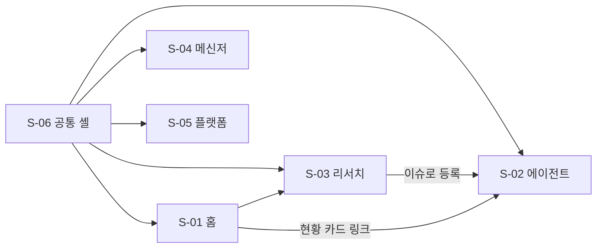

# 06. 기능 정의서

> Dev Agent — 개인 개발 서버용 에이전트 운용 플랫폼으로의 전환(2.0)
> 버전 0.5 · 2026-11-25 · 상태: Draft
> 선행 문서: [01. 요구사항 정의서](./01-requirements.md), [05. API 명세서](./05-api-specification.md)

화면의 현재 기능 상세는 `README.md`(캡처 포함)가 기준이다. 이 문서는 **전환으로 바뀌는 것과 모바일 동작**을 적는다.

---

## 1. 표기 규칙

- 화면 ID: `S-xx`. 지금의 다섯 화면과 공통 셸에 번호를 붙였다.
- "모바일 동작"은 두 단계로 적는다: **4단계까지**(정적 HTML — 지금의 반응형 그대로, 새로 만들지 않는다. 예외: S-06 상단바의 좁은 폭 보정 — §3.7, OI-26)와 **SPA**(5단계 목표).
- SPA의 화면별 상세(컴포넌트·상태)는 5단계 기획에서 이 문서를 보완한다(OI-13).

## 2. 사용자와 권한

| 사용자 유형 | 설명 | 역할 |
|---|---|---|
| 사용자 | 플랫폼 주인 한 명. tailnet 기기(PC·모바일)에서 접속 | 전부 가능 |

## 3. 화면별 기능

### 3.1 화면 목록과 메뉴

| 화면 ID | 화면 | 파일(4단계까지) | 메뉴 위치 |
|---|---|---|---|
| S-01 | 홈 | `home.html` | 상단 탭 1 (Alt+1) |
| S-02 | 에이전트 | `agent.html` | 상단 탭 2 (Alt+2) |
| S-03 | 리서치 | `research.html` | 상단 탭 3 (Alt+3) |
| S-04 | 메신저 | `messenger.html` | 상단 탭 4 (Alt+4) |
| S-05 | 플랫폼 | `platform.html` | 상단 탭 5 (Alt+5) |
| S-06 | 공통 셸(상단바·알림함·플랫폼 관리 창) | `ui.js` | 모든 화면 |

### 3.2 S-01 홈

- **목적**: 전체 현황 한눈에 보기.
- **변경**
  - Phase 2: 메신저 요약·최근 활동(요약, 멘션 초안) 영역 제거(FR-207). 남는 것: 이슈 세션 현황, 리서치·루틴 현황, 사용량, 시스템 상태.
  - Phase 3: 표기 `owner/repo#n`, "MR" → "PR".
- **오류·빈 상태**: 대상 저장소가 없으면 "플랫폼 탭에서 대상 저장소를 추가하세요" 안내(현행 문구를 GitHub에 맞춤).
- **모바일 동작 (390px)**
  - 4단계까지: 현행(1100px 이하에서 카드가 1열로 쌓임). 보정하지 않는다.
  - SPA: 카드 1열. 맨 위에 "확인 대기 중인 세션"을 고정으로 두고(모바일에서 가장 자주 하는 일이 진행/중단 확인), 누르면 S-02의 그 세션으로 간다.

### 3.3 S-02 에이전트

- **목적**: 이슈 세션 진행 확인과 사람 확인(진행/중단/피드백).
- **변경**
  - Phase 2: 프리뷰 스크린샷 갤러리 제거(OI-04 결정 2026-11-25: 프리뷰 삭제).
  - Phase 3: 이슈 목록·등록·가져오기가 GitHub로 동작(FR-306). 링크·문구 "GitLab"·"MR" → "GitHub"·"PR". 세션 참조 표기 `repo#n`.
- **업무 규칙**: 「진행」+ 입력 글은 DESIGN_WAIT에서 추가 지시, REVIEW_WAIT에서는 푸시하지 않고 재수정(현행, FR-601).
- **오류·빈 상태**: 세션 없음 → 「이슈 목록」「가져오기」 안내.
- **모바일 동작 (390px)**
  - 4단계까지: 현행(980px 이하에서 사이드바가 본문 위로 쌓임). Diff·로그는 가로 스크롤.
  - SPA: 세션 목록 → 세션 상세의 2단계 이동(목록 화면에서 세션을 누르면 상세, 상단에 뒤로 가기). 상세는 스테퍼를 가로 스크롤 한 줄로, 문서 탭(설계안·변경 요약·검증·Diff·로그)은 가로 스크롤 탭. 진행/중단/피드백 입력은 화면 아래 고정 바. Diff는 파일별 접기 유지, 줄은 줄바꿈 없이 가로 스크롤(블록 안에서만 — 페이지는 넘치지 않는다). 사이드바 폭 조절 손잡이는 없음.

### 3.4 S-03 리서치

- **목적**: 저장소에 대한 질문·후속 질문, 결과 문서 보기, 루틴(예약) 관리.
- **변경**
  - Phase 3: 프로젝트·브랜치 선택이 GitHub 저장소 기준. 「이슈로 등록」이 GitHub 이슈를 만든다.
- **오류·빈 상태**: 대상 저장소 없음 → 안내. 사용량 한도 중 → 대기 표시(현행).
- **모바일 동작 (390px)**
  - 4단계까지: 현행(980px 이하 1열).
  - SPA: 스레드 목록 → 스레드 상세 2단계 이동. 질문 입력은 화면 아래 고정, 프로젝트·브랜치·모델 선택은 입력 위 접이식 "옵션" 한 줄. 이미지 첨부는 버튼(파일 선택·촬영)으로, 끌어놓기 안내는 숨김. 결과 문서의 표·코드는 블록 안 가로 스크롤. 루틴 목록은 카드형, 등록·수정은 전체 화면 시트.

### 3.5 S-04 메신저

- **목적**(Phase 2 이후): 메신저 연결 상태 확인과 알림 유형 켜기/끄기, 쓸 수 있는 명령 안내.
- **변경**
  - Phase 2: 방 설정(수집·요약·자동응답)과 최근 활동(요약·멘션 초안) 제거. 남는 것: 연결 상태 카드, "메신저 알림" 카드(유형 `issue`·`research`·`system`), 명령 안내(§4.2).
  - Phase 4: 연결 상태 카드가 Telegram 상태(봇 이름, 허용 대화 설정 여부, 마지막 수신 시각)와 「시험 전송」을 보여 준다. 토큰·chat id 값은 표시하지 않는다.
  - SPA에서 이 화면을 플랫폼 탭으로 흡수할지는 OI-13.
- **오류·빈 상태**: `none`이면 "메신저 없이 사용 중 — 알림은 알림함에 남습니다"와 설정 방법(`.env` 키 이름) 안내.
- **모바일 동작 (390px)**
  - 4단계까지: 현행(1100px 이하 1열).
  - SPA: 데스크톱과 동일(카드가 1열로 쌓임). 토글은 44px 이상.

### 3.6 S-05 플랫폼

- **목적**: 연동 상태, 에이전트 설정, 대상 저장소, 스킬, MCP, 시스템(버전·점검·재시작).
- **변경**
  - Phase 1: 시스템 카드의 실행 방식에 `systemd`, 설치 점검에 Linux 항목. 재시작 버튼이 systemd 아래에서도 보인다.
  - Phase 2: RAG(사내 문서) 카드와 프리뷰 항목 제거. 연동 카드는 메신저·코딩 에이전트만(채팅 모델·지식 검색 제거). MCP 카드에서 내장 운영 MCP 3종의 상태와 `운영` 질의 입력을 제거하고 사용자 정의 MCP 서버 목록·등록만 남긴다(FR-208).
  - Phase 3: 대상 프로젝트 칩 표기 `owner/repo`, 연동 카드에 GitHub(토큰 상태·권한 점검).
- **모바일 동작 (390px)**
  - 4단계까지: 현행 그대로(보정하지 않음. 폭이 좁으면 카드가 1열).
  - SPA: 카드 1열. 긴 카드(스킬·MCP)는 목록만 보이고 항목을 누르면 전체 화면 편집 시트. 스킬 본문 편집기는 전체 폭.

### 3.7 S-06 공통 셸

- **목적**: 탭 이동, 사용량 배터리, 버전, 알림함(종), 플랫폼 관리 창(렌치).
- **변경**
  - Phase 2: 알림함의 메신저 관련 문구 정리(요약·멘션 언급 제거).
  - 플랫폼 관리 창은 서버에서 켜져 있을 때만 버튼이 보인다(현행 `enabled` 규칙, OI-14).
- **모바일 동작 (390px)**
  - 4단계까지(OI-26 결정 ①, 서버 반영 뒤 T-020): 좁은 폭에서 상단바만 보정한다 — 탭 5개는 아이콘만(이름은 `title`·`aria-label`), 한 줄에 안 들어가면 탭 영역만 가로 스크롤. 에이전트 칩·버전·배터리 글자 라벨은 숨긴다(배터리 막대는 남겨도 된다). 종·테마·렌치(보일 때) 버튼은 남기고 터치 영역 44px 이상. 페이지 전체는 390px에서 가로로 넘치지 않는다. 768px 이상은 지금 모양 그대로. 새 디자인·새 아이콘은 만들지 않는다. 단축키(Alt+숫자) 안내는 의미가 없지만 건드리지 않는다.
  - SPA: 탭은 화면 아래 고정 탭 바(아이콘 + 이름 5개 — S-04 흡수 시 4개). 상단바에는 화면 제목·배터리·종·렌치만. 알림함과 플랫폼 관리 창은 전체 화면 시트. 탭 전환 때 화면 상태(스크롤·입력 중인 글)를 유지한다.

## 4. 서버 자동 처리 기능

### 4.1 스케줄·이벤트

| 기능 | 트리거 | 동작 | 요구사항 | 변경 |
|---|---|---|---|---|
| 이슈 스캔 | 2분 주기 | 라벨 이슈를 큐에 등록 | FR-302 | Phase 3: GitHub |
| 메신저 수신 | 어댑터 수신(long polling) | 명령 라우터로 전달 | FR-203, FR-204 | Phase 2 신설 |
| 확인 대기 리마인더 | 대기 4시간마다 | 알림 | FR-205 | 유지 |
| 루틴 | 1분 틱 | 예약 질의 접수 | FR-603 | 유지 |
| 리서치 대기열 | 60초 틱 | 한도 해제 후 재시작 | FR-602 | 유지 |
| ~~방 수집~~ | 20초 주기 | — | — | Phase 2 삭제 |
| ~~정기 요약~~ | 업무일 09·13·18시 | — | — | Phase 2 삭제 |
| ~~멘션 폴링~~ | 20초 주기 | — | — | Phase 2 삭제 |
| ~~문서 재적재~~ | 매일 06:30 | — | — | Phase 2 삭제(OI-02) |

### 4.2 메신저 명령 체계 (Phase 2 이후, 자기 대화)

접두어 `@AI`는 없앤다. 첫 단어로 구분한다.

| 입력 | 동작 | 비고 |
|---|---|---|
| `이슈 스캔` | 즉시 스캔 | 현행 `@AI 이슈 스캔` |
| `이슈 owner/repo#12` 또는 이슈 URL | 그 이슈를 큐에 등록(닫힌 이슈 재실행 포함) | Phase 3 전에는 현행 표기 |
| `이슈 프로젝트 추가\|삭제 owner/repo` | 대상 저장소 변경 | |
| `이슈 상태` 등 그 외 `이슈 …` | 현행 `IssueAgentService.command`가 받는 것 그대로 | |
| `질문 <저장소>: <질문>` | 리서치 접수(완료 시 알림) | 현행 `@AI 질문 batch: …` |
| `진행`·`승인`·`중단`·`diff`·`상태`·`검증`·`피드백: …` | 확인 대기 답변. 대기 세션이 2건 이상이면 앞에 `repo#n`. 앞 답변(피드백·검증 등)을 처리하는 사이 새 결과가 나오면, 그 전에 접수된 답은 적용하지 않고 "새 결과를 확인하고 다시 답해 달라"고 1회 안내한다(대시보드 입력도 같음 — 보지 못한 결과를 승인하지 않게) | 현행 규칙 + 대기 세대(T-006) |
| `질의 …` | `질문`과 같다 | |
| 그 외 | 대기 세션이 없으면 명령 안내 1회(이슈·질문·확인 답변·`이슈 중단 [repo#n]` 사용법), 있으면 무시 + 안내(대기 단계당 1회) | |

제거되는 명령: 방 요약·멘션 관련, `운영 …`(운영 MCP 질의 — OI-03 결정), 일반 대화 응답(`@AI <아무 질문>`에 채팅 모델이 답하던 것 — 채팅 모델 포트와 함께 제거).

## 5. 미구현·계획 기능

| 기능 | 상태 | 예정 Phase | 비고 |
|---|---|---|---|
| 서버 제어 | 범위 미정 | — | OI-01 |
| 일반 화면 검증(프리뷰 대체) | 계획 없음 | — | OI-04 결정(2026-11-25): 프리뷰 삭제, 대체 계획 없음 |
| Slack 어댑터 | 범위 밖 | — | |
| 자기소개서·포트폴리오 작성용 RAG와 작성 화면 | 후속 과제(범위 밖) | 2.0 전환 뒤 | OI-17. 시작할 때 별도 기획 |

## 6. 요구사항 추적

| 요구사항 | 화면 | 기능 | API |
|---|---|---|---|
| FR-102, FR-106 | S-05, S-06 | 실행 방식·점검·재시작 | `/api/system/*` |
| FR-201, FR-207 | S-01, S-04 | 방 설정·요약·멘션 제거 | 05 §2.2 |
| FR-202 | S-05 | RAG 카드 제거 | 05 §2.2 |
| FR-203, FR-204 | §4.2 | 메신저 명령·답변 | — |
| FR-205 | S-04 | 알림 유형 켜기/끄기 | `/api/messenger-notify` |
| FR-206 | S-02, S-05 | 프리뷰 요소 제거 | 05 §2.2 |
| FR-301, FR-306 | S-02, S-03, S-05 | 대상 저장소·이슈 목록·등록·브랜치 | 05 §2.3 |
| FR-305 | S-01, S-02 | PR 링크 표시 | `/api/issues` |
| FR-401~FR-403 | S-04 | Telegram 상태·시험 전송 | `/api/platform` |
| FR-501, FR-502 | S-01~S-06 | SPA·모바일 | OI-13 |

---

## 변경 이력

| 일자 | 버전 | 내용 |
|---|---|---|
| 2026-11-24 | 0.1 | 최초 작성 |
| 2026-11-24 | 0.2 | `운영` 명령과 운영 MCP 화면 요소 제거(S-05, §4.2), 후속 과제 OI-17 기록 |
| 2026-11-24 | 0.3 | T-006 반영(§4.2): `질의` 별칭, `검증` 답변, 대기 세대(새 결과 뒤 접수된 답 폐기 + 안내), 명령 안내에 `이슈 중단` |
| 2026-11-25 | 0.4 | §3.3·§5의 OI-04 표기를 결정 표시(프리뷰 삭제)로 |
| 2026-11-25 | 0.5 | OI-26 결정 ①: §3.7 S-06 "4단계까지" 모바일 동작을 좁은 폭 상단바 보정으로(T-020), §1에 예외 표기 |
