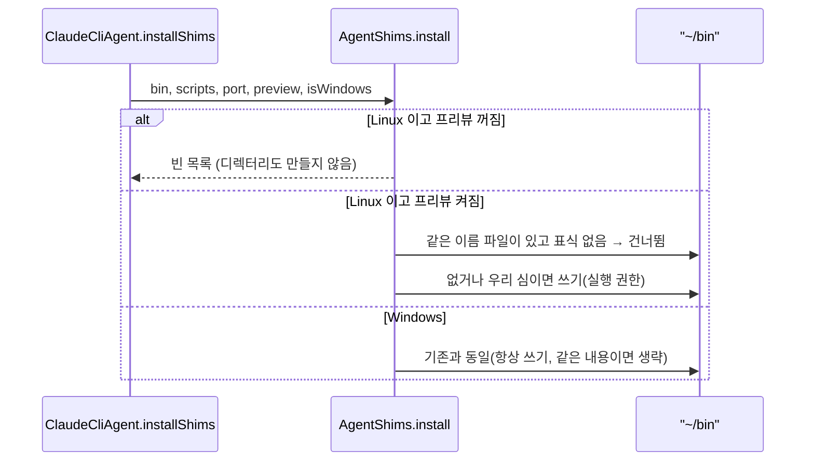
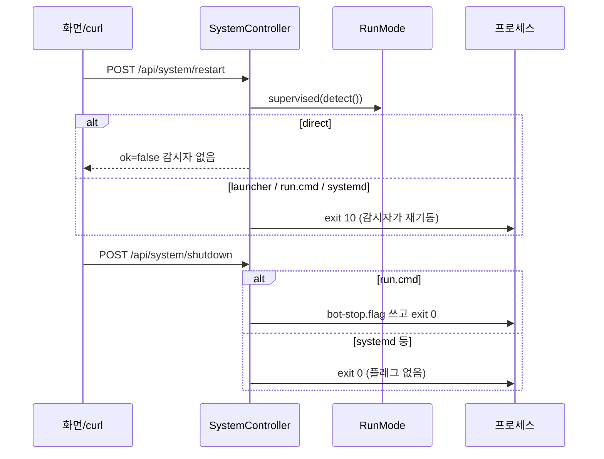

# T-001 변경 설명서 — Linux 기동 지원

> 담당: backend-dev (backend-dev) · 2026-11-24 · 지시서: [T-001](../T-001-linux-기동.md)

## 요약
같은 jar 가 Ubuntu(그래픽 없음, 비루트, systemd)에서 기동·에이전트 준비를 마치도록 OS 의존 코드 12개를 조사하고 깨지는 곳만 고쳤다(FR-101·102·106).
기동 때 `~/bin` 에 심을 쓰던 동작을 Linux 에서는 프리뷰가 꺼져 있으면 쓰지 않고, 사용자의 기존 파일은 덮어쓰지 않게 했다. 실행 방식 `systemd`(`DEV_AGENT_RUN_MODE=systemd`)를 추가했다.
서버 격리 기동 확인 스크립트 `deploy/smoke/server-smoke.sh` 를 작성했다. **`DEV_AGENT_SSH` 가 없어 이번 세션에서는 실행하지 못했다**(메인 세션이 실행).

## 그림
### 그림 1. 기동 때 심 설치(`AgentShims.install`) 분기

Linux 서버의 홈은 사용자의 실제 계정이므로 기본은 "아무것도 쓰지 않음"이다. 표식은 심 두 번째 줄의 "dev-agent 이 생성한 심" 이다. Windows 동작은 바꾸지 않았다.

### 그림 2. 재시작·종료와 실행 방식

판별 우선순위는 launcher 환경변수, `DEV_AGENT_RUN_MODE=systemd`, `DEV_AGENT_SUPERVISED`, direct 순이다. systemd 는 종료 코드 0 이면 다시 띄우지 않는 unit 설정(T-003)에 기댄다.

## 파일 지도
| 파일 | 추가/수정 | 역할 |
|---|---|---|
| `platform/RunMode.java` | 추가 | 실행 방식 판별·감시 여부·stop 플래그 여부 |
| `admin/SystemController.java` | 수정 | runMode 판별을 `RunMode` 로 위임(`foreign` 은 건드리지 않음 — T-002) |
| `agent/claude/AgentShims.java` | 추가 | `~/bin` 심 작성(OS·프리뷰 분기, 기존 파일 보호) |
| `agent/claude/ClaudeCliAgent.java` | 수정 | `installShims` 가 `AgentShims` 호출 |
| `mcp/McpConfigService.java` | 수정 | Playwright MCP 의 `cmd /c` 감싸기를 Windows 만 |
| `gitlab/VerifyService.java` | 수정 | 검증 빌드 PATH 구분자 `;` → `File.pathSeparator` |
| `maintain/MaintainPrompts.java` | 수정 | `gradlew.bat`·PowerShell 안내를 OS 별로 |
| `ops/Doctor.java` | 수정 | Linux 용 로그인·git·프리뷰 문구 |
| `deploy/smoke/server-smoke.sh` | 추가 | 서버 격리 기동 확인(TC-001) |
| `RunModeTest`, `AgentShimsTest`, `PlaywrightNodeOsTest` | 추가 | TC-005·심·MCP 단위 테스트 |

## OS 의존 파일 12개 조사
| 파일 | Linux 에서의 동작 | 고친 것 | 고치지 않은 이유 |
|---|---|---|---|
| `admin/SystemController` | runMode 가 direct/run.cmd/launcher 만, systemd 없음 | `systemd` 추가, stop 플래그는 run.cmd 만 | `foreign()` 은 T-002 범위 |
| `agent/claude/ClaudeCliAgent` | `@PostConstruct`+매 실행 전에 `~/bin` 에 심 3개를 덮어씀. PATH 구분자는 `File.pathSeparator` 라 정상. `--disallowedTools PowerShell` 은 Linux 에서 무해 | 심 설치를 `AgentShims` 로: 프리뷰 꺼짐이면 쓰지 않음, 기존 파일 보호 | 프롬프트의 "PowerShell 도구는 쓰지 마세요" 한 줄은 Linux 에서 해가 없어 둠 |
| `boot/Autostart` | `supported()` 가 Windows 만 true → Linux 에서 레지스트리 호출 없음 | 없음 | 이미 안전 |
| `boot/Launcher` | `--launch` 없이는 로드되지 않음(AWT 미사용). `--launch` 에서도 headless 면 트레이 생략, 브라우저는 headless 면 열지 않음 | 없음 | 이미 안전. 지금 jar 에서 `DEV_AGENT_HOME` 은 `Launcher` 자식 JVM 의 작업 디렉터리로만 쓰이고 `java -jar` 직접 실행은 **현재 작업 디렉터리**가 홈(`Bootstrap.prepare`) — systemd 는 `WorkingDirectory` 로 맞춰야 함(T-003) |
| `config/ClaudeCliLocator` | PATH → `/opt/homebrew/bin`·`/usr/local/bin`·`~/.claude/local`·`~/.local/bin` 에서 `claude` 탐색 | 없음 | PATH 는 서비스 환경의 것을 쓴다. npm 전역 경로(nvm 등)는 서버 확인 항목 |
| `config/ClaudeProperties` | `claude.exe` 가정 없음(`ClaudeCliLocator` 위임) | 없음 | 이미 안전 |
| `gitlab/VerifyService` | pom → `mvn`, gradle → `sh gradlew --no-daemon`(없으면 `gradle`)로 Linux 에서 맞게 선택됨. JSP 검사는 프리뷰 켜짐일 때만이라 `bash` | PATH 구분자(프리뷰 켜짐일 때 `;` 였음) | 선택 로직은 이미 맞음 |
| `maintain/MaintainPrompts` | `./gradlew.bat`·restart.cmd·PowerShell 안내가 틀림 | OS 별 명령, Linux 는 systemctl 언급 | 허용 도구 목록(`maintain.tools`)은 이미 `./gradlew` 포함 |
| `mcp/McpConfigService` | Playwright MCP 가 `cmd` 를 command 로 씀 → Linux 에서 실패 | Windows 만 `cmd /c npx`, 그 외 `npx` | 기본 브라우저 `msedge` 는 프리뷰(Linux 미지원) 범위라 둠 |
| `platform/Os` | `shellLine`·`viaShell` 이 Linux 에서 `sh -c`·인자 그대로 | 없음 | 이미 안전 |
| `preview/PreviewService` | `mvn.cmd`·`catalina.bat`·`cmd /c` 고정 → Linux 에서 동작 불가 | 없음 | 범위 밖(프리뷰는 Linux 에서 돌리지 않음). 기동 때는 `PREVIEW_ENABLED=false`(기본값)면 호출되지 않음 |
| `ops/Doctor` | Git Bash 항목은 Windows 만. Claude CLI·git·DB 항목은 OS 중립. 로그인 파일이 없으면 Linux 도 "macOS 키체인" 문구가 나옴 | 로그인·git·프리뷰 문구를 OS 별로. Windows 전용 항목은 Linux 에서 목록에 없음 | `claude --version` 외 호출 없음(토큰 사용 없음) |

## 주요 결정
| 결정 | 이유 | 검토한 대안 |
|---|---|---|
| 심 로직을 `AgentShims` 로 분리 | 단위 테스트 가능(임시 홈), `ClaudeCliAgent` 는 800줄 근처 | 기존 메서드 안에서 분기 |
| 표식 없는 기존 파일 보호는 비 Windows 만 | Windows 기존 동작 불변 | 전 OS 적용 |
| `RunMode` 는 `Launcher` 를 참조하지 않고 환경변수 이름 복제 | `Launcher` 는 AWT 를 import 해 헤드리스 서버에서 로드를 피하고 싶음 | `Launcher.ENV_FLAG` 참조 |
| smoke 는 내장 DB 기본 포트(54329)를 그대로 쓰고 사용 중이면 FAIL | 지시서 ③ 문구, 기존 서버에 붙는 사고 방지 | 별도 포트 지정 |
| smoke 의 `DEV_AGENT_RUN_MODE=systemd` 로 기동해 status 의 runMode 도 확인 | 새 실행 방식 검증을 겸함 | 지정 안 함 |

## 지시서 밖 추가
없음

## 제안
- `java -jar` 직접 실행에서 `DEV_AGENT_HOME` 이 적용되지 않는다(작업 디렉터리가 홈). 지시서 참고 항목의 확인 결과이며 코드는 바꾸지 않았다. T-003 unit 은 `WorkingDirectory` 를 지정해야 한다(필요하면 `DEV_AGENT_HOME` 적용을 별도 작업으로).
- `ClaudeCliLocator` 가 npm 전역·nvm 경로를 찾지 않는다. 서버에서 claude 가 그런 위치면 unit 의 PATH 지정이 필요하다.

## 서버에서 확인할 것
- `server-smoke.sh` 실행 결과(`SMOKE PASS`, `~/bin` 전후 동일, 서버 CPU 아키텍처에서 내장 DB 바이너리(linux amd64) 기동).
- 실제 에이전트 실행(Claude CLI 호출)과 로그인 상태 — 이번 확인은 `claude --version` 까지만.
- systemd 아래의 PATH(java·claude·git·node)와 `WorkingDirectory`.
- `DEV_AGENT_RUN_MODE=systemd` 에서 재시작(종료 코드 10)이 unit 의 `Restart=` 로 되살아나는지, 종료(0)는 되살아나지 않는지.
- 서버에 기존 Dev Agent/DB 가 54329 를 쓰고 있으면 smoke 가 FAIL 한다(의도).

## 검증
- 검증 명령: `./gradlew.bat test bootJar -q` → 통과(86 테스트, 실패 0, 새 테스트 포함). `bash deploy/smoke/server-smoke.sh` → 미실행(`DEV_AGENT_SSH` 없음).
- smoke 스크립트: `bash -n` 통과, `DEV_AGENT_SSH` 없을 때 `SMOKE SKIP`(종료 2). 가짜 ssh 로 로컬에서 접속·mktemp·업로드·포트 점검과 두 실패 경로(포트 사용 중, 앱 미기동)에서 정리(`cleanup: ok`)와 `SMOKE FAIL` 마지막 줄을 확인. 정상 경로(기동~종료~`~/bin` 비교)는 Linux 에서만 확인 가능해 서버 실행이 필요하다.
- 테스트: 추가 8건(RunModeTest 3, AgentShimsTest 4, PlaywrightNodeOsTest 1). 커버리지 도구는 프로젝트에 없어 측정하지 않았다.
- security-scan: 대상 `deploy/smoke`·`AgentShims`·`RunMode`(+변경 파일) — 하드코딩 비밀·외부 주소 없음(loopback 만), 명령 인자에 사용자 입력 없음. Critical/Major/Minor 0.
