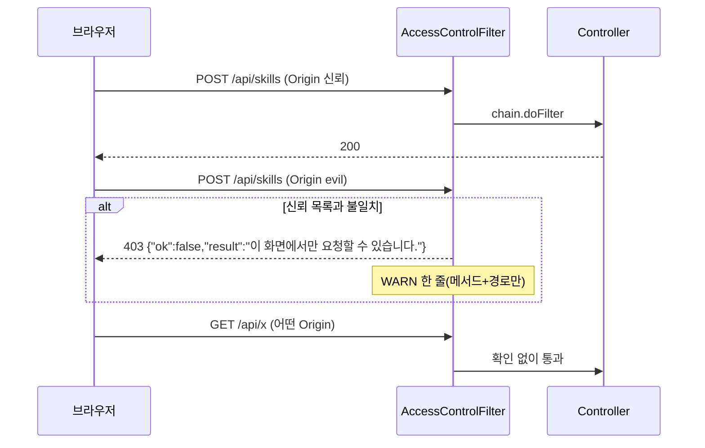
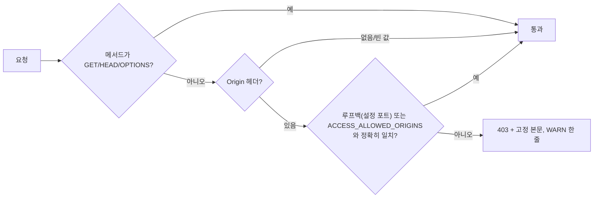

# T-002 변경 설명서 — 접근 제어: 신뢰 Origin 일괄 확인

> 담당: backend-dev (backend-dev) · 2026-11-24 · 지시서: [T-002](../T-002-접근-제어.md)

## 요약
- 상태 변경 `/api/**` 요청(GET·HEAD·OPTIONS 외)의 `Origin` 확인을 서블릿 필터 `AccessControlFilter` 하나로 모았다(FR-104). 컨트롤러 10곳의 `foreign(req)`와 메서드 자체를 삭제했다.
- 신뢰 목록은 루프백(`http://127.0.0.1:<port>`, `http://localhost:<port>`) + 설정 `access.allowed-origins`(`ACCESS_ALLOWED_ORIGINS`). `tailscale serve` 뒤 주소(`https://<MagicDNS>:8443`)를 넣으면 통과하고 그 밖의 출처는 전 API에서 403.
- 엔드포인트 전수 조사 결과 GET으로 상태를 바꾸는 것은 `/api/llm-test` 하나라 POST로 바꿨다. 버전 1.13.0.

## 그림
### 그림 1. 필터의 판정 흐름 (정상 + 거부)

필터는 `shouldNotFilter`로 GET·HEAD·OPTIONS와 `/api/` 밖 경로를 건너뛴다. `Origin`이 없으면(curl 등) 통과한다. 비교는 정확히 일치이며 끝 슬래시·`null` 문자열·접두 일치는 모두 거부된다. 거부 본문은 고정 문자열이라 Origin 값을 되돌려 주지 않는다. 루프백 포트는 요청의 서버 포트(`req.getServerPort()`)를 쓴다(기존 `foreign()`과 같음).

## 파일 지도
| 파일 | 추가/수정 | 역할 (한 줄) |
|---|---|---|
| `config/AccessControlFilter.java` | 추가 | 상태 변경 `/api` 요청의 Origin 확인, 403 응답 |
| `config/AccessProperties.java` | 추가 | `access.allowed-origins` record, 쉼표 목록 파싱 |
| `test/.../config/AccessControlFilterTest.java` | 추가 | TC-002, TC-003 외 8개 단위 테스트 |
| `admin/SystemController.java` | 수정 | `foreign()`과 호출 2곳 삭제 |
| `admin/AdminController.java` | 수정 | `foreign()` 호출 삭제, `/api/llm-test` GET→POST |
| `admin/BundleController.java`·`MaintainController.java`·`ResearchController.java`·`SkillController.java` | 수정 | `foreign()` 호출과 `req` 인자 삭제 |
| `static/admin.js` | 수정 | `llm-test` 호출을 POST로 |
| `application.yml`·`.env.example`·`dist/env.template`·`README.md` | 수정 | `ACCESS_ALLOWED_ORIGINS`(기본 빈 값, 자리표시자 없음), README의 llm-test 표기 |
| `build.gradle` | 수정 | 1.13.0 |

## 주요 결정
| 결정 | 이유 | 검토한 대안 |
|---|---|---|
| `OncePerRequestFilter` + `@Component` 자동 등록 | 설정 한 곳, 별도 등록 코드 불필요 | HandlerInterceptor(정적 경로·예외 처리 분기가 늘어남) |
| 루프백 포트는 요청의 서버 포트 | 기존 동작과 동일, e2e(8778)도 그대로 | `server.port` 주입 |
| 거부 로그는 메서드+경로만 | 지시서: 헤더 값·본문 금지 | Origin 로그 |
| `/api/llm-test`를 POST로 | GET이 LLM 호출(토큰·사용량 기록)을 일으켜 교차 출처 GET로 유발 가능 | 필터 대상에 GET 추가(05 §1.2 규칙과 달라짐) |

## 지시서 밖 추가
없음. (`llm-test` POST 전환은 지시서 범위의 전수 조사 처리다.)

## 제안
- 거부 응답이 컨트롤러 단계에서는 HTTP 200 + `ok:false`였으나 이제 403이다. 화면 코드는 본문을 `r.json()`으로 읽어 호환되지만, 05 §1.2는 이미 403이라 명세와는 일치한다.
- T-007이 `/api/llm-test`를 삭제할 예정이다(05 §2.2). 그때 이 전환은 자연히 사라진다.
- `GET /api/bundle/export`는 상태는 안 바꾸나 구성(스킬·MCP 헤더 자리표시자)을 내려 준다. 교차 출처 GET은 응답을 못 읽으므로 현행 유지로 충분하다고 본다.

## 엔드포인트 조사 표
전 컨트롤러(`admin/*Controller`) 매핑 79개를 점검했다. 상태 변경 POST는 모두 필터가 확인한다. GET 중 상태를 바꾸는지 의심된 것만 아래에 적는다.

| 메서드 | 경로 | 상태 변경 여부 | 처리 |
|---|---|---|---|
| GET | `/api/llm-test` | 예 (LLM 호출, 토큰 사용 기록) | POST로 변경 + `admin.js` 호출부 수정, `node --check` 통과. 옛 GET은 405 확인 |
| GET | `/api/rooms` | 아니오 (`client.connect()` 멱등 연결) | 변경 없음 |
| GET | `/api/issues-list`, `/api/research/branches` | 아니오 (GitLab 읽기) | 변경 없음 |
| GET | `/api/system/doctor?refresh=` | 아니오 (60초 캐시 갱신뿐) | 변경 없음 |
| GET | `/api/bundle/export`, `/api/research/{id}/download`, `/api/docs-*`, `/api/preview/*`(status·log·status.json), `/api/mcp-status`, `/api/mcp-servers`, `/api/agent/**`, `/api/usage` 등 나머지 GET | 아니오 (조회) | 변경 없음 |
| POST | `/api/**` 전부(이슈·설정·MCP·루틴·스킬·리서치·플랫폼 관리·프리뷰·시스템 등) | 예 | 필터가 일괄 확인(기존 10곳 개별 확인 삭제) |

## 서버에서 확인할 것
- `tailscale serve` 뒤에서 브라우저가 보내는 `Origin` 값의 실제 형태(`https://<MagicDNS 이름>:8443`로 오는지, 포트 생략 여부). 값이 다르면 `ACCESS_ALLOWED_ORIGINS`를 그 값으로 맞춘다. 이 PC에서는 확인할 수 없다.
- SSE(`/api/agent/stream`, GET이라 필터 밖)와 파일 올리기(`POST /api/research/attach`)가 serve 뒤에서 통과하는지.
- 서버 `.env`에 `ACCESS_ALLOWED_ORIGINS`를 넣은 뒤 재기동했는지.

## 검증
- 검증 명령: `./gradlew test bootJar` → 전체 99개 테스트 0 실패(새 필터 테스트 8개), bootJar 성공. `grep -rn "foreign(" src/main/java` → 없음(종료 1). `node --check static/*.js` 전부 통과.
- 앱 확인(`bash e2e/scripts/start-app.sh`, 포트 8778): `/api/system/status` 200. 설정 비어 있을 때 `POST` Origin evil → 403 + 본문, 같은 출처 Origin → 200, Origin 없음 → 200, GET + evil Origin → 200. e2e(`e2e/core` 5개, TC-007 포함) 5 passed. 확인 후 `/api/system/shutdown`으로 8778 앱만 내렸다.
- 커버리지: 새 클래스의 모든 분기를 테스트가 지난다(별도 측정 도구 미실행).
- security-scan: 하드코딩 비밀·인젝션 없음. Origin은 정확 일치 비교만 하고 로그에는 값을 남기지 않는다. 발견 사항 없음.

## 보안 검토 후 수정 (메인 세션 수정 · PM 기록, 2026-11-24)
> 이 절은 위 본문보다 우선한다. 위 그림 1 설명의 "`/api/` 밖 경로를 건너뛴다"·"루프백 포트는 `req.getServerPort()`", 주요 결정 2행, 파일 지도의 "상태 변경 `/api` 요청"은 아래로 바뀌었다.

| 검토 지적 | 수정 | 테스트 |
|---|---|---|
| CRITICAL C-1: `getRequestURI().startsWith("/api/")` 조건은 `/api;x/…`·`/%61pi/…`처럼 Spring MVC가 컨트롤러에 매칭하는 표기로 우회된다(실측 재현). 예전 `foreign()` 10곳도 다시 열렸다 | 경로 조건 삭제. **경로와 무관하게 `GET`·`HEAD`·`OPTIONS` 외 모든 요청**을 검사한다(`shouldNotFilter`는 메서드만 본다) | `TC002_pathSpellingCannotBypassTheCheck` (`/api;x/…`, `/%61pi/…`, `/api/…;x`, `/API/…`, `//api/…`, `/home.html`, `/`) |
| LOW L-1: 루프백 신뢰 포트를 요청(Host)에서 가져왔다 | 생성자가 `@Value("${server.port:8777}")`를 받아 고정(생성자 하나) | `TC002_loopbackPortComesFromConfigNotFromHostHeader` |

그림 2. 수정 후 판정 흐름. 경로는 판정에 쓰지 않는다. 루프백 포트는 요청이 아니라 설정값이다.

- 메인 세션 확인: `gradlew.bat test bootJar` rc=0. 실제 Tomcat(8778)에서 `Origin: https://evil.example`의 POST가 `/api/…`, `/api;x/…`, `/%61pi/…`, `/api/…;x`, `/home.html` 모두 403. `Origin: null` 403. `Host: 127.0.0.1:9999` + `Origin: http://localhost:9999` 403. 같은 출처·Origin 없음은 통과. 다른 출처 GET 200. e2e @core 5개 통과.
- PM 재실행(2026-11-24): `./gradlew test bootJar` 성공(전체 101개, 실패 0 — 필터 테스트 10개), `foreign(` 없음, `node --check` 전부 통과.
- 처리하지 않은 검토 지적은 00-INDEX `OI-21`(Host 검사·DNS rebinding, 허용 Origin 정규화, 비용 유발 GET)과 `OI-22`(에이전트 세션의 로컬 상태 변경 API 호출)로 올렸다.
