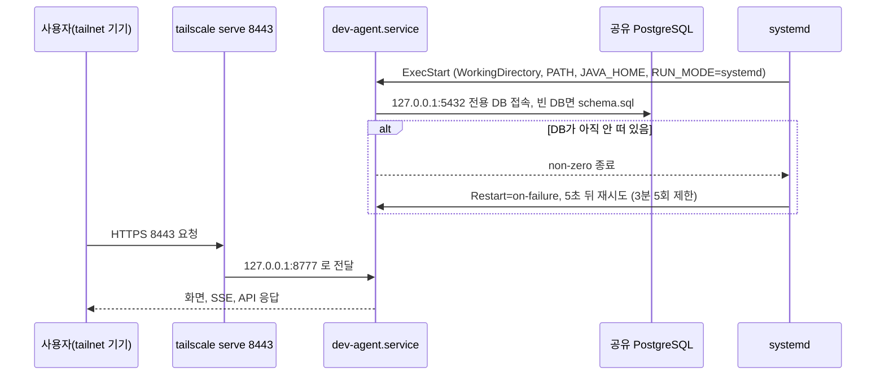
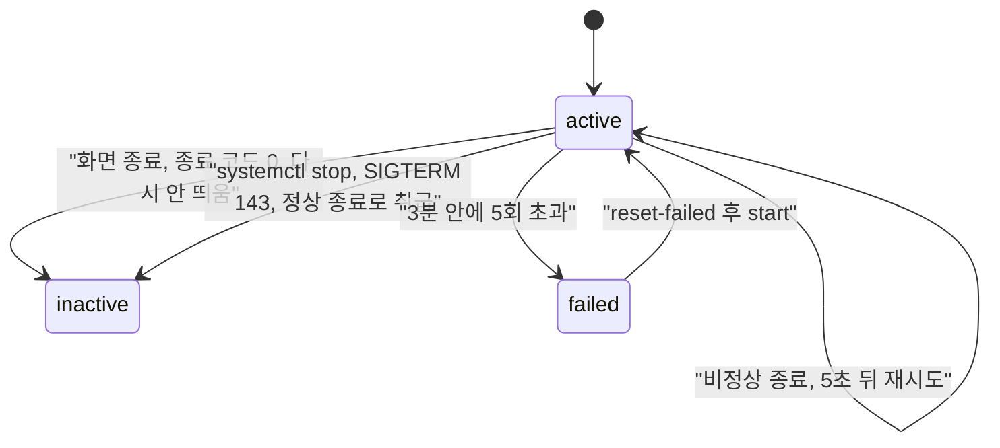

# T-003 변경 설명서 — 서버 실행 구성 (systemd unit · 전용 DB SQL · 절차서)

> 담당: backend-dev (backend-dev) · 2026-11-24 · 지시서: [T-003](../T-003-서버-실행-구성.md)

## 요약
서버에 Dev Agent 를 올리는 데 필요한 파일 네 개를 `deploy/` 에 만들었다: systemd unit 틀, 공유 PostgreSQL 에 전용 role·DB 를 만드는 SQL, 서버용 `.env` 키 목록, 한국어 절차서(1~11장 + 확인 항목).
근거는 FR-102·FR-103, NFR-201·301~303, 02 §4.2 D-1~D-3. 앱 코드는 바꾸지 않았다(Bootstrap·매퍼 DDL 은 다시 읽어 근거만 확인).
결과: 사용자가 절차서만 따라 서버 기동 → `tailscale serve` 8443 → tailnet 기기 접속까지 갈 수 있고, 서버에서 확인할 것(미확인 포함)이 체크리스트로 남았다.

## 그림
### 그림 1. 서버 배치와 기동 순서

앱은 `127.0.0.1:8777` 에만 바인딩하고 tailnet 에는 serve 의 8443 만 열린다. DB 는 호스트 `127.0.0.1:5432` 로만 접속한다(공개는 사용자 작업, 절차서 2장). `Bootstrap` 이 DB 접속 실패 시 스키마 확인을 건너뛰므로 DB 보다 먼저 떠도 Spring 접속 실패로 종료되고 unit 이 다시 띄운다는 흐름은 **확인 필요**(서버 재부팅 시험, 절차서 8장).

### 그림 2. 종료 코드와 unit 재시작 정책

`Restart=on-failure` 는 0 이면 안 띄우고 non-zero 면 띄운다. 10 은 non-zero 라 이미 포함되지만 `RestartForceExitStatus=10` 으로 의도를 못 박았다. `Restart=always` 는 「종료」가 듣지 않고 `Restart=no` 는 「재시작」이 듣지 않는다(unit 주석에 적음). 143 은 `SuccessExitStatus` 로 정상 취급해 `systemctl stop` 이 failed 로 남지 않게 했다.

## 파일 지도
| 파일 | 추가/수정 | 역할 (한 줄) |
|---|---|---|
| `deploy/systemd/dev-agent.service` | 추가 | 비루트 User, WorkingDirectory, PATH·JAVA_HOME·RUN_MODE, java 절대경로, 재시작 정책, docker 뒤 기동 |
| `deploy/sql/create-db.sql` | 추가 | 전용 role(LOGIN만, 연결 10개 제한)과 그 소유 전용 DB 생성, PUBLIC 접속 권한 회수 |
| `deploy/env.server.example` | 추가 | 서버 `.env` 키 이름·설명(값 없음), 끌 기능 두 개 |
| `deploy/README.md` | 추가 | 설치 절차서 1~11장과 확인 항목 |
| `docs/tasks/results/T-003-서버-실행-구성.md` | 추가 | 이 문서 |
| `docs/tasks/T-003-서버-실행-구성.md` | 수정 | 검증 증거·상태만 |

## 주요 결정
| 결정 | 이유 | 검토한 대안 |
|---|---|---|
| EnvironmentFile 을 쓰지 않고 앱이 `<APP_HOME>/.env` 를 직접 읽게 함 | `Bootstrap.readEnv` 가 `.env` 를 읽는다. CRLF 시 값 끝 CR 위험 한 경로 제거(`RUN_MODE` 만 unit `Environment=`) | EnvironmentFile 병행 |
| `After=docker.service` 만, `Requires` 없음 | docker 재시작이 앱을 끄지 않게. DB 지연은 재시도로 | `Requires=docker.service` |
| `StartLimitIntervalSec=180`, `StartLimitBurst=5`, `RestartSec=5` | 앱 `Launcher` 규약(3분 5회 포기)과 같은 수치 | 무제한 재시도 |
| `SuccessExitStatus=143`, `NoNewPrivileges=true`, `UMask=0077` | stop 이 failed 로 안 남게, 에이전트가 권한 상승 못 하게, 파일 권한 기본 제한 | 추가 하드닝(에이전트가 쓰는 경로가 많아 보류) |
| role 에 `CONNECTION LIMIT 10` | 공유 인스턴스 보호(앱 풀 5 + 여유). 권한이 아니라 제한 | 제한 없음 |
| SQL 의 비밀번호는 psql 변수(`:'dbpass'`) | 파일에 값을 쓰지 않음. 프로세스 목록 노출은 절차서에 주의로 적음 | `\getenv`(PG 15+ 필요, 버전 미확인) |
| JVM 옵션 `-XX:+UseSerialGC -Xmx512m` | `run.cmd` 의 경량 운용 설정과 동일 | 서버 메모리에 맞춘 값(서버 사양 미확인) |
| 삭제 문(`DROP`) 을 SQL 에 넣지 않음 | 공유 인스턴스 보호 | 재실행용 `DROP IF EXISTS` |

## 지시서 밖 추가
없음. (넘어온 사항 중 `WorkingDirectory`·PATH·JAVA_HOME·종료 코드 규약·LF 주의는 모두 지시서 범위 안의 산출물에 반영.)

## 제안
- **전용 role 의 다른 DB 접속 차단은 SQL 만으로 안 된다.** PostgreSQL 은 DB 마다 PUBLIC 에 `CONNECT` 를 기본 부여하므로, 전용 role 이 다른 DB 에 *접속*은 될 수 있다(테이블 권한이 없으면 읽기는 안 됨). 지시서 확인 항목 "다른 DB 에 접속되지 않는다"는 그대로면 실패할 수 있어, 절차서에 `permission denied` 여부로 판단하도록 쓰고 접속 차단용 `REVOKE CONNECT … FROM PUBLIC` 은 사용자 판단 항목으로 남겼다(다른 서비스 영향·SQL 범위 밖). PM 이 항목 문구를 조정하거나 별도 결정(OI)으로 올릴지 판단 필요.
- `ClaudeCliLocator` 가 nvm 경로를 찾지 않는 점(T-001 제안)은 서버 claude 위치에 따라 `CLAUDE_EXE_COMMAND` 로 우회하도록 절차서에 적었다. 서버 위치 확인 뒤 필요하면 별도 작업.
- `DEV_AGENT_HOME` 이 `java -jar` 에서 적용되지 않는 점(T-001 제안)은 unit 의 `WorkingDirectory` 로 우회했다. 코드 변경은 하지 않았다.

## 검증
- 검증 명령 4개 실행: 파일 4개 존재, `grep -nE "^(User|Environment|ExecStart|Restart)"` 가 User·Environment 3줄·ExecStart·Restart 를 출력, 금지어 grep 체인 `test $? -eq 1` 통과(`OK_SQL`), README 에 `8443`·`127.0.0.1:5432` 존재.
- 코드 재확인(절차서 근거): `Bootstrap.initSchema` 는 접속한 DB 의 `to_regclass('public.bot_setting')` 만 보고 없을 때만 `db/schema.sql` 을 실행, DROP 은 `splitStatements` 에서 제외. `db/schema.sql` 은 `CREATE TABLE` 15문 외에 ALTER·GRANT·EXTENSION 이 없다. 매퍼 DDL 은 `CREATE TABLE/INDEX IF NOT EXISTS` 와 `ALTER TABLE … ADD COLUMN IF NOT EXISTS`(2곳)뿐이고 `CREATE DATABASE/ROLE/SCHEMA/EXTENSION`·`GRANT` 는 `src/main/java` 에 없다. **지시서 서술과 다른 점 없음.**
- 테스트: 코드 변경이 없어 추가한 테스트 없음. 프로젝트 전체 테스트는 실행하지 않음(범위가 배포 구성 파일뿐).
- 미실행/불가: `systemd-analyze verify`(이 PC 는 Windows, 절차서 6장에 사용자 실행 명령으로 넣음), `psql` 로 SQL 실행(이 PC 에 PostgreSQL 컨테이너 없음 — SQL 문법은 눈으로만 확인, psql 변수 보간 `:"x"`/`:'x'` 는 표준 문법), 서버 동작 전부.
- 비밀·주소 점검(grep으로 IP·홈 경로·토큰 패턴 검색. security-scan 스킬은 실행하지 않음 — 2026-11-24 PM 정정, 개발 에이전트 정정 보고에 따름): 대상 `deploy/README.md`·`systemd/`·`sql/`·`env.server.example`. 하드코딩 비밀·실제 주소·계정·홈 경로 없음(IP 는 `127.0.0.1` 만, 모두 자리표시자). SQL 은 NOSUPERUSER 등 권한 최소, 다른 DB·role 을 바꾸는 문 없음. unit 은 비루트·NoNewPrivileges. 남은 주의: `-v dbpass=` 의 프로세스 목록 노출(절차서에 명시).
