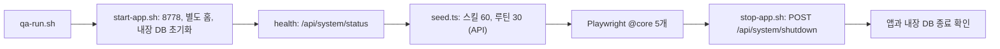

# T-004 변경 설명서 — QA 기반 구축(e2e와 핵심 TC 묶음)

> 담당: qa (qa) · 2026-11-24 · 지시서: [T-004](../T-004-qa-구축.md)

## 요약
- `e2e/`(Playwright 골격, seed 생성기, 기동·종료 스크립트)를 만들고 07 §8의 TC-006~TC-010을 `@core`로 자동화했다. 5개 전부 통과(22.6초), 기준 기록을 남겼다.
- 04 §8 로컬 실행(가정)을 실제로 띄워 확인했다. 그대로는 안 되는 항목이 있어 아래 `## 제안`에 고칠 값을 적었다.
- 앱은 작업 트리가 아니라 **HEAD(d216efc) 스냅샷**(`git archive`를 임시 디렉터리에 풀어 `bootJar`)으로 빌드했다. T-001의 미완성 변경이 섞이지 않았다.

## 그림
### 그림 1. 핵심 묶음 실행 흐름

`start-app.sh`가 `e2e/test-results/qa-home/`을 작업 디렉터리로 쓰고 `pgdata-embedded/`만 지운다(`pg-bin/`은 재사용). 종료는 API가 앱과 내장 DB를 함께 내린다.

## 파일 지도
| 파일 | 추가/수정 | 역할 (한 줄) |
|---|---|---|
| `e2e/`(골격: package.json, playwright.config.ts, support/, seed/rng.ts·boundary.ts) | 추가 | qa-e2e 템플릿 그대로 |
| `e2e/core/*.spec.ts` (5개) | 추가 | TC-006~TC-010 `@core` |
| `e2e/support/console.ts` | 추가 | 콘솔 오류·pageerror 수집(favicon 제외) |
| `e2e/seed/seed.ts` | 수정 | 스킬 60·루틴 30 생성·주입(결정적) |
| `e2e/scripts/start-app.sh`, `stop-app.sh` | 추가 | 04 §8 띄우기·내리기 |
| `docs/tasks/results/T-004-qa/`, `qa-baseline.md` | 추가 | 증거, 기준 기록 |

## 주요 결정
| 결정 | 이유 | 검토한 대안 |
|---|---|---|
| seed: 스킬 60(수십=30의 2배), 루틴 30(앱 상한 50, 여유 20), 경계값 4행(약 4%), 루틴은 비활성 | 루틴이 실행되면 Claude를 호출한다 | 루틴 60 — 상한 초과 |
| 주입은 앱 API(`/api/skills`, `/api/routines`) | 앱 경로까지 검증 | DB SQL |
| `GITLAB_PROJECTS=qa-group/qa-sample` 가짜 프로젝트 1개를 env로 | UI의 프로젝트 추가는 실제 GitLab 조회가 필요해 오프라인 불가. 루틴 저장은 프로젝트가 필수 | DB에 직접 쓰기(캐시 문제) |
| TC-010은 "프로젝트 없음" 대신 세션·스레드 빈 상태로 확인 | 위 이유로 TC-008과 한 인스턴스에서 양립 불가 | 실행 순서 의존(독립성 위반) |
| TC-009는 `da-notices.seen=1`을 init script로 심음 | 처음 쓰는 브라우저는 지난 알림을 새 알림으로 세지 않는다(ui.js noticePoll) | UI.toast 직접 호출 |
| `CLAUDE_WARM=false`, `CLAUDE_WARM_PREWARM=false` | 기본값은 기동 때 `claude.exe` warm 프로세스를 띄운다(첫 실행에서 실측) | 없음 |
| `-Duser.home=<qa-home>/home` | 앱이 `~/bin`에 preview·jscheck·jspcheck 심을 덮어씀(첫 3회 실행에서 실제로 덮어씀) | — |
| 루틴 시각 23:59 | 지난 시각이면 다음 틱에 실행될 수 있다 | — |

정리한 테스트: `e2e/tasks/`는 비어 있어 지운 파일 없음.

## 지시서 밖 추가
없음.

## 제안
04 §8에서 고칠 항목(PM):
1. **띄우기 명령**: `bash e2e/scripts/start-app.sh`로 바꾼다(`QA_JAR` 미지정 시 `build/libs/dev-agent.jar`). 스크립트가 `ADMIN_PORT=8778 PREVIEW_ENABLED=false MAINTAIN_ENABLED=false`에 더해 **`CLAUDE_WARM=false CLAUDE_WARM_PREWARM=false`**(없으면 기동 때 Claude CLI warm 프로세스가 뜬다), **`GITLAB_PROJECTS=qa-group/qa-sample`**, **`-Duser.home=<작업디렉터리>/home`**(없으면 사용자 `~/bin` 심을 덮어씀)을 준다. `bootJar`는 JDK 17 toolchain(첫 실행은 gradle 8.10.2 다운로드 필요).
2. **작업 디렉터리 위치**: `.env`(앱이 틀 생성)·`pgdata-embedded/`·`pg-bin/`·`logs/`·`work/`가 모두 **현재 디렉터리**(`Bootstrap`이 `Path.of("")`)에 생긴다. 기본값 `e2e/test-results/qa-home/`(git 제외).
3. **DB 초기화**: 기동 전 `<작업디렉터리>/pgdata-embedded` 삭제(확인됨, initdb 포함 기동 약 30초). `pg-bin`은 남겨 재사용.
4. **내장 DB 포트**: 54329 고정(`DB_EMBEDDED_PORT`로 바꿀 수 있음, `Bootstrap.java`). 사용자 인스턴스가 내장 DB를 쓰면 **겹친다**. 이번 실행 때는 사용자 인스턴스가 떠 있지 않아(8777·54329 비어 있음) 충돌은 실측하지 못했다. `DB_EMBEDDED_PORT`(예: 54330) 지정을 권장하나 아직 검증하지 않았다.
5. **내리기**: `POST /api/system/shutdown`(Origin 없는 curl 가능)이 앱과 내장 DB를 함께 내림 — 확인됨(실행 뒤 8778·54329 닫힘, postgres 프로세스 0).
6. **07 보완**: TC-010 사전 조건 "대상 저장소 없음"은 오프라인에서 TC-008과 양립하지 않는다(프로젝트 추가에 GitLab 필요). "세션·스레드 없음"으로 바꾸길 제안. TC-009에 "읽지 않은 상태의 브라우저" 조건 추가. 루틴은 상한 50이라 07 §3 "수십"의 2배(60)를 넣을 수 없다.
7. **주의(이미 발생)**: 스크립트를 고치기 전 첫 3회 실행이 사용자 `~/bin/{preview,jscheck,jspcheck}`를 QA 홈 경로·포트 8778으로 덮어썼다. 사용자 인스턴스가 다음에 기동하면(`@PostConstruct`) 다시 쓰이지만, 그 전에 에이전트 프리뷰를 쓰면 잘못된 경로를 가리킨다. 사용자 인스턴스를 재시작하면 복구된다.
8. 앱 관찰: 종료 시 SSE `AsyncRequestTimeoutException` WARN 2줄(무해). 앱 로그 ERROR 0건.
묶음 제안: 없음(07 §8의 5개와 `@core` 5개 일치).

## 검증
- 로그: `e2e/test-results/qa-run-4.log` (git 제외). 증거: `docs/tasks/results/T-004-qa/` (report.json: expected 5, skipped 0, unexpected 0)
```
== up
== health (http://127.0.0.1:8778/api/system/status, timeout 180s)
== seed
seed: 90 rows, boundary 4
== test (@core)

Running 5 tests using 1 worker

  ✓  1 [chromium] › core\empty-states.spec.ts:5:1 › TC-010 세션·스레드가 없을 때 에이전트·리서치 탭이 빈 상태 안내를 보인다 @core (2.1s)
  ✓  2 [chromium] › core\notifications.spec.ts:5:1 › TC-009 알림함을 열면 시작 알림이 보이고 읽음 뒤 배지가 사라진다 @core (4.0s)
  ✓  3 [chromium] › core\routine-crud.spec.ts:5:1 › TC-008 리서치에서 루틴을 등록하고 삭제한다(예약 전이라 실행되지 않음) @core (2.3s)
  ✓  4 [chromium] › core\shell-tabs.spec.ts:17:1 › TC-006 홈에서 다섯 탭을 차례로 이동한다 @core (4.5s)
  ✓  5 [chromium] › core\skill-crud.spec.ts:5:1 › TC-007 플랫폼에서 스킬을 등록하고 삭제한다 @core (6.2s)

  5 passed (22.6s)
== down
QA PASS
```
- 정리 확인: 준비 URL 응답 없음, 8778·54329 리슨 0, postgres 프로세스 0.
- 최종 화면 확인: TC-009 알림 패널 스크린샷 1장(시작 알림 표시, 시드 스킬 목록).
