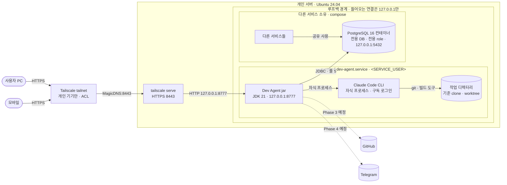

# T-005 변경 설명서 — 전체 구성도 (서버 배치 · 접근 경로)

> 담당: devops (devops) · 2026-11-24 · 지시서: [T-005](../T-005-전체-구성도.md)

## 요약
- Phase 1 종료 시점의 서버 한 대 배치와 접근 경로(사용자 기기 → tailnet → `tailscale serve` → 앱 → DB·CLI·작업 디렉터리)를 한 장의 HTML 구성도 `docs/architecture/dev-agent-overview.html`로 만들었다(근거: 02 §2.1·§2.2·§5·§6, D-1~D-3, 04 §9, `deploy/`).
- 공유 PostgreSQL은 "다른 서비스 소유", GitHub·Telegram은 "Phase 3·4 예정"(점선)으로 구분했고, 루프백 경계(들어오는 연결은 127.0.0.1만)를 영역으로 표시했다.
- 02 §2에 넣을 Mermaid 요약 그림과 근거 표를 이 설명서에 담았다. 서버에는 접속하지 않았고 실제 주소·계정·컨테이너 이름은 자리표시자로만 썼다.

## 그림
### 그림 1. 전체 구성도 (HTML)
- 파일: `docs/architecture/dev-agent-overview.html` (원본 후보: `docs/architecture/src/dev-agent-overview.json`)
- 영역 4개(개인 서버 / 루프백 경계 / systemd 서비스 / 다른 서비스 소유)와 상자 11개, 선 10개. 상자마다 근거 파일·줄을 `sources`로 달았다(HTML에서 상자를 누르면 보인다).
- 카드 4장: 접근 경로, 서비스 실행, 공유 PostgreSQL, 예정(점선).

### 그림 2. 02 §2에 넣을 요약 (Mermaid)

- tailnet 쪽에 열린 입구는 `tailscale serve`의 HTTPS 8443 하나다. 앱과 DB는 127.0.0.1에만 바인드되므로 루프백 경계 안의 상자에는 서버 밖에서 직접 닿을 수 없다. 이 경계는 들어오는 연결 기준이고, GitHub·Telegram으로 나가는 연결은 막지 않는다.
- PostgreSQL 컨테이너의 127.0.0.1:5432 공개는 사용자가 그 compose에 직접 추가한 뒤에야 성립한다(OI-18). 그림은 추가된 뒤의 상태다.
- `.env`(권한 600)는 별도 상자로 그리지 않고 카드("서비스 실행")에 적었다. 앱이 `<APP_HOME>/.env`를 직접 읽는다(unit 32행).
- 점선 두 개는 Phase 1 종료 시점에는 없는 연결이다. 토큰 이름만 04 §9에 있다(`GITHUB_TOKEN`, `TELEGRAM_BOT_TOKEN`).

## 근거 표

| 그림 | 요소 | 근거 파일 |
|---|---|---|
| 그림 1·2 | 상자 사용자 PC (브라우저) | `docs/02-architecture.md` §2.1 (23–34행) |
| 그림 1·2 | 상자 모바일 (브라우저) | `docs/02-architecture.md` §2.1 (23–34행) |
| 그림 1·2 | 상자 Tailscale tailnet (개인 기기만 · ACL) | `docs/02-architecture.md` §6 (286–288행), `deploy/README.md` §7 (132–133행) |
| 그림 1·2 | 상자 tailscale serve (tailscaled · HTTPS 8443) | `deploy/README.md` §7 (120–133행), `docs/02-architecture.md` D-1 (162–176행) |
| 그림 1·2 | 상자 Dev Agent jar (JDK 21 · 127.0.0.1:8777) | `deploy/systemd/dev-agent.service` (23–41행), `src/main/resources/application.yml` (31–33행 `server.address`·`server.port`) |
| 그림 1·2 | 상자 Claude Code CLI (자식 프로세스 · 구독 로그인) | `docs/02-architecture.md` D-2 (178–196행), §2.2 (36–54행) |
| 그림 1·2 | 상자 작업 디렉터리 (기준 clone · worktree, `GITLAB_WORK_DIR`) | `docs/02-architecture.md` §2.2 (36–54행), `deploy/env.server.example` (19행) |
| 그림 1·2 | 상자 PostgreSQL 16 컨테이너 (전용 DB · 전용 role · 127.0.0.1:5432, 태그 "다른 서비스 소유") | `docs/02-architecture.md` D-3 (198–213행), `docs/04-project-structure.md` §9 (150행), `deploy/README.md` §2·§3 (37–71행) |
| 그림 1·2 | 상자 다른 서비스들 (같은 인스턴스 공유) | `docs/02-architecture.md` §2.2 (36–54행), D-3 (201행) |
| 그림 1·2 | 상자 GitHub (REST · git push, Phase 3 예정) | `docs/02-architecture.md` §2.1 (23–34행), `docs/04-project-structure.md` §9 (153행) |
| 그림 1·2 | 상자 Telegram (long polling · 전송, Phase 4 예정) | `docs/02-architecture.md` §2.1 (23–34행), `docs/04-project-structure.md` §9 (153행) |
| 그림 1·2 | 영역 개인 서버 · Ubuntu 24.04 | `docs/02-architecture.md` §2.2 (36–54행), `docs/04-project-structure.md` §9 (141행) |
| 그림 1·2 | 영역 루프백 경계 · 들어오는 연결은 127.0.0.1만 | `deploy/README.md` (7행), `docs/02-architecture.md` §6 (288행), `src/main/resources/application.yml` (32행) |
| 그림 1·2 | 영역 systemd dev-agent.service · <SERVICE_USER> | `deploy/systemd/dev-agent.service` (25–30행), `docs/04-project-structure.md` §9 (143행) |
| 그림 1·2 | 영역 다른 서비스 소유 · compose | `docs/02-architecture.md` D-3 (201–202행), `deploy/README.md` §2 (37–47행) |
| 그림 1·2 | 선 사용자 PC·모바일 → tailnet (HTTPS) | `docs/02-architecture.md` §2.1 (27행) |
| 그림 1·2 | 선 tailnet → tailscale serve (MagicDNS:8443) | `deploy/README.md` §7 (130행), `docs/02-architecture.md` D-1 (173–174행) |
| 그림 1·2 | 선 tailscale serve → Dev Agent jar (HTTP 127.0.0.1:8777) | `deploy/README.md` §7 (123–124행), `docs/04-project-structure.md` §9 (149행) |
| 그림 1·2 | 선 Dev Agent jar → PostgreSQL (JDBC · 풀 5) | `docs/04-project-structure.md` §9 (150행), `docs/02-architecture.md` D-3 (210행) |
| 그림 1·2 | 선 다른 서비스들 → PostgreSQL (공유 사용) | `docs/02-architecture.md` §2.2 (48행) |
| 그림 1·2 | 선 Dev Agent jar → Claude Code CLI (자식 프로세스) | `docs/02-architecture.md` §2.1 (32행), §2.2 (50행) |
| 그림 1·2 | 선 Claude Code CLI → 작업 디렉터리 (git · 빌드 도구) | `docs/02-architecture.md` §2.2 (51행), D-2 (179행) |
| 그림 1·2 | 선 Dev Agent jar → GitHub (나가는 연결, 점선) | `docs/02-architecture.md` §2.1 (31행), `docs/04-project-structure.md` §9 (153행) |
| 그림 1·2 | 선 Dev Agent jar → Telegram (나가는 연결, 점선) | `docs/02-architecture.md` §2.1 (30행), `docs/04-project-structure.md` §9 (153행) |
| 그림 1 | 카드 서비스 실행 (Restart=on-failure, After=docker.service, .env 권한 600) | `deploy/systemd/dev-agent.service` (17–38행), `docs/02-architecture.md` §5 (275행) |
| 그림 1 | 카드 공유 PostgreSQL (OI-18, 연결 10 제한) | `deploy/README.md` §2·§3 (37–71행) |
| 그림 1 | 카드 접근 경로 (ACCESS_ALLOWED_ORIGINS, funnel 미사용) | `docs/02-architecture.md` D-1 (174행), `deploy/README.md` §7 (130–132행) |

## 02 반영 안내

| 02 절 | 넣을 것 |
|---|---|
| §2.2 컨테이너 구성 끝(56행 "완료되면 여기에 링크한다") | HTML 링크 `docs/architecture/dev-agent-overview.html` |
| §2 전체 구조 | 이 설명서의 "그림 2" Mermaid(§2.2 그림을 대체하거나 그 아래에 추가 — PM 판단) |
| §5 배포 구성 | 변경 없음. 같은 HTML 링크만 덧붙여도 된다 |

## 파일 지도
| 파일 | 추가/수정 | 역할 (한 줄) |
|---|---|---|
| `docs/architecture/dev-agent-overview.html` | 추가 | 전체 구성도(브라우저로 여는 독립 HTML) |
| `docs/architecture/src/dev-agent-overview.json` | 추가 | archify 후보(그림의 원본, 상자별 근거 `sources` 포함) |
| `docs/architecture/.gitignore` | 추가 | archify 영수증(`*.finalize.json` 등, 로컬 절대 경로 포함)과 `.review/` 제외 |
| `docs/tasks/results/T-005-전체-구성도.md` | 추가 | 이 변경 설명서 |
| `docs/tasks/T-005-전체-구성도.md` | 수정 | `검증 증거`·`상태`만 |

## 주요 결정
| 결정 | 이유 | 검토한 대안 |
|---|---|---|
| tailnet은 영역이 아니라 상자 하나로 그림 | tailnet은 사용자 기기와 서버를 모두 포함해 영역으로 그리면 서버 영역과 겹친다. 경로상 한 단계로 보이면 충분하다 | tailnet 영역 안에 기기·서버를 넣기(겹침으로 읽기 어려움) |
| 루프백 경계를 "들어오는 연결 기준" 영역으로 표시하고 systemd 서비스와 공유 DB를 그 안에 둠 | `deploy/README.md` 7행: 앱 127.0.0.1:8777, DB 127.0.0.1:5432, tailnet에는 serve 8443만 연다 | 선 라벨에만 127.0.0.1을 적기(경계가 안 보임) |
| `.env`는 상자 대신 카드로 | 범위 목록에 없고, 앱 내부 설정 파일이라 연결선이 없다. 근거(unit 32행, 02 §5)는 카드에 담음 | 상자로 추가 |
| 사용자 → Telegram 1:1 대화 선은 그리지 않고 카드에 적음 | Phase 4 예정이며 왼쪽 끝에서 오른쪽 위로 그림 전체를 가로지른다 | 점선으로 추가 |
| `meta.repository`에 원격 저장소 주소를 `local-only`로 둠 | archify 근거 확인이 커밋 6d73f47 기준으로 동작하도록. 공개 소스 저장소 주소이며 서버 접속 주소가 아니다 | 저장소 정보 생략(근거 링크 검증 불가) |

## 지시서 밖 추가
- `docs/architecture/.gitignore`: devops-kit §5 규칙(영수증 파일은 커밋 대상 아님)에 따라 새로 만들었다.
- `docs/architecture/src/dev-agent-overview.json`: 그림의 원본. devops-kit §5의 정해진 위치다.

## 제안
- 확인 필요: Phase 1 시점에 실제로 쓰는 GitLab 연동(`deploy/README.md` §4 "GitLab 항목", `GITLAB_*` 키)과 Claude CLI가 나가는 연결(구독 로그인 대상)은 범위 목록에 없어 그리지 않았다. 구성도에 넣을지 PM이 정해 주면 같은 파일을 덮어써 반영한다.
- 확인 필요: 앱 로그(`logs/dev-agent.log`)·systemd journal(02 §6)은 그리지 않았다. 관측 경로를 그림에 넣을지 결정이 필요하다.
- HTML 그림의 눈 확인(스크린샷)은 하지 않았다(devops-kit §5 — PM 검수 단계에서 메인 세션이 한다).

## 검증
- archify finalize: 종료 코드 0, `"status":"pass"`
  ```
  "gates":{"validate":"pass","deliver":"pass","check":"pass","browser-check":"pass"},"diagnostics":[]
  ```
- 근거 대조 검사(`node ~/.claude/skills/devops-kit/scripts/evidence-check.mjs docs/architecture/src/dev-agent-overview.json docs/tasks/results/T-005-전체-구성도.md --root .`):
  ```
  EVIDENCE PASS
  ```
- 비밀·주소 검사(grep, 2026-11-24): JSON·설명서·HTML에서 IP 형태는 루프백 `127.0.0.1`뿐, `http(s)://`는 JSON `meta.repository`의 공개 소스 저장소 주소 1건뿐(서버 주소 아님), 토큰 접두어(`ghp_`·`github_pat_`·`sk-ant`·`xox`) 0건, HTML의 로컬 절대 경로 0건, MagicDNS 이름(`ts.net`) 0건.
- 서버·클러스터에 접속하지 않았다. 앱을 띄우지 않았다.
