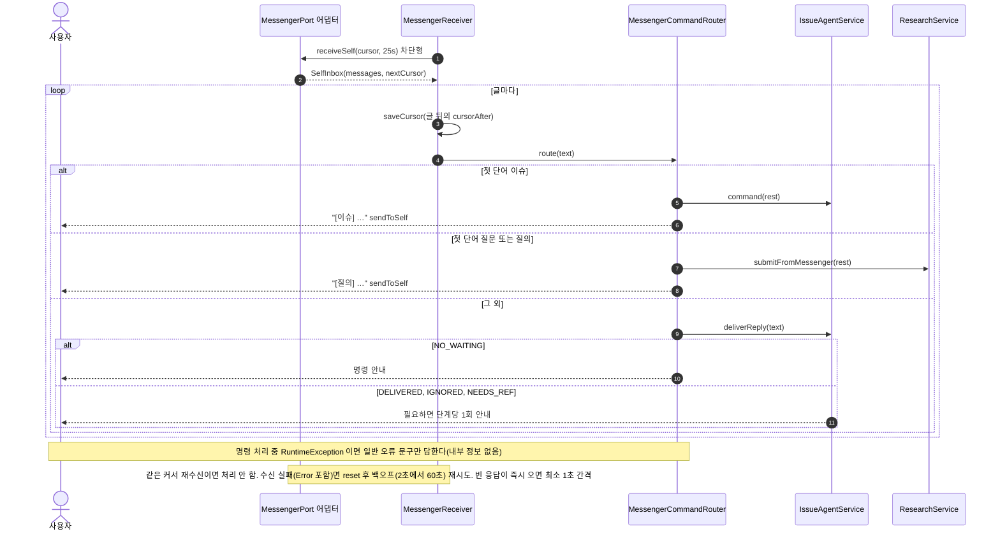
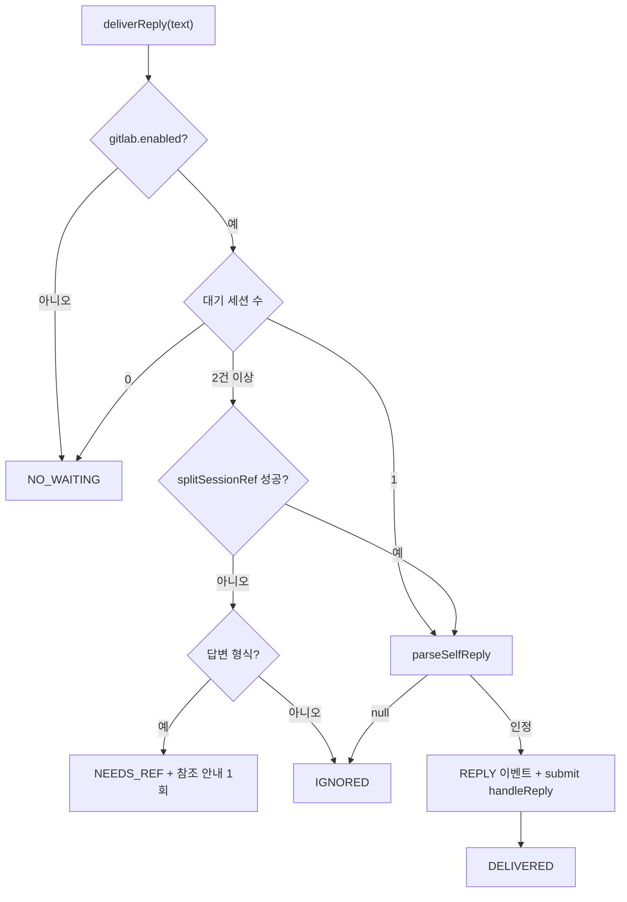
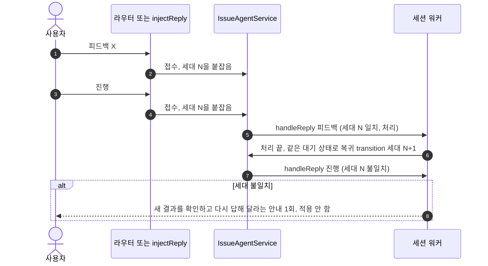

# T-006 변경 설명서 — 메신저 수신 경로 신설 (어댑터 → 명령 라우터)

> 담당: backend-dev (backend-dev) · 2026-11-24 · 지시서: [T-006](../T-006-메신저-수신-경로.md)

## 요약
자기 대화의 글을 수집(`chat_message`) 없이 어댑터에서 바로 받아 명령 라우터가 첫 단어로 분기한다(FR-203). 확인 대기 답변은 도착하는 순간 대기 세션에 전달하고 `wait_after_seq`를 없앴다(FR-204).
수신 커서는 코어가 `bot_setting.messenger_cursor`에 저장하고, 알림 유형 끄기는 그대로 유지한다(FR-205).
옛 경로(`MentionService`)의 이슈·질문 명령과 대기 양보 분기는 끊어 중복 실행이 없다.

## 그림
### 그림 1. 수신 → 라우터 → 처리 (정상 + 대표 실패)

커서는 글마다 그 글을 처리하기 직전에 저장하므로(글 단위 최대 한 번) 처리 중 재시작해도 같은 명령이 두 번 돌지 않고, 묶음 중간에 죽어도 아직 처리하지 않은 글은 유실되지 않는다. 사용자가 보낸 명령의 답은 `sendToSelf`라 알림 끄기와 무관하게 항상 가고, 플랫폼이 스스로 보내는 알림(`IssueNotifier.sendSelf`)은 기존대로 `notifyOn(issue)`를 따르며 알림함에는 항상 남는다. 수신 루프는 `none` 어댑터면 스레드를 띄우지 않는다.

### 그림 2. 확인 답변 전달 (`IssueAgentService.deliverReply`)

IGNORED는 문장처럼 보일 때만 대기 단계당 한 번 안내한다(기존 `guidedStates` 규칙 그대로). 답변 해석은 `IssueTexts.parseSelfReply`·`splitSessionRef`를 그대로 쓴다. 워커가 앞선 답변을 처리하는 중인 세션도 대상에 넣었다(제외하면 NO_WAITING으로 오인해 명령 안내가 나간다). 중복 답변은 기존 `expectedState` 검사가 버린다.

## 확정한 포트 메서드 시그니처
```java
// messenger/MessengerPort.java
SelfInbox receiveSelf(String cursor, java.time.Duration timeout);

// messenger/SelfInbox.java
public record SelfInbox(List<SelfMessage> messages, String nextCursor) {
    public static SelfInbox empty(String cursor) { ... }
}

// messenger/SelfMessage.java
public record SelfMessage(IncomingMessage message, String cursorAfter) { }
```
- 커서 키: `bot_setting`의 `messenger_cursor.<provider>`(`MessengerService.cursorKey()`, 접두 상수 `CURSOR_KEY`). `MessengerService`에 `receiveSelf`, `loadCursor`, `saveCursor`, `setReceiverState`가 있다. `none` 구현체는 `SelfInbox.empty(cursor)`.
- 새 글이 없으면 최대 `timeout` 동안 기다렸다 빈 결과(차단형 허용, Telegram `getUpdates` offset·timeout 대응). `cursor`는 직전 `nextCursor`(처음이면 null — 처음 시작 정책은 어댑터가 정함). 코어는 커서를 해석하지 않고 저장·전달만 한다.
- `SelfMessage.cursorAfter`는 **null이면 안 된다**(어댑터 규약). 코어가 글을 처리하기 직전에 이 값을 저장해 글 단위 최대 한 번을 만든다. null이면 그 글의 커서를 저장하지 못해 묶음 중간 유실 방지가 깨진다. `nextCursor`는 묶음 끝 커서이고 글이 없어도 앞으로 갈 수 있다.
- 봇이 보낸 글·허용하지 않은 대화의 글은 어댑터가 거른다. 실패는 RuntimeException이며 메시지에 자격증명·URL을 넣지 않는다.

## 파일 지도
| 파일 | 추가/수정 | 역할 (한 줄) |
|---|---|---|
| `messenger/SelfInbox.java` | 추가 | 수신 결과 record |
| `messenger/SelfMessage.java` | 추가 | 글 하나와 그 글 뒤의 커서(`cursorAfter`, null 불가) record |
| `messenger/MessengerPort.java` | 수정 | `receiveSelf` 규약 추가 |
| `messenger/MessengerService.java` | 수정 | 수신·커서 저장 메서드 |
| `messenger/none/NoMessengerAdapter.java` | 수정 | 빈 결과 구현 |
| `messenger/MessengerCommandRouter.java` | 추가 | 첫 단어 분기, 안내, 오류 처리(ChatModel·mcp 비참조) |
| `messenger/MessengerReceiver.java` | 추가 | 전용 스레드 수신 루프, 커서 저장, 재시도 백오프 |
| `gitlab/IssueAgentService.java` | 수정 | `pollReplies`·`isWaiting`·`stripCommand`·`ChatMessageMapper`·`BotProperties` 제거, `deliverReply`·`remindWaiting` 추가, 안내 문구의 `@AI` 제거 |
| `gitlab/IssueAgentScheduler.java` | 수정 | 답변 폴링 대신 리마인더만 호출 |
| `gitlab/IssueSession.java`, `IssueSessionMapper.java`, `db/schema.sql` | 수정 | `wait_after_seq`·`setWaitAfter` 제거 |
| `mention/MentionService.java` | 수정 | 이슈·질문 명령과 대기 양보 분기 제거(옛 경로 끊기), 의존 2개 제거 |
| 테스트 5개 | 추가/수정 | `MessengerCommandRouterTest`, `MessengerReceiverTest`, `ReplyDeliveryTest`, `FakeMessengerPort`, `MessengerServiceTest`(가짜 포트에 메서드 추가) |

## 주요 결정
| 결정 | 이유 | 검토한 대안 |
|---|---|---|
| 커서를 글마다 처리 직전에 저장(글 단위 최대 한 번) | FR-203 중복 처리 금지. 코드 수정 명령 중복 실행이 더 위험. 묶음 단위 저장은 중간에 죽으면 남은 글이 전부 유실됨(M-1) | 처리 후 저장(재시작 시 중복 가능), 묶음 끝에 저장 |
| 라우터와 수신 루프를 별도 클래스, 둘 다 생성자 1개 | 라우터를 단위 테스트하기 쉽고 CLAUDE.md 생성자 함정 회피 | 한 클래스 |
| 답변 후보 판정·안내는 `IssueAgentService.deliverReply`에 두고 라우터는 결과만 본다 | `IssueTexts` 함수가 gitlab 패키지 전용이라 공개 표면을 최소화 | `IssueTexts`를 public으로 |
| 알 수 없는 글 안내는 글마다 1회, 대기 중이면 기존 대기 단계당 1회 | 06 §4.2 | 전역 1회 제한(미요청) |
| 기존 DB의 `wait_after_seq` 컬럼은 지우지 않음 | 검증 명령이 mapper에 해당 문자열 없음을 요구하고 컬럼은 nullable이라 무해. 스키마 정리는 dba 담당 | `ensureColumns`에 DROP |
| 확인 대기 세대는 메모리 카운터(`waitGenerations`, `transition()`이 대기 진입 때 상태 저장 전에 증가) | DB 컬럼 없이 가장 단순. 재기동하면 처리 중이던 답변도 사라지고 이후 접수는 그때 값을 붙잡으므로 안전. 스키마 변경 금지 범위 준수 | `issue_session`에 컬럼(스키마 변경), `updated_at` 비교(다른 갱신에도 변해 부정확) |
| 수신기는 `SmartLifecycle`(기본 phase) | 컨텍스트가 다 뜬 뒤 시작, 종료 때 이슈 워커(`@PreDestroy`)보다 먼저 정지하고 join(상한 10초) | `@PostConstruct` 스레드(덜 뜬 상태에서 커서를 먹음) |
| 커서 키는 `messenger_cursor.<provider>` | 어댑터를 바꿔도 다른 어댑터의 커서를 해석하지 않음. 03 §2는 키 이름을 `messenger_cursor`로만 적음 — PM이 문서에 반영 필요 | 단일 키 |
| `none` 이면 수신 스레드 미기동 | 즉시 빈 결과를 돌려주는 어댑터로 바쁜 루프가 도는 것 방지 | 어댑터가 sleep |
| 수신 대기 25초 상수 | 새 설정 금지. Telegram 대응 값 | 설정 키 |

## 지시서 밖 추가
없음. (`IssueAgentService`의 사용자 안내 문구에서 `@AI 이슈`를 `이슈`로 바꾼 것은 "`@AI` 키워드 처리를 없앤다" 범위 안.)

## 제안
- `ResearchService.submitFromMessenger`의 사용법 문구와 `IssueNotifier`·`IssueAgentService`의 일부 안내(예: "다시 시작: …")에 `@AI` 표기가 남아 있을 수 있다. T-007에서 `bot.mention.command-keyword`와 함께 정리 권장.
- 기존 설치 DB의 `issue_session.wait_after_seq` 컬럼은 남는다(무해). 정리가 필요하면 dba 마이그레이션.
- `IssueNotifier.warnIfSelfRoomNotCollected`와 `MessengerService.NOTICE_SUMMARY/MENTION`은 T-007/T-008 몫으로 그대로 둠.
- 라우터가 동기 실행이라 `이슈 스캔`처럼 오래 걸리는 명령 동안 다음 수신이 지연된다(이전에도 폴링 스레드를 막았음). 문제가 되면 별도 제안.

## 검증
- RED 실행 기록: 구현 전(포트·서비스 시그니처만 있는 빈 스텁)에 `./gradlew test --tests "*MessengerCommandRouterTest" --tests "*MessengerReceiverTest" --tests "*ReplyDeliveryTest"` → 24건 중 18건 실패. 예) `tc011_issueCommandGoesToIssueAgentAndAnswersToSelf`: "Wanted but not invoked: issueAgentService.command(스캔)", `tc011_unknownTextWithoutWaitingSessionGetsGuideOnce`: expected 1 but was 0, `tc011_newMessagesAreRoutedInOrderAndCursorIsSaved`: expected 2 but was 0, `tc011_emptyInboxWithAdvancedCursorStoresCursor`: expected 9 but was null, `tc012_oneWaitingSession_approveAndFeedbackAreDelivered_chatterIsIgnored`: expected DELIVERED but was NO_WAITING, `tc012_twoWaitingSessions_replyWithoutRefGetsGuideAndIsNotDelivered`: expected NEEDS_REF but was NO_WAITING. (스텁이 우연히 만족한 6건은 통과: disabled·noWaiting 등.)
- GREEN 중 1건 실패 → 원인: 답변 처리 중인 세션을 대기 목록에서 제외해 연속 답변이 NO_WAITING이 됨(실제로는 오안내 유발) → 구현 수정(제외 제거), 테스트는 그대로.
- 검증 명령: `./gradlew test bootJar` → 통과(125건, 실패 0, 건너뜀 1). 두 grep(`ChatMessageMapper|waitAfterSeq|wait_after_seq`, `ChatModel|devagent.mcp`)는 rc=1(없음). 격리 인스턴스 `start-app.sh` → `/api/system/status` 200 → `stop-app.sh` 후 응답 없음. 기동 로그에 "메신저 없음 — 수신 루프를 시작하지 않습니다", Caused by 없음.
- 테스트: 신규 24건(TC-011 18건 `tc011_*`, TC-012 6건 `tc012_*`) + 기존 수정. 커버리지 수치는 측정 도구 미실행(분기 단위로 라우터·수신·deliverReply 전 경로 테스트).
- security-scan: Skill 호출, 변경 파일 범위 검사. 비밀값 하드코딩·SQL 연결·명령 실행 없음. 오류 응답은 일반 문구(내부 정보 없음, 테스트 `tc011_commandFailure…`).  입력 경계 검증은 어댑터(허용 대화·발신자 필터)와 T-013 보안 리뷰 몫.

- 로그·민감 정보(사실대로): 수신기·라우터의 경고 로그는 글 내용 없이 분류·길이·예외 클래스 이름만 남긴다(어댑터 예외 메시지에 토큰이 든 URL이 있을 수 있어 `getMessage()`·`toString()`을 쓰지 않는다). 다만 기존 동작인 `IssueAgentService`의 INFO 로그(무시한 글 60자, 수신한 답변 80자)와 세션 이벤트(200자)에는 사용자 글의 앞부분이 남는다 — 이 작업이 만든 것이 아니라 `pollReplies` 때부터 있던 동작이다.

## 재작업 이력
### 2026-11-24 — java-reviewer HIGH 2건 + 보강
| 항목 | 처리 | 내용 |
|---|---|---|
| H-1 수신 루프 영구 정지 | 고침 | 루프 본문이 `Throwable`을 잡는다(`stopping`이면 종료). `reset()` 실패도 삼킨다. 스레드에 uncaught handler(ERROR 로그 + `NotificationService.add("system","err",…)` + 상태 `died: …`). `MessengerService.health()` details에 `receiver`(running/stopped/died)를 노출(메모리 값만 읽음, 외부 호출 없음) |
| H-2 「피드백」 직후 「진행」 | 고침 | 대기 세대(그림 3). `transition()`이 대기 상태 진입마다 `waitGenerations`를 올리고, `deliverReply`(메신저)와 `injectReply`(대시보드 `/api/issues-reply`)가 접수 때 세대를 붙잡아 `handleReply`가 비교. 다르면 폐기하고 "새 결과를 확인하고 다시 답해 주세요" 안내를 한 번 보냄. 대시보드 경로는 기존에 `handleReply`를 타지만 세대 검사가 없어서 같은 규칙을 적용 |
| M-1 묶음 단위 커서 | 고침 | `SelfMessage(message, cursorAfter)`. 글마다 처리 직전 저장, 묶음 끝 커서는 모두 처리한 뒤 저장. 정지 요청 시 남은 글과 끝 커서는 저장하지 않음 |
| M-2 시작·종료 수명 | 고침 | `SmartLifecycle`(기본 phase: 가장 늦게 시작·가장 먼저 정지). `stop()`이 interrupt 후 join(상한 10초). 글 반복 안에서 `stopping` 확인. 격리 인스턴스 종료 로그에 예외 없음 |
| M-3 즉시 빈 응답 | 고침 | 받은 글이 없고 호출이 1초 미만이면 남은 만큼 쉼 |
| M-4 토큰 노출 | 고침 | 경고 로그는 `describe(t)`(클래스 이름만). `MessengerPort` 주석에 "예외 메시지에 자격증명·URL을 넣지 않는다" 명시 |
| L-1 커서 키 | 고침 | `messenger_cursor.<provider>`. 03 §2는 `messenger_cursor`로만 적혀 있어 PM이 문서 정정 필요 |
| L-4 안내문 | 고침 | GUIDE에 `이슈 중단 [repo#n]` 추가 |
| L-2 설명서 사실 정정 | 고침 | 위 "로그·민감 정보(사실대로)". 라우터 로그는 첫 단어 대신 분류(명령 단어 또는 기타)·길이만 |
| M-5 `이슈 스캔` 비동기화 | 안 함 | `IssueAgentService.command("스캔")`의 반환 문구("N건 큐 추가")를 대시보드 「가져오기」(`/api/issues-command?cmd=스캔`)도 쓰므로, 비동기로 바꾸면 그 화면 동작이 달라진다. 작지 않아 T-010(GitHub 교체) 때 함께 다루기를 제안 |
| M-6 | 안 함(지시) | T-007이 T-013보다 먼저라 순서로 해소 |
| L-3, L-5, L-6 | 안 함(지시) | PM 판단 |

### 그림 3. 대기 세대로 「피드백」 직후 「진행」 막기

상태 이름만 비교하면 두 번째 답이 "같은 대기 상태"로 보여 통과한다. 세대는 대기에 들어갈 때마다 오르므로 그 사이에 새 결과가 나왔는지를 구분한다. 증가는 상태 저장 전에 일어나, 새 대기 상태를 본 쪽은 항상 새 세대를 본다.

### 재작업 RED 기록
구현 전(수신기는 빈 스텁, 세대 검사 없음)에 같은 4개 테스트 클래스를 돌렸다: 42건 중 13건 실패.
- `ReplyDeliveryTest.tc012_feedbackThenApprove_backInSameWaitState_approvalIsDiscardedWithNotice`, `tc012_dashboardReplyGoesThroughTheSameGenerationCheck`: 안내 `sendSelf(contains("새 결과를 확인하고 다시 답해"))`가 호출되지 않음(Argument(s) are different).
- `MessengerReceiverTest.tc011_cursorIsSavedPerMessage_deathBeforeSecondMessageKeepsItForNextReceive`: expected 1 but was 2(묶음 끝 커서가 먼저 저장됨).
- `tc011_loopRetriesAfterReceiveFailureWithBackoffAndReset`, `tc011_loopSurvivesErrorAndFailingReset`, `tc011_stopEndsTheThreadAndHealthShowsReceiverState`, `tc011_adapterThatReturnsImmediately…MinimumGap`, `tc011_healthDetailsExposeReceiverLiveness`(expected running but was null), `tc011_uncaughtHandlerLogsAndRecordsSystemNotification`, `tc011_stopMidBatch…`, `tc011_aFailingMessageDoesNotStopTheNext`, `tc011_backoffLogDoesNotLeakExceptionMessage`: 스텁이라 모두 실패.
- `MessengerCommandRouterTest.tc011_unknownTextWithoutWaitingSessionGetsGuideOnce`: 안내문에 `이슈 중단`이 없음(expected true but was false).
- 이미 통과한 것: `tc012_approveTwice_secondIsDiscarded`(상태 검사로 이미 막힘 — 회귀 방지용).
- GREEN: 같은 클래스 전부 통과. 전체 `./gradlew test bootJar` 139건 통과(실패 0, 건너뜀 1). 두 grep rc=1. 격리 인스턴스(8778) status 200, 종료 로그에 예외 없음("메신저 없음 — 수신 루프를 시작하지 않습니다").
- 검증하지 못한 것: 실제 어댑터로 도는 `SmartLifecycle` 종료 순서(수신기 join → 이슈 워커 종료)는 `none`이라 루프가 안 돌아 실환경 관찰 불가. 루프·정지·join은 가짜 포트와 가짜 sleep 단위 테스트로만 확인했다.

### 2026-11-24 (2차, PM 반려 재작업) — 세대 읽는 순서
- (a) `deliverReply`/`injectReply`가 세대를 상태 조회(`findWaiting`/`find`)보다 먼저 읽는다. 조회 전에 `Map.copyOf(waitGenerations)` 스냅샷을 만들고 대상 세션의 값을 `dispatchReply`/`handleReply`에 넘긴다. 이전에는 상태를 먼저 읽고 세대를 나중에 읽어, 그 사이 "대기 → 작업 → 같은 대기"가 끝나면 옛 상태 이름과 새 세대 조합이 검사를 통과했다.
- (b) RED: `ReplyDeliveryTest.tc012_waitStateReEnteredWhileReadingState_staleApprovalIsDiscardedOnce`(조회 도중 `transition`으로 같은 대기 상태에 재진입) — 수정 전 10건 중 1건 실패, `sendSelf(contains("새 결과를 확인하고 다시 답해"))` 미호출(Argument(s) are different). GREEN: 수정 후 통과, 안내 1회.
- (c) 이 설명서의 파일 지도에 `SelfMessage.java` 추가, 시그니처 블록을 실제 코드로 교체, `cursorAfter` non-null 규약을 `MessengerPort`·`SelfMessage` 주석과 이 설명서에 명시.
