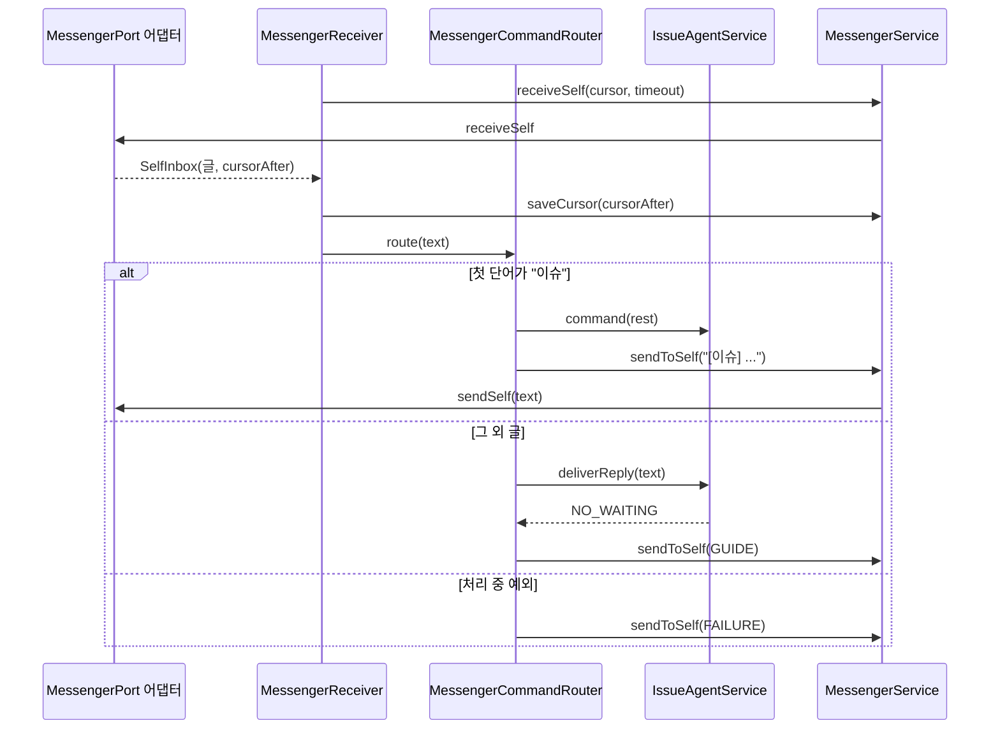
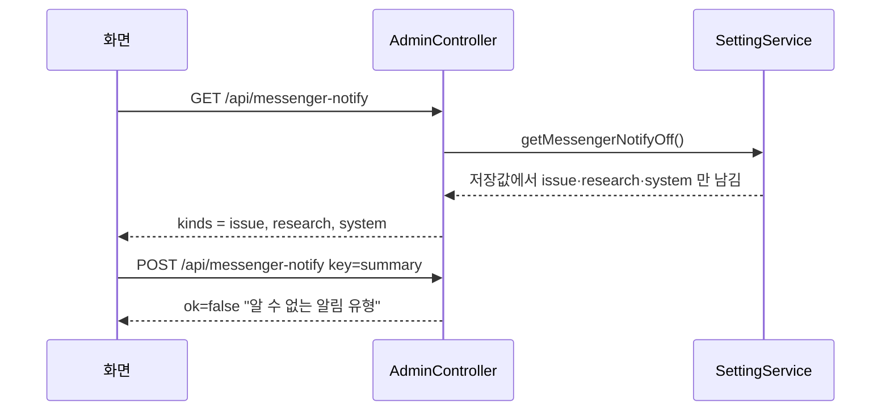

# T-007 변경 설명서 — 사내 전용 기능 제거 ① (수집·요약·멘션·문서 RAG, 메신저 포트 축소, 2.0.0)

> 담당: backend-dev (backend-dev) · 2026-11-25 · 지시서: [T-007](../T-007-사내-기능-제거.md)

## 요약
- 다른 사람의 메시지를 읽고 저장하던 수집·요약·멘션 코드와 사내 문서 RAG, 방 목록 조회·방 지정 전송을 삭제했다(FR-201·202·205, NFR-401, 02 D-4·D-7).
- `MessengerPort` 는 "자기 대화의 새 글 받기(`receiveSelf`)"와 "자기 대화로 보내기(`sendSelf(text)`)"만 남았고, 알림 유형은 `issue`·`research`·`system` 3개, 연동 카드에서는 지식(RAG) 행이 빠졌다.
- 버전 2.0.0, `db/schema.sql` 에서 테이블 5개 삭제. 운영 MCP·채팅 모델 포트는 T-018 로 남겼다.

## 그림
### 그림 1. 자기 대화 수신·명령 처리·알림 전송 (정상 + 대표 실패)

수신 루프와 라우터는 글을 저장하지 않고 어댑터가 준 글을 바로 처리한다(저장 테이블 없음). 전송 메서드에는 방을 고르는 인자가 없어 그룹·타인에게 보내는 경로 자체가 없다. 커서는 글을 처리하기 직전에 저장한다(기존 동작 그대로).

### 그림 2. 알림 유형 3개와 기존 설치 값 처리

기존 설치의 `messenger_notify_off` 에 `summary`·`mention` 이 들어 있어도 읽을 때 걸러지고, 다음에 저장하면 사라진다.

## 파일 지도
| 파일 | 추가/수정 | 역할 |
|---|---|---|
| `collect/`·`summarize/`·`mention/`·`docs/` 패키지 전체 | 삭제 | 수집·요약·멘션·문서 RAG(`KnowledgeSource` 포함) 일체 |
| `ops/RoomListRunner`, `config/DocsProperties`, `admin/AdminMapper`, `messenger/Room`·`RoomKind`·`SendBlockedException` | 삭제 | 방 목록 실행기, 문서 설정, 삭제 테이블 조회, 방 모델 |
| `list-rooms.cmd` | 삭제 | `RoomListRunner` 를 부르던 스크립트(아래 "지시서 밖 추가") |
| `messenger/MessengerPort`·`MessengerService`·`none/NoMessengerAdapter` | 수정 | 포트 축소, 방 전송·정책·`NOTICE_SUMMARY/MENTION` 제거 |
| `command/MessengerCommandRouter`·`MessengerReceiver` | 이동(`messenger/`→`command/`) | L-6 상호 참조 정리, 동작 변경 없음 |
| `admin/AdminController`·`PlatformController`·`SettingService` | 수정 | API 8개 제거, 지식 행 제거, 알림 유형 필터 |
| `config/BotProperties`, `application.yml` | 수정 | `ops` 만 남김, `docs.*`·`platform.knowledge` 제거 |
| `ops/Doctor`, `agent/claude/ClaudeCliAgent` | 수정 | 지식 점검 항목, 문서 검색 도구·안내 제거 |
| `gitlab/IssueAgentService`·`IssuePrompts`·`IssueNotifier`·`IssueAgentScheduler`, `research/ResearchService`, `config/ResearchProperties` | 수정 | RAG 주입·수집 경고 제거, `@AI` 표기 제거 |
| `db/schema.sql`, `.env.example`, `dist/env.template`, `README.md`, `CLAUDE.md`, `build.gradle` | 수정 | 테이블 5개·설정 키·문서 정리, 버전 2.0.0 |
| 테스트: `MessengerServiceTest`, `SettingServiceNotifyTest`(신규), `BootstrapTest`, `ReplyDeliveryTest`, `command/*`(이동), `CollectServiceTest`(삭제) | 수정/추가 | TC-011·TC-014 |

## 삭제 목록
- **API 8개**(모두 404 확인): `GET /api/rooms`, `POST /api/rooms-config`, `GET /api/recent`, `GET /api/status`, `GET /api/docs-status`, `POST /api/docs-refresh`, `GET /api/docs-search`, `GET /api/docs-read`.
- **설정 키**: `bot.poc`·`bot.collect`·`bot.summary`·`bot.mention`(`command-keyword` 포함)·`bot.safety`, `docs.*`(전부), `platform.knowledge`. 환경변수 `BOT_MENTION_KEYWORDS`·`BOT_COMMAND_KEYWORD`·`BOT_AUTO_ROOMS`·`BOT_PROGRESS_ACK`·`DOCS_*`·`PLATFORM_KNOWLEDGE`. `bot_setting` 의 `auto_room_keys`·`collect_room_keys` 접근자(값은 DB 에 남아도 쓰지 않음).
- **테이블 5개**(`db/schema.sql` 의 CREATE·DROP·인덱스): `chat_message`, `chat_room_cursor`, `chat_summary`, `mention_reply`, `doc_chunk`. 삭제 패키지 매퍼의 `ensureTable()` 도 함께 사라졌다.
- **포트 메서드**: `rooms()`, `latest(Room,int)`, `after(Room,String,int)`, `send(RoomKind,String,String)`. 서비스: `rooms/latest/after/sendAutoReply/sendToRoomChecked/send(Room,…)/selfKey`.
- 그 밖: `ClaudeCliAgent.docsTools()`(`Bash(curl -s -G:*)`)·`docsHint()`, `IssueAgentService.retrieveDocs`, `IssueNotifier.warnIfSelfRoomNotCollected`, `Doctor` 의 `knowledge` 점검, `PlatformController` 의 `knowledge` 행·테스트 분기.

## 보고할 것
1. **정적 파일·e2e 검색**(착수 때): `src/main/resources/static`·`e2e` 에서 `/api/status`·`/api/rooms`·`/api/recent`·`/api/docs-` 호출 0건(검증 명령 4행 출력 없음). `agent.html` 753행 주석의 `@AI 이슈` 표기는 범위 밖이라 그대로 둠(보고만).
2. **`MessengerPort` 최종 메서드(T-013 어댑터 규약)**: `provider()`, `health()`, `selfId()`, `connect()`, `reset()`, `receiveSelf(String cursor, Duration timeout)` → `SelfInbox`(글마다 `SelfMessage.cursorAfter` 필수, 차단형 허용, 자기가 보낸 글·허용하지 않은 대화의 글은 어댑터가 거름), `sendSelf(String text)`(대상 인자 없음, 정책 검사 없음). 제거: `rooms`·`latest`·`after`·`send(RoomKind,roomId,text)`. `IncomingMessage` 는 `SelfMessage` 가 쓰므로 남기고(주석만 수정), `Room`·`RoomKind`·`SendBlockedException` 은 사용처가 없어 삭제.
3. **L-6 정리 방법**: `MessengerCommandRouter`·`MessengerReceiver` 를 `messenger/` 에서 새 패키지 `command/` 로 옮겼다(테스트와 `FakeMessengerPort` 도 같이). 이유: 라우터만 옮기면 수신 루프(`messenger`)→라우터(`command`)→`messenger` 순환이 남는데, 수신 루프도 라우터가 있어야만 의미가 있고 둘 다 `MessengerService`·`SelfInbox` 의 public API 만 쓴다. 이동 후 `messenger` 패키지는 `gitlab`·`research` 를 참조하지 않고, `gitlab`·`research`→`messenger`, `command`→`messenger`·`gitlab`·`research` 의 단방향만 남는다. 클래스 내용은 package/import 만 바뀌었고 동작 변경 없음.
4. **L-3**: 대기 세션 수 안내(「확인 대기 중인 이슈가 N건…」, `splitSessionRef`)는 `sessions.findWaiting()`(이슈 세션 DB) 집계라 수집 제거와 무관하게 맞는다. 문구 수정 불필요. L-5: `IssueAgentScheduler` 로그를 「확인 대기 리마인더 오류」로, `warnIfSelfRoomNotCollected`·`bot.mention.command-keyword`·안내 문구의 `@AI` 를 제거(검증 명령 3행 통과).
5. **M-6**: 그룹방 글에 LLM 이 답하거나 같은 글에 답이 두 번 가는 경로가 없다. 수신 경로는 `receiveSelf`(자기 대화만) → 라우터 한 곳뿐이고, 라우터는 `이슈`·`질문` 명령과 대기 답변 후보만 처리하며 `ChatModel` 에 의존하지 않는다. 멘션 감지·자동응답·`sendToRoomChecked` 는 삭제되어 어댑터를 붙여도 다른 대화로 보내는 메서드가 없다.

## 주요 결정
| 결정 | 이유 | 검토한 대안 |
|---|---|---|
| 라우터와 수신 루프를 함께 `command/` 로 이동 | 보고 3번 | 라우터만 `gitlab/`로 이동(순환 잔존) |
| `MessengerService`·`IssueNotifier`·`SettingService` 생성자에서 쓰지 않게 된 `BotProperties`·`SettingService` 인자 제거 | 사용처 없는 의존 제거(테스트 호출부 같이 수정) | 인자 유지 |
| 알림 꺼짐 목록을 읽을 때 `NOTICES` 키로 걸러냄 | 기존 설치의 `summary`·`mention` 무시(지시서 범위 4) | 마이그레이션으로 값 정리(범위 밖) |
| `BootstrapTest` 의 스키마 기대 목록 수정 | 삭제한 테이블을 기대하던 테스트가 틀려짐. 삭제 5개가 없음을 확인하는 단언 추가(TC-014) | — |

## 지시서 밖 추가
- `list-rooms.cmd` 삭제: 삭제된 `RoomListRunner`(`--list-rooms`)만 부르던 스크립트라 남기면 동작하지 않는다.
- `SettingServiceNotifyTest` 신규, `ReplyDeliveryTest`·`BootstrapTest` 수정: 생성자·스키마 변경에 따른 테스트 정합.
- `.env.example` 의 `PLATFORM_CHAT_MODEL` 주석에서 "요약·멘션" 만 뺌.

## 제안
- 남은 `@AI`·요약·멘션 표기: `application.yml`·`McpProperties` 주석, `agent.html`, `README`/`.env.example` 의 운영 MCP 항목(`@AI 운영`, `MCP_CHAT_ENABLED`)은 T-018 에서 정리가 필요하다.
- `application.yml` 의 `claude.system-prompt`("사내 메신저 업무를 돕는 보조자")도 T-018 의 채팅 모델 정리 때 함께 볼 것.
- 02 §2.3·T-013 에 위 `MessengerPort` 최종 메서드 목록과 `command/` 패키지 이동을 반영해야 한다.

## 검증
- `./gradlew test bootJar` → 성공, 테스트 136건 중 실패 0(건너뜀 1, 기존).
- 검증 명령 2~5행(grep 4개) 모두 출력 없음(종료 코드 1 = 일치 없음).
- 첫 기동(빈 작업 디렉터리, 8778): `/api/system/status` 200, `GET /api/messenger-notify` 유형 = `issue`·`research`·`system`, `GET /api/platform` 의 `ports` = `messenger`·`chat`·`tool`·`agent`(`knowledge` 없음), 제거 API 8개 모두 404, `POST /api/messenger-notify?key=summary` 는 `ok=false`, Doctor 항목에 `knowledge` 없음, 로그 ERROR 0. 확인 뒤 종료해 8778·54329 LISTEN 0 확인(TIME_WAIT 만 남음), 임시 작업 디렉터리 삭제.
- 테스트: 신규 `SettingServiceNotifyTest` 3건, `MessengerServiceTest` 3건(TC-011), `BootstrapTest`(TC-014). 커버리지 수치는 측정 도구가 없어 미측정(삭제가 대부분이며 새 로직은 필터 한 줄).
- security-scan: 호출해 변경 범위(`command/`·`messenger/`·`admin/`·`ops/Doctor`·`config/BotProperties`·`.env.example`·`env.template`)를 검사 — 하드코딩 비밀 0, 프로세스 실행·SQL 문자열 결합 추가 없음, `.env` git 제외 확인. 제거 API 는 인증 없이 열려 있던 읽기 경로가 사라지는 방향이라 노출이 줄었다.
