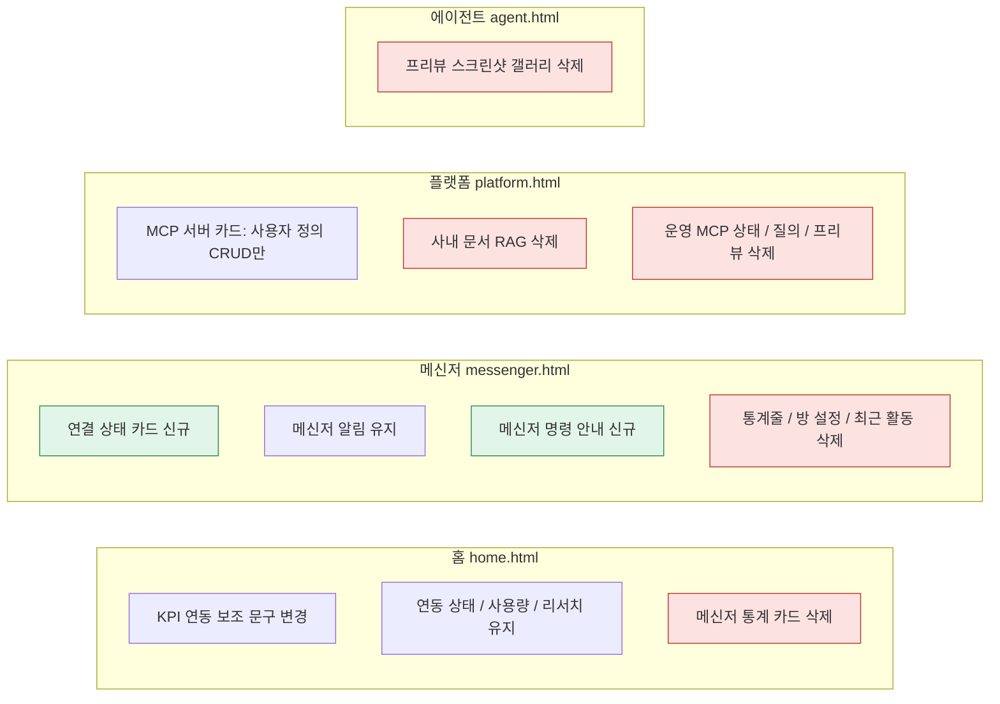
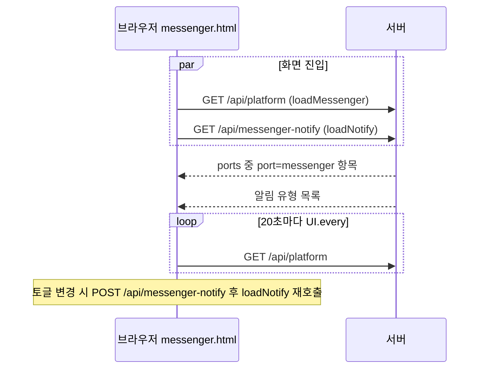
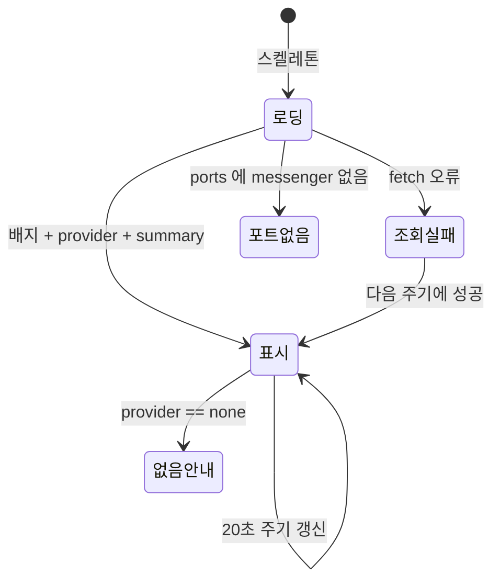

# T-008 변경 설명서 — 화면 정리: 제거되는 기능의 화면 요소 없애기

> 담당: frontend-dev (frontend-dev) · 2026-11-25 · 지시서: [T-008](../T-008-화면-정리.md)

## 요약
- 홈·메신저·플랫폼·에이전트 화면에서 방 요약·멘션·사내 문서(RAG)·운영 MCP 질의·로컬 프리뷰 요소와 그 호출 코드를 지웠다(`FR-207`, 06 §3). 백엔드는 건드리지 않았다.
- 메신저 탭은 유지하고 「연결 상태」 카드와 「메신저 명령」 안내 카드(06 §4.2)를 새로 넣었다.
- 화면이 제거 예정 API를 더 이상 부르지 않으므로 T-007·T-009의 백엔드 제거가 화면을 깨뜨리지 않는다.

## 그림
### 그림 1. 화면 구성 변화 (다섯 탭 유지)

빨강은 삭제, 초록은 신규다. 신규 두 카드는 `ui.css`·`admin.css`의 기존 `card`·`callout`·`badge`와 메신저 화면 안의 작은 스타일(`.crow`, `.msgr`)만 쓴다. 연동 카드 행과 메신저 알림 유형 목록은 서버 응답을 그대로 그리며 걸러내는 코드가 없다(T-007 이후 사라진다).

### 그림 2. 메신저 화면의 데이터 요청 (병렬, 대기 없음)

두 요청은 서로 기다리지 않는다. 가려진 탭에서는 `UI.every`가 폴링을 멈춘다. 연결 상태는 `ports`에서 `port === 'messenger'` 한 항목의 상태 배지·`provider`·`summary`만 그리고, `details`(계정·대화 id류)는 그리지 않는다.

### 그림 3. 연결 상태 카드의 상태 전이

`provider`가 `none`이면 "메신저 없이 사용 중 — 알림은 알림함에 남습니다"와 `.env`의 `PLATFORM_MESSENGER` 키 이름(값은 적지 않음)을 안내한다.

## 파일 지도
| 파일 | 추가/수정 | 역할 (한 줄) |
|---|---|---|
| `src/main/resources/static/home.html` | 수정 | 메신저 카드·`/api/status` 호출 삭제, KPI 보조 문구 `메신저 · 코딩 에이전트` |
| `src/main/resources/static/messenger.html` | 수정 | 통계줄·방 설정·최근 활동 삭제, 연결 상태·명령 안내 카드 추가, 알림 안내 문구 수정 |
| `src/main/resources/static/platform.html` | 수정 | RAG 카드, 운영 MCP 목록·질의, 로컬 프리뷰 삭제, 카드 제목 `MCP 서버` |
| `src/main/resources/static/agent.html` | 수정 | 프리뷰 스크린샷 갤러리(요소·스타일·함수·이벤트 분기) 삭제 |
| `src/main/resources/static/admin.js` | 수정 | 지운 화면 전용 함수·전역 삭제, `loadMessenger` 추가 |
| `src/main/resources/static/admin.css` | 수정 | 방 설정·문서 검색·LLM 통계 전용 스타일 삭제 |
| `e2e/core/shell-tabs.spec.ts` | 수정 | 메신저 `marker` 한 줄만 `'메신저 알림'`으로 |
| `docs/tasks/results/T-008/*.png` | 추가 | 스크린샷 9장(홈·메신저·플랫폼 × 390/768/1440) |

### 지운 것과 남긴 것
- 지운 함수·전역(`admin.js`): `ROOMS`, `loadStatus`, `stat`, `llmTest`, `loadRooms`, `syncRoomsFromDom`, `renderRooms`, `save`, `loadRecent`, `[data-r]` 탭 처리, `loadDocs`, `isStale`, `refreshDocs`, `searchDocs`, `loadMcp`, `loadPreview`, `mcpAsk`, 그리고 `on('filter'…)`·`on('docQ'…)`·`on('mcpQ'…)` 등록. 아이콘 주입 목록에서 `icRooms`·`icSearch2`·`icSearch3`·`icBook`·`icRefresh` 제거. `mcpSave`·`mcpDelete`·`bundleImport`의 `loadMcp()` 호출 제거.
- 지운 곳(`agent.html`): `#shots`, `.shots`·`.gallery`·`.shot*` 스타일, `loadShots`, `shotsLoadedFor`, 로그 이벤트 분기, 「프리뷰 열기」 링크.
- 지운 스타일(`admin.css`): `.rhead`, `.rlist`, `.rrow` 의 방 목록 격자 규칙·`.rrow .nm/.c`, `.tbadge*`, `.stat.action`, `.hits .item .meta a`, `.score`. 지운 스타일(`home.html`): `.mini3`.
- 남긴 것: `.rrow`의 `border-radius`·`:hover`(홈 리서치 행이 `.rrow`를 씀, 정의는 `home.html`), `.toolbar`(홈·플랫폼이 씀), `.plat .prov`(연동 카드와 새 연결 상태 카드), `.stats.hero`. 홈 사용량 카드의 `chat`·`ops` 출처 라벨(과거 기록 표시용).
- `ui.js`: 확인만 했다. 요약·멘션 문구가 없어 고치지 않았다.

## 주요 결정
| 결정 | 이유 | 검토한 대안 |
|---|---|---|
| 연결 상태 카드를 `admin.js`의 `loadMessenger`로 둠 | 홈·메신저·플랫폼이 이 파일을 공유하고 `loadNotify`·`loadPlatform`도 여기 있다 | `messenger.html` 인라인(공유 규칙과 어긋남) |
| 연결 상태에는 `provider`·`summary`·배지만 표시 | 지시서가 토큰·대화 id를 표시하지 말라고 함. `details`는 그리지 않음 | `details` 일부 표시 |
| 사용자 정의 MCP가 비었을 때 문구를 바꿈(`위 세 서버…` 삭제) | 지운 내장 목록을 가리키는 문구가 남으면 틀린 안내가 된다 | 문구 유지 |
| `.rrow` 일부 규칙 유지 | 지시서가 예로 든 대로 홈 리서치 행이 쓰며, 지우면 hover·모서리가 달라진다 | 전부 삭제 |
| `.msgr`, `.crow` 같은 새 클래스는 `messenger.html` 안에 | `ui.css`는 건드리지 않는 범위, 이름 충돌 없음을 `grep`으로 확인 | `admin.css` |

## 지시서 밖 추가
- 사용자 정의 MCP 목록이 비었을 때의 안내 문구를 새로 썼다("등록된 MCP 서버가 없습니다. + 서버 추가로 올리면 …"). 이유: 기존 문구가 지운 내장 서버 3개를 가리켰다.
- 메신저 「메신저 명령」 카드 끝에 "그 밖의 입력은 … 명령 안내를 한 번 보내 줍니다" 한 줄(06 §4.2 마지막 행). 이유: 표의 마지막 동작이라 빠뜨리면 안내가 불완전하다.
- `.msgr .prov`를 `.plat .prov` 규칙에 합쳐 provider 칩 모양을 연동 카드와 맞췄다.

## 제안
- 06에 메신저 화면 모바일 동작은 지시서대로 "4단계까지 현행 유지"라 보정하지 않았다. 390px에서 페이지 레이아웃 폭이 약 937px로 잡힌다(수정하지 않은 `research.html`도 937px로 같다). 기존 상태이며 SPA 전환 때의 문제로 보고만 한다.
- 서버 텍스트가 아직 제거 대상 기능을 말한다(T-007·T-009 몫이며 화면에서 가리지 않았다): 홈·플랫폼 「연동」 행의 `채팅 모델`·`도구 모델`·`지식(RAG)`, 설치 점검의 `로컬 프리뷰`·`지식(RAG)`·`작업 디렉터리`의 "@AI 명령" 문구, 메신저 알림 유형 `방 요약`·`멘션 초안`, 메신저 상태 문구 "@AI 명령·자기방 알림". 「시스템」 카드의 실행 방식 라벨(`RUN_MODE`)은 T-009 이후 정리 대상이다.
- 「메신저 알림」의 알림 유형 설명(서버 `hint`)과 홈 사용량의 `@AI` 표기 같은 서버 문구는 T-007에서 확인할 것.

## 검증
- 검증 명령: 1행 `node --check` 전체 통과, 2·3행 출력 없음(`ok`), 4행 `1`, `./gradlew bootJar` 성공, 앱 기동 `ready=200`, `home/agent/research/messenger/platform` 모두 200, 메신저 화면의 "메신저 알림" 1, `stop-app.sh` 종료 후 8778·54329 리슨 0.
- 직접 확인(8778, Playwright, 1440px): 사용자 정의 MCP 서버 등록 → 목록 표시 → 수정 반영 → 삭제 반영, 스킬 등록 → 삭제, 에이전트 설정 저장, 구성 묶음 내보낸 파일을 가져오기까지 전부 기존 토스트와 함께 성공, 콘솔 오류 0.
- 다섯 화면 × 390/768/1440: 콘솔 오류 0, 페이지 가로 넘침 없음(`scrollWidth <= innerWidth`).
- 테스트: 정적 화면이라 새 단위 테스트는 없다. TC-006(메신저 표식)은 한 줄 수정으로 유지, `TC-013` 자동화와 핵심 묶음 실행은 qa 확인 몫.
- 스크린샷: `docs/tasks/results/T-008/{home,messenger,platform}-{390,768,1440}.png` (로컬 경로 `~` 처리 후 촬영).
- Figma 반영 안 함(지시서 기본값). `inspect`·`lint`는 기존 정적 화면 유지 작업이라 돌리지 않았다.

## 재작업 이력
없음
