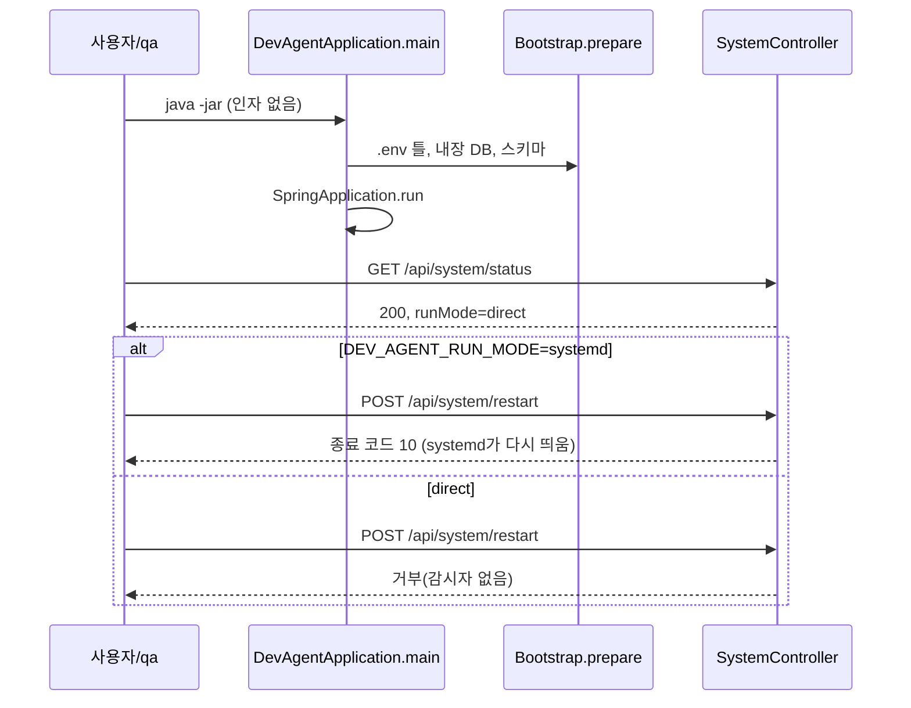
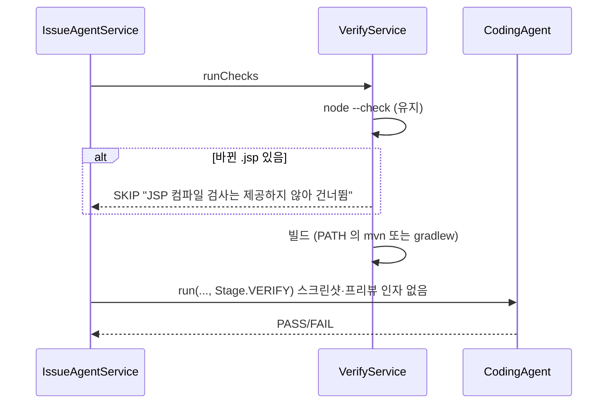

# T-009 변경 설명서 — Windows 전용 요소와 로컬 프리뷰 제거

> 담당: backend-dev (backend-dev) · 2026-11-25 · 지시서: [T-009](../T-009-windows-요소-제거.md)

## 요약
- 로컬 프리뷰(Tomcat·WAR)·playwright MCP·`~/bin` 심·실행 파일 배포(Launcher·트레이·jpackage)·`run.cmd` 계열을 삭제했다(FR-206, NFR-401, OI-04, OI-20 ①).
- 실행 방식은 `systemd`·`direct` 둘만 남고, 앱은 `<user.home>/bin`에 아무것도 쓰지 않는다.
- 설치 점검에서 「로컬 프리뷰」 항목, `/api/preview/**`, `/api/agent/sessions/{id}/shots/**`가 사라졌다.

## 그림
### 그림 1. 기동과 실행 방식 판별

`--launch` 분기와 `bot-stop.flag` 쓰기가 없어졌다. 종료 코드 10(재시작)·0(종료) 규칙은 `SystemController.EXIT_RESTART` 상수로 유지했다(`Launcher.EXIT_RESTART`를 대체).

### 그림 2. 검증 단계(VERIFYING)의 변경

`jspcheck` 단계는 도구(`scripts/bin/jspcheck`, 프리뷰 Tomcat JspC)와 함께 사라졌다. 단계를 지우는 대신 SKIP으로 보고해 "검사하지 않았다"는 사실이 검증 탭과 리뷰어 프롬프트에 남게 했다.

## 파일 지도
| 파일 | 추가/수정 | 역할 |
|---|---|---|
| `boot/Launcher`, `boot/Autostart`, `preview/`, `admin/PreviewController`, `config/PreviewProperties`, `agent/claude/AgentShims` | 삭제 | 실행 파일 감시자·트레이, 프리뷰, 심 |
| `gradle/dist.gradle`, `gradle/dist/`, `scripts/`, `run.cmd`·`stop.cmd`·`restart.cmd`·`admin.cmd`·`install-autostart.ps1` | 삭제 | 배포 묶음, 프리뷰 스크립트, 배치 파일 |
| 테스트 `PreviewConfigTest`, `PreviewSyncTest`, `AgentShimsTest`, `PlaywrightNodeOsTest` | 삭제 | 삭제 대상 전용 |
| `DevAgentApplication` | 수정 | `--launch` 분기 제거 |
| `platform/RunMode`(+Test) | 수정 | `systemd`·`direct`만, `writesStopFlag` 삭제 |
| `admin/SystemController` | 수정 | stop 플래그 쓰기·`Launcher` 참조 제거, 주석 |
| `agent/CodingAgent` | 수정 | `run(...)`에서 `shotsDir`·`previewUp` 제거(오버로드 정리) |
| `agent/claude/ClaudeCliAgent` | 수정 | 심·PATH 앞붙이기·프리뷰 도구/안내·프리뷰 JDK 분기 제거 |
| `gitlab/IssueAgentService`, `VerifyService`(+Test), `ReplyDeliveryTest` | 수정 | 프리뷰 의존·스크린샷·jspcheck·프리뷰 Maven 제거 |
| `research/ResearchService`, `maintain/MaintainService` | 수정 | `run(...)` 인자만 맞춤 |
| `admin/AgentMonitorController` | 수정 | `/shots`, `previewUrl` 제거 |
| `mcp/McpConfigService`(+`McpCustomOnlyTest`, `McpServerValidationTest`), `admin/McpController` | 수정 | playwright 연동·`RESERVED`·`configFor` 제거 |
| `ops/Doctor` | 수정 | 「로컬 프리뷰」 항목, 안내 문구 |
| `maintain/MaintainPrompts` | 수정 | 문구만 (systemctl) |
| `build.gradle`, `application.yml`, `.env.example`, `dist/env.template`, `README.md`, `CLAUDE.md` | 수정 | 설정·문서 정리 |
| `deploy/env.server.example`, `deploy/README.md`, `e2e/scripts/start-app.sh`, `static/admin.js` | 수정 | 허용된 흔적 정리(`PREVIEW_ENABLED`, `CLAUDE_WARM*`, `PLAT_KEYS`, `RUN_MODE`) |

## 주요 결정
| 결정 | 이유 | 대안 |
|---|---|---|
| 바뀐 `.jsp`는 SKIP 으로 보고 | 검사 도구가 없어졌고, 침묵 대신 "검사 안 함"을 남긴다 | 단계 삭제(흔적 없음) |
| `RESERVED` 상수·검사 삭제, `McpController`의 `reserved` 응답 키도 삭제 | 비면 의미 없음. 화면·05 명세에서 쓰지 않음(검색 확인) | 빈 목록 유지 |
| `McpConfigService.configFor`와 `sessionConfigs` 삭제 | playwright 분기를 빼면 `configPath()`의 복사본일 뿐(호출처도 없어짐). 테스트는 `configPath()`로 단언 | 인자 없는 `configFor()` 유지 |
| 재시작 종료 코드 10을 `SystemController`로 이동 | `Launcher` 삭제 | `RunMode`에 둠 |
| Doctor의 Git Bash 항목은 유지, 문구만 수정 | Windows의 Claude Code Bash 도구가 쓴다 | 삭제 |

## 지시서 밖 추가
없음. (`McpController`의 `reserved` 키 삭제와 `configFor` 삭제는 위 삭제의 직접 결과이며 결정 표에 적음.)

## 제안
- `start-app.sh` 의 낡은 주석은 재작업에서 고쳤다(재작업 이력 참고). 04 §8의 심·warm 문구는 PM이 정리. `deploy/smoke/server-smoke.sh` 의 `PREVIEW_ENABLED` 등도 허용 범위 밖이라 PM 정리 대상.
- `docs/images`, `CLAUDE.md` 버전 이력의 "실행 파일 배포" 서술은 역사 기록이라 남겼다.

## 적용 방법
- **`~/bin` 심**: 앱은 더 이상 쓰지도 지우지도 않는다. 이 PC에 이미 있는 `~/bin`의 파일 중 표식(`dev-agent 이 생성한 심`)이 있는 것은 지워도 된다.
- **`.env`에서 지울 키**: `PREVIEW_ENABLED`, `PREVIEW_LOGIN_ID`, `PREVIEW_LOGIN_PW`(및 `PREVIEW_*`), `CLAUDE_WARM`, `CLAUDE_WARM_PREWARM`. 남아 있어도 읽는 곳이 없어 무해하다. `deploy/`의 unit이 쓰는 환경변수 이름은 바뀌지 않았다.
- **실행 중인 사용자 인스턴스의 배치 파일**: `run.cmd`·`restart.cmd`·`stop.cmd`를 이 작업 트리에서 삭제했다. 사용자 인스턴스(8777)가 `run.cmd` 감시 루프로 떠 있다면, 실행 중 수정 함정(cmd는 배치 파일을 바이트 위치로 이어 읽는다 — CLAUDE.md 구판 "run.cmd 를 봇이 도는 중에 고치면")이 있다. 사용자 조치: 이 변경을 커밋·반영하기 전에 해당 인스턴스를 `stop.cmd`로 내린 뒤(이미 실행 중인 `run/` 복사본은 영향 없음) 새 jar는 `java -jar`로 띄운다. 작업 스케줄러의 `dev-agent` 작업(`install-autostart.ps1`이 만든 것)은 이 파일을 가리키므로 해제하거나 `java -jar` 호출로 바꿔야 한다. 이 에이전트는 사용자 인스턴스·`~/bin`을 건드리지 않았다.

## 검증
- `./gradlew test bootJar` → 성공, 테스트 125건 실패 0(XML 합산).
- 검색 명령(2행) 결과 0건(rc=1), 파일 존재 확인(3행) 삭제됨, `start-app.sh`·`env.server.example`의 `PREVIEW_ENABLED|CLAUDE_WARM` 0건(rc=1).
- 기동 확인(04 §8, 포트 8778, 포그라운드 한 번): `/api/system/status` 200, `version 2.0.0`, `runMode=direct`. `/api/system/doctor` 키: runtime, db, agent, login, git, messenger, gitlab, workdir, node, bash — `preview` 없음. `/api/preview/status`·`/api/agent/sessions/1/shots` 404.
- `-Duser.home` 아래 `bin/`: 기동 전 이전 실행의 `home/bin`이 있어 `home/`(git 제외 폴더)을 지우고 띄웠고, 기동·종료 뒤 `home/`은 비어 있다(`ls -A | wc -l` = 0) → 심 미생성 확인.
- 종료: `stop-app.sh` 뒤 8778·54329 LISTEN 0 확인.
- `deploy/smoke/server-smoke.sh`: 미실행 — `DEV_AGENT_SSH` 환경변수 없음.
- 테스트 변경: `RunModeTest`·`McpCustomOnlyTest`·`McpServerValidationTest`·`VerifyServiceTest`·`ReplyDeliveryTest` 갱신, 삭제 대상 전용 테스트 4개 삭제. 신규 로직이 없는 삭제 작업이라 커버리지 측정은 하지 않았다(기존 테스트 전부 통과).
- security-scan(Skill 호출): 변경 범위에서 하드코딩 비밀·인젝션·XSS 패턴 신규 추가 없음. 변경은 대부분 삭제이며 프리뷰 로그인 계정이 모델에 전달되던 경로가 사라졌다.

## 재작업 이력
### 2026-11-25 (java-reviewer Block 반영)
- HIGH: 지운 `verifyHint()` 의 첫 줄(독립 리뷰어, 파일 수정 금지)이 VERIFY 시스템 프롬프트에서 사라졌던 회귀를 고쳤다. `ClaudeCliAgent.stageNote(Stage)` 를 추가해 `stage == VERIFY` 일 때 항상 붙인다(프리뷰와 무관). 실행이 `acceptEdits` 라 프롬프트가 유일한 수정 금지 장치다. 테스트 `ClaudeCliAgentTest.verifyStageGetsReadOnlyReviewerNote`·`nonVerifyStagesGetNoReviewerNote` 를 먼저 써서 컴파일 실패(RED) 확인 뒤 구현(GREEN).
- MEDIUM(보고할 것): 검증 빌드·수정 세션의 JDK/Maven 이 바뀌었다. 예전에는 프리뷰 JDK 21·Maven 을 JAVA_HOME·PATH·mvn 경로로 넣었고, 지금은 봇 JVM 의 JDK(서버 배포 unit 은 17)와 PATH 의 `mvn` 을 쓴다. 영향: Java 21 을 요구하는 대상 프로젝트는 `mvn -o -q compile` 검사가 FAIL 로 나올 수 있다(자동 재수정 루프를 불필요하게 돌 수 있음). 코드는 바꾸지 않았다. 대안: ① `gitlab.verify.commands` 로 프로젝트별 검증 명령(필요한 JDK 를 지정하는 명령) 지정, ② 대상 프로젝트별 JDK 선택을 후속 작업으로 분리.
- MEDIUM: `IssueAgentService.verify()` javadoc 의 "JSP 컴파일"·"프리뷰 열람" 문구 삭제. 1205행 알림 문구("빌드·정적검사 후 독립 리뷰어가 확인")는 현재 동작과 일치해 그대로 둔다.
- LOW: `AgentMonitorController` 의 쓰지 않는 import `ResponseEntity`·`FileSystemResource` 제거(`MediaType` 은 사용 중이라 유지). `.env.example`(동시 처리 주석, 소스 저장소 안내)·`README.md`(`preview deploy`)·`e2e/scripts/start-app.sh`(`DEV_AGENT_SUPERVISED` unset 제거, `-Duser.home` 주석을 격리 목적으로)·`.gitignore`(`bot-stop.flag`·`bot.lock` 삭제, setup-preview·run.cmd 주석 정리) 의 죽은 문구 정리.
- 제안(허용 범위 밖이라 미수정): `deploy/smoke/server-smoke.sh` 의 `PREVIEW_ENABLED` 등 프리뷰 흔적 정리. 04 §8 표의 "심 때문에 `-Duser.home`" 설명도 격리 목적으로 고칠 것(PM).
- 검증: `./gradlew test bootJar` 통과(127건, 실패 0). 지시서 검증 명령 2~4행 통과(검색 0건, 삭제 확인), 5행 `server-smoke.sh` 는 `DEV_AGENT_SSH` 없어 미실행. 8778 기동 status 200·doctor 에 preview 없음, 종료 뒤 8778·54329 LISTEN 0.
