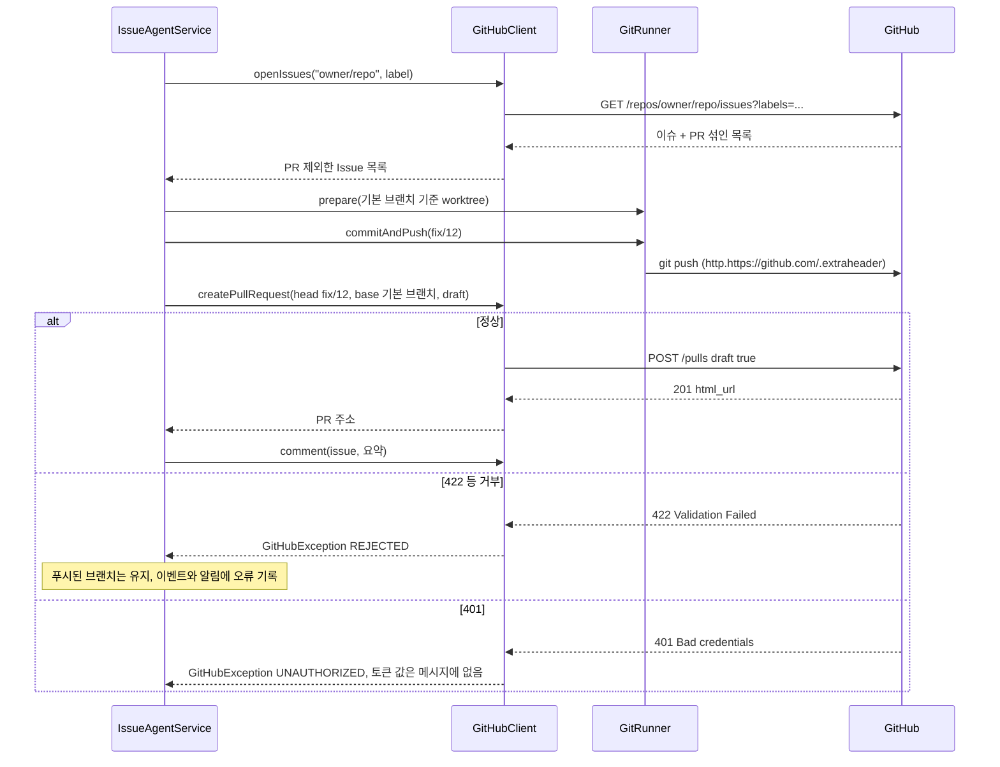
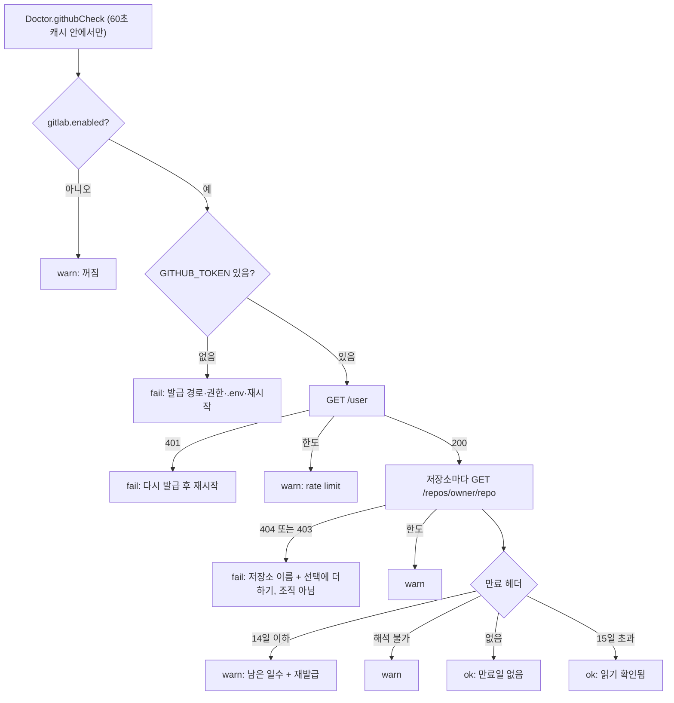
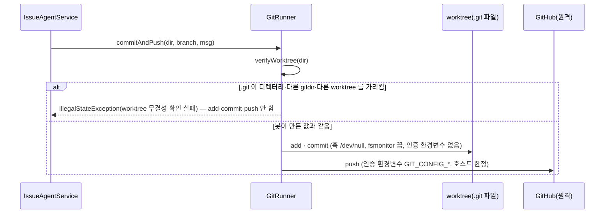

# T-010 변경 설명서 — GitHub 연동 (GitLabClient 교체)

> 담당: backend-dev (backend-dev) · 2026-11-25 · 지시서: [T-010](../T-010-github-연동.md)

## 요약
`GitLabClient`를 `GitHubClient`(REST, fine-grained PAT, 연결·응답 제한 시간)로 교체해 라벨 스캔부터 Draft PR·이슈 코멘트까지 GitHub로 간다 (FR-301~307, NFR-302).
브랜치는 `{유형}/{이슈번호}`로 항상 기본 브랜치 기준(OI-10), git 인증 헤더는 GitHub 호스트로 한정(OI-09 ①), `GITHUB_TOKEN`은 자식 프로세스 비밀 키에 추가했다.
Doctor가 토큰 없음·401·저장소 접근 불가·rate limit·만료 임박(14일)을 구분해 알려 주고, `deploy/README.md`에 빌드 도구 절 틀(§12)을 더했다.

## 그림
### 그림 1. 스캔 → 푸시 → Draft PR (정상 + 대표 실패)

GitHub의 이슈 목록 API는 PR도 돌려주므로 클라이언트가 `pull_request` 키로 거른다. PR 실패는 푸시된 브랜치를 건드리지 않고 세션은 계속(이벤트·알림만). 오류 문구는 상태 코드와 GitHub 메시지뿐이며 토큰이 섞여 오면 `***`로 가린다.

### 그림 2. Doctor GitHub 점검

여러 결과가 겹치면 가장 나쁜 상태(fail > warn > ok)로 표시하고 문구는 합친다. 쓰기 권한은 조회로 확인할 수 없어 "읽기 확인됨"까지만 말한다. `/api/system/status`는 Doctor를 부르지 않는다(기존 규칙 그대로).

## 파일 지도
| 파일 | 추가/수정 | 역할 |
|---|---|---|
| `gitlab/GitHubClient.java` | 추가 | GitHub REST 클라이언트(저장소·이슈·코멘트·Draft PR·probe), JDK HttpClient, 연결 5초·응답 20초 |
| `gitlab/GitHubException.java` | 추가 | 실패 종류(UNAUTHORIZED·NOT_ACCESSIBLE·RATE_LIMITED·REJECTED·NETWORK) 분류 |
| `gitlab/GitLabClient.java` | 삭제 | GitLab 호출 코드 제거 |
| `config/GitHubProperties.java` | 추가 | `github.token`, `github.api-url`, 웹·clone 주소 파생 |
| `config/GitLabProperties.java` | 수정 | `url`·`token` 제거, Convention을 `prefixes`만 남김(hotfix 분기·일감번호·base/mr-target 제거) |
| `gitlab/GitRunner.java` | 수정 | 인증 헤더를 `http.<GitHub 주소>/.extraheader`로 한정, `branchName(유형, 이슈번호)`, 보호 브랜치 main/master/develop |
| `gitlab/IssueAgentService.java` | 수정 | owner/repo 사용, 기본 브랜치 기준, PR 생성, 충돌 접미사 함수 사용, hotfix·일감번호 제거 |
| `gitlab/IssueTexts.java` | 수정 | `workIdOf` 제거, `uniqueBranch` 추가 |
| `gitlab/IssueProjects.java`, `IssueReferences.java`, `IssuePrompts.java` | 수정 | GitHubClient 사용, 프롬프트의 GitLab·MR 문구 수정 |
| `research/ResearchService.java`, `ResearchPrompts.java`, `ResearchJob.java` | 수정 | GitHubClient 사용, 문구 |
| `ops/GitHubCheck.java` | 추가 | Doctor GitHub 점검 로직(가짜 HTTP로 시험 가능하게 분리) |
| `ops/Doctor.java` | 수정 | `gitlabCheck` → `githubCheck`, 생성자 의존 변경 |
| `platform/ChildEnv.java` | 수정 | `SECRET_KEYS`에 `GITHUB_TOKEN`(`GITLAB_TOKEN`은 유지) |
| `mcp/McpConfigService.java` | 수정 | 거부 문구 "GitHub 토큰" |
| `application.yml` | 수정 | `github:` 블록 추가, gitlab url/token·hotfix 관련 키 제거 |
| `.env.example`, `dist/env.template`, `deploy/env.server.example` | 수정 | fine-grained PAT 안내, `GITHUB_TOKEN`·`GITHUB_API_URL` |
| `deploy/README.md` | 수정 | §4 문구, §12 대상 저장소 빌드 도구 틀 |
| `README.md` | 수정 | 설정 표·브랜치 규칙·설치 안내 |
| `static/agent.html` | 수정 | 브랜치 링크 주소 한 줄(`/-/tree/` → `/tree/`) |
| 테스트 | 추가/수정 | `GitHubClientTest`, `GitHubCheckTest`, `GitHubWiringTest`, `FakeGitHubServer`(가짜 서버), `McpPlaceholderSecurityTest`, `ChildEnvTest`, `IssueAgentHelpersTest`, `VerifyServiceTest` |

## 주요 결정
| 결정 | 이유 | 검토한 대안 |
|---|---|---|
| git Basic 인증 사용자 이름은 `x-access-token` | GitHub는 PAT의 Basic 사용자 이름 값을 보지 않는다(비어 있지 않으면 됨). GitHub 문서가 쓰는 관례 이름 | `oauth2`(GitLab 관례) |
| 헤더 키 `http.<webBase>/.extraheader` | git의 URL별 설정으로 다른 호스트(참고 저장소·서브모듈)에 토큰이 안 나감. GHE는 api-url에서 호스트 파생 | 전역 `http.extraheader` |
| HTTP는 JDK HttpClient 기반 요청 팩토리 | `HttpURLConnection`은 POST 4xx·401에서 예외가 달라지는 제약이 있어 시험에서 NETWORK로 둔갑함 | SimpleClientHttpRequestFactory |
| 저장소 식별 인자를 `long id` → `owner/repo`로 | GitHub API는 숫자 id로 부르지 않음. 입력은 정규식 검증(경로 조작 방지) | id 병행 |
| `project_id` 쓰기 중단(0 저장), `work_id`는 안 채움 | 지시서(사용 중단까지). 컬럼 삭제는 T-011 | 계속 repo id 저장 |
| 브랜치 목록은 첫 100개를 받아 이름으로 거름 | GitHub 브랜치 API에 정렬·검색이 없음 | 전체 페이지 순회 |
| 이슈 에이전트가 쓰는 `gitlab.*` 키 이름은 그대로 | 개명은 T-011 | — |
| PR 본문에서 `Closes #n` 제거, `이슈: #n` 언급만 | FR-305 가정(PR 본문에 닫기 참조 없음). 닫기는 커밋 메시지 `Resolves #n`이 기본 브랜치 병합 때 수행 | PR 본문에도 닫기 유지 |
| 브랜치 충돌 접미사 로직을 `IssueTexts.uniqueBranch`로 추출 | TC-017을 단위 테스트하려고(동작 동일) | 서비스 내부 유지 |
| 이슈 스캔은 비동기로 바꾸지 않음 | 반환 문구("N건 큐 추가")를 쓰는 화면 동작이 바뀌어 05·06 변경이 필요. 대신 모든 호출에 제한 시간을 둬 무기한 막힘은 해소 | 비동기 접수 + 알림 |

## 지시서 밖 추가
- `static/agent.html` 한 줄: 브랜치 링크가 GitLab 주소 형식(`/-/tree/`)이라 GitHub에서 깨지므로 `/tree/`로 고침(이 작업의 직접 회귀 방지). 화면 문구는 건드리지 않았다(T-012).
- 그 외 없음.

## 제안
- 이슈 스캔 비동기 접수(위 결정): 화면 「가져오기」의 반환 문구가 바뀌므로 05·06 변경이 필요하다. 제한 시간(연결 5초·응답 20초)으로 최악 대기는 줄었으나 저장소 수만큼 직렬이다. PM 결정 요청.
- 브랜치 목록 정렬: GitHub에는 "최근 갱신 순"이 없어 리서치 탭 브랜치 선택이 알파벳순 첫 100개다. 브랜치가 100개를 넘는 저장소는 일부가 안 보인다(검색도 그 100개 안에서만). 필요하면 페이지 순회 지시서.
- `IssueEvent.GITLAB`, `closesIssue`의 설명, `mrUrl` 필드·DB 컬럼 `mr_url` 등 GitLab 용어는 T-011에서 개명.
- 이슈 목록 API는 PR이 섞여 와서 첫 100건 중 PR을 빼고 50건까지 반환한다. PR이 매우 많은 저장소는 라벨 이슈가 100건 뒤로 밀리면 못 볼 수 있다(드묾).
- 보안 리뷰는 수행됨(재작업 이력 참고).

## 05·06 불일치 / 보고 사항
- 커밋 메시지 마지막 줄 `Resolves #n`(IssueAgentService `commitMessage`, 약 1590·1600행)은 바꾸지 않았다. PR 본문의 닫기 참조만 제거했다(FR-305 가정과 일치).
- 프롬프트의 출력 틀 절 제목(`## 작업 유형` 등)은 그대로. 괄호 안 안내 문구만 새 규칙으로 바꿈.
- TDD: 대규모 치환 작업이라 구현을 먼저 하고 TC 테스트를 뒤에 쓴 구간이 있다(테스트 실패 확인은 JDK 팩토리 전환 전 2건 실패→수정 후 통과로만 확보).

## 사용자가 서버에서 확인할 것 (실제 GitHub, 수동)
1. 서버 `.env`에 `GITHUB_TOKEN`(fine-grained PAT: 대상 저장소만, Contents·Issues·Pull requests 읽기/쓰기 + Metadata 읽기, 만료 90일 안팎), `GITLAB_ENABLED=true`, `GITLAB_PROJECTS=<owner/repo>`를 넣고 unit 재시작.
2. 플랫폼 탭 "설치 점검"의 GitHub 항목이 `ok`이고 "토큰 만료일 YYYY-MM-DD (남은 N일)"이 표시되는지(만료 없는 토큰이면 "만료일 없음"). 일부러 저장소 선택에서 하나를 빼면 `fail` + 그 저장소 이름이 나오는지.
3. 대상 저장소에 시험 이슈를 만들고 `ai-fix` 라벨을 붙여 스캔(또는 `이슈 스캔`) → 큐 등록 확인.
4. 설계 승인 → 수정 → 「진행」: 원격에 `fix/<이슈번호>`(유형에 따라 접두어) 브랜치가 생기고, 기본 브랜치를 대상으로 하는 **Draft PR**이 만들어지며, 이슈에 코멘트가 달리는지.
5. 같은 이슈를 다시 처리하면 `-ai`(그다음 `-ai-r<시각>`) 접미사 브랜치가 쓰이는지, 기본 브랜치에 직접 푸시되지 않았는지.
6. 쓰기 권한은 Doctor가 확인하지 못하므로 4번이 곧 쓰기 확인이다. PR을 병합하면 커밋의 `Resolves #n`이 이슈를 닫는지(원하지 않으면 보고 사항 참고).

## 검증
- 검증 명령: `./gradlew test bootJar` → 211개 테스트 통과(실패 0), bootJar 성공(재작업 후 재실행).
- `grep -rnE "api/v4|merge_requests|GitLabClient" src/main/java` → 없음. `ChildEnv`에 `"GITHUB_TOKEN"` 있음. `write_repository` 예시 3종에서 0건. `deploy/README.md`에 "대상 저장소 빌드 도구"(§12), 기존 절 번호 유지.
- 앱 기동: 04 §8 형태로 8778 한 번 기동(토큰 없음, `GITHUB_API_URL`은 닿지 않는 로컬 주소) → `/api/system/doctor`의 github 항목이 `fail` + 원인·고치는 방법을 표시. 종료 후 8778·54329 리슨 0, 8777은 건드리지 않음.
- 테스트: 신규 약 40개(`GitHubClientTest` 15, `GitHubCheckTest` 14, `GitHubWiringTest` 5, MCP 1 등). 실제 GitHub 호출 없음(JDK `HttpServer` 가짜). 커버리지 수치는 측정 도구를 돌리지 않았다(신규 클래스의 공개 경로·실패 경로는 모두 테스트).
- security-scan: 호출함. 하드코딩 비밀·토큰 로깅 없음. 토큰은 Authorization 헤더·git 환경변수로만 쓰이고 예외·Doctor 결과에서 `***` 처리·부재를 테스트로 확인. `.env` git 제외 확인. 발견 사항 없음.

## 재작업 이력
### 2026-11-25 — security-reviewer 결과(HIGH 1, MEDIUM 3, LOW 5) 반영

로컬 명령(status·add·commit·diff 등)에는 토큰 환경변수를 주지 않고, 원격 명령(clone·fetch·push·ls-remote)에만 준다. 모든 호출에 `core.hooksPath=/dev/null`·`core.fsmonitor=false`·`core.sshCommand=false`·`credential.helper=` 를 `-c` 로 덮고, diff·show 는 `--no-ext-diff --no-textconv`. 세션·참고 worktree 를 만지는 호출 전에 `.git` 파일이 기준 clone 의 `worktrees/<이름>` 을 가리키고 그 관리 디렉터리의 역참조가 같은 worktree 인지 확인한다.

| 항목 | 반영 |
|---|---|
| HIGH | 위 그림. `GitRunner.processFor/verifyWorktree/HARDENING/DIFF_SAFE`, 테스트 `GitRunnerHardeningTest`(실제 git + 로컬 bare: 저장소 훅이 commit·push 에서 실행되지 않음, .git 리다이렉트·디렉터리 치환 거부) |
| MEDIUM 1 | 이슈 코멘트는 `author_association` OWNER/MEMBER/COLLABORATOR 만 프롬프트에(`GitHubClient.issueNotes`). 본문 작성자가 아니면 스캔은 건너뛰고(이슈당 1회 로그), 수동 시작은 사유를 답하고, 분석 단계는 방어적으로 실패 처리. 설정 `github.trusted-authors-only`(`GITHUB_TRUSTED_AUTHORS_ONLY`, 기본 true; yml·.env.example·env.template·env.server.example·README) |
| MEDIUM 2 | 참고 저장소는 대상 프로젝트 목록에 있는 것만 clone(`IssueReferences.isTarget`), 나머지는 이벤트로 알림 |
| MEDIUM 3 | `gitlab.label` 이 비면 `scan()` 이 0건, Doctor 는 fail + 고치는 방법(`GITLAB_LABEL`) |
| LOW ① ⑤ | `ownerRepo`·`repoDir`·`referenceDir` 가 `.`·`..` 세그먼트 거부 |
| LOW ② | `GitHubClient.probeRepo`(ownerRepo 검증 + URI 템플릿 변수), `probe(template, vars)` |
| LOW ③ | 응답 본문 5MB 상한(`MAX_RESPONSE_BYTES`) 초과 시 NETWORK 오류 |
| LOW ④ | `GitHubProperties.apiUrlPolicy()`: https OK / localhost·127.0.0.1 http 는 허용 + Doctor warn / 그 외 거부(토큰을 붙이지 않고 호출 안 함, git 인증 환경변수도 없음, Doctor fail) |

테스트 변경(명세 변경에 따른 기대값 수정): `GitHubClientTest` 코멘트 픽스처에 `author_association: OWNER` 추가, `GitHubCheckTest` 의 "만료일 있음/없음 ok" 두 건은 가짜 서버가 로컬 http 라 warn 으로 기대. 신규: `GitRunnerHardeningTest` 9, `GitHubSecurityTest` 12, `GitHubCheckTest` 3. TDD: 새 테스트가 컴파일되지 않는 상태(RED)에서 구현했고, 첫 전체 실행에서 8건 실패(정규식 오류·코멘트 픽스처)를 고친 뒤 통과.

### 남는 위험
- 라벨 승인 뒤 본문 변경(`updated_at` 기억)은 세션 테이블 컬럼이 필요해 이번에 넣지 않았다(아래 제안). 작성자 확인은 변경 전 본문의 작성자만 보증한다.
- `.gitattributes` 의 `filter=` 가 가리키는 명령은 기준 clone 설정에 정의돼 있어야 실행되므로 에이전트가 worktree 안에서 새로 만들 수 없다. 다만 기준 clone 의 `.git/config` 를 에이전트가 직접 쓸 수 있는 경로(절대경로 쓰기)는 도구 권한(T-023·T-024)에 의존한다.
- 기준 clone(`work/<이름>`) 자체는 `verifyWorktree` 대상이 아니다(에이전트 편집 위치가 아님).
- 작성자 확인을 끄면(`GITHUB_TRUSTED_AUTHORS_ONLY=false`) 외부인의 이슈·코멘트가 프롬프트로 들어간다.

### 제안(추가)
- 이슈 본문 `updated_at` 을 분석 시점에 `issue_session` 에 저장해 수정 시작 때 달라졌으면 멈추는 방어(ensureTable + schema.sql 컬럼 1개). 별도 지시서 요청.

- 재작업 후 8778 기동 1회: status 200, Doctor github 항목 정상 응답(설정 바인딩 이상 없음), 종료 후 8778·54329 리슨 0, 8777 미접촉. security-scan 재호출: 변경 파일에 하드코딩 비밀 없음, `.env` git 제외, 발견 사항 없음.
