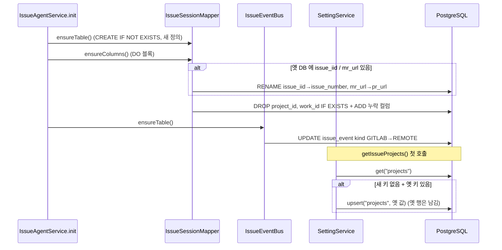
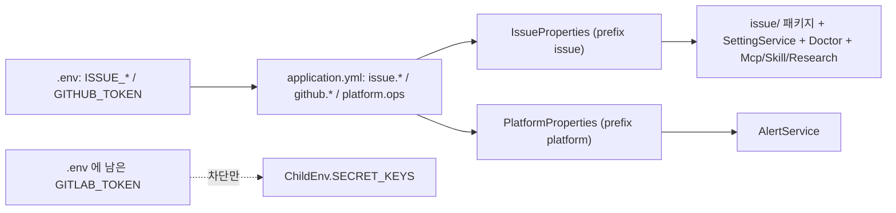
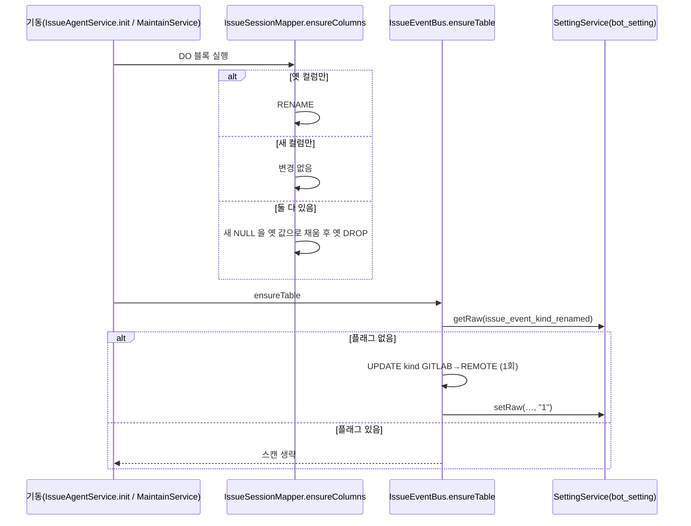

# T-011 변경 설명서 — 이름 정리 (`gitlab` 개명)

> 담당: backend-dev (backend-dev) · 2026-11-26 · 지시서: [T-011](../T-011-이름-정리.md)

## 요약
- 패키지 `gitlab/` → `issue/`, `GitLabProperties` → `IssueProperties`, 설정 `gitlab.*`/`GITLAB_*` → `issue.*`/`ISSUE_*`, `bot.*` → `platform.*` 로 개명했다(D-10, NFR-401·402). 로직은 바꾸지 않았다.
- DB: `issue_session` 컬럼 `issue_iid`→`issue_number`, `mr_url`→`pr_url`, `project_id`·`work_id` 삭제, `issue_event.kind` `GITLAB`→`REMOTE`, `bot_setting` 키 `gitlab_projects`→`projects`. 기존 DB 는 기동 때 자동으로 옮겨진다.
- API 응답 필드가 `issueIid`→`issueNumber`, `mrUrl`→`prUrl` 로 바뀐다(`workId`·`projectId` 는 사라짐). 화면(static/)은 T-012 범위라 건드리지 않았으므로 **T-012 와 한 묶음으로 커밋해야 한다**.

## 그림
### 그림 1. 기동 시 기존 DB 이어받기

`ensureColumns()` 는 한 개의 `DO $$` 블록이라 몇 번을 돌려도 같은 결과다(멱등). 빈 DB 는 `db/schema.sql`(또는 `ensureTable`)이 새 정의로 바로 만들어 옮길 것이 없다. 옛 `bot_setting` 행은 지우지 않는다(되돌릴 때를 위해). 이 흐름은 `IssueSchemaMigrationTest`(내장 PostgreSQL)와 `SettingServiceLegacyKeyTest` 가 검증한다.

### 그림 2. 설정 이름이 바뀌는 길

옛 환경변수 `GITLAB_*` 는 더 이상 읽히지 않는다(예전 값은 무시됨). 서버 `.env` 를 아래 대응표대로 고쳐야 한다. `GITLAB_TOKEN` 만 자식 프로세스로 새지 않게 차단 목록에 남겼다.

## 이름 대응표 (사용자가 서버 `.env` 를 고칠 때 쓴다)
환경변수는 접두어 `GITLAB_` → `ISSUE_` 가 기본이고, 예외는 맨 아래 한 줄이다.

| 옛 환경변수 | 새 환경변수 | 설정 키(application.yml) |
|---|---|---|
| `GITLAB_ENABLED` | `ISSUE_ENABLED` | `issue.enabled` |
| `GITLAB_PROJECTS` | `ISSUE_PROJECTS` | `issue.projects` |
| `GITLAB_LABEL` | `ISSUE_LABEL` | `issue.label` |
| `GITLAB_SCAN_INTERVAL_MS` | `ISSUE_SCAN_INTERVAL_MS` | `issue.scan-interval-ms` |
| `GITLAB_REPLY_POLL_MS` | `ISSUE_REPLY_POLL_MS` | `issue.reply-poll-interval-ms` |
| `GITLAB_WORK_DIR` | `ISSUE_WORK_DIR` | `issue.work-dir` |
| `GITLAB_BRANCH_PREFIXES` | `ISSUE_BRANCH_PREFIXES` | `issue.convention.prefixes` |
| `GITLAB_GIT_USER_NAME` / `GITLAB_GIT_USER_EMAIL` | `ISSUE_GIT_USER_NAME` / `ISSUE_GIT_USER_EMAIL` | `issue.git-user-name` / `issue.git-user-email` |
| `GITLAB_COMMENT_ON_ISSUE` | `ISSUE_COMMENT_ON_ISSUE` | `issue.comment-on-issue` |
| **`GITLAB_CREATE_MR`** | **`ISSUE_CREATE_PR`** | `issue.create-mr` → **`issue.create-pr`** |
| `GITLAB_PREFETCH` / `GITLAB_CONCURRENCY` / `GITLAB_WAIT_REMIND_MS` | `ISSUE_PREFETCH` / `ISSUE_CONCURRENCY` / `ISSUE_WAIT_REMIND_MS` | `issue.prefetch` / `issue.concurrency` / `issue.wait-remind-ms` |
| `GITLAB_AGENT_MODEL`, `_EFFORT`, `_TIMEOUT_MS`, `_MAX_TURNS`, `_FIX_TIMEOUT_MS`, `_FIX_MAX_TURNS`, `_IDLE_TIMEOUT_MS`, `_ANALYZE_TOOLS`, `_FIX_TOOLS`, `_TEST_HINT`, `_MAX_MESSAGE_CHARS` | 같은 꼬리의 `ISSUE_AGENT_*` | `issue.agent.*` |
| `GITLAB_VERIFY_ENABLED`, `_MAX_RETRIES`, `_REVIEWER`, `_MODEL`, `_EFFORT`, `_COMMAND_TIMEOUT_MS`, `_COMMANDS`, `_TOOLS`, `_REVIEWER_TIMEOUT_MS` | 같은 꼬리의 `ISSUE_VERIFY_*` | `issue.verify.*` |
| (설정 키만) `bot.ops.notify-on-startup` / `bot.ops.alert-cooldown-minutes` | 환경변수 없음(상수) | `platform.ops.notify-on-startup` / `platform.ops.alert-cooldown-minutes` |
| `GITLAB_TOKEN` | (쓰지 않음 — `GITHUB_TOKEN`) | 이름만 `ChildEnv.SECRET_KEYS` 에 남음 |

변하지 않는 것: `github.*`(`GITHUB_TOKEN`, `GITHUB_API_URL`, `GITHUB_TRUSTED_AUTHORS_ONLY`), `bot_setting` 테이블 이름, `platform.messenger`/`platform.coding-agent`.

기타 이름 대응

| 영역 | 옛 | 새 |
|---|---|---|
| 패키지(main·test) | `io.github.lib0823.devagent.gitlab` | `io.github.lib0823.devagent.issue` |
| 설정 record | `config/GitLabProperties`(`createMr`) / `config/BotProperties` | `config/IssueProperties`(`createPr`) / `config/PlatformProperties` |
| `SettingService` | `getGitLabProjects` / `setGitLabProjects` | `getIssueProjects` / `setIssueProjects` |
| `bot_setting` 키 | `gitlab_projects` | `projects` |
| `issue_session` | `issue_iid`, `mr_url`, `project_id`, `work_id` | `issue_number`, `pr_url`, (삭제), (삭제) |
| `IssueSession`·응답 JSON | `issueIid`, `mrUrl`, `projectId`, `workId` | `issueNumber`, `prUrl`, (삭제), (삭제) |
| `issue_event.kind` / `IssueEvent` 상수 | `GITLAB` | `REMOTE` |

## 파일 지도
| 파일 | 추가/수정 | 역할 (한 줄) |
|---|---|---|
| `src/main/java/.../issue/*` (16개) | 이동+수정 | `gitlab/` 패키지를 `issue/` 로 옮기고 참조 개명 |
| `src/main/java/.../config/IssueProperties.java` | 이동+수정 | prefix `issue`, `createPr` |
| `src/main/java/.../config/PlatformProperties.java` | 이동+수정 | `BotProperties` → prefix `platform`(운영 알림) |
| `issue/IssueSession.java`, `IssueSessionMapper.java` | 수정 | 컬럼·필드 개명, `project_id`·`work_id` 제거, `ensureColumns()` 를 마이그레이션 DO 블록으로 |
| `issue/IssueEventMapper.java`, `IssueEventBus.java` | 수정 | 옛 `kind` 값 변환(`renameLegacyKind`) |
| `admin/SettingService.java` | 수정 | 키 `projects`, 옛 키 이어받기, 메서드 개명 |
| `admin/*`, `agent/`, `command/`, `maintain/`, `mcp/`, `ops/`(Doctor·GitHubCheck·AlertService), `research/`, `skill/` | 수정 | 타입·import·힌트 문구 개명 |
| `src/main/resources/application.yml` | 수정 | `issue:` 블록, `ISSUE_*`, `platform.ops` |
| `src/main/resources/dist/env.template`, `.env.example`, `deploy/env.server.example` | 수정 | 키 이름 |
| `db/schema.sql` | 수정 | `issue_session` 새 정의(`ensureTable()` 과 동일), 주석 |
| `deploy/README.md`, `deploy/smoke/server-smoke.sh`, `README.md`, `CLAUDE.md` | 수정 | 이름·설명 |
| `e2e/scripts/start-app.sh`, `e2e/seed/seed.ts`, `e2e/core/routine-crud.spec.ts` | 수정 | `GITLAB_PROJECTS` → `ISSUE_PROJECTS`(안 바꾸면 QA 앱의 대상 프로젝트가 비어 루틴 시험이 깨진다) |
| `src/test/java/.../issue/*`, 기타 테스트 | 이동+수정 | 개명 반영. `McpPlaceholderSecurityTest` 는 비밀 이름 예시를 `GITHUB_TOKEN` 으로 |
| `src/test/java/.../issue/IssueSchemaMigrationTest.java` | 추가 | 내장 PostgreSQL 로 옛 스키마 이어받기·멱등·빈 DB 일치·kind 변환 3건 |
| `src/test/java/.../admin/SettingServiceLegacyKeyTest.java` | 추가 | 옛 `bot_setting` 키 이어받기 2건 |

## 의도적으로 남긴 곳 (`gitlab` 검색 결과가 0이 아닌 이유)
검증 명령의 검색은 아래 11줄(main 3개 파일 + 시험 3개 파일)이 남는다. 모두 "옛 이름을 알아야 하는" 자리다.
- `platform/ChildEnv.java:26` `GITLAB_TOKEN` — 옛 `.env` 잔존 값이 자식 프로세스로 새지 않게(PM 허용). 시험: `platform/ChildEnvTest.java`(5줄).
- `admin/SettingService.java:21` `"gitlab_projects"` — 기존 DB 의 옛 키를 새 키로 이어받기. 시험: `SettingServiceLegacyKeyTest`(1줄).
- `issue/IssueEventMapper.java:29` `'GITLAB'` — 기존 `issue_event` 행의 옛 kind 변환. 시험: `IssueSchemaMigrationTest`(2줄).
- `README.md` 에는 이력 설명이 없어 남은 곳이 없다.

## 주요 결정
| 결정 | 이유 | 검토한 대안 |
|---|---|---|
| 환경변수 접두어 `GITLAB_`→`ISSUE_` 일괄(MR 만 PR) | 설정 키 `issue.*` 와 1:1 이라 사용자가 외우기 쉽다 | 접두어 `GITHUB_` — 이미 `github.*`(접속 설정)가 있어 섞인다 |
| 마이그레이션은 `ensureColumns()` 한 DO 블록 | 04·CLAUDE.md 규약("매퍼 ensureTable 멱등")대로, 별도 도구·파일 없이 기동 때 처리 | Flyway 파일 — 이 프로젝트는 쓰지 않음 |
| 옛 `bot_setting` 행은 삭제하지 않음 | 되돌리기 쉽고 키가 달라 충돌 없음 | 이름 바꾸기(UPDATE) — 새 키가 이미 있으면 충돌 |
| `BotProperties` → `PlatformProperties`(prefix `platform`) | 지시서 "남은 bot.* → platform.*". `platform.messenger`·`platform.coding-agent` 는 `@ConditionalOnProperty` 가 읽고 record 는 모르는 키를 무시 | `OpsProperties`(prefix `platform.ops`) — 파일 이름만 다름 |
| `McpPlaceholderSecurityTest` 비밀 이름 예시를 `GITHUB_TOKEN` 으로 | 이 시험은 `ChildEnv.SECRET_KEYS` 에 있는 이름을 쓰는 것이 핵심(단순 치환하면 `ISSUE_TOKEN` 이 목록에 없어 의미가 바뀐다) | `ISSUE_TOKEN` 을 SECRET_KEYS 에 추가 — 범위 밖 |
| e2e 시작 스크립트·시드의 `GITLAB_PROJECTS` 도 개명 | 안 고치면 QA 앱이 대상 프로젝트 없이 떠 `routine-crud` 가 깨짐 | 두고 PM 이 고치게 함 — 검증 가능한 상태를 깨는 것이라 같이 고침 |

## 지시서 밖 추가
- `e2e/` 3개 파일(위 결정 참고)과 새 시험 2개(마이그레이션·키 이어받기). 시험은 완료 조건 "빈 DB 에서 기동" 외에 기존 DB 이어받기를 보장하려고 추가했다. 설정·스키마 기능은 늘리지 않았다.

## 제안
- 화면(T-012): `agent.html` 등이 아직 `issueIid`·`mrUrl`·`workId`·이벤트 종류 `GITLAB`(CSS `.k-GITLAB`)를 읽는다. 개명한 응답 필드·`REMOTE` 에 맞춰야 한다(예: `agent.html:620,627,749,983`, `admin.js`, `home.html`). `workId` 링크(`agent.html:626`)는 필드가 사라져 자연히 안 보이므로 제거가 맞다.
- `docs/04-project-structure.md` §7 환경변수 표와 §8 `start-app.sh` 설명의 `GITLAB_PROJECTS` 를 `ISSUE_PROJECTS` 로 고쳐야 한다(문서는 PM 담당).
- 서버 배포 전 서버 `.env` 의 `GITLAB_*` 를 위 표로 바꿔야 한다. 안 바꾸면 `ISSUE_ENABLED` 가 기본 false 로 돌아가 에이전트가 꺼진다.
- 시험은 구현 뒤에 썼다(기계적 개명이라 기존 211개 시험이 RED/GREEN 역할). 새 시험 5건만 구현 후 작성.

## 검증
- `./gradlew test bootJar` → 성공, 시험 216건 실패 0 skip 0(기존 211 + 신규 5), `build/libs/dev-agent.jar` 생성.
- `grep -rni "gitlab" src/main src/test db deploy build.gradle` → `src/main/resources/static`(T-012, 11줄) 제외하면 위 "의도적으로 남긴 곳" 11줄만 남는다. 지시서의 `test $? -eq 1` 은 이 때문에 rc=0 이다(PM 허용 범위인 `GITLAB_TOKEN` 외에 옛 키·옛 kind 변환 2곳이 더 있음 — PM 판단 필요).
- 기동: `ISSUE_ENABLED=true bash e2e/scripts/start-app.sh`(8778, 백그라운드) → `/api/system/status` 200, `/api/issues` `enabled:true`(ensureColumns 실행), 로그에 오류 없음. `stop-app.sh` 로 정지, 8778·54329 리슨 0, 8777 미접촉.
- 커버리지: 신규 시험이 마이그레이션 SQL·키 이어받기를 직접 실행한다. 개명 외 로직 변경 없음.
- security-scan: 변경 범위(설정 키 이름·SQL 마이그레이션·시험)에서 비밀값 하드코딩 없음. SQL 은 상수(문자열 연결 없음), `GITHUB_TOKEN`·`GITLAB_TOKEN` 차단 목록 유지, 오류 응답 변경 없음.

## 재작업 이력
### 2026-11-26 — java-reviewer Warning(MEDIUM 3) 반영

두 호출처(IssueAgentService, MaintainService)는 이미 같은 `IssueEventBus.ensureTable()` 을 부르므로 그 한 곳에 플래그를 뒀다. `issue_iid`/`mr_url` 두 쌍은 같은 루프로 처리한다.

- M-1: `ensureColumns` 를 쌍별 경우 분기로 교체. 시험 추가: 둘 다 있음(병합·DROP·재실행), 새 컬럼만(보존·재실행) — 내장 PostgreSQL.
- M-2: `boot/LegacyEnvKeys`(키 이름만 수집·안내문), `Doctor` 「옛 설정 키」 항목(있으면 warn, 없으면 ok), `Bootstrap.prepare()` 기동 로그 WARN 한 줄, `deploy/README.md` §4 아래 「기존 설치의 `.env` 개명」 절(대응표·sed 안내). 시험: `LegacyEnvKeysTest`, `DoctorLegacyEnvTest`.
- M-3: `IssueEventBus` 가 `SettingService` 를 받아 `bot_setting.issue_event_kind_renamed` 플래그로 개명 UPDATE 를 한 번만 실행. 시험: `IssueEventBusLegacyKindTest`.
- LOW: `.env.example` 중복 `ISSUE_WORK_DIR=` 빈 줄 제거.
- 시험은 구현 뒤에 작성(RED 확인 생략 — 솔직히 기록).
- 기동 확인(8778): 이전 실행이 남긴 시험 홈의 옛 `.env`(`GITLAB_*` 4개)에서 WARN 이 실제로 찍혔다. 정지 뒤 8778·54329 리슨 0.

### 추가 제안 (남은 LOW)
- `/api/issues-list` 응답의 `iid` 키를 `number` 류로(T-012 화면과 함께), `projects` 키 이름 재검토, `issue_session` UNIQUE 제약 이름(자동 이름 `issue_session_project_path_issue_number_key` 이므로 옛 DB 는 옛 이름 `…issue_iid_key` 가 남는다 — 기능 영향 없음).
