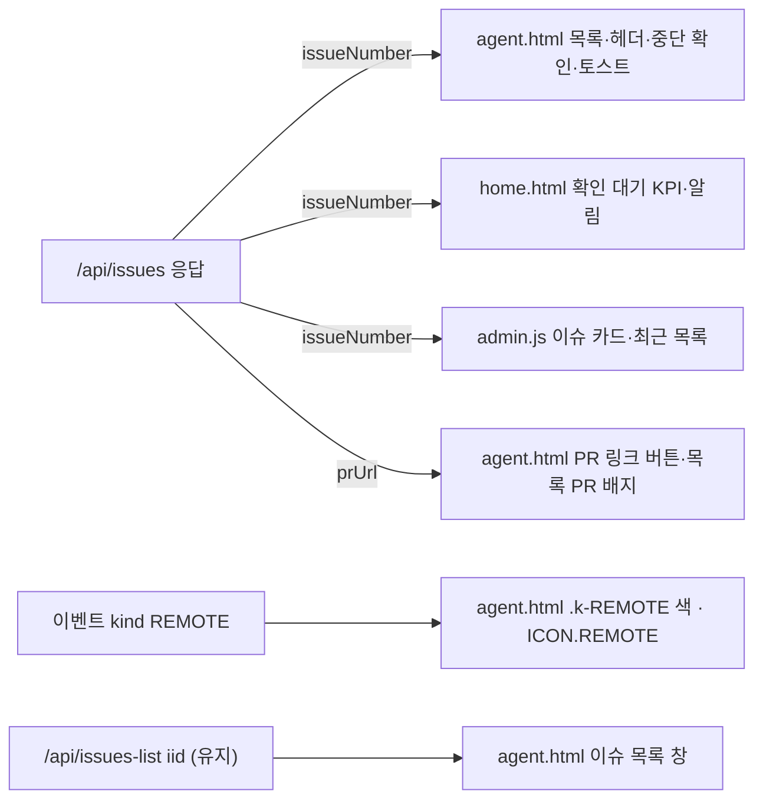
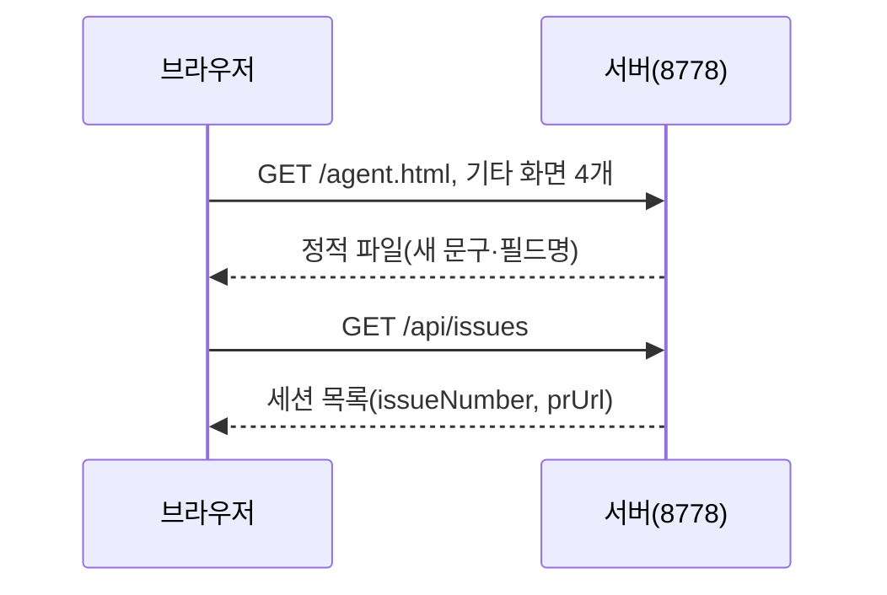

# T-012 변경 설명서 — 화면의 GitHub 표기 반영

> 담당: frontend-dev (frontend-dev) · 2026-11-26 · 지시서: [T-012](../T-012-화면-github-표기.md)

## 요약
정적 화면의 GitLab·MR 용어를 GitHub·PR로, 응답 필드를 T-011 개명(`issueNumber`·`prUrl`)과 이벤트 종류 `REMOTE`에 맞췄다(FR-305, FR-306).
사라진 `workId` 브랜치 계획 칩과 `projectId` 사용은 제거했다. 대상 프로젝트 입력 자리 표시는 `owner/repo`다.
검증 명령의 검색 결과는 0이고 `node --check`가 통과한다. 레이아웃·디자인 변경은 없다(문자열과 키 이름만).

## 그림
### 그림 1. 화면이 읽는 응답 필드 대응

세 화면이 모두 `issueNumber` 하나를 읽고, PR 링크는 `prUrl`이 있을 때만 나타난다. 이슈 목록 창의 `iid`는 T-011 결정대로 그대로 읽는다.
`workId`가 사라져 「컨벤션 브랜치 계획」 칩(`{유형}/{일감번호}`)은 제거했고, 브랜치가 실제로 생기면 기존 브랜치 링크가 대신 보인다.

### 그림 2. 확인 흐름

8778에 jar를 띄워 다섯 화면을 390·768·1440에서 열어 콘솔·페이지 오류 0을 확인했다. 세션 데이터는 시험 앱에 없어 목록 렌더는 빈 상태까지만 눈으로 봤다(제안 참고).

## 파일 지도
| 파일 | 추가/수정 | 역할 (한 줄) |
|---|---|---|
| `src/main/resources/static/agent.html` | 수정 | `issueNumber`·`prUrl`, `REMOTE`, PR/GitHub 문구, work 칩 제거 |
| `src/main/resources/static/admin.js` | 수정 | `issueNumber`, `ISSUE_ENABLED=false` 안내 |
| `src/main/resources/static/home.html` | 수정 | `issueNumber`, 수동 시작 자리 표시 `owner/repo#12` |
| `src/main/resources/static/platform.html` | 수정 | 프로젝트 추가 자리 표시 `추가: owner/repo` |
| `src/main/resources/static/research.html` | 수정 | GitHub 문구, `issue.enabled` 안내 |
| `src/main/resources/static/messenger.html` | 수정 | 명령 예시 `group/repo` → `owner/repo` |
| `docs/tasks/results/T-012/{390,768,1440}.png` | 추가 | 에이전트 화면 스크린샷 |

## 주요 결정
| 결정 | 이유 | 검토한 대안 |
|---|---|---|
| work 브랜치 계획 칩 삭제 | 필드 `workId`가 서버에서 삭제됨(T-011 설명서 「제안」) | `branchName` 기반 대체 표시 — 새 정보라 범위 밖 |
| 링크 버튼 이름 `Pull Request` | GitHub 공식 용어 | `PR` 약어 — 버튼엔 풀 이름이 기존(`Merge Request`)과 대응 |
| 이슈 목록 `it.iid` 유지 | T-011에서 `/api/issues-list`의 `iid` 유지 결정 | 개명 — 서버 변경 필요 |

## 지시서 밖 추가
- `messenger.html`의 명령 예시 3곳(`group/repo` → `owner/repo`): 지시서 관련 경로에 없으나 같은 GitLab 표기이고 화면 문구 일관을 위해 고쳤다.
- `agent.html`의 단계 이름 `푸시 · MR` → `푸시 · PR`, 주석의 MR 표기.

## 제안
- 06에 모바일 동작 필요 — S-01·S-02·S-03·S-05(06에 "모바일 동작 (390px)"이 없어 모바일 레이아웃은 만들지 않았다). 390·768 에뮬레이션에서 `scrollWidth`가 확장된 레이아웃 뷰포트(910~932)와 같아 화면 폭 자체는 작업 전과 같다(문자열 교체뿐).
- 세션이 있는 상태(PR 링크, `REMOTE` 이벤트 색)는 시험 앱에 GitHub 연동·세션 시드가 없어 눈으로 확인하지 못했다. qa 단계에서 세션 시드가 있으면 확인 권장.
- 이슈 에이전트 비활성 배지는 시험 앱(토큰 없음)에서 정상 표시.

## 검증
- 검증 명령: `for f in static/*.js; do node --check`  → 통과. `grep -rniE "gitlab|issueIid|mrUrl|projectId|workId" src/main/resources/static` → 일치 0(rc=1).
- 테스트: 정적 화면이라 단위 테스트 추가 없음(검증 명령 + 브라우저 확인).
- 스크린샷: `docs/tasks/results/T-012/390.png`·`768.png`·`1440.png`(에이전트 화면, 로컬 경로 노출 없음). 다섯 화면 콘솔 오류 0. taste inspect·Figma는 지시서(`Figma 반영: 아니오`, 문구 교체만)상 생략.
- 앱 확인 후 8778·54329 리슨 0, 8777 미접촉.
