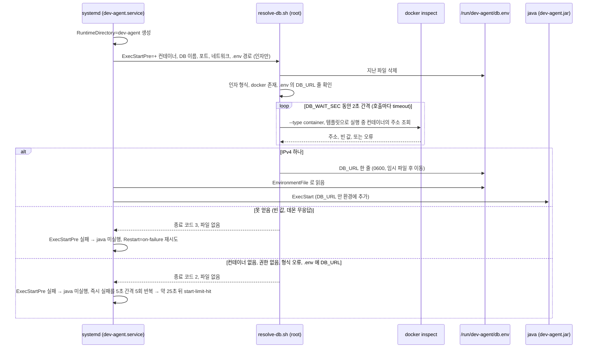
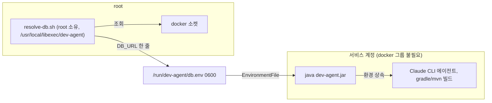

# T-017 변경 설명서 — 공유 DB 접속 경로 (기동 때 컨테이너 주소 조회)

> 담당: backend-dev (backend-dev) · 2026-11-25 · 지시서: [T-017](../T-017-공유-db-접속-경로.md)

## 요약
- 공유 PostgreSQL 컨테이너의 호스트 포트를 공개하지 않고, unit 의 `ExecStartPre=+`(root)가 `resolve-db.sh` 로 `docker inspect` 를 해 주소를 조회하고 `DB_URL` 한 줄을 `/run/dev-agent/db.env` 에 쓴다(OI-18 방법 c, 02 §4.2 D-3).
- 조회는 root 가 하므로 서비스 계정은 docker 그룹이 필요 없고, 컨테이너·DB 이름은 인자로만 줘서 java 와 그 자식(에이전트·빌드)의 환경에 남지 않는다.
- 조회가 실패하면 `ExecStartPre` 가 실패해 java(`ExecStart`)가 실행되지 않는다. 서버 `.env` 에는 `DB_URL` 을 두지 않으며 있으면 거부한다.

## 그림
### 그림 1. 기동 순서 (정상 + 대표 실패)

빈 값(컨테이너가 있는데 미실행·IP 없음)과 데몬 연결 오류만 스크립트 안에서 다시 조회한다. `No such object`·`permission denied`·값이 IPv4 하나가 아닌 경우는 기다려도 나아지지 않아 바로 코드 2 로 끝난다. 코드 3 은 실패 한 번이 약 60초 + 5초라 5회에 약 5분이 걸려 `StartLimitBurst`(3분 5회)에 닿지 않고 계속 재시도한다. 코드 2 도 systemd 는 다시 시도하지만(`RestartPreventExitStatus` 는 `ExecStartPre` 종료 코드에 적용되지 않는다 — 서버 확인) 매번 즉시 끝나므로 약 25초 만에 `StartLimitBurst` 로 멈춘다. 컨테이너를 다시 만들어 주소가 바뀌면 앱 재시작이 필요하다.

### 그림 2. 권한과 환경 경계

조회·docker 권한은 root 쪽에만 있다. java 환경에는 `DB_URL` 하나만 들어가고(DB 컨테이너·DB 이름은 없다) 에이전트와 빌드까지 상속되므로, `DB_URL` 이 자식에게 새는 것은 앱 코드 문제로 아래 제안에 남겼다.

## 파일 지도
| 파일 | 추가/수정 | 역할 (한 줄) |
|---|---|---|
| `deploy/bin/resolve-db.sh` | 추가 | root 로 주소 조회 → db.env 에 DB_URL 한 줄, 실패 시 파일 없음 |
| `deploy/smoke/start-server-check.sh` | 추가 | 가짜 docker 로 정상·재시도·실패 경로 시험, `CHECK PASS/FAIL` (이름은 지시서 그대로) |
| `deploy/systemd/dev-agent.service` | 수정 | `RuntimeDirectory`, `ExecStartPre=+`, `EnvironmentFile`, java 직접 실행(`RestartPreventExitStatus=2` 는 서버 확인 뒤 메인 세션이 뺐다) |
| `deploy/env.server.example` | 수정 | `DB_URL` 줄 제거, 안내 주석 |
| `deploy/README.md` | 수정 | 요약·자리표시자·§2(docker 그룹 위험/선택)·§4·§6(root 소유 설치)·§8(서버 확인)·§11 |

## 주요 결정
| 결정 | 이유 | 검토한 대안 |
|---|---|---|
| 조회를 `ExecStartPre=+` 로 root 에서 분리 | 서비스 계정에 docker 그룹(사실상 root)이 필요 없고, 이름 같은 입력이 java 환경에 안 남음 | 계정이 직접 docker 호출(리뷰 HIGH), 환경변수로 입력 전달 |
| 스크립트는 `/usr/local/libexec/dev-agent/` 에 root 소유 설치 | 앱 홈은 서비스 계정 소유라 그 안의 root 파일도 디렉터리 쓰기로 바꿔치기할 수 있다(권한 상승 통로) | 앱 홈에 설치 |
| `.env` 경로를 절대 경로 인자로 | `ExecStartPre` 에 `WorkingDirectory` 가 적용되는지 이 저장소에서 확인하지 못해 기대지 않음 | 상대 경로 `.env` |
| db.env 는 root 소유 0600 | systemd 가 읽으므로 서비스 계정이 읽을 필요 없음(더 엄격) | 서비스 계정 소유 |
| 실패 코드 2(재시도 무의미, 즉시 종료)·3(대기 만료) | 설정 오류는 기다리지 않고 바로 끝내 약 25초 만에 `start-limit-hit` 으로 멈추게(5분 동안 반복하지 않게). 처음엔 `RestartPreventExitStatus=2` 로 막으려 했으나 서버 systemd 255 에서 `ExecStartPre` 종료 코드에는 적용되지 않음이 확인돼(2026-11-25) 그 줄은 뺐다 | 모두 1 |
| docker 호출마다 `timeout`(상한 5초, 남은 시간이 짧으면 하한 3초) | 데몬 무응답이 대기를 무한정 늘리지 않게. 하한은 정상 응답을 끊지 않으려는 것 | 상한 없음 |
| docker stderr 를 받아 실패 메시지에 마지막 줄 포함 | 원인이 journal 에 보이게 | `2>/dev/null` |
| DB 이름 `^[A-Za-z0-9_]+$`, 컨테이너 `^[A-Za-z0-9][A-Za-z0-9_.-]*$`, 네트워크 `^[A-Za-z0-9_.-]+$` | docker 인자·템플릿 주입 방지, `-` 로 시작하는 옵션 오인 방지 | 검증 없음 |
| `deploy/` 기존 4개 파일을 작업 트리에서 LF 로 정규화 | `core.autocrlf=true` 로 체크아웃이 CRLF 라 검증 5행이 실패. 인덱스는 이미 LF | 그대로 |

## 지시서 밖 추가
없음. (지시서의 파일 이름 `start-server.sh` 는 역할이 바뀌어 `resolve-db.sh` 로 바꿨다 — PM 재작업 지시. `deploy/sql/create-db.sql` 은 내용 변경 없이 줄바꿈만 LF 로 맞췄다.)

## 제안
- 앱 코드(`ClaudeCliAgent`·`VerifyService` 의 `ProcessBuilder`)에서 자식 프로세스 환경으로 `DB_URL`·`DB_PASSWORD` 등 앱 비밀 환경변수를 제거할 것. 지금은 java 가 받은 환경이 에이전트와 대상 프로젝트 빌드까지 상속된다(이번 범위 밖, `src/` 미변경).
- 앱이 도는 중에 DB 컨테이너 주소가 바뀌면 연결이 끊기고 재시작이 필요하다. 자동 복구는 앱 쪽 재조회나 고정 IP/별칭이 필요하다(범위 밖).
- Spring 쪽의 환경변수 대 `.env` 우선순위는 확인하지 않았다(그래서 `.env` 의 DB_URL 금지).
- ~~`RestartPreventExitStatus=2` 는 java 의 종료 코드 2 에도 적용된다~~ — 해소: 그 줄을 unit 에서 뺐다(2026-11-25). 참고로 java 가 스스로 쓰는 종료 코드는 0·10 뿐이다(`SystemController`·`Launcher`, 메인 세션 확인).

## 검증
- 지시서 검증 명령 대응(파일 이름 `start-server.sh` → `resolve-db.sh`): 1행은 `bash -n deploy/bin/resolve-db.sh && bash -n deploy/smoke/start-server-check.sh` → 출력 없음. 2행 `bash deploy/smoke/start-server-check.sh | tail -5` → 마지막 줄 `CHECK PASS`(이 PC 에서 약 2분: 프로세스 생성이 느림). 3·4·5행 그대로 → 출력 없음(grep 종료 코드 1). 홈 경로 grep(`/home/`, `C:/Users`) 도 출력 없음.
- security-scan(Skill 호출, 1차) 후 재작업에서 추가한 root 실행 부분은 직접 점검: 인자 형식 검증, 임시 파일 `mktemp` + `mv`, 0600, 입력을 환경이 아닌 인자로. Critical·Major 없음.
- 테스트(가짜 docker, 약 45개 단언): 정상(db.env 한 줄·docker 인자 `--type container -f` 템플릿·컨테이너 이름·지난 값 덮어씀), 네트워크 지정 템플릿 경로, 포트 인자, 1회차 빈 값 → 2회차 성공(docker 2회 호출), 빈 값·데몬 오류는 코드 3·파일 없음·메시지에 docker 오류, `No such object`·`permission denied` 는 코드 2·1회 조회·메시지에 오류, 형식 오류·`.env` DB_URL(주석은 허용)·`.env` 없음·인자 부족·형식 검사 6종은 코드 2·파일 없음, docker 실행 파일 없음은 코드 2. 이 PC 의 파일 시스템은 모드를 저장하지 않아 db.env 0600 단언은 건너뛴다(스크립트가 건너뜀을 출력).
- **서버 systemd 동작 — 확인됨**(메인 세션, Ubuntu 24.04 · systemd 255, 사용자 매니저의 임시 시험 unit, 2026-11-25):
  1. `ExecStartPre` 가 0 이 아닌 코드로 끝나면 `ExecStart` 는 실행되지 않고 `Restart=on-failure` 가 다시 시도한다.
  2. `RuntimeDirectory` 는 `ExecStartPre` 전에 만들어진다.
  3. `EnvironmentFile` 은 `ExecStartPre` 가 쓴 파일을 `ExecStart` 직전에 읽는다(main 이 시험 값을 받음).
  4. `ExecStartPre` 의 인자·입력은 `ExecStart` 환경에 남지 않는다.
  5. `RestartPreventExitStatus=2` 는 `ExecStartPre` 의 종료 코드 2 에 **적용되지 않는다**(재시도함) — 개발 에이전트의 가정이 틀렸다. 그래서 unit 에서 그 줄을 빼고 unit 주석·README(unit 핵심, resolve-db 설명, §8 실패 경로, 문제 해결 표)를 "코드 2 는 즉시 실패를 5초 간격 5회 반복한 뒤 약 25초 만에 `start-limit-hit`" 으로 고쳤다.
- **서버에서 아직 확인하지 못한 항목**(실제 설치 때 README §8 로 확인): `systemd-analyze verify`, `+` 접두의 root 실행(시스템 매니저에서 — 사용자 매니저 시험으로는 확인 불가), db.env 가 root 0600 인지, **네트워크 지정 경로(`<DB_NETWORK>`)의 실제 템플릿 평가**, docker 그룹 없는 서비스 계정으로 기동, 주소 변경 뒤 재시작, 재부팅 때 DB 가 늦게 떠도 재시도.

## 재작업 이력
### 2026-11-25 — code-reviewer 경고(HIGH 1, MEDIUM 4, LOW 4) 반영
- RED: 검사 스크립트를 새 구조(`resolve-db.sh`, db.env, 재시도·코드 2/3 구분, docker 인자 단언, 네트워크 경로, 입력 검사, docker 없음)로 먼저 다시 쓰고 `resolve-db.sh` 없이 실행 → `CHECK FAIL (27)`(코드 126·127 은 통과로 치지 않음).
- GREEN 과정: 스크립트 작성 직후 7건 실패 — ① 입력 검사 실패 때 지난 db.env 가 남아 있어 "파일 없음" 단언이 깨짐 → `rm -f` 를 맨 앞으로 이동, ② 느린 PC 에서 대기 2초 안에 두 번째 조회가 못 들어가는 시험 불안정 → 재시도 시험은 대기를 길게, ③ 마지막 호출 상한이 1초라 느린 환경에서 정상 응답을 끊음 → 하한 3초. 이후 `CHECK PASS`. (병렬로 두 번 돌리면 서로 느려져 불안정하게 실패하니 한 번에 하나만 실행한다.)
- 항목별 처리: HIGH(docker 그룹=root) → 조회를 root `ExecStartPre=+` 로 분리, README §2 에 위험·선택 명시. MEDIUM 환경변수 유출 → 입력을 인자로, unit 에서 `Environment=DB_*` 제거. MEDIUM docker 오류 → `command -v docker`, stderr 보존, `No such object`·`permission denied` 즉시 코드 2. MEDIUM timeout → 호출마다 `timeout`, 남은 대기 반영. MEDIUM 검사 보강 → 위 테스트 항목. LOW `RestartPreventExitStatus=2`, DB 이름 검사, `sudo install -o root -m 755` 설치와 권한 상승 통로 설명 → 반영(README §6). 이 중 `RestartPreventExitStatus=2` 는 아래 서버 확인으로 뺐다.

### 2026-11-25 — 서버 확인 뒤 정정 (메인 세션)
- 서버 systemd 255 시험 unit 으로 위 `## 검증` 의 확인 항목 1~5 를 확인. 5(`RestartPreventExitStatus` 가 `ExecStartPre` 에 적용되지 않음)에 따라 unit 의 그 줄을 지우고 unit 주석(18~22행)·README 의 관련 문장을 사실에 맞게 고쳤다. 스크립트·검사 스크립트는 바뀌지 않았다.
