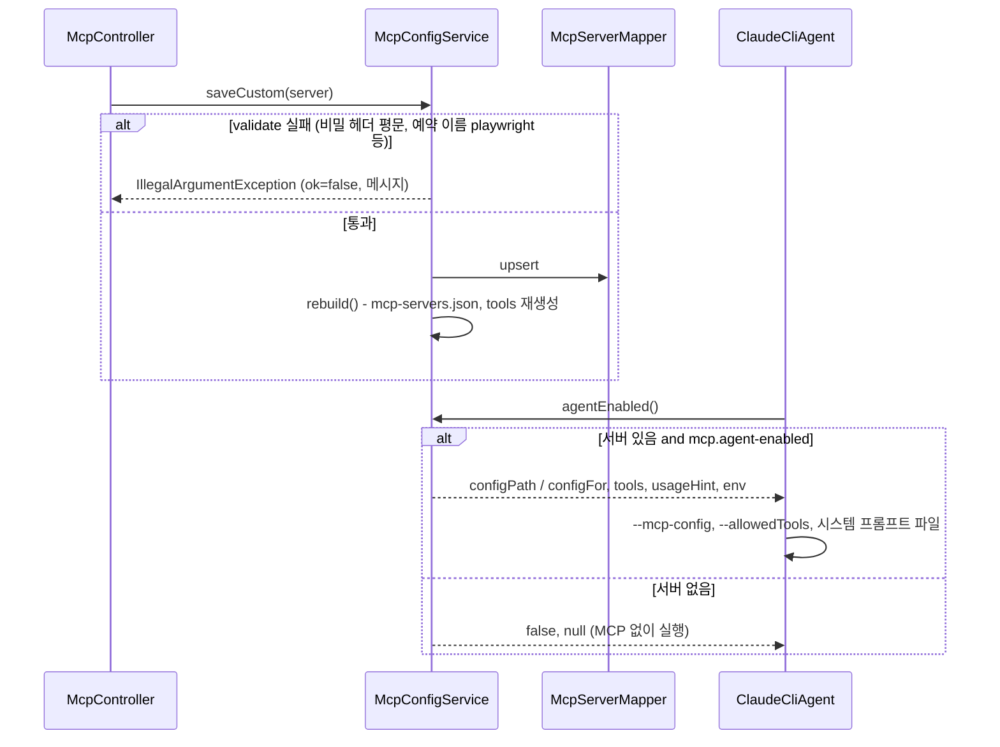
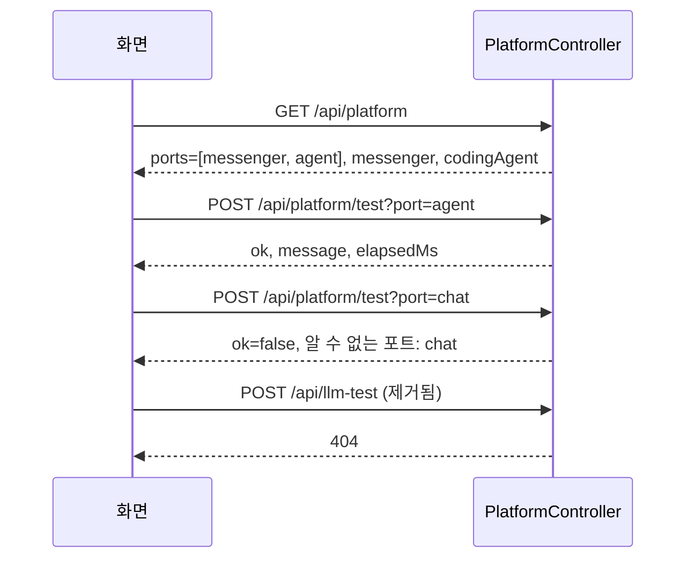

# T-018 변경 설명서 — 사내 전용 기능 제거 ② 내장 운영 MCP·`운영` 질의·채팅 모델 포트

> 담당: backend-dev (backend-dev) · 2026-11-25 · 지시서: [T-018](../T-018-운영-mcp-채팅-모델-제거.md)

## 요약
- 내장 운영 MCP 3종(opensearch·postgres·k3s-ops), `운영` 질의(`OpsQueryService`), 채팅 모델 포트(`ChatModel`·`ToolChatModel`과 warm 세션 구현)를 지웠다(FR-208, NFR-401, OI-03, 02 D-11).
- `/api/llm-test`·`/api/mcp-ask`·`/api/mcp-status`가 404가 되었고, `/api/platform`의 `ports`는 `messenger`·`agent` 2개다.
- 사용자 정의 MCP(AS-07)는 그대로 에이전트 실행에 붙는다. 단위 테스트(`McpCustomOnlyTest`)로 고정했다.

## 그림
### 그림 1. 사용자 정의 MCP가 에이전트 실행에 붙는 흐름 (정상 + 대표 실패)

내장 서버 분기가 사라져 `rebuild()`는 DB의 사용 중 사용자 정의 서버만 본다. 서버가 하나도 없으면 설정 파일을 만들지 않고, playwright(프리뷰)용 세션 설정은 기존대로 `configFor()`가 만든다. 비밀값은 설정 파일에 `${ENV}` 자리표시자로만 남고 `env()`로 자식 프로세스에만 전달된다.

### 그림 2. 연동 카드 API 변경

화면은 `ports`만 그리므로 `chatModel`·`toolChatModel` 필드 제거의 영향이 없다. 알 수 없는 `port` 값은 기존 default 분기가 처리한다.

## 파일 지도
| 파일 | 추가/수정 | 역할 (한 줄) |
|---|---|---|
| `mcp/OpsQueryService.java` | 삭제 | `운영` 질의 서비스 |
| `llm/ChatModel.java`, `llm/ToolChatModel.java` | 삭제 | 채팅·도구 모델 포트 |
| `llm/claude/ClaudeCliChatModel`, `ClaudeCliToolChat`, `ClaudeWarmSession` | 삭제 | 채팅·도구 모델 구현, warm 세션 |
| `test/.../mcp/McpRoutingTest.java` | 삭제 | 운영 질의 라우팅·k3s 도구 테스트 |
| `agent/claude/ClaudeCliProbe.java` | 추가(이동) | `llm/claude/`에서 이동, 내용 동일(패키지 선언만) |
| `mcp/McpConfigService.java` | 수정 | 내장 3종 설정·허용 도구·안내문·토큰 env·상태 점검 제거, `RESERVED`=`playwright`, 안내문 일반화 |
| `config/McpProperties.java` | 수정 | `enabled`·`agentEnabled`만 남김 |
| `config/ClaudeProperties.java` | 수정 | `cliCommand`·`exeCommand`만 남김, `warmCommand()`를 `command()`로 개명 |
| `admin/McpController.java` | 수정 | `/api/mcp-status`·`/api/mcp-ask` 제거, `/api/mcp-servers` 계열 유지 |
| `admin/AdminController.java` | 수정 | `/api/llm-test`·`ChatModel` 주입 제거 |
| `admin/PlatformController.java` | 수정 | 채팅·도구 모델 항목·필드·`chat`/`tool` 테스트 분기 제거 |
| `agent/claude/ClaudeCliAgent.java` | 수정 | 주석·안내 문구 정리, `claude.command()` 사용, 프로브 import 제거 |
| `platform/PortHealth.java`, `mcp/McpServer.java`, `llm/ClaudeUsageMapper.java`, `db/schema.sql` | 수정 | 주석만 |
| `application.yml` | 수정 | `platform.chat-model`, `mcp.opensearch-url`·`postgres-url`·`k3s-*`·`chat.*`, `claude.*` 채팅 키 제거 |
| `.env.example`, `README.md`, `CLAUDE.md` | 수정 | 운영 MCP·`운영` 질의·warm 채팅·`/api/llm-test` 설명 제거 |
| `test/.../mcp/McpCustomOnlyTest.java` | 추가 | 사용자 정의 MCP 회귀 테스트 6개(TC-014) |
| `test/.../mcp/McpServerValidationTest.java` | 수정 | 예약 이름 단언을 `opensearch`에서 `playwright`로 |

`dist/env.template`에는 제거 대상 키가 없어 수정하지 않았다.

## 주요 결정
| 결정 | 이유 | 검토한 대안 |
|---|---|---|
| 범위 1 재검색: `ChatModel`·`ToolChatModel` 호출처는 `OpsQueryService`·`AdminController`·`PlatformController` 3곳뿐 | 지시서 조건 충족, 다른 기능 사용처 없음(코어 gitlab/research/command 0건) | - |
| `mcp.enabled`·`mcp.agent-enabled` 유지 | `enabled`는 사용자 정의 MCP 테이블 준비·설정 파일 생성, `agentEnabled`는 에이전트에 붙일지 결정(`ClaudeCliAgent`가 사용). 둘 다 사용자 정의 MCP를 끄는 수단 | 제거 - 끌 방법이 사라짐 |
| `McpConfigService.health()`와 probe 메서드 삭제 | 호출처가 `/api/mcp-status`와 연동 카드 도구 분기뿐이었고 둘 다 삭제됨. 호출처 없는 코드를 남기지 않음 | 유지 - 죽은 코드 |
| `ClaudeCliProbe`를 `agent/claude/`로 이동 | 호출처가 `ClaudeCliAgent` 하나뿐이고 `llm/claude/`에 이 파일만 남음. 같은 패키지가 되어 import 제거 | `llm/claude/` 유지 |
| `McpServerValidationTest`의 `opensearch` 예약 단언을 `playwright`로 변경 | 지시서 범위 4-①(이름을 예약에서 뺀다)에 따라 기존 단언이 낡음. 테스트 쪽이 틀린 경우 | - |
| `ClaudeProperties.warmCommand()`를 `command()`로 개명 | warm 세션이 없어져 이름이 뜻과 맞지 않음(지시서가 허용) | 이름 유지 |
| 기존 `claude_usage`의 `ops`·`chat` 행은 그대로 | 범위 5. 코드·주석에 "새로 생기지 않는다"만 적음 | - |

남긴 `claude.*` 키:
| 키 | 사용처 | 이유 |
|---|---|---|
| `claude.cli-command` (`CLAUDE_CLI_COMMAND`) | `ClaudeProperties.command()` → `ClaudeCliAgent` 실행·`ClaudeCliProbe.version` | 코딩 에이전트가 CLI를 띄움 |
| `claude.exe-command` (`CLAUDE_EXE_COMMAND`) | 같음 | 절대경로 지정, 비면 `ClaudeCliLocator` 자동 탐색 |

제거: `timeout-ms`·`model`·`effort`·`strict-mcp-config`·`disable-slash-commands`·`system-prompt`·`warm`·`warm-reset-turns`·`warm-prewarm`·`warm-failure-threshold`·`warm-breaker-cooldown-ms`(검색 결과 사용처가 지워진 채팅 클래스뿐).

삭제 목록 요약
- API: `/api/llm-test`, `/api/mcp-ask`, `/api/mcp-status` (모두 404 확인). `POST /api/platform/test`의 `chat`·`tool` 분기. `/api/platform` 응답의 `chatModel`·`toolChatModel` 필드.
- 설정 키: `platform.chat-model`(`PLATFORM_CHAT_MODEL`), `mcp.opensearch-url`·`postgres-url`·`k3s-url`·`k3s-token`(`K3S_MCP_TOKEN`)·`k3s-read-tools`, `mcp.chat.*`(`MCP_CHAT_*`), 위 `claude.*` 11개(`CLAUDE_TIMEOUT_MS`·`CLAUDE_MODEL`·`CLAUDE_EFFORT`·`CLAUDE_STRICT_MCP`·`CLAUDE_DISABLE_SLASH`·`CLAUDE_SYSTEM_PROMPT`·`CLAUDE_WARM*`).
- `/api/mcp-status` 호출처 재검색: `src/main/resources/static`·`e2e/`·`deploy/` 0건(검증 명령 5행 출력 없음). PM이 05 §2.2에 반영하면 된다.

## 지시서 밖 추가
없음 (`McpConfigService.health()` 삭제는 호출처가 사라진 데 따른 정리 — 위 결정 표).

## 제안
- **TC-023 갱신 필요**: `e2e/core/access-control.spec.ts`가 `GET /api/llm-test`의 응답 코드(405)를 확인한다. API가 없어져 기대값이 404가 된다. 범위 밖이라 고치지 않았다(qa 확인 때 qa가 수정).
- 05 §2.2: 제거 API 3개 행 반영(PM).
- `scripts/preview-tomcat.cmd`와 `PreviewProperties`의 `opensearch` 오버레이 폴더 이름은 T-009 대상이라 그대로 두었다.
- `static/admin.js`의 `PLAT_KEYS`에 `warm` 관련 표시 이름이 남아 있다(화면 파일, 범위 밖 — 무해).

## 검증
- 검증 명령 1: `./gradlew test bootJar` → 성공(테스트 139개, 실패 0, 에러 0, 스킵 1은 기존), `build/libs/dev-agent.jar` 생성.
- 검증 명령 2~5(grep): 모두 출력 없음(`test $? -eq 1` 충족).
- 8778 기동(04 §8 형태, `e2e/scripts/start-app.sh` 백그라운드 + 대기 + `stop-app.sh` 조건 없이): `/api/system/status` 200(약 18초), `/api/platform` ports = `["messenger","agent"]`, `/api/mcp-servers` 200(`reserved=["playwright"]`), `/api/llm-test` POST·GET 404, `/api/mcp-ask` POST 404, `/api/mcp-status` GET 404, `port=chat` 테스트는 "알 수 없는 포트". 기동 로그에 `Caused by` 0건. 종료 뒤 8778·54329 리슨 0 확인(기동 전에도 0).
- 테스트: 새 `McpCustomOnlyTest` 6개(TC-014 — 예약 이름에서 세 이름 제외, 사용자 정의 서버만 있을 때 `available`·`agentEnabled`·`tools`·설정 파일·`configFor`·`usageHint`, 서버 없음, agent 플래그 꺼짐, mcp 꺼짐). `McpServerValidationTest` 통과(비밀 헤더 검증 그대로). 삭제 코드의 테스트(`McpRoutingTest`)는 함께 삭제. 변경 클래스 라인 커버리지는 별도 측정하지 않았다.
- security-scan(skill 호출): 변경분에서 하드코딩 비밀·인젝션·위험 호출 패턴 0건, `.env`는 git 제외. 비밀 헤더 검증과 `${ENV}` 전달 방식은 그대로. 제거된 `K3S_MCP_TOKEN` 경로로 비밀 노출면이 줄었다. Critical 0, Major 0, Minor 0.
- 점검: 생성자가 둘인 `@Component` 변경 없음(`McpConfigService`·`PlatformController` 생성자 하나), 기동 확인으로 배선 오류 없음 확인.
