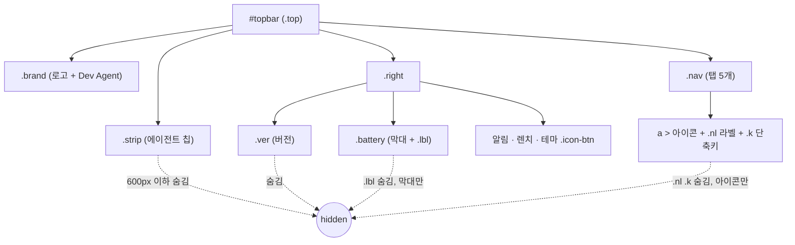
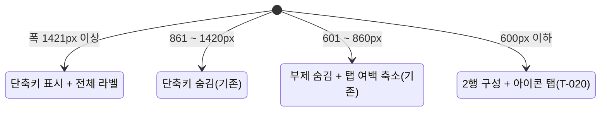

# T-020 변경 설명서 — 좁은 폭(390px) 상단바 보정

> 담당: frontend-dev (frontend-dev) · 2026-11-26 · 지시서: [T-020](../T-020-좁은-폭-상단바.md)

## 요약
- 공통 상단바(S-06)가 줄어들지 않아 휴대폰에서 레이아웃이 가로로 넘치던 것을 `max-width: 600px` 미디어 쿼리 하나와 탭 라벨 마크업 정리로 고쳤다(OI-26 ①, 06 §3.7, FR-502, TC-024).
- 390px에서 다섯 화면 모두 `scrollWidth = 390`, 탭 5개·배터리 막대·종·테마가 44px 이상 터치 영역으로 보인다.
- 601px 이상은 CSS가 적용되지 않아 768·1440 상단바는 변경 전과 픽셀 단위로 같다(전후 클립 `cmp` 동일).

## 그림
### 그림 1. 상단바 컴포넌트 구조와 600px 이하 동작

600px 이하에서 `.top`이 줄바꿈(wrap)되어 1행은 브랜드와 우측 버튼들, 2행은 `.nav`가 전체 폭을 차지하며 탭 5개가 균등 분할된다. 탭 라벨은 ``로 감싸 CSS로만 숨기고, 이름은 `title`·`aria-label`로 유지했다. 탭이 한 줄에 못 들어가는 극단적으로 좁은 폭이면 `.nav`만 가로 스크롤한다.

### 그림 2. 폭에 따른 상단바 상태

기존 1420·860px 규칙은 그대로 두고 600px 규칙만 얹었다. 요청·데이터 흐름은 바뀌지 않아 시퀀스 그림은 해당 없음(상단바의 기존 fetch 그대로).

## 파일 지도
| 파일 | 추가/수정 | 역할 (한 줄) |
|---|---|---|
| `src/main/resources/static/ui.css` | 수정 | `@media (max-width: 600px)` 상단바 보정 블록 추가 |
| `src/main/resources/static/ui.js` | 수정 | `topbar()` 탭에 `title`·`aria-label`, 라벨을 `.nl`로 감쌈 |
| `docs/tasks/results/T-020/` | 추가 | 스크린샷(390/768/1440, 390 다섯 화면 상단 클립, 768·1440 전후 비교) |

## 주요 결정
| 결정 | 이유 | 검토한 대안 |
|---|---|---|
| 기준 폭 600px | 휴대폰 세로(390~430)만 대상, 기존 860px 규칙과 겹치지 않게 태블릿 세로(768)는 현행 유지 | 860px(768 모양이 바뀌어 "768 불변" 위반) |
| 탭을 2행으로 내려 전체 폭 균등 분할 | 1행에 탭 5개 + 버튼 3~4개를 44px로 넣으면 약 440px라 390을 넘고 탭이 스크롤로 가려진다. 2행이면 탭 5개가 모두 보이고 각 70x44px | 1행 유지 + 탭 영역 가로 스크롤(탭이 일부 가려짐) |
| 배터리는 막대만 남김 | 06 허용 사항, 사용량을 잃지 않으면서 폭 절약. 터치 44x44 | 배터리 숨김 |
| 알림 패널을 상단바 기준 좌우 10px로 | 380px 패널이 종 버튼 위치(오른쪽에서 두 번째)에 맞춰 왼쪽으로 화면 밖으로 나가는 것을 방지(상단바 안의 요소라 범위 안) | 그대로 둠 |
| 라벨을 `.nl` span으로 감쌈 | CSS만으로는 텍스트 노드를 숨길 수 없음. 601px 이상은 span이 inline이라 모양 불변 | `font-size:0` 꼼수 |

## 지시서 밖 추가
- 알림 패널(`.notice-panel`) 모바일 위치 보정: 상단바가 좁아지며 패널이 화면 밖으로 밀리는 부작용 방지용.
- 브랜드 텍스트("Dev Agent")는 06이 숨기라고 하지 않아 남겼다.

## 제안
- **768px(iPad Mini 에뮬레이션)에서도 상단바가 넓다**: 변경 전·후 모두 레이아웃 폭이 910~931px(innerWidth가 확장됨). 원인은 에이전트 칩·버전·배터리 라벨이 줄어들지 않는 것. 지시서가 "768 모양 불변"이라 손대지 않았다. 06에 768(태블릿 세로) 보정을 넣을지 PM 판단 필요(inspect의 768 overflow FAIL이 이것).
- `agent.html`의 `.sidebar { position: sticky; top: 78px }`는 데스크톱 상단바 높이 기준이다. 휴대폰 상단바는 약 108px로 높아졌으나 사이드바가 본문 위로 쌓이는 폭이라 실제 겹침은 확인하지 못함. 범위 밖이라 그대로.
- `inspect` 기준 홈 화면의 기존 FAIL(heavy-shadow, button-fx, 10px 단축키 글자, h1 없음)은 디자인 시스템 전반 사항이라 범위 밖. 필요하면 별도 지시서.
- `.taste-skill/` 산출물은 임시 폴더에만 두었다. 저장소에는 남기지 않음.

## 검증
- `node --check src/main/resources/static/ui.js` → 통과.
- 앱: `e2e/scripts/start-app.sh`(8778, 변경 반영을 위해 정적 파일 2개를 교체한 jar 사본 사용, `QA_JAR`) → 확인 후 `stop-app.sh`로 종료(8778 응답 없음 확인). 8777은 건드리지 않음.
- Playwright(`playwright-core`, `chrome` 채널, iPhone 13 / iPad Mini / 1440x900): 390px 다섯 화면(홈·에이전트·리서치·메신저·플랫폼) `scrollWidth=390 <= 390`. 탭 5개 각 70x44, 배터리·알림·테마 44x44(렌치는 QA 앱에서 비활성이라 미표시).
- 768·1440 상단바 전후 클립 `cmp` 동일(`768-top-*.png`, `1440-top-*.png`).
- 테스트: JS/CSS 시각 보정이라 별도 단위 테스트 없음(TC-024 자동화는 qa 몫, 범위 밖). 위 Playwright 측정이 증거.
- inspect(`inspect.mjs --app`, 홈): FAIL 5 — 전부 변경 전부터 있던 것: heavy-shadow, button-fx, tiny-text(Alt+N 10px), no-title(h1), 768 overflow(위 제안 참조). **390px 관련 FAIL 없음, FAIL 0은 달성하지 못함**(범위 밖 사유).
- 스크린샷: `docs/tasks/results/T-020/390.png`, `768.png`, `1440.png`(홈 전체), 390 상단 클립 5개 `390-top-<화면>.png`. 로컬 경로·계정명은 화면에 노출되지 않음(배터리 툴팁에만 있고 화면에 안 보임).
- Figma: 반영 안 함(지시서 기본값).
