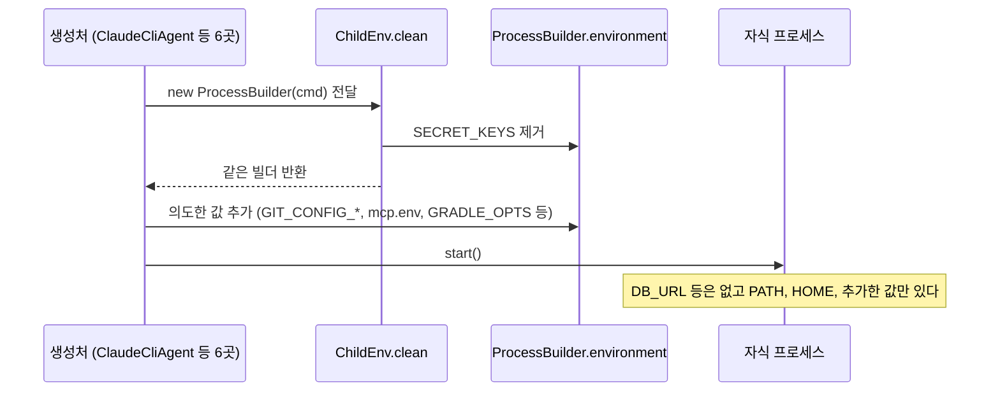
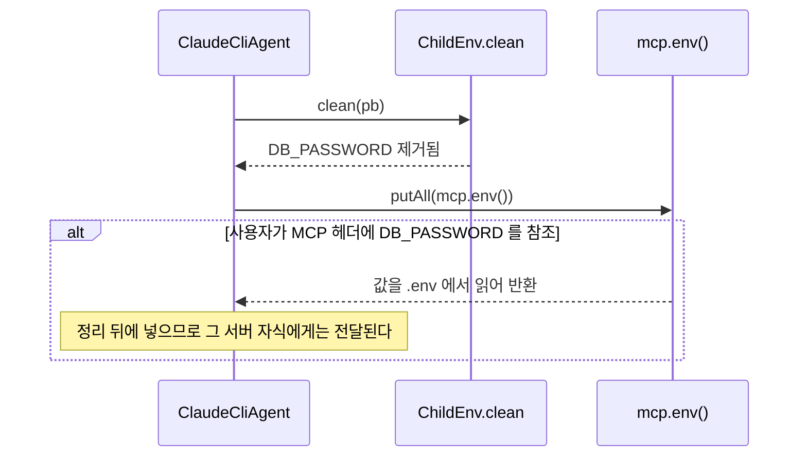

# T-021 변경 설명서 — 자식 프로세스 환경에서 앱 비밀 환경변수 제거

> 담당: backend-dev (backend-dev) · 2026-11-25 · 지시서: [T-021](../T-021-자식-프로세스-환경-정리.md)

## 요약
앱이 띄우는 자식 프로세스 6곳이 `platform/ChildEnv.clean`을 거쳐 `DB_URL`·`DB_USERNAME`·`DB_PASSWORD`·`GITLAB_TOKEN`을 물려받지 않는다(OI-27 ①, NFR-401).
대상 프로젝트 테스트가 같은 이름의 변수로 이 플랫폼 DB에 붙거나, 에이전트가 `env`로 값을 보거나, 빌드 로그에 값이 남는 일이 막힌다.
버전은 2.0.0에서 2.0.1(patch)로 올렸다.

## 그림
### 그림 1. 생성처 → 공통 함수 → 자식

정리가 먼저, 일부러 넣는 값이 나중이다. 이 순서 덕분에 `GitRunner`의 `GIT_CONFIG_*`와 `mcp.env()` 값은 지워지지 않는다.
생성처 6곳은 `ClaudeCliAgent`, `ClaudeCliProbe`, `GitRunner`, `VerifyService`, `MaintainService`, `Doctor`다.

### 그림 2. 대표 경로: MCP 헤더가 앱 비밀 키를 참조한 경우

MCP 값은 정리 뒤에 넣는 것이 지시서 범위 2의 설계라 그대로 유지했다. 다만 재작업(HIGH-1)으로 MCP 가 앱 비밀 키(`ChildEnv.isSecretKey`)나 점 든 속성명을 참조하면 저장 때 거부되고, 이미 저장된 서버도 `env()` 가 그 이름을 빈 값으로 둔다(위 `alt` 분기는 이제 정상 이름 `MY_API_KEY` 등에만 해당).

## 파일 지도
| 파일 | 추가/수정 | 역할 (한 줄) |
|---|---|---|
| `platform/ChildEnv.java` | 추가 | `SECRET_KEYS` 상수와 `scrub(Map)`·`clean(ProcessBuilder)` |
| `agent/claude/ClaudeCliAgent.java` | 수정 | 세션 생성 시 clean 후 mcp.env 등 추가 |
| `agent/claude/ClaudeCliProbe.java` | 수정 | `--version` 실행에 clean |
| `gitlab/GitRunner.java` | 수정 | clean 후 `GIT_CONFIG_*` 추가 |
| `gitlab/VerifyService.java` | 수정 | 검증 빌드·`node --check`에 clean, 호출자 env는 뒤에 추가 |
| `maintain/MaintainService.java` | 수정 | git 실행에 clean |
| `ops/Doctor.java` | 수정 | 도구 버전 확인에 clean |
| `mcp/McpConfigService.java` | 수정 | 자리표시자 이름 검증·`env()` 필터 (재작업) |
| `McpPlaceholderSecurityTest.java` (test) | 추가 | MCP 필터 테스트 5건 (재작업) |
| `ChildEnvTest.java` (test) | 추가 | 단위 테스트 5건 + 재작업 6건(대소문자·SPRING_DATASOURCE·yml 대조·소스 검사) |
| `CLAUDE.md` | 수정 | 코드 작업 규칙 한 줄 추가 |
| `build.gradle` | 수정 | 버전 2.0.1 |

## 주요 결정
| 결정 | 이유 | 검토한 대안 |
|---|---|---|
| 제거 목록은 설정 키 이름 상수(`SECRET_KEYS`) 한 곳 | 지시서 요구, 새 비밀 키는 거기에 추가 | 코드에 흩어 쓰기 |
| `*_TOKEN`·`*_PASSWORD`·`*_SECRET` 이름 규칙은 넣지 않음 | `CLAUDE_CODE_OAUTH_TOKEN`, `NPM_TOKEN` 등 자식이 정당하게 쓰는 변수까지 지워 Claude CLI 인증·대상 프로젝트 빌드를 깰 수 있다. 규칙을 넣으면 예외 목록도 필요 | 접미사 규칙 + 예외 목록 |
| `clean`은 빌더를 돌려주는 정적 함수 | 기존 한 줄 생성 코드에 그대로 감쌀 수 있다 | 별도 헬퍼 클래스 인스턴스 |
| 기동 확인은 내장 DB 기동 + 단위 테스트로 대체 | 지시서가 허용한 방법. 앱 자신이 `DB_URL=...invalid`를 쓰려다 실패하기 때문 | `example.invalid` DB_URL 로 기동 |

## 지시서 밖 추가
- (버전 patch 상향과 `CLAUDE.md` 한 줄은 지시서 범위 4항이다.)
- **MCP 자리표시자 필터**(`McpConfigService`, security-reviewer HIGH-1): `${…}` 가 Spring `environment.getProperty` 로 풀려 `${GITLAB_TOKEN}`·`${spring.datasource.password}` 같은 앱 비밀이 정리 뒤 claude 환경(과 http URL)으로 나갈 수 있었다. 같은 "자식 환경으로 앱 비밀이 넘어감" 문제라 메인 세션이 범위에 넣기로 했다. 내용: ① `validate()` 가 url·headers·args·command 의 모든 자리표시자를 `[A-Z][A-Z0-9_]*` 로 제한(점 든 속성명·소문자 거부) ② `ChildEnv.isSecretKey` 에 든 이름 거부 ③ `env()` 에도 같은 필터 — 이미 저장된 서버는 거부된 이름이 빈 값이 되고 이름만 WARN 로그(값은 쓰지 않음). 구성 묶음 import 는 `saveCustom` 검증을 타므로 같이 막힌다. 부작용: 예전에 소문자 자리표시자로 저장한 서버는 그 값이 더 이상 전달되지 않는다.

## 제안
- 앞으로 메신저 어댑터 토큰 등 비밀 설정 키가 생기면 `ChildEnv.SECRET_KEYS`에 더해야 한다. application.yml 의 password·secret·token 속성은 테스트가 목록과 대조하지만, 그 밖의 위치(코드 안 `getenv`)는 못 잡는다. 새 설정 키 추가 절차(CLAUDE.md "새 설정은 …")에 이 확인을 넣을지 PM이 판단해 주길 바란다.
- 구성 묶음 import 화면에 "stdio MCP = 임의 명령 실행" 경고를 보여 줄 것(화면 파일이라 이번에 손대지 않음, frontend 지시서 필요).
- (MEDIUM-1 후속은 메인 세션이 T-023 에 넣는다.)

## 알려진 한계 (MEDIUM-1, 코드 변경 없음)
이 정리는 **환경변수 상속**만 막는다. 자식은 앱과 같은 OS 계정으로 돌므로 ① 작업 디렉터리·홈의 `.env` 파일을 직접 읽을 수 있고 ② 내장 DB 는 127.0.0.1 trust 인증이라 포트(54329)로 바로 접속할 수 있다. 이 둘은 막지 못한다.

## 재작업 이력
- 2026-11-25 (security-reviewer 반영)
  - HIGH-1: 위 "지시서 밖 추가"의 MCP 필터. 테스트 `McpPlaceholderSecurityTest` 5건(헤더·URL·args 의 `GITLAB_TOKEN`·`DB_PASSWORD`·`spring.datasource.password`·`gitlab.token` 거부, 정상 `${MY_API_KEY}` 통과, `env()` 필터). RED(컴파일 실패) 확인 뒤 구현.
  - MEDIUM-2: `SECRET_KEYS` 에 `SPRING_DATASOURCE_URL|USERNAME|PASSWORD` 추가. GitLab 토큰은 `application.yml` 이 `gitlab.token: ${GITLAB_TOKEN:}` 라 relaxed binding 으로 닿는 환경변수 이름이 `GITLAB_TOKEN` 하나뿐이어서 추가 없음.
  - MEDIUM-1: 위 "알려진 한계"로 기록.
  - LOW-1: `scrub` 을 `keySet().removeIf(isSecretKey)`(equalsIgnoreCase)로. `SECRET_KEYS` 는 public.
  - LOW-2: 회귀 테스트 2건 — application.yml 의 password·secret·token 속성 자리표시자가 전부 목록에 있는지, `new ProcessBuilder(` 가 있는 소스는 `ChildEnv.clean(` 을 호출하는지.
  - LOW-3: 6곳의 전체 이름 호출을 import 로 바꿈.

## 검증
- 검증 명령(재작업 후): `./gradlew test bootJar` → 성공, 전체 142건 실패 0·오류 0·건너뜀 0. 검색 두 목록 차이는 `McpConfigService.java` 하나(ChildEnv 쪽에만, 위 지시서 밖 추가). 8778 기동 200 → stop-app.sh → 8778·54329 리슨 0.
- 최초 검증: `./gradlew test bootJar` → 132건 실패 0. 검색 두 목록은 같다(`ChildEnv.java`는 주석의 `new ProcessBuilder` 표기 때문에 양쪽에 모두 나온다).
- 테스트: `ChildEnvTest` 5건 추가(제거 목록 전부 사라짐, 일반 변수 유지, 정리 뒤 넣은 값 유지, 빌더 반환). 먼저 컴파일 실패(RED)를 확인한 뒤 구현했다. `ChildEnv`는 두 메서드 모두 테스트가 지난다.
- 기동 확인: 04 §8 형태로 8778에 한 번 기동(내장 DB) → `/api/system/status` 200, 버전 2.0.1. 이후 `stop-app.sh`로 내렸고 8778·54329 리슨 0건을 확인했다. 8777은 건드리지 않았다.
- security-scan: 호출해 변경 범위를 검사했다. 하드코딩 비밀·인젝션 해당 없음. 비밀을 로그에 남기는 코드 없음.
