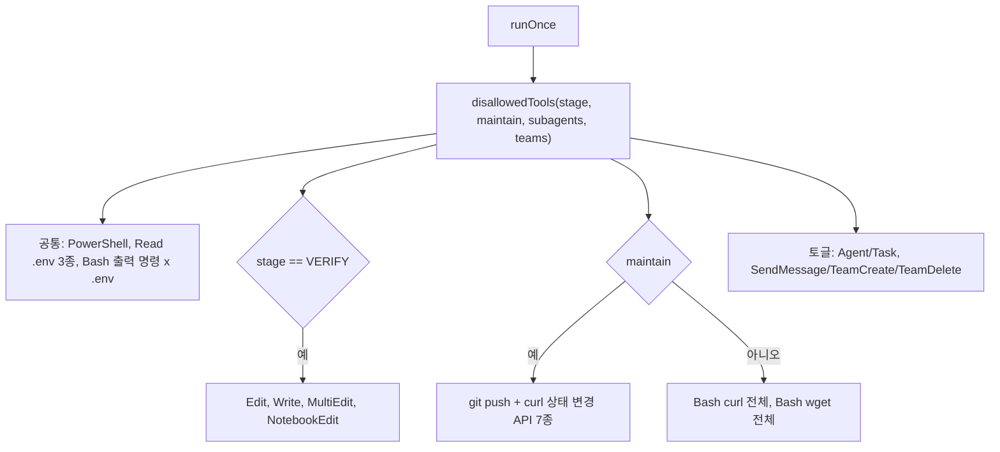
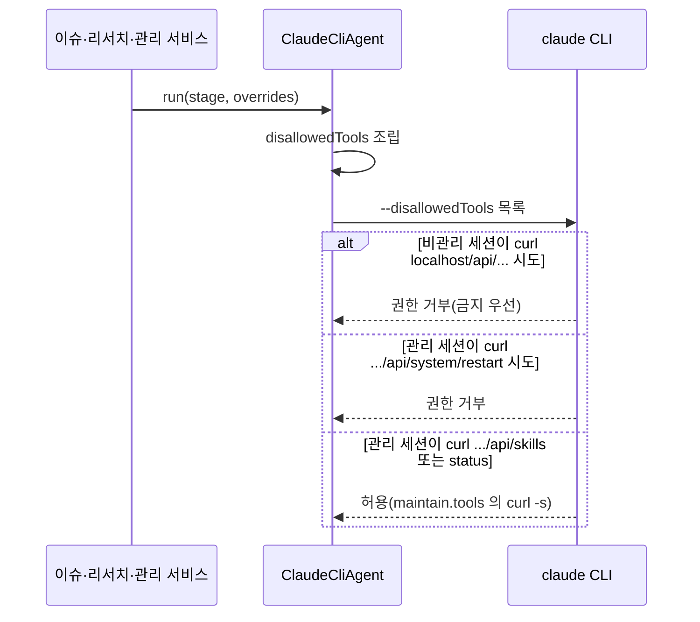

# T-023 변경 설명서 — 검증 리뷰어 편집 도구 금지와 에이전트 curl 제한

> 담당: backend-dev (backend-dev) · 2026-11-25 · 지시서: [T-023](../T-023-에이전트-도구-제한.md)

## 요약
에이전트 세션의 `--disallowedTools` 조립을 `ClaudeCliAgent.disallowedTools(stage, maintain, subagents, teams)` 한 곳으로 모으고, 단계·출처별 금지를 더했다(OI-30 ①, OI-22 ①, T-021 MEDIUM-1).
검증 리뷰어는 Edit/Write 류 금지, 플랫폼 관리가 아닌 세션은 curl·wget 금지, 플랫폼 관리 세션은 상태 변경 로컬 API 로의 curl 만 금지, 모든 세션은 `.env` 읽기 금지다.
버전 2.0.2.

## 그림
### 그림 1. 단계·출처 → 금지 목록

금지는 허용(`*-tools`)보다 우선하므로 `.env`로 curl 을 허용 목록에 넣어도 비-관리 세션에서는 막힌다. 관리 세션은 스킬 등록·삭제와 상태 조회 curl 이 필요해 curl 전체를 막지 않는다. VERIFY 는 단계만 보며(관리 세션은 항상 FIX).

### 그림 2. 시퀀스(정상 + 대표 실패)

거부는 CLI 의 권한 판정이며 앱은 별도 처리 없이 결과를 그대로 받는다(실제 CLI 호출 확인은 하지 않았다).

## 파일 지도
| 파일 | 추가/수정 | 역할 |
|---|---|---|
| `src/main/java/io/github/lib0823/devagent/agent/claude/ClaudeCliAgent.java` | 수정 | `disallowedTools` 정적 메서드 추가, `runOnce`가 이를 사용 |
| `src/test/java/io/github/lib0823/devagent/agent/claude/ClaudeCliAgentTest.java` | 수정 | TC 5개(`tc023*`) 추가 |
| `build.gradle` | 수정 | 2.0.1 → 2.0.2 |
| `README.md`, `CLAUDE.md` | 수정 | 금지가 허용보다 우선하는 동작 변화 한 줄씩 |

## 주요 결정
| 결정 | 이유 | 검토한 대안 |
|---|---|---|
| 중간 `*` 패턴(`Bash(curl *api/maintain*)`) 사용 | `claude --help`(2.1.332)의 `--disallowedTools` 예시가 `Bash(git *)` 형태(공백+`*` 와일드카드)를 보이고, Claude Code 권한 문서가 와일드카드를 패턴 어느 위치에나 허용하며 `Read()`는 gitignore 식 경로(`./`, `**`, `//절대경로`)를 쓴다고 안내한다(문서는 직접 열람하지 못하고 알려진 문서 내용 기준 — 아래 제안 참고) | 패턴 없이 curl 전체 금지(스킬 등록이 깨짐 — 범위 밖) |
| `.env` Bash 금지는 `<cmd> *.env`·`<cmd> *.env *` 두 형태 | `.env.example`·`env.template`은 `.env`로 끝나지 않아 걸리지 않는다 | `*.env*`(example 까지 막힘) |
| Grep·Glob 전용 패턴은 넣지 않음 | 문서상 Read 금지 규칙이 Grep·Glob 에도 최선 노력으로 적용되며, `Grep(...)` 경로 패턴 문법은 확인하지 못했다 | 추측 패턴 추가 |
| `Read(//**/.env)`로 앱 홈(작업 디렉터리 밖) 포괄 | 이슈 세션의 cwd 는 worktree 라 `./.env`만으로는 앱 홈 `.env`를 못 덮는다 | `./.env`만 유지 |

## 지시서 밖 추가
없음

## 제안
- 중간 `*`·`Read(//**/.env)` 의 실제 매칭은 CLI 를 띄워 확인하지 않았다(토큰 사용 금지 지침). PM 이 qa 에서 한 번 확인할지 판단해 달라: 비관리 세션 curl 거부, 관리 세션의 `curl .../api/system/restart` 거부·`/api/skills` 허용, 앱 홈 `.env` Read 거부, `.env.example` 허용. 실제로 매칭되지 않으면 해당 패턴만 OI 로 다시 연다.
- Windows 에서 `Bash` 도구가 `cat` 대신 `type`·PowerShell 을 쓰는 경우 등은 `type`만 포함했다. 관리 세션의 `maintain.tools`에 `grep`·`head`·`tail`이 허용돼 있으나 `.env` 인자가 있으면 이번 금지가 이긴다.

## 상태 변경 API 목록 (admin/ `@PostMapping` 재검색, 범위 3 기준)
| 경로 | 관리 세션 curl 금지 | 비고 |
|---|---|---|
| `/api/maintain`(+`/{id}/abort`, `/push`) | 예 (`api/maintain*`) | |
| `/api/system/restart`·`/shutdown` | 예 | |
| `/api/system/import` | 예 | 지시서 목록 항목. 이번 검색의 `admin/`에서는 `SystemController`에 restart·shutdown 만 보임 — 패턴은 미래 대비로 유지 |
| `/api/issues-reply`·`/issues-create`·`/issues-command` | 예 | |
| `/api/skills`, `/api/skills/delete`, `/api/skills/defaults` | 아니오(유지) | 스킬 등록·삭제는 관리 기능 |
| 그 외 POST: `/api/agent-subagents`·`/agent-teams`·`/agent-models`·`/issues-projects/*`·`/messenger-notify`·`/mcp-servers*`·`/platform/test`·`/research*`·`/routines*`·`/agent/sessions/{id}/abort` | 아니오 | 지시서 목록 밖이라 막지 않았다. 설정을 바꾸거나 작업을 시작하는 API 이므로 PM 이 추가 여부 판단(제안) |

## 남는 위험
- Bash 로 파일을 쓰는 경로는 도구 금지로 못 막는다(VERIFY 리뷰어는 `stageNote` 프롬프트에 의존).
- 같은 OS 계정이라 python·node·다른 HTTP 도구·`.env` 를 다른 명령(`awk`, 스크립트)으로 읽는 우회가 가능하다. 개발 PC 내장 DB 의 127.0.0.1 trust 인증도 그대로.
- 관리 세션은 위 표의 "그 외 POST" 를 curl 로 부를 수 있다(OI-33).
- (PM 검수 추가, java-reviewer MEDIUM-1) `.env` Bash 금지는 관리 세션의 허용 명령(`head`·`tail`·`grep`)을 조금 바꾸면 우회된다 — 파일명 없는 `grep -r`, 따옴표(`".env"`), glob(`.env*`). Read 금지가 덮는 Bash 명령도 Claude Code가 인식하는 파일 명령에 한정된다.
- (PM 검수 추가, java-reviewer MEDIUM-2) 관리 세션의 상태 변경 API 금지는 부분 문자열 비교라 `//`·`/./`·문자열 조합으로 우회된다. 실질적 차단은 요청 토큰(OI-22 ②) 몫이다(OI-33).
- (PM 검수 추가, java-reviewer MEDIUM-3, 범위 밖) 이슈 분석·리서치·리서치 검증 세션도 읽기 전용이어야 하지만 편집 도구 금지는 VERIFY에만 있다(OI-34).

## PM 검수 메모 (2026-11-25)
- 패턴 문법 근거 보강: 메인 세션이 Claude Code 공식 권한 문서·CLI 레퍼런스로 확인 — Bash 패턴 중간 `*` 지원, `:*` 는 끝의 ` *` 와 같음, Read 경로 `./`·`**`·`//`(절대)·`~/` 지원, Read 금지는 Grep·Glob(최선 노력)과 Bash 의 인식되는 파일 명령에도 적용, 금지 > 확인 > 허용, `--disallowedTools` 는 규칙마다 별도 인자. 위 "주요 결정"의 "문서는 직접 열람하지 못하고" 는 이 확인으로 대체한다. 그래서 CLI 실측(제안 1)은 하지 않는다.
- 메인 세션 반영(리뷰 LOW): `teams` 지역 변수 하나로, `ENV_READ_COMMANDS` 에서 `type` 제거, `MAINTAIN_DENIED_APIS`·`ENV_READ_COMMANDS` 주석에 우회 한계 명시. 그림 1의 "Bash 출력 명령"은 이제 `type` 없이 7종이다.
- `/api/system/import` 는 코드에 없다(구성 묶음 가져오기는 다른 경로). 패턴은 무해하므로 그대로 둔다.
- 단위 테스트 이름 `tc023*` 는 07의 `TC-023`(접근 제어 E2E)과 무관하다 — 작업 번호(T-023)다. 다음에 이 파일을 고치는 작업에서 `t023*` 로 바꾼다.

## 검증
- 검증 명령: `./gradlew test bootJar` → 성공(전체 147 테스트, 실패 0, `ClaudeCliAgentTest` 10개 중 신규 5개). grep 4종은 지시서 증거 참고.
- 테스트: 신규 5개(TC ID `tc023*`), 순수 단위(Spring 없음). 변경 메서드의 모든 분기를 덮는다.
- 앱 기동: 8778 한 번 기동해 `/api/system/status` 200(version 2.0.2) 확인 후 `stop-app.sh`로 내림, 8778·54329 리슨 0. 8777 은 건드리지 않았다.
- security-scan: 변경 범위 점검 — 하드코딩 비밀 없음, 새 입력 경로·쿼리 없음, 금지 목록 추가만(공격 면 축소). Critical/Major/Minor 0.
