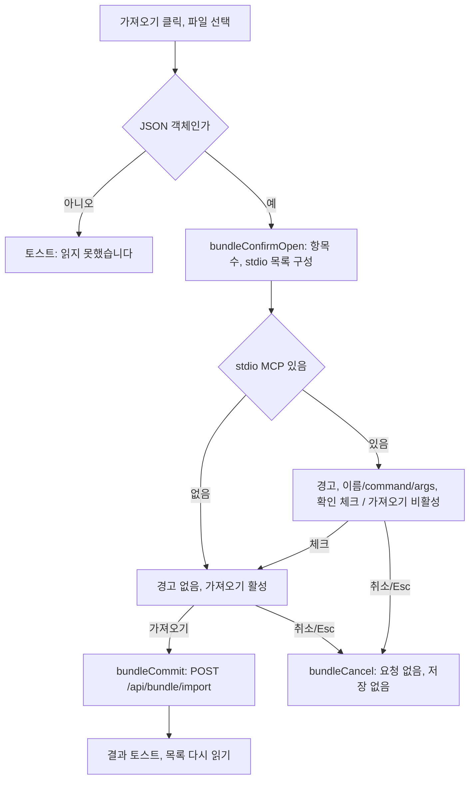
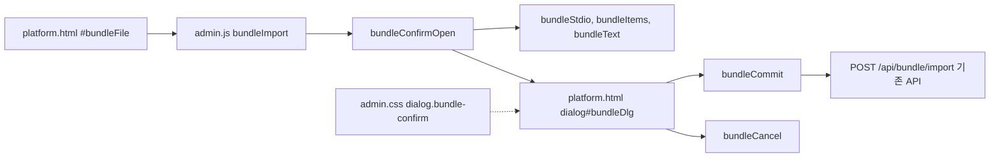
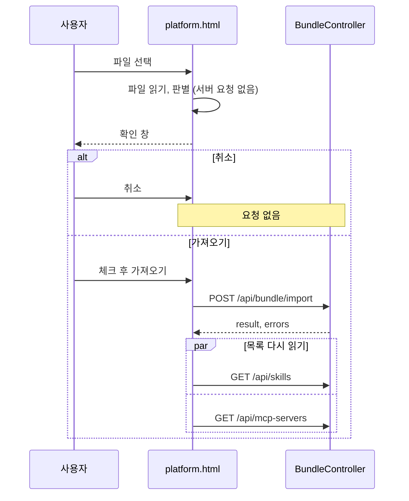

# T-025 변경 설명서 — 구성 묶음 가져오기 확인 창

> 담당: frontend-dev (frontend-dev) · 2026-11-25 · 지시서: [T-025](../T-025-묶음-가져오기-확인.md)

## 요약
- 플랫폼 탭 「가져오기」가 파일을 고르면 바로 보내지 않고 확인 창을 띄운다(OI-32 ①, 06 §3.6, FR-604). 창은 항목 수와 stdio MCP 서버마다 이름·`command`·`args` 전체(고정폭)를 보여 준다.
- stdio MCP가 있으면 경고와 확인 체크가 나오고, 체크 전에는 「가져오기」가 눌리지 않는다. 취소하면 저장 요청이 나가지 않는다. stdio가 없으면 경고 없이 항목 수만 보이고 바로 가져온다.
- 묶음 값은 모두 `textContent`로 넣어 HTML로 해석되지 않는다. 화면만 고쳤고 서버 API는 추가하지 않았다. 버전 2.0.3 → 2.0.4.

## 그림
### 그림 1. 파일 선택 → 확인 창 → 저장/취소

확인 창이 열려 있는 동안 서버로 나가는 요청은 없다. 보낼 때는 화면이 읽어 보여 준 바로 그 JSON 객체를 그대로 보내므로, 보인 목록과 저장되는 목록이 어긋나지 않는다. Esc(`cancel` 이벤트)도 취소와 같다.

### 그림 2. 컴포넌트 구조

모두 플랫폼 화면 전용이라 공통 컴포넌트로 빼지 않았다. 로직은 `admin.js`, 마크업은 `platform.html`, 스타일은 `admin.css`에 있다.

### 그림 3. 데이터 요청 순서

확인 단계에는 요청이 없고, 가져온 뒤 목록 갱신은 기존대로 병렬로 시작한다.

## 파일 지도
| 파일 | 추가/수정 | 역할 (한 줄) |
|---|---|---|
| `src/main/resources/static/admin.js` | 수정 | `bundleImport`를 확인 창 흐름으로 교체, `bundleConfirmOpen`·`bundleCommit`·`bundleCancel`·`bundleStdio` 추가 |
| `src/main/resources/static/platform.html` | 수정 | `dialog#bundleDlg` 마크업 |
| `src/main/resources/static/admin.css` | 수정 | `dialog.bundle-confirm` 스타일(줄바꿈·내부 스크롤·44px 터치) |
| `build.gradle` | 수정 | version 2.0.4 |
| `docs/tasks/results/T-025/{390,768,1440}.png` | 추가 | 확인 창 스크린샷(stdio MCP 1개 묶음) |

## 주요 결정
| 결정 | 이유 | 검토한 대안 |
|---|---|---|
| 화면만 고치고 미리보기 API(`/api/bundle/preview`)는 만들지 않음 | stdio 기준이 서버에서도 `type`을 strip+소문자로 비교해 `stdio`와 같은지(`McpConfigService`) 뿐이고, 값은 `BundleController.text()`(문자열 그대로, 객체·배열은 빈 문자열)로 읽는다. 화면이 같은 규칙을 그대로 따라 할 수 있다. 05 변경도 필요 없다 | 미리보기 API — 서버 기준이 화면과 같아져 기준이 두 곳이 될 필요가 없음 |
| `args`·`command`가 문자열이 아니면 서버처럼 빈 문자열로 보여 줌 | 서버가 `asText()`로 읽으면 배열은 빈 문자열이 저장된다. 보인 것 = 저장될 것 | 배열을 펼쳐 보여 주기(저장 값과 달라짐) |
| `mcpServers`가 객체여도 값들을 항목으로 취급 | 서버가 `JsonNode` 순회로 객체의 값도 돈다 | 배열만 인정 |
| 「가져오기」 체크 비활성은 `disabled` 속성 + 스크립트 가드(`bundleCommit`) | 버튼을 스크립트로 눌러도 체크 없이는 전송되지 않게 | `disabled`만 |
| 새 클래스는 `bundle-confirm`/`bc-*` 접두어 | `ui.css`의 `.sec` 충돌 사례(CLAUDE.md) 방지 | - |

## 지시서 밖 추가
- 창 머리에 "같은 이름은 덮어쓰고 지우지는 않습니다." 한 줄(기존 `confirm` 문구에 있던 내용을 옮김).
- `dialog.bundle-confirm [hidden]{display:none!important}`: `.callout`의 `display:flex`가 `hidden` 속성을 덮어쓰는 것을 막는 스타일.

## 제안
- 06에 모바일 동작 필요 — S-05 플랫폼 화면 자체: 390px에서 상단바(`header#topbar`의 `nav.nav`, `div.strip`)가 가로로 넘쳐 페이지 `scrollWidth`가 약 931px이 된다(이 변경 전부터 있음, T-020 상단바 범위로 보임). 모바일 실기기·에뮬레이션(`isMobile`)에서는 레이아웃 뷰포트가 넓어져 가운데 정렬된 `fixed` 다이얼로그가 화면 밖으로 밀린다. 이 창 자체는 390 폭에서 넘침 없이 동작하지만(아래 검증), 페이지 넘침이 고쳐져야 실제 모바일에서 보인다. 스크린샷은 `isMobile` 없이 390 폭 뷰포트로 찍었다.
- 05 반영 필요 없음(API 추가 없음). 07 TC-025 단계에서 취소 버튼 선택자는 창 안으로 한정해야 한다(`#bundleDlg .bc-btns`) — 스킬 폼 등에도 「취소」가 있다.
- `inspect.mjs --app`의 FAIL 6건(micro-label, button-fx, heavy-shadow, tiny-text, no-title, overflow@768 외 contrast 등)은 모두 기존 상단바·카드 규칙이며 확인 창과 무관하다(창은 닫힌 상태로 검사됨). 이 지시서 범위에서 고치지 않았다.

## 검증
- 검증 명령: `node --check admin.js`, `node --check ui.js` → 통과. `./gradlew test bootJar -q` → 종료 코드 0(테스트 실패 0).
- `grep -n innerHTML admin.js`: 이번에 추가·교체한 208~256행에는 없음. 묶음 값은 `textContent`/`append`만 사용. 남은 `innerHTML`은 기존 코드(261행 이슈 에이전트 비활성 안내 등, 묶음 값 아님).
- 앱 확인(8778, 확인 뒤 `stop-app.sh`로 내림, 8778·54329 리슨 0): Playwright 20개 확인 모두 통과 — 이름·인자의 `<b>` 글자 그대로 표시(`b` 요소 0개), 체크 전 가져오기 비활성, 취소 뒤 `/api/mcp-servers`에 없음, 체크 후 가져오기하면 저장됨, stdio 없는 묶음은 경고·목록·체크 없이 가져오기 후 스킬 반영, 390/768/1440에서 창이 뷰포트 안·버튼 보임·터치 영역 44px 이상. 시험 데이터(MCP·스킬)는 삭제, 시험 묶음 파일은 저장소 밖 임시 폴더.
- 테스트: 저장소에 화면 단위 테스트 틀이 없어 위 Playwright 스크립트(저장소 밖 임시 폴더)로 확인했다. TC-025 E2E는 qa 단계에서 작성.
- 스크린샷: `docs/tasks/results/T-025/390.png`, `768.png`, `1440.png` (페이지 본문은 숨기고 확인 창만 — 로컬 경로가 찍히지 않게)
- inspect: `platform.html` FAIL 6/WARN 5, 전부 기존 페이지 요소(위 제안 참고), 확인 창 관련 항목 없음. 지시서의 "FAIL 0"은 이 변경만으로는 달성하지 못함.
- Figma: 반영 안 함(지시서 기본값)

## 재작업 이력
### 2026-11-25 코드 리뷰 반영 (HIGH 1, MEDIUM 2, LOW 3)
- H1: 화면 stdio 판별이 서버(`McpConfigService`의 `strip().toLowerCase(ROOT)`)와 달라 `"type":"stdio\u001f"`가 경고 없이 통과하던 문제. 이제 `bundleIsRemote`가 Java `String.strip()`과 같은 공백 집합(U+001C~U+001F 포함, NBSP·U+2007·U+202F 제외)으로 type을 정리·소문자화한 값이 정확히 `http`·`sse`일 때만 "원격"으로 보고, 나머지(stdio, 누락, null, 배열, 이상한 값)는 전부 경고·확인 대상이다(실패하면 닫히는 쪽). 판별은 `javaStrip`·`bundleIsRemote` 순수 함수.
- 변형 입력 확인: `node docs/tasks/results/T-025/bundle-type-check.mjs` → 전부 통과. `stdio`+U+001F, ` STDIO `, `stdio`+U+00A0, 누락, null, 배열은 경고 대상, `http`·` HTTP `·`sse`·`http`+U+001F는 원격(경고 없음), `http`+U+00A0은 서버가 지우지 않으므로 경고 대상.
- M1: command는 strip, args는 `\r?\n` 분리·빈 줄 제거·줄마다 strip(서버와 같은 규칙). 제어·서식 문자(`\p{Cc}`·`\p{Cf}`, 개행 제외)는 `\u202E` 같은 가시 표기로 바꿔 보여 준다(`bundleVisible`, `textContent` 유지, 이름에도 적용).
- M2: 파일 2MB 초과는 읽지 않고 토스트로 거부(`BUNDLE_MAX_BYTES`). stdio 항목은 50개(`BUNDLE_MAX_SHOWN`)까지만 그리고 "외 N개" 표시, 경고·확인은 전체 기준.
- L1: `settings`가 배열이면 「에이전트 설정」을 세지 않음. L2: `format`이 `dev-agent-bundle`(서버 `BundleController.FORMAT`)이 아니면 확인 창 전에 거부. L4: 가져오기 응답이 JSON이 아니면 `서버 응답을 읽지 못했습니다 (HTTP 상태)` 토스트.
- 앱 확인(8778, 확인 뒤 `stop-app.sh`로 내림, 8778·54329 리슨 0, 8777 무관): 기존 묶음 경고·체크 필수, 변형 type(`stdio`+U+001F) 묶음이 경고를 띄우고 `\u202E`를 가시 표기, http 묶음은 경고 없음, 잘못된 format·2.2MB 파일은 토스트 거부, 60개 stdio는 50개+"외 10개", 배열 settings는 개수에 없음. `node --check admin.js` 통과, `./gradlew.bat test bootJar -q` 종료 코드 0.
- 추가 파일: `docs/tasks/results/T-025/bundle-type-check.mjs`(위 변형 입력 확인 스크립트, 지시서 밖 추가).

### 재작업 시 제안 추가
- 서버 `/api/bundle/import`는 stdio 확인 여부를 받지 않아 curl 등으로 직접 호출하면 경고 없이 등록된다(이 확인은 화면 한정). 서버가 확인 플래그나 별도 승인 단계를 요구할지는 PM 판단 필요(범위 밖).
- L3(리뷰 지적, 이번에 하지 않음): PM이 범위를 정해 주세요.
