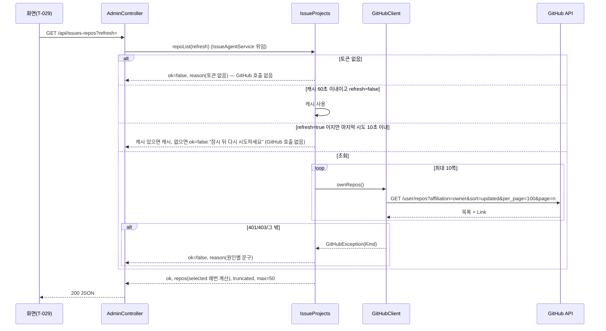
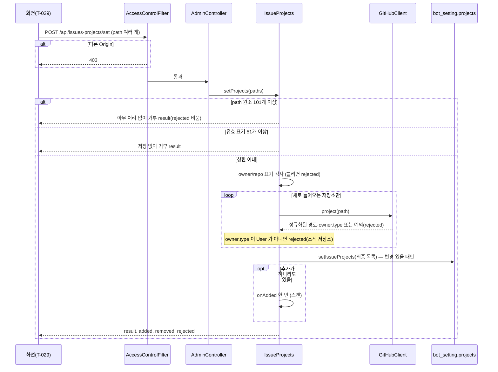
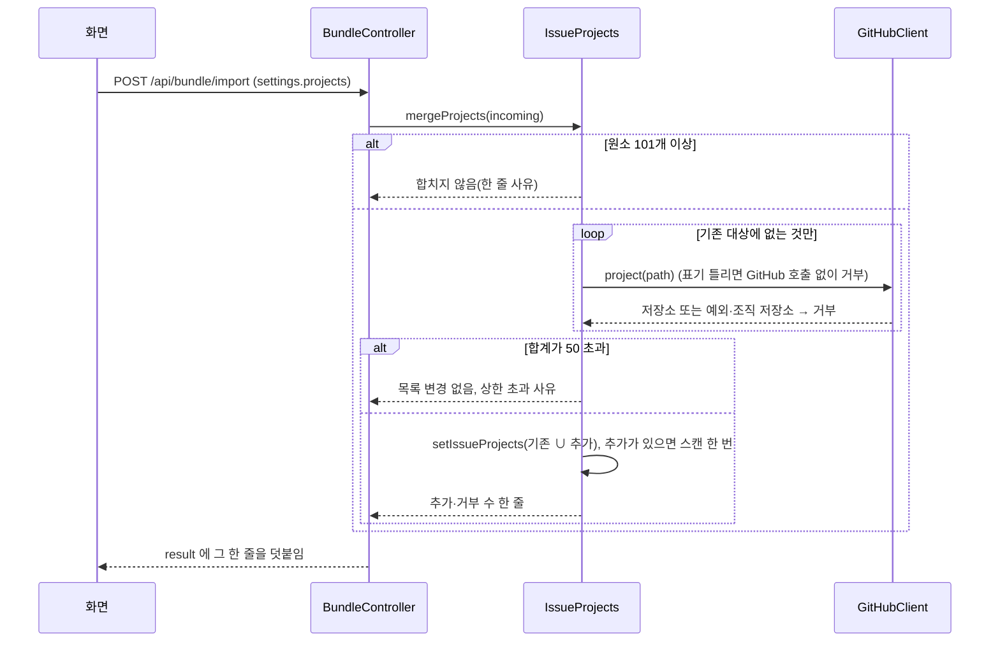

# T-028 변경 설명서 — GitHub 내 저장소 목록 API와 대상 프로젝트 일괄 저장

> 담당: backend-dev (backend-dev) · 2026-11-27 · 지시서: [T-028](../T-028-github-저장소-목록-api.md)

## 요약
토큰이 접근할 수 있는 내 소유 GitHub 저장소 목록(`GET /api/issues-repos`)과 대상 프로젝트 일괄 저장(`POST /api/issues-projects/set`)을 추가했다(OI-09 변경·OI-42, FR-301·FR-307).
화면(T-029)이 저장소를 골라 한 번에 저장할 수 있다. 처리 범위는 여전히 대상 프로젝트 목록으로 제한되고 상한은 50개다.
안내 문구를 토큰 "All repositories" 기준으로 고쳤고 버전은 2.3.0이다.

## 그림
### 그림 1. 저장소 목록 조회

조직 소유(`owner.type != User`) 항목은 버린다. 받은 쪽이 100개 미만이거나 `Link`에 `rel="next"`가 없으면 멈추고, 10쪽까지 다음 쪽이 이어지면 `truncated=true`. 실패는 HTTP 200 + `ok:false`이며 실패는 캐시하지 않는다. `selected`는 캐시와 무관하게 현재 대상 목록으로 계산한다.

### 그림 2. 대상 프로젝트 일괄 저장

기존 대상은 GitHub 재확인 없이 원래 표기를 유지한다. 빠진 기존 대상은 `removed`(진행 중 세션은 건드리지 않음). `path` 0개는 전체 해제. `/add`에도 같은 상한(50)을 적용했다.

### 그림 3. 구성 묶음 가져오기의 대상 프로젝트 (재작업 R1)

`BundleController`는 더 이상 `settings.setIssueProjects`를 직접 부르지 않고 `synchronized` 메서드 `IssueProjects.mergeProjects`를 거친다. 기존 대상은 지우지 않는다(`setProjects`와 달리 합집합). 토큰이 없으면 새 대상은 전부 거부되고 사유가 응답에 보인다.

## 파일 지도
| 파일 | 추가/수정 | 역할 (한 줄) |
|---|---|---|
| `issue/GitHubClient.java` | 수정 | `ownRepos()`, `Repo`/`RepoList`, `hasToken()` — 쪽 이어 붙이기·조직 제외·10쪽 상한. `Project`에 `ownerType`·`isUserOwned()`(R2) |
| `issue/IssueProjects.java` | 수정 | `repoList`(60초 캐시·reason·10초 refresh 간격 R4)·`setProjects`(일괄 저장·요청 100개 상한 R3)·`mergeProjects`(R1)·조직 저장소 거부(R2)·상한 50, add/remove/set/merge `synchronized` |
| `admin/BundleController.java` | 수정 | 가져오기의 대상 프로젝트를 `IssueProjects.mergeProjects`로 위임, 응답에 결과 한 줄(R1) |
| `agent/claude/ClaudeCliAgent.java` | 수정 | `MAINTAIN_DENIED_APIS`에 `api/issues-repos` 추가(R5) |
| `test/.../admin/BundleProjectsTest.java` | 추가 | R1 위임·직접 쓰기 없음 |
| `issue/IssueAgentService.java` | 수정 | 위임 메서드 2개 |
| `admin/AdminController.java` | 수정 | `GET /api/issues-repos`, `POST /api/issues-projects/set` |
| `ops/GitHubCheck.java`, `config/GitHubProperties.java`, `application.yml`, `.env.example`, `deploy/env.server.example`, `dist/env.template`, `README.md`, `CLAUDE.md` | 수정 | "All repositories" 안내·위험 문구·새 API 표기 |
| `build.gradle` | 수정 | 버전 2.3.0 |
| `test/.../issue/RepoPickerTest.java` | 추가 | TC-026 ①②③ |
| `test/.../issue/FakeGitHubServer.java` | 수정 | 질의 문자열 포함 키(쪽별 응답) 지원 |
| `GitHubSecurityTest`, `AccessControlFilterTest`, `ClaudeCliAgentTest`, `ResearchServiceTest` | 수정 | 토큰 누출·Origin 403·금지 패턴·질의 대상 제한 테스트 |

## 주요 결정
| 결정 | 이유 | 검토한 대안 |
|---|---|---|
| 목록 캐시·일괄 저장을 `IssueProjects`에 둠 | 지시서 지정, 기존 add/remove와 같은 곳 | 새 서비스 클래스(범위 밖) |
| 토큰 없음은 GitHub 호출 전에 `IssueProjects`가 판정 | 불필요한 호출 방지, 문구 구분 | 클라이언트 예외 Kind 추가 |
| 캐시 시계를 패키지 전용 필드(`clock`)로 | 생성자를 둘로 만들면 `@Autowired` 함정 | 생성자 오버로드 |
| 형식 오류·상한은 GitHub 호출 전에 거름 | 51개 이상이면 외부 호출 0 | 호출 후 거름 |
| 조직 저장소 판정을 `Project.ownerType`(GitHub `owner.type`)으로, 새로 들어오는 것만 | 지시서 R2. 기존 대상은 다시 검사하지 않음. `owner` 누락은 `User`가 아니므로 거부 | 목록 API 결과로 판정(캐시와 어긋남) |
| refresh 간격은 마지막 "시도" 시각 기준, `refresh=true`에만 적용 | 지시서 R4. 실패도 호출 한도를 쓰므로 시도로 셈. 일반 조회는 기존대로 | 성공 시각 기준 |
| 묶음 가져오기는 별도 `mergeProjects`(합집합) | `setProjects`는 빠진 것을 지우므로 의미가 달라 재사용 불가, 규칙(검사·상한·스캔)만 공유 | `setProjects` 호출 |
| `GitHubCheck` 힌트에 "저장소 선택" 문구 유지 | 기존 `GitHubCheckTest` 단언 | 문구 전면 교체 |

## 지시서 밖 추가
없음. (`GitHubCheck`의 `REPO_HINT` 문구와 `FakeGitHubServer` 질의 키 지원은 범위 6·8의 부수 변경.)

## 제안
- 남는 위험: 토큰 범위가 개인 저장소 전부로 넓어졌다. 플랫폼 관리 세션의 curl 금지 패턴은 부분 문자열 비교라 `//`·문자열 조합 등으로 우회할 수 있다(02 §6, 실질 차단은 요청 토큰 몫). 재작업 R5로 `api/issues-repos`는 금지 목록에 들어갔다.
- 반영하지 않은 것(지시): `rejected[].path` 입력 그대로 → T-029 출력 이스케이프, Host 미확인·DNS rebinding → OI-21(PM).
- 문서(05 §2.3·02 D-6·04 §9 위험)는 PM이 검수 때 반영.
- 없음 외 명세 불일치: 없음.

## 검증
- 검증 명령: `./gradlew.bat test bootJar` → BUILD SUCCESSFUL, 251건 0 실패(재작업 전 243건, R1~R5 테스트 8건 추가). 8778 격리 기동 결과는 지시서 검증 증거 참조.
- 커버리지: 별도 측정 도구 없음. 새 분기(토큰 없음·캐시·401/403/500·쪽 상한·표기 오류·거부·상한 초과·0개·추가만 스캔)를 테스트함.
- security-scan: 호출 완료 — 하드코딩 비밀·실제 계정명·`.env` 값 없음(테스트 토큰은 가짜 값), 쿼리는 URI 변수(`{p}`)로 파라미터화, 토큰은 응답·예외·로그에 없음(`***` 마스킹 테스트), 상태 변경 POST는 Origin 확인 필터 적용. Critical/Major 0.

## 재작업 이력
- 2026-11-27 (반려 R1~R5 반영): R1 묶음 가져오기를 `IssueProjects.mergeProjects`로 이전(직접 `setIssueProjects` 호출 제거, 합집합·상한·스캔 한 번·결과 한 줄) / R2 새 대상은 `owner.type=User`만(`addProject`·`setProjects`·R1, 메신저 포함) / R3 `setProjects` 요청 원소 100개 초과 시 선처리 거부 / R4 `refresh=true`도 마지막 시도 10초 안이면 호출하지 않음 / R5 `MAINTAIN_DENIED_APIS`에 `api/issues-repos`. 기존 테스트는 `owner` 스텁과 시계 진행을 추가해 맞췄다(동작 변경에 따른 수정). 단위 테스트: `RepoPickerTest` 7건, `BundleProjectsTest` 1건, `ClaudeCliAgentTest` 단언 1줄 확장.
