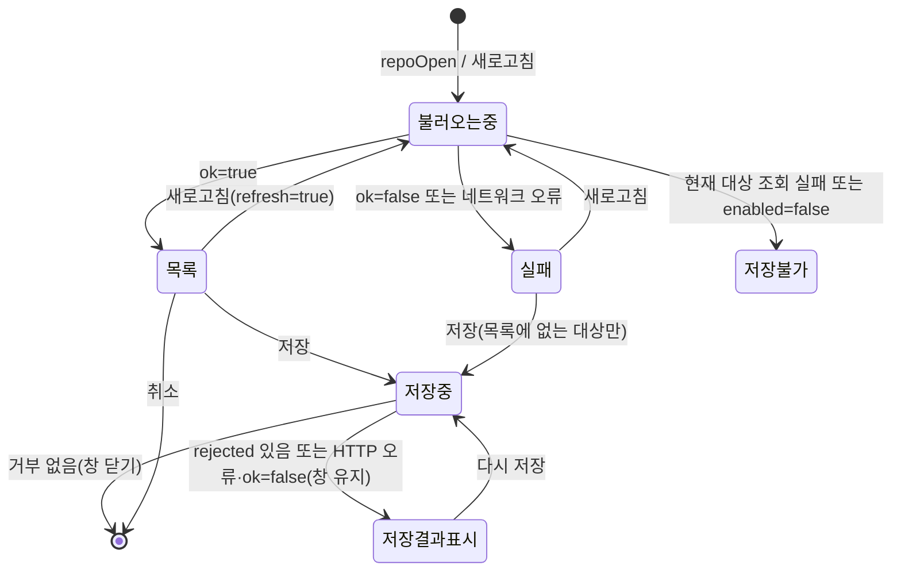
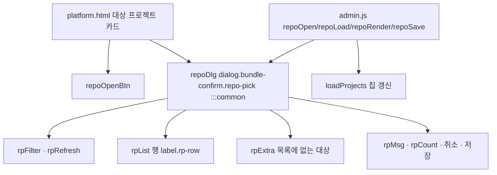
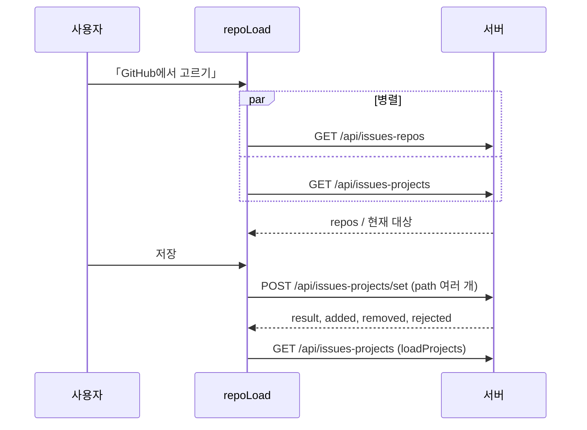

# T-029 변경 설명서 — 플랫폼 탭 「GitHub에서 고르기」 창

> 담당: frontend-dev (frontend-dev) · 2026-11-27 · 지시서: [T-029](../T-029-github-저장소-고르기-화면.md)

## 요약
플랫폼 탭 「대상 프로젝트」 카드에 「GitHub에서 고르기」 버튼과 선택 창(`#repoDlg`)을 추가했다(06 §3.6, OI-09·OI-42, FR-301).
창을 열 때 한 번 `GET /api/issues-repos`를 불러 체크로 고르고 `POST /api/issues-projects/set`으로 한 번에 저장한다.
직접 입력 칸과 칩 × 삭제는 그대로이고, 서버가 준 문자열은 전부 `esc`/`textContent`로만 넣는다.

## 그림
### 그림 1. 창 상태 전이

저장불가 상태는 현재 대상을 모를 때(06 §3.6 ⑨)로, 창 안 원인 문구와 비활성 「저장」을 보이며 새로고침으로도 풀리지 않는다(다시 열어야 한다). 저장 중에는 「저장」·「새로고침」이 모두 비활성이다. 실패 상태에서도 「목록에 없는 대상」은 현재 대상 전부로 보여 체크를 풀어 정리할 수 있다. 상한(`max`) 초과면 저장이 비활성이고, 전부 해제 저장은 `confirm`을 한 번 거친다.

### 그림 2. 컴포넌트 구조

창 껍데기는 T-025 가져오기 확인 창의 `dialog.bundle-confirm`(admin.css) 모양을 재사용했고, 이 창 전용 규칙만 `.repo-pick`·`.rp-*`로 추가했다.

### 그림 3. 데이터 요청 순서

두 조회는 병렬이라 waterfall이 없다. 새로고침이나 창 닫기는 진행 중 요청을 `AbortController`로 취소하고, 순번(`repoSeq`)으로 늦은 응답을 버린다.

## 파일 지도
| 파일 | 추가/수정 | 역할 |
|---|---|---|
| `src/main/resources/static/platform.html` | 수정 | 「GitHub에서 고르기」 버튼, `#repoDlg` 창 마크업 |
| `src/main/resources/static/admin.js` | 수정 | `repoOpen/repoLoad/repoRender/repoFilter/repoCount/repoSave/repoCancel` |
| `src/main/resources/static/admin.css` | 수정 | `.repo-pick`·`.rp-*` 스타일, 768px 이상 한 줄 행, 600px 이하 전체 폭·높이 90% |

## 주요 결정
| 결정 | 이유 | 검토한 대안 |
|---|---|---|
| 보관 저장소는 「현재 대상이 아닐 때만」 비활성 | 이미 대상인 보관 저장소를 체크 해제할 수 없으면 정리가 불가능하다(06 ②는 고를 수 없게 하는 뜻) | 항상 비활성 |
| 체크 상태는 DOM(`input[data-p]`)이 보관, 필터는 `hidden`만 토글 | 필터로 가려진 행의 체크가 저장에서 빠지지 않는다 | 별도 Set 상태 |
| 서버 문자열은 `esc` 또는 `textContent`, `webUrl`은 `https://github.com/` 접두일 때만 링크 | T-028 security-reviewer LOW3 | — |
| 현재 대상은 `/api/issues-projects`로 병렬 조회(+`selected`) | 목록 실패 시에도 「목록에 없는 대상」을 보여야 한다 | `selected`만 사용 |
| 두 조회를 `Promise.allSettled`로 분리: 저장 가능 여부는 현재 대상 조회로만, 목록 실패는 안내 문구만 | 목록만 실패해도 현재 대상을 알면 정리 저장 가능, 현재 대상을 모르면 어떤 경로로도 저장 불가(06 ⑨) | `Promise.all` + catch로 삼키기(반려 사유) |
| 저장 응답은 `res.ok`와 `ok !== false`로 판정, `ok` 필드가 없으면(T-030 이전) `rejected` 기준 | 전부 거부된 응답을 성공으로 보이지 않게(06 ⑩, 05 §2.3) | — |
| 결과 문구는 서버 `result`만(수 덧붙이지 않음), 토스트는 `ok`/`err` | 서버 문구와 화면 수치가 어긋나지 않게, `ui.css`에 없는 종류 제거 | `warn` 유지 |
| 카드 머리 배지 위치는 `admin.css`의 `.sec.proj-sec` 범위 규칙 | `.sec`는 사이드바 제목용이라 `ui.css`를 건드리지 않음 | `ui.css` 수정 |
| 새 색·글꼴 없이 `badge`·`callout`·토큰만 사용 | 지시서 디자인 시스템 규정 | — |

## 지시서 밖 추가
- 불러오는 중 스켈레톤 4행(`.rp-skel`): 레이아웃 이동 방지.
- 창 안 「N개 선택 (최대 50개)」 카운터: 상한 안내용(06 ③의 안내 문구 위치).
- 이 변경의 확인용 스크립트 `e2e/test-results/t029-check.mjs`(Playwright, 응답 가로채기·넘침·터치·XSS 확인; 이 폴더는 git 제외 산출물 위치, 커밋 대상 아님).

## 제안
- (재작업 반영) 제안 ①은 PM이 기각했다 — 현재 대상 미표시는 서버 변경 없이 R1(저장 불가 + 안내)로 처리했다.
- 토큰이 없으면 서버가 `/api/issues-projects`에 `projects: []`(enabled=false)를 돌려줘 창의 「목록에 없는 대상」이 비어 보인다. 현재 대상이 있는 정상 설치에서는 무관하지만, 토큰 없음 상태에서도 현재 대상을 볼 수 있으려면 서버 확인이 필요하다(T-028 범위, 불일치는 아님).
- 06에는 `truncated` 문구의 구체 숫자가 없어 "최대 1,000개까지"로 적었다(06 ⑥의 1,000개 기준).
- inspect 기존 FAIL 6건(micro-label, button-fx, heavy-shadow, tiny-text, no-title, 768px 가로 넘침)은 이 변경과 무관(상단바·셸·기존 카드, OI-35·OI-40).
- `.taste-skill/`은 루트 `.gitignore`에 한 줄 추가했다(사용자 지시).

## 검증
- 검증 명령: `node --check admin.js`·`ui.js` 통과, `grep issues-repos|issues-projects/set` 3곳, `./gradlew.bat bootJar` 성공.
- 테스트: 화면은 vanilla JS라 단위 테스트 도구가 없어 Playwright 스크립트로 확인(별도 TC-027은 QA). 확인 항목: 행 렌더·필터·보관 비활성·현재 대상 체크·목록에 없는 대상·저장 payload(`path` 반복)·거부 표시(창 유지, 태그 미해석)·상한 초과 저장 비활성·취소 시 요청 없음·XSS(``, `javascript:` URL) 미실행·콘솔 오류 0.
- 토큰 없음(실제 응답, 8778): 창 안에 "GitHub 토큰이 설정되지 않았습니다 … 직접 입력은 그대로 쓸 수 있습니다." 표시, 콘솔 오류 0.
- 넘침: 390/768/1440 모두 `scrollWidth <= innerWidth`, 창·본문 가로 넘침 없음(창 폭 371/637/636px). 44px 미만 터치 영역 0.
- inspect: `platform.html` 6 FAIL / 5 WARN, 전부 기존 항목(위 제안 참조), 이 변경으로 생긴 FAIL 0.
- 재작업 확인(2026-11-27, 8778 재기동, `bootJar` 재빌드 후): Playwright `e2e/test-results/t029-r-check.mjs` 63개 항목 ALL PASS. R1 — `/api/issues-projects` 500·네트워크 실패·JSON 아님·`enabled:false` 4경우 모두 창 안 원인 문구 + 「저장」 비활성, 새로고침 뒤에도 유지, `repoSave()` 직접 호출도 무동작. R2 — `/api/issues-repos` 네트워크 실패 + 현재 대상 조회 성공이면 실패 문구와 함께 「저장」 활성·「목록에 없는 대상」 표시. R3 — `ok:false`·HTTP 500(JSON/비JSON) 모두 성공 토스트 없이 `result`(또는 대체 문구)를 창 안에 보이고 창 유지·버튼 복구, `ok` 필드 없는 응답은 기존 동작(닫힘 + `result`만 쓴 `ok` 토스트). R4/R5 — `rejected` 있으면 문구는 `result`만, 토스트 `err`, 거부 사유 태그 미해석. R6 — 배지가 제목 바로 옆(간격 6px), 버튼은 오른쪽 끝. R7 — 저장 중 「저장」·「새로고침」 비활성이고 `repoCount()`를 불러도 켜지지 않음. R8 — `path`가 숫자인 항목은 건너뜀. 390/768/1440 넘침 없음·44px 미만 0·콘솔 오류 0·XSS 미실행도 다시 확인. inspect는 재실행하지 않았다(이번 변경은 창 스크립트와 카드 머리 flex 규칙뿐, 새 FAIL 요인 없음).
- 스크린샷(재촬영, 위 스크립트): `docs/tasks/results/T-029/390.png`, `768.png`, `1440.png`(추가 `1440-saved.png` 저장 결과). 가짜 저장소는 `demo-user/*` 예시. 시스템 카드의 로컬 홈 경로는 `/api/system/**` 응답을 가로채 `<repo>`로 바꿔 촬영(공개 저장소).
- Figma: 반영 안 함(지시서 기본값).

## 재작업 이력
- 2026-11-27: PM 반려 R1~R8 반영. `admin.js` `repoLoad`(`Promise.allSettled`, 현재 대상 조회 실패·`enabled:false`면 `repoBlock` 문구 + 저장 비활성), `repoSave`(HTTP 상태·`ok` 확인, 서버 `result`만 표시, 토스트 `ok`/`err`, `repoSaving` 동안 저장·새로고침 비활성), `repoRender`(`path`가 문자열 아닌 항목 건너뜀), `platform.html` 카드 머리에 `proj-sec` 클래스, `admin.css`에 `.sec.proj-sec` 규칙. 서버 코드는 건드리지 않았다(`ok`는 T-030). 스크린샷 3장 재촬영(`1440-saved.png`는 이전 촬영본 그대로).
