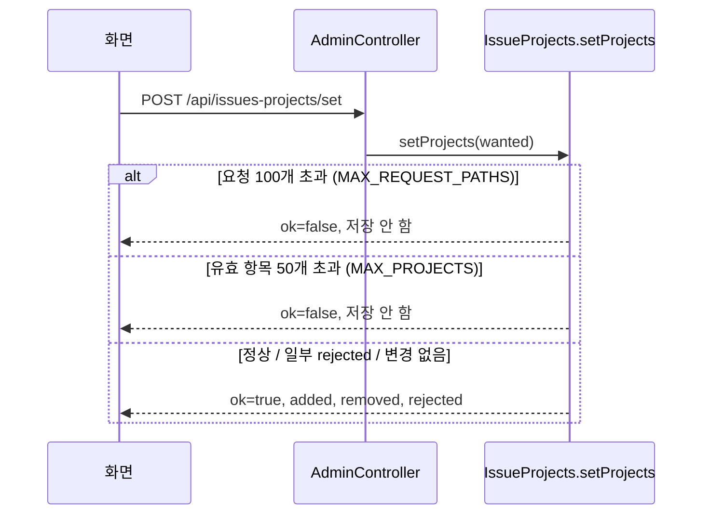

# T-030 변경 설명서 — `/api/issues-projects/set` 응답에 `ok` 추가

> 담당: backend-dev (backend-dev) · 2026-11-27 · 지시서: [T-030](../T-030-일괄-저장-ok-필드.md)

## 요약
일괄 저장이 통째로 거부돼도 응답 모양이 정상과 같아 화면이 성공으로 보이던 문제를 없앴다(FR-301, TC-026).
`IssueProjects.setResult` 응답 맨 앞에 `ok`를 넣어, 아무것도 저장하지 않은 두 거부 경로는 `false`, 그 밖은 `true`로 준다.
화면(T-029)이 이 값으로 성공/실패를 구분할 수 있다.

## 그림
### 그림 1. `setProjects`의 `ok` 결정

HTTP 상태 코드는 그대로(항상 200)이고 본문 `ok`만 다르다. 일부 `rejected`가 있어도 나머지는 저장되므로 `true`다.

## 파일 지도
| 파일 | 추가/수정 | 역할 (한 줄) |
|---|---|---|
| `src/main/java/io/github/lib0823/devagent/issue/IssueProjects.java` | 수정 | `setResult`에 `ok` 인자 추가(맵 첫 항목), 호출 3곳 갱신 |
| `src/test/java/io/github/lib0823/devagent/issue/RepoPickerTest.java` | 수정 | `ok` 확인 테스트 3개 추가(기존 테스트 미변경) |

## 주요 결정
| 결정 | 이유 | 검토한 대안 |
|---|---|---|
| `setResult`의 첫 인자를 `boolean ok`로 | 호출 3곳뿐, 규칙이 호출부에서 보임 | 문자열로 판별 — 취약 |

## 지시서 밖 추가
없음

## 제안
없음

## 검증
- 검증 명령: `./gradlew test bootJar` → 성공(exit 0), 테스트 254개 실패 0. `grep "\"ok\""` → `IssueProjects.java:377` 포함.
- 테스트: 3개 추가(`tc026_okFalseWhenValidOverLimitRejectsAll`, `tc026_okFalseWhenRequestOverMaxPathsRejectsAll`, `tc026_okTrueForNormalPartialRejectAndNoChange`). 추가 분기는 모두 커버.
- security-scan: 입력 검증·응답 형식만 바뀌었고 새 입력·쿼리·비밀값·로그 없음(변경 범위 2파일 점검, 발견 없음).
