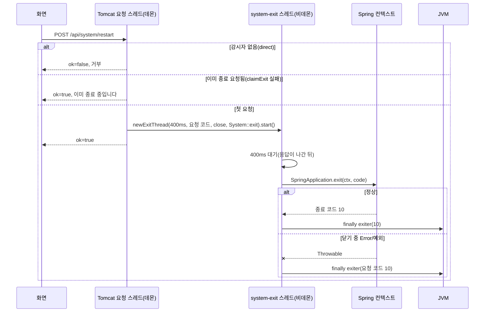
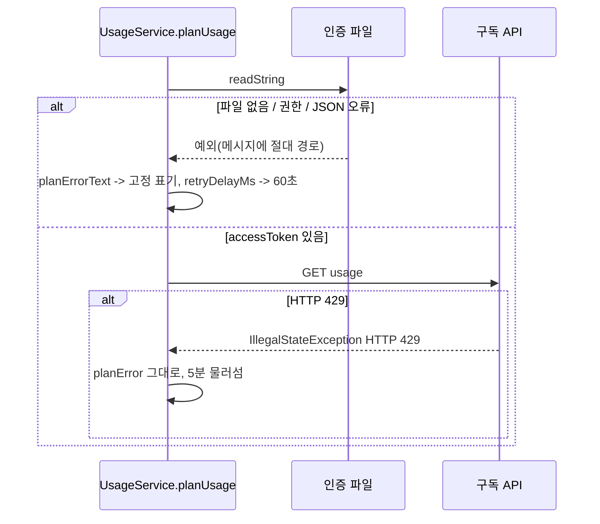

# T-031 변경 설명서 — 화면 「재시작」 종료 코드 10 보장 + `/api/usage` 인증 파일 경로 노출 제거 (2.3.1)

> 담당: backend-dev (backend-dev) · 2026-11-27 · 지시서: [T-031](../T-031-재시작-종료-코드-경로-노출.md)

## 요약
- 종료 스레드를 명시적 비데몬으로 만들어, 컨텍스트가 닫힌 뒤 JVM 이 종료 코드 0 으로 먼저 끝나 `System.exit(10)` 이 밀리는 문제를 막았다(FR-102, TC-028).
- `/api/usage` 의 `planError` 에서 `.credentials.json` 절대 경로·계정 이름이 나가지 않게 고정 문구로 바꿨다(OI-43, TC-029).
- 버전 2.3.0 → 2.3.1.

## 그림
### 그림 1. 종료 경로 (restart = 10, shutdown = 0) — 재작업 반영

요청 스레드가 데몬이라 예전에는 종료 스레드도 데몬이 됐고, 컨텍스트가 닫혀 비데몬 스레드가 사라지면 JVM 이 코드 0 으로 먼저 끝날 수 있었다. 이제 `setDaemon(false)` 라서 `System.exit` 호출 전까지 JVM 이 살아 있다. `/shutdown` 은 같은 경로에 코드 0 을 넘긴다. 재작업으로 닫기 실패에도 `finally` 가 요청 코드로 `exiter` 를 부르고, 연타는 `AtomicBoolean` 으로 첫 요청만 스레드를 만든다.

### 그림 2. 사용률 조회 실패 문구

예외 메시지는 `log.debug` 에만 남고(로컬 로그), 응답의 `planError` 는 `planErrorText` 결과만 실린다. 물러서는 시간은 원래 예외 메시지 기준(`retryDelayMs`)이라 문구를 바꿔도 429 판별이 유지된다.

## 파일 지도
| 파일 | 추가/수정 | 역할 (한 줄) |
|---|---|---|
| `src/main/java/io/github/lib0823/devagent/admin/SystemController.java` | 수정 | `newExitThread` 분리, 비데몬 명시, finally 로 exiter 보장(요청 코드), `claimExit` 연타 방지, shutdown 한계 주석 |
| `src/main/java/io/github/lib0823/devagent/llm/UsageService.java` | 수정 | `planErrorText`·`retryDelayMs` 순수 함수, debug 로그 분리, `parseUsageBody`(응답 해석 실패를 「구독 API 응답 형식 오류」로) |
| `build.gradle` | 수정 | version 2.3.1 |
| `src/test/java/io/github/lib0823/devagent/admin/SystemExitThreadTest.java` | 추가 | TC-028(닫기 Error·연타 포함) |
| `src/test/java/io/github/lib0823/devagent/llm/UsageServiceTest.java` | 수정(추가만) | TC-029(응답 본문 오류 포함) |

## 주요 결정
| 결정 | 이유 | 검토한 대안 |
|---|---|---|
| `newExitThread(delay, requestedCode, closeContext, exiter)` 에 종료 동작을 주입 | 테스트가 `System.exit` 을 부르지 않고 코드 전달을 확인 | 스레드만 반환 — 코드 전달은 못 봄 |
| `FileSystemException` 은 「읽기 실패」, `JsonProcessingException` 은 「형식 오류」 | 지시서 예시대로 원인 종류 구분 | 예외 메시지 노출 — 경로 유출 |
| accessToken 없음·`HTTP n` 은 `IllegalStateException: …` 현행 문구 유지 | 지시서: 그대로 | — |

## 지시서 밖 추가
없음

## 제안
없음

## 서버에서 확인할 것
- `systemctl show dev-agent -p NRestarts -p MainPID` 기록 → 화면/API 「재시작」 → journal 에 `ExecMainStatus=10`, `NRestarts` +1, 새 `MainPID`, `/api/system/status` 200.

## 재작업(R1~R4)
- R1: 구독 API 응답 본문 해석을 `parseUsageBody` 로 떼어 `JsonProcessingException` 을 `IllegalStateException("구독 API 응답 형식 오류")` 로 바꿔 던진다(cause 로만 원인 보존). 인증 파일 단계 「형식 오류」와 문구가 갈린다. 테스트 `tc029_malformedApiResponseBodyIsNotReportedAsCredentialsError` 추가, 기존 `tc029_malformedCredentialsJsonHasFixedText` 는 그대로.
- R2: `newExitThread` 에 요청 코드 인자를 추가하고 `try/finally` 로 `exiter.accept` 를 항상 부른다. 닫기가 Error 를 던지면 요청 코드(10/0)를 넘긴다. 테스트 `tc028_exiterIsCalledWithRequestedCodeEvenWhenCloseContextThrowsError`. 기존 TC-028 테스트는 시그니처 변경에 맞춰 인자만 추가(테스트 자체가 새 시그니처를 쓰는 것이라 불가피).
- R3: `AtomicBoolean exiting` + `claimExit` 로 종료 스레드를 한 번만 만든다. 두 번째부터는 응답 `ok=true`, `result="이미 종료 중입니다."`(키·형식 그대로). 테스트 `tc028_onlyFirstExitRequestClaimsTheExitThread`.
- R4: 코드 변경 없이 `shutdown` 주석에 한계(닫기 중 예외 시 `SpringApplication.exit` 가 0 을 1 로 바꿔 `Restart=on-failure` 가 다시 띄울 수 있음)를 기록. 04 §9 기록은 PM.

## 검증
- 검증 명령: `./gradlew.bat test bootJar` → 성공(재작업 후 재실행, 실패 0). `setDaemon(false)` 179행, `version = '2.3.1'` 확인.
- 앱 기동(8778, `e2e/scripts/start-app.sh`): `/api/system/status` 200, `version` 2.3.1, `/api/usage` 의 `planError` = `인증 파일(~/.claude/.credentials.json) 없음`(경로 없음). `stop-app.sh` 로 내려 포트 응답 없음 확인. 8777 은 건드리지 않음.
- 테스트: TC-028 4건, TC-029 7건(재작업 후). 커버리지 수치는 별도 측정하지 않았다(새 로직 전부 단위 테스트 대상).
- 8778 기동은 재작업 후 다시 확인(status 200, version 2.3.1, planError 경로 없음, stop-app.sh 로 종료).
- security-scan: 변경 파일에서 하드코딩 비밀·주입 없음. 경로·계정 이름 노출은 오히려 제거됨.

## 재작업 이력
- 2026-11-27: PM 반려(R1~R4) 반영. 위 「재작업(R1~R4)」 참조.
