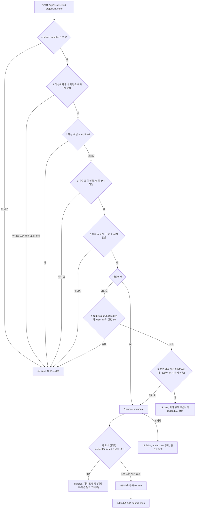
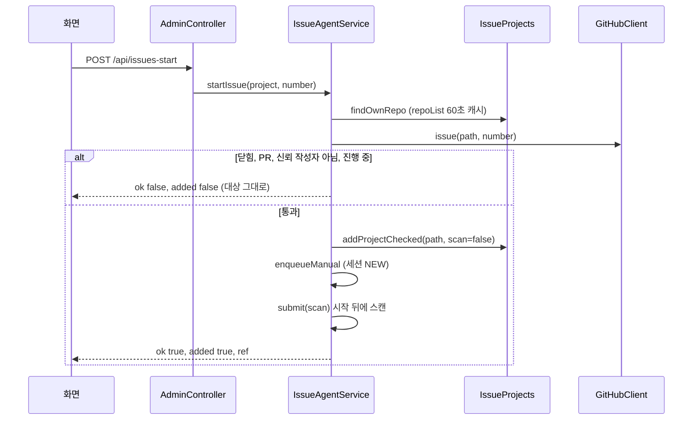

# T-032 변경 설명서 — 대상 아닌 내 저장소의 이슈 목록 조회와 「시작 = 대상 추가 후 처리」 API

> 담당: backend-dev (backend-dev) · 2026-11-27 · 지시서: [T-032](../T-032-내-저장소-이슈-시작-api.md)

## 요약
`GET /api/issues-list`가 대상이 아닌 내 소유 저장소(내 저장소 목록 60초 캐시 기준)의 이슈도 돌려주고, 새 `POST /api/issues-start`가 검사를 모두 통과한 뒤에만 그 저장소를 대상에 넣고 이슈를 시작한다(FR-301, FR-306).
검사에 실패하면 대상 목록은 그대로다. 두 경로는 플랫폼 관리 세션 curl 금지 목록에 올렸고 버전은 2.4.0이다. 화면은 T-033.

## 그림
### 그림 1. `issues-start` 판정 순서 — 어디서 실패하면 대상이 그대로인가

①~③과 ④의 실패까지는 대상 목록을 쓰지 않는다. 목록이 바뀌는 지점은 ④ 성공 한 곳뿐이다. ⑤가 실패하면 추가는 남고(`added:true`) `result`가 "대상 프로젝트에 추가했지만 시작하지 못했습니다"라고 알린다(05 §2.3과 같음). ⑤의 NEW 분기(R3)는 `startIssue` 경로에만 있어 메신저 `이슈 owner/repo#n`은 그대로이고, 종료 세션 재시작(R1)은 `UPDATE … WHERE id AND state IN ('DONE','ABORTED','FAILED')` 한 문장이라 겹친 요청 중 하나만 1건을 얻는다.

### 그림 2. 정상 경로와 대표 실패, 스캔과의 순서

스캔은 시작 뒤에 건다. 추가 직후 스캔이 먼저 같은 라벨 이슈를 집으면 수동 시작이 "이미 진행 중"으로 실패해 `ok:false`가 되기 때문이다. 순서를 추가 → 시작 → 스캔으로 하면 스캔은 `findByIssue`로 기존 세션을 보고 건너뛰고, DB의 `insertIgnore`가 마지막 방어선이다.

## 파일 지도
| 파일 | 추가/수정 | 역할 (한 줄) |
|---|---|---|
| `admin/AdminController.java` | 수정 | `POST /api/issues-start` 추가, issues-list 주석 갱신 |
| `issue/IssueAgentService.java` | 수정 | `openIssueList` 확장, `startIssue`·`locate`, `startManual`에서 `enqueueManual`을 뽑아 공용화 |
| `issue/IssueProjects.java` | 수정 | `addProjectChecked(path, scan)`·`AddResult`, `findOwnRepo`·`OwnRepo`, R2 목록 조회 실패 30초 캐시(`FailCache`) |
| `issue/IssueSessionMapper.java` | 수정 | R1 `restartIfFinished`(종료 상태일 때만 NEW 로 되돌리는 조건부 UPDATE, 스키마 변경 없음) |
| `src/test/.../issue/RepoPickerTest.java` | 수정 | 옛 「실패는 캐시하지 않음」 시험을 R2에 맞게 「30초 안엔 실패 유지, 지난 뒤 재시도」로 바꿈 |
| `issue/GitHubClient.java` | 수정 | `Issue`에 `state`·`isClosed()` 추가 |
| `agent/claude/ClaudeCliAgent.java` | 수정 | 금지 API에 `api/issues-start`·`api/issues-list`, 주석 이유 줄 |
| `build.gradle` | 수정 | version 2.4.0 |
| `CLAUDE.md` | 수정 | 「화면에서 이슈 등록」 단락에 내 저장소 시작 설명 |
| `src/test/.../issue/IssueStartTest.java` | 추가 | TC-030 ①~⑤ (18건) |
| `src/test/.../agent/claude/ClaudeCliAgentTest.java` | 수정 | TC-030 ⑥ 금지 패턴 시험 |

## 주요 결정
| 결정 | 이유 | 검토한 대안 |
|---|---|---|
| `ok`를 `StartResult(ok, message)` 구조로 판정, `startManual`은 `.message()`만 반환 | 문구 정규식 금지, 메신저 명령 문구·동작 불변 | 문구 매칭 |
| 대상 추가는 `addProject`를 `addProjectChecked`로 바꿔 재사용(`addProject`는 위임) | 존재·User 소유·상한 검사를 복제하지 않음, 문구 동일 | 검사 복제 |
| 추가는 스캔 보류(`scan=false`) 후 시작 뒤 스캔 | 위 그림 2 | 스캔 먼저 |
| 대상 아닌 저장소는 `projectCache`를 쓰지 않고 경로 문자열로 `recentOpenIssues`·`issue` 직접 호출 | 영구 캐시에 안 남김. 추가가 성공할 때만 `addProjectChecked`가 캐시에 넣음 | 조회용 캐시 후 정리 |
| 닫힘 판정을 위해 `Issue.state` 추가 | 단건 조회는 closed도 돌려주는데 기존 `startManual`은 거르지 않음(메신저 동작 유지) | 별도 조회 |
| `blocked`는 대상·비대상 목록 모두에 넣음 | 화면이 어디서든 처리 불가 이슈를 표시 | 비대상만 |
| R1 종료 세션 재시작을 전용 조건부 UPDATE(`restartIfFinished`)로, 0건이면 이벤트를 지우지 않고 「이미 진행 중」 거부 | `update(행 전체)`는 그 사이 시작된 세션을 덮어쓴다. 종료 상태 목록은 SQL 텍스트 블록에 리터럴로 적었다(`IssueSession` 상수는 `isActive`와 같은 세 값) | 기존 `updateIf`(상태 하나만 비교 — 종료 상태가 셋이라 부적합) |
| R1 상태 기록은 `transition()`을 쓰지 않고 성공 뒤 `events.clear` → INFO → STATE(`<이전> → NEW`) 이벤트를 직접 남김 | `transition()`은 `sessions.update(행 전체)`를 부르므로 조건부 갱신을 깨뜨린다 | `transition()` 재사용 |
| R2 실패 예외 객체를 30초 보관해 `refresh=false` 호출에 같은 예외를 다시 던짐(`refresh=true`는 기존 10초 간격 규칙 그대로) | 같은 `reason`이 나오고 GitHub 재호출이 없다. 성공하면 실패 기록을 지운다 | 문구만 저장 |
| R3 `startIssue`의 ⑤ 직전에 세션이 NEW면 `ok:true` 「이미 큐에 있습니다」 | 추가 직후 스캔이 만든 세션과 겹쳐도 사용자에게 실패로 보이지 않는다. 메신저 경로는 그대로 | `enqueueManual` 안에서 처리(메신저 문구가 바뀜) |

## 지시서 밖 추가
없음. (`GitHubClient.Issue.state` 필드는 닫힘 판정을 위한 범위 안 내부 변경이다.)

## 제안
없음. (R1로 종료 세션 재시작이 조건부 갱신이 됐다. 재시작 때 `verify_rounds`·`verify_result`·`work_type`·`base_branch`는 예전처럼 그대로 둔다.)

## 검증
- 검증 명령: `./gradlew.bat test bootJar` → exit 0(전체 통과). `version = '2.4.0'`, 금지 패턴 두 경로·`issues-start` 매핑 grep 확인.
- 테스트: IssueStartTest 18건, ClaudeCliAgentTest 15건 통과(TC-030 ①~⑥). 실패 케이스(보관·이슈 없음·닫힘·PR·신뢰 작성자 아님·진행 중·조직 소유·상한 50·다른 사람 저장소·토큰 없음)에서 대상 목록 그대로, 응답에 토큰 없음, 저장소 목록 호출 1회(캐시)를 단언한다. 커버리지 수치는 측정 도구를 돌리지 않았다. 새 분기는 모두 테스트가 지난다.
- 빈 배선: `e2e/scripts/start-app.sh`(8778) 기동, `GET /api/system/status` → 200, version `2.4.0`. `POST /api/issues-start`(Origin·토큰 없음)와 `GET /api/issues-list`는 `ok:false` + "이슈 에이전트가 비활성 상태입니다" 문구, `/api/issues-projects`는 전후 모두 빈 목록. 이 기동 환경은 `ISSUE_ENABLED`가 꺼진 상태라 비활성 분기가 확인된 것이고, 토큰 없음 분기는 단위 테스트가 덮는다. `stop-app.sh`로 종료해 8778 응답 없음을 확인했고 8777은 건드리지 않았다.
- security-scan: 호출해 변경 파일 범위 점검. 하드코딩 비밀 없음(테스트의 가짜 토큰 값뿐), SQL 연결 없음, 입력은 `owner/repo` 정규식·양의 정수로 검증, Origin 확인은 `AccessControlFilter` 일괄, 오류 응답에 토큰·스택 없음. 발견 사항 없음.
- TDD 참고: 테스트를 먼저 썼고(컴파일 실패 상태) 구현 뒤 통과했다. 개별 실패 실행 로그는 따로 남기지 않았다.
- 재작업(R1~R3) 검증 (2026-11-27): `./gradlew.bat test bootJar` → exit 0(전체 통과). 새 테스트 `tc030_r1_*`(조건부 갱신 0건: 거부·`events.clear` 미호출·`claudeSessionId` 유지·`update` 미호출 / 1건: NEW 재시작) 2건, `tc030_r2_*`(실패 뒤 `issues-list` 두 번 → `/user/repos` 1회, 같은 문구) 1건, `tc030_r3_*`(NEW 세션 끼어듦 → `ok:true`, `insertIgnore` 없음) 1건. 빈 배선은 이번에도 `e2e/scripts/start-app.sh`(8778, `ISSUE_ENABLED` 꺼진 환경)로 확인: status 200·`2.4.0`, `POST /api/issues-start`(Origin·토큰 없음) → `ok:false`+비활성 문구, `/api/issues-projects` 빈 목록 그대로, `/api/system/shutdown`으로 8778만 종료(응답 없음 확인, 8777 무접촉). 이 환경은 이슈 에이전트가 꺼져 있어 새 SQL(`restartIfFinished`)과 NEW 분기는 이 기동으로는 실행되지 않는다 — 단위 테스트(메모리 세션 저장소·가짜 GitHub)로만 확인했고 실제 DB 위 UPDATE 문장은 PostgreSQL 에서 실행해 보지 않았다.

## 재작업 이력
- 2026-11-27 R1~R3: 종료 세션 재시작 조건부 갱신(`IssueSessionMapper.restartIfFinished`), 목록 조회 실패 30초 캐시(`IssueProjects.cachedRepos`), `startIssue` ⑤의 NEW 세션 「이미 큐에 있음」 `ok:true`. 그림 1의 ⑤ 분기·주요 결정·파일 지도·검증 갱신. `RepoPickerTest`의 옛 「실패 미캐시」 시험은 R2와 정면으로 충돌해 새 동작에 맞게 고쳤다(테스트가 틀린 경우).
