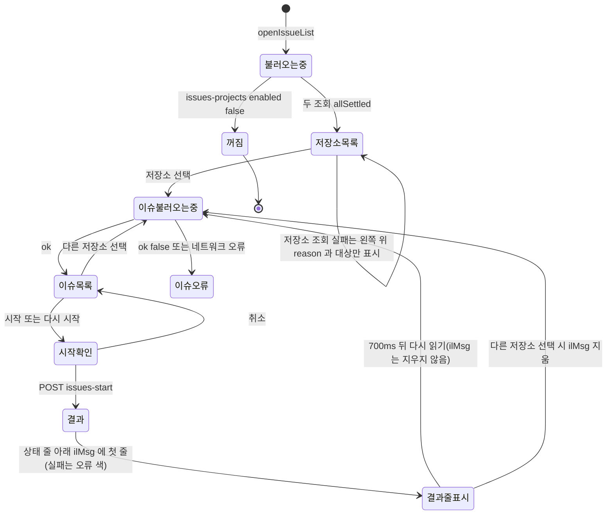
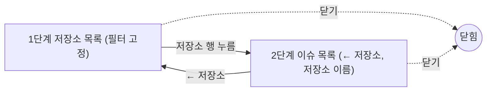
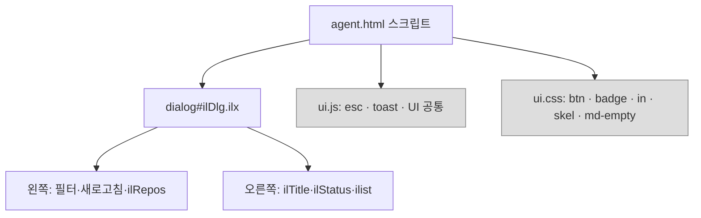
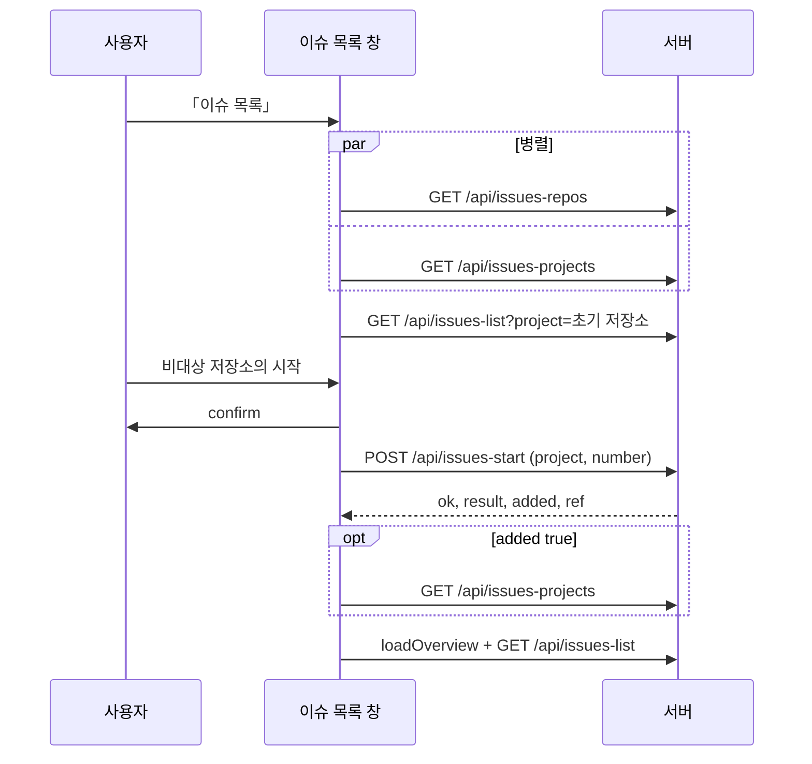

# T-033 변경 설명서 — 에이전트 탭 「이슈 목록」 창 저장소·이슈 두 칸

> 담당: frontend-dev (frontend-dev) · 2026-11-27 · 지시서: [T-033](../T-033-이슈-목록-저장소-고르기-화면.md)

## 요약
「이슈 목록」 창을 왼쪽 「저장소」(★ 대상 먼저 + 내 저장소) · 오른쪽 「이슈」 두 칸으로 바꿨다(06 §3.3, FR-301·FR-306). 저장소를 고르면 그 저장소의 열린 이슈가 나오고, 대상이 아닌 저장소는 확인 뒤 `POST /api/issues-start`로 시작하면 ★(대상)가 된다. 390px에서는 저장소 → 이슈 두 단계, 768px 이상은 두 칸이다. 서버 코드는 건드리지 않았다.

## 그림
### 그림 1. 창 상태 전이

창을 열 때만 저장소·대상 두 조회를 보내고, 이슈는 저장소를 고를 때마다 한 번이다. 폴링과 `UI.every`는 없고 창을 닫으면 진행 중 요청을 abort한다. 결과가 `added:true`면 대상 목록을 다시 읽어 ★와 사이드바 프로젝트 필터를 갱신한다. 대상 아닌 저장소의 시작만 추가 확인을 받고, 다시 시작은 기존 확인 문구를 쓴다. 둘이 겹치면 한 `confirm`에 합친다.

재작업(R1~R4): 시작 결과는 토스트(알림함 기록용)와 함께 오른쪽 칸 상태 줄 아래 `#ilMsg`에 보이고, 다음 시작·저장소 변경·창 열기 때만 지워진다. 「새로고침」은 이슈 조회(`il.ctrl`·`il.seq`)와 분리된 `il.rctrl`·`il.rseq`를 쓰므로 저장소를 눌러도 끊기지 않고, 닫으면 둘 다 abort·순번 증가로 늦은 응답을 버린다. 버튼 활성화는 `finally`와 창 열기 초기화 두 곳이 맡는다.

### 그림 2. 모바일 두 단계

767px 이하에서만 `.ilx-cols[data-step]` 값으로 한 칸씩 보인다. 「닫기」는 창 위 오른쪽에 두 단계 모두 있다. 768px 이상에서는 `data-step`과 무관하게 두 칸이 보이고 「← 저장소」는 숨는다.

### 그림 3. 컴포넌트 구조

공통(`ui.js`·`ui.css`) 요소는 그대로 재사용했고 새 클래스는 모두 `ilx-` 접두다. 창 코드는 `agent.html` 안 한 블록(`il*` 함수)이다. 화면 전용이라 공통 컴포넌트로 빼지 않았다.

### 그림 4. 데이터 요청 순서

두 조회는 병렬이라 waterfall이 없다. 이슈 조회는 두 조회가 끝난 뒤 시작하는데 초기 저장소를 대상 목록으로 정하기 때문이다.

## 파일 지도
| 파일 | 추가/수정 | 역할 (한 줄) |
|---|---|---|
| `src/main/resources/static/agent.html` | 수정 | `#ilDlg` 마크업·`ilx-` CSS 교체, `il*` 스크립트(열기·저장소 목록·이슈 행·시작·모바일 단계) |
| `e2e/tasks/T-033.check.mjs` | 추가 | Playwright 확인 스크립트(요청 가로채기·넘침·터치·요청 0·동작·R1~R4, 스크린샷). 머리 주석에 용도·전제·실행법 |
| `docs/tasks/results/T-033/{390,768,1440}.png` | 추가 | 스크린샷 |

## 주요 결정
| 결정 | 이유 | 검토한 대안 |
|---|---|---|
| localStorage 키 `agent.ilRepo`(마지막으로 고른 저장소) | 06 ②의 "지난번 저장소" | 기존 `agent.projFilter` 재사용(필터와 의미가 섞임) |
| ★는 항상 서버 목록(`/api/issues-projects`)에서 파생. 시작 응답이 `added:true`면 `ok:false`여도 다시 읽는다 | 06 ④·05는 `added`가 ⑤ 실패 뒤에도 남는다고 정의. `added:false`나 HTTP 오류면 ★를 달지 않는다 | 화면이 ★를 임의로 달기 |
| 초기 저장소의 이슈는 390px 1단계에서도 미리 조회 | 두 칸과 같은 코드. 요청 1건 | 모바일에서만 지연 조회 |
| 이슈 행은 `data-act`·`data-i`와 이벤트 위임, `onclick`에 서버 값 없음 | 범위 4 | 기존 `onclick` 인라인 |
| 보관 저장소는 시작 버튼만 비활성, 이미 진행·완료 세션의 「보기」는 유지 | 06 ⑤ | 전부 비활성 |
| 선택 강조는 선·테두리 없이 면 색(accent 16%)만 | taste lint hairline/outlined-box | 1px 테두리 |
| `blocked` 이슈는 「처리 안 함」 배지, 시작 버튼 없음(세션이 있으면 「보기」만) | 06 이슈 행 규칙 | - |
| 새로고침 전용 `AbortController`·순번(`il.rctrl`·`il.rseq`), 활성화는 `finally` + `openIssueList` 초기화 | R1·R2: 닫은 뒤에도 버튼이 잠기지 않게, 저장소 클릭이 새로고침을 끊지 않게 | 컨트롤러 공유(1차) |
| 시작 결과는 창 안 `#ilMsg` 한 줄(`textContent`, 실패 오류 색), 같은 저장소를 보고 있을 때만 표시 | R3·06 §3.3 ④: 모달 `dialog`가 토스트를 가림. 다른 저장소로 옮긴 뒤의 늦은 결과가 엉뚱한 칸에 뜨지 않게 | 토스트만(1차) |
| `blocked` 사유를 행 안 `.why` 글(이스케이프)로, `title`은 유지 | R4: 터치에서 hover 가 없음 | 배지 `title`만 |
| `AbortError`는 오류 문구로 바꾸지 않고 무시(`ilLoadIssues`·`ilReloadRepos`) | R2 | - |
| 미사용 `IL_MOBILE`·`il.busy`·`openIssueList`의 중복 `ilRenderRepos()` 제거(`ilBuildList()`만 호출) | R5 | - |
| 기존 `loadIssueList`·`ilProj` 제거 | 다른 곳에서 안 쓰임 확인(grep) | 유지 |
| 6번째 ① 처음 고르는 저장소 순서: localStorage → 프로젝트 필터 → 첫 대상 → 첫 내 저장소 | 06 ② | - |

## 지시서 밖 추가
- 저장소 목록이 잘렸을 때 왼쪽 위 "일부만 표시합니다" 안내와, 필터에 맞는 저장소가 없을 때 "일치하는 저장소가 없습니다": 상태 안내 완성도.
- `e2e/tasks/T-033.check.mjs`: 스크린샷·검증용 스크립트(저장소 검증 도구 `scripts/check-layout.mjs` 없음).

## 제안
- 페이지 단위 기존 inspect FAIL 5건(`Alt+n` 키캡 10px, h1 없음, 768px에서 상단바 `span.lbl`·`path`로 131px 가로 넘침 등)은 이 변경 이전부터다(OI-35·OI-40 범위). 이 변경으로 생긴 것은 없다. inspect는 닫힌 창 상태의 페이지를 보므로 창 내부는 Playwright 검사로 대신했다.
- 768px 가로 넘침은 에뮬레이션 없는 일반 viewport(768 폭)에서만 재현된다(iPad Mini 에뮬레이션에서는 0). 상단바 정리는 OI-40 쪽에서 처리하길 제안한다.
- 명세 불일치: 없음. T-032 응답 형식(`ok/result/added/ref`, `target/archived/blocked/label`)과 06 §3.3 그대로 구현했다.
- `.gitignore`에는 `.taste-skill/`이 이미 있다.

## 검증
- 검증 명령: `grep -nE "issues-start|issues-repos" agent.html` → 4줄 / `node --check ui.js` → 통과 / `agent.html`의 `<script>` 2개를 뽑아 이어 붙인 파일에 `node --check` → 통과 / `./gradlew bootJar -q` → 성공(jar 2회 빌드)
- Playwright(`e2e/tasks/T-033.check.mjs`, 8778, `ISSUE_ENABLED=true`로 기동, Chrome): 45개 확인 통과(ALL PASS, 재작업 R1~R4 항목 10개 포함: 새로고침 중 닫았다 열면 활성, 새로고침 중 저장소 클릭 시 결과 반영·오류 문구 없음, 가짜 409·`added:true`+`ok:false` 결과가 창 안 줄에 보이고 700ms 갱신 뒤에도 유지·저장소 변경 시 지워짐, 390px `blocked` 사유 글 보임·넘침 0). 확인 스크립트는 앱을 `ISSUE_ENABLED=true`로 띄워야 한다(안 띄우면 A 항목이 시간 초과). 닫힌 창 요청 0·닫은 뒤 3.5초 요청 0, 실제 응답(가로채기 없음)에서 "GITHUB_TOKEN" 안내와 `qa-group/qa-sample` ★·콘솔 오류 0, 1440/768/390 페이지·창·칸 가로 넘침 0, 390px 터치 요소 44px 이상, 확인 취소 시 POST 0, POST 본문, ★ 갱신, 보관·blocked·XSS 이스케이프. 가짜 409 응답이 브라우저 콘솔에 찍히는 것은 의도한 것이라 검사에서 제외했다.
- 테스트: 화면 코드는 Playwright 시나리오로 확인했다(단위 테스트 프레임워크 없는 vanilla 화면).
- taste lint: 이 변경이 만든 hairline FAIL 제거. 나머지 FAIL은 기존 파일 전체 기준(mono 등).
- 스크린샷: `docs/tasks/results/T-033/390.png`(2단계 이슈), `768.png`·`1440.png`(두 칸). `/api/system/**`·`/api/usage` 응답의 로컬 경로는 `<repo>`로 치환했고, DOM 문구 검사와 이미지 직접 확인에서 "Users"·계정명 없음.
- 앱 종료: `stop-app.sh` 성공, 8778 응답 없음. 8777은 건드리지 않았다.
- Figma 미반영 — 지시서 기본값(아니오).

## 재작업 이력
- 2026-11-27: PM 반려 R1~R6 반영. R1 새로고침 버튼 `finally` 복구·창 열 때 초기화, R2 새로고침 전용 컨트롤러·순번과 AbortError 무시, R3 시작 결과 창 안 `#ilMsg` 줄, R4 `blocked` 사유 행 안 글, R5 미사용 코드·중복 호출 제거, R6 확인 스크립트 머리 주석·R1~R4 시험 추가. 스크린샷 3장 다시 촬영(390은 `blocked` 사유 줄이 보이는 2단계), 이미지에 "Users"·계정명 없음 확인. 서버 코드 변경 없음.
